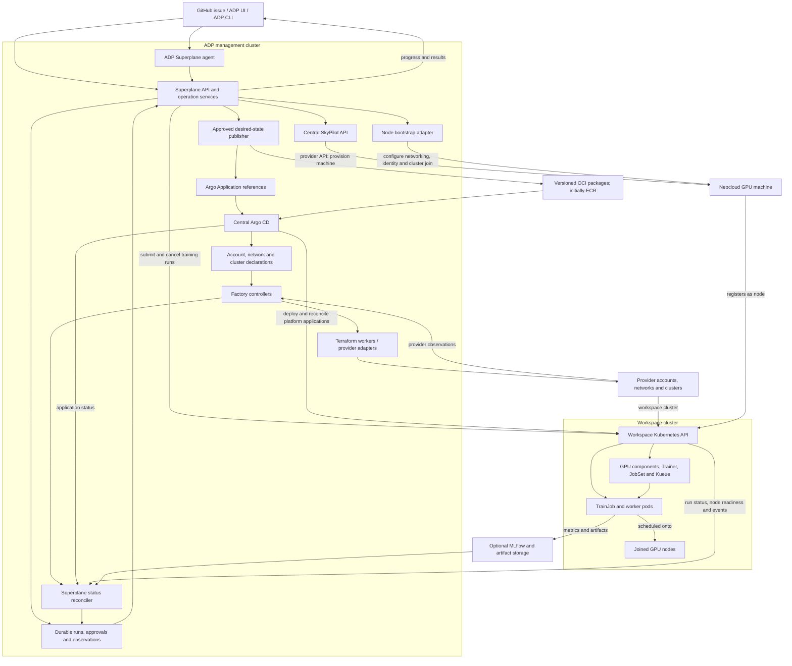
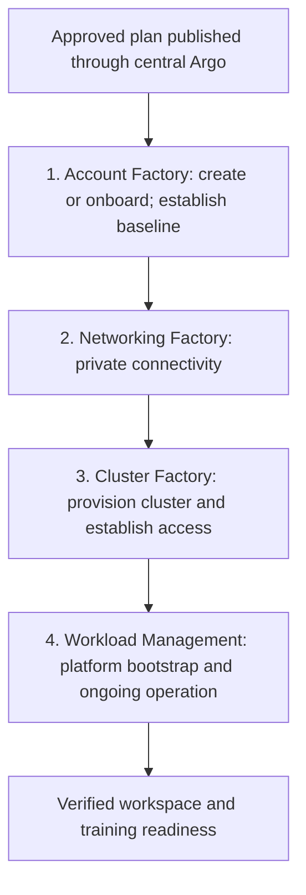

# Superplane: workspace deployment and agent-driven training

Date: 2026-10-15

Status: Proposed architecture from the workspace and training discussion.

An [interactive architecture diagram](superplane-architecture.html) accompanies
this design, with an [editable Archify source](superplane-architecture.archify.json).
Download the HTML and open it in a browser for source links, zoom, themes and
exports; GitHub displays the HTML source. The diagram shows the target design,
including recovery and cutover notes, rather than current deployment status.
It was generated with [Archify 3.2.0](https://github.com/tt-a1i/archify);
its embedded runtime, font licenses and attribution notices are retained.

Users describe work through GitHub issues, ADP UI or ADP CLI. ADP agents turn
those requests into workspace and training plans. Superplane has four abstraction
layers: Account Factory, Networking Factory, Cluster Factory and Workload
Management. Central Argo CD maintains their approved declarations; factory and
workload controllers reconcile the resources they own. Superplane exposes one API
for preparation, placement, execution and results across the enabled providers.
Users do not need Argo CD, Kubeflow or MLflow dashboards.

Bootstrap spans Cluster Factory and Workload Management: it makes the cluster
operational and installs its selected platform applications. The fourth layer
also covers ongoing deployment, training admission, execution and observation.

This document describes the intended integration, including the work required
to deliver it. It does not claim that the complete flow is implemented or has
passed live acceptance. Existing Superplane identity, approval, budget and
resource-ownership contracts remain the foundation. Those contracts belong to
the [Superplane module](../../../modules/domain-apps/superplane/); this proposal
adds account-factory, networking, Argo and training integrations.

The [control-plane and reconciliation design](control-plane-and-reconciliation.md)
defines state ownership, factory controller contracts, drift handling and the
common training API. This overview describes their end-to-end integration.

The [database design](database-design.md) specifies durable intent, planning
evidence, approvals, resource bindings, training history and recovery. The
[API and ADP CLI design](api-design.md) specifies discovery, option comparison,
approval, submission, status, results and cleanup, including proposed CLI commands.
Both distinguish existing ADP contracts from the extensions needed to deliver
this architecture.

This is public, environment-neutral documentation. Example names are fictional.
Use placeholders for deployment inputs; never include actual cloud account,
subscription, project or tenant identifiers, cluster names, resource IDs,
endpoints, credentials or private operational records in this document or its
examples.

## 1. Architecture choices

| Area | Proposed choice |
| --- | --- |
| User experience | GitHub issues, ADP UI and ADP CLI all use the same Superplane APIs and workspace permissions. |
| Agents | Superplane agents run through the existing ADP agent infrastructure in the management cluster. |
| Account Factory | Create or onboard an AWS account, Azure subscription, GCP project or neocloud environment through provider adapters, and establish a selected, versioned baseline. |
| Networking Factory | Use provider-specific private networks, service access and regional/cross-cloud transport. The AWS profile uses regional VPC Lattice with Transit Gateway peering or Cloud WAN between regions. |
| Cluster Factory | Use reviewed Terraform/provider adapters for EKS, AKS, GKE or a compatible neocloud Kubernetes cluster, including initial nodes, identity and associated infrastructure. |
| Workload Management | Install and maintain platform applications, admit training, manage capacity and execution, and report logs, metrics and results through Superplane. |
| Workspace bootstrap | Establish cluster access, register the Argo target, install selected applications and verify readiness through durable, resumable stages. |
| Desired configuration across all four layers | Use central standard Argo CD for factory declarations in the management plane and applications on EKS, AKS, GKE and neocloud targets. AWS-managed Argo remains an optional backend for EKS targets. |
| Drift reconciliation | Factory controllers observe cloud resources and reconcile authorized changes; Argo reconciles Kubernetes declarations. Terraform workers retain durable state and mutation controls behind the factory interface. |
| Deployment source | Publish versioned Helm charts or OCI manifest bundles to an approved registry, initially ECR; applications reference an approved, immutable release. |
| Machine provisioning | Keep the SkyPilot API service in the management cluster. It selects, provisions, observes and terminates eligible machines through provider APIs. |
| Node registration | An ADP bootstrap adapter connects each provisioned machine to its assigned workspace cluster and verifies node and GPU readiness. |
| Training planning | Check requirements and capacity through SkyPilot/provider adapters, present 2–3 suitable options, and execute the selected plan only after approval. |
| Training execution | Install standalone Kubeflow Trainer v2, its JobSet dependency and Kueue on workspace clusters. |
| Individual training runs | Superplane submits a uniquely identified `TrainJob` through the workspace Kubernetes API. |
| Experiment tracking | Add MLflow for metrics, experiment comparison and model artifacts. Its placement is a separate decision. |
| Status | Superplane combines infrastructure, SkyPilot, Kubernetes, Argo and optional MLflow observations into one ADP view. |
| Later infrastructure option | Evaluate managed kro plus ACK separately; they are not prerequisites for the first Argo and training integration. |

AWS is the first concrete implementation described here. The account factory and
workspace lifecycle also target Azure, GCP and neocloud-hosted workspaces; their
adapters require implementation and acceptance. The management plane can remain
in its existing cluster while workspace infrastructure runs in another cloud.

One deployment profile includes SkyPilot-provisioned neocloud GPU machines
joining their assigned workspace EKS cluster. Another places the whole workspace
cluster on the selected neocloud. Both fit the same lifecycle, with networking,
identity, capacity and cleanup specific to the provider.

## 2. Component placement

The target multi-cloud design uses standard Argo CD operated centrally by ADP.
It reconciles factory declarations on the management cluster and application
declarations on workspace clusters. Factory controllers live in the management
plane so they can create, observe and retire a workspace before or after its
cluster exists. Provider credentials and private connectivity are scoped to the
resources each controller manages.

AWS-managed Argo is an optional backend for EKS targets. AWS hosts that service;
its Application resources live in the associated management EKS cluster and its
targets are registered by EKS ARN. Standard Argo uses Kubernetes API endpoints
and configured provider authentication, including for EKS. Deployments need only
their selected backend. If both are used, isolate controller scope and assign
each target and Application one backend. A workspace does not need its own Argo.



| Component | Placement and responsibility |
| --- | --- |
| Superplane API, agent tools and status reconciler | Management cluster; authorize requests, coordinate operations and expose workspace/run views. |
| ADP reasoning agents | Management cluster; interpret issues, prepare specifications, use authorized tools and explain outcomes. |
| Factory controllers and adapters | Management plane; reconcile account, network and cluster declarations, observe provider state, and dispatch authorized durable operations. |
| Infrastructure worker | Management execution path; obtain approved provider credentials and apply reviewed Terraform or provider operations for networking and clusters. |
| Workspace bootstrap services | Management execution path; establish access, install the selected platform profile and persist readiness observations. |
| SkyPilot API | Management cluster; retain machine and provider-request identity centrally. A workspace does not need another SkyPilot API server. |
| Managed Argo CD | AWS control plane, associated with the management cluster; deploy to registered workspace EKS targets. |
| Standard Argo CD backend | Central ADP management infrastructure; reconcile management-plane factory declarations and applications on all selected Kubernetes target types. |
| Trainer, JobSet and Kueue controllers | Workspace cluster, normally on CPU nodes; coordinate training and admission. |
| GPU and networking components | Workspace cluster and relevant nodes, according to their installation requirements. |
| Training pods | Workspace GPU nodes; temporary workloads for an individual run. |
| Host bootstrap tooling | Provisioned machines; prepare the host and join the selected cluster. |
| MLflow | Optional shared service with explicit tenant isolation, or a workspace-local service. This choice remains open. |
| Datasets, checkpoints and model artifacts | Durable storage selected for the workspace and compute location; independent of agent and training-pod lifetimes. |

If multiple workspaces share a cluster, install compatible cluster-wide operators
once. Give each workspace its own execution namespace, queue, permissions and
resource allocation. Cluster-wide CRDs and controllers have cluster ownership;
one workspace must not remove them while other workspaces depend on them.

## 3. Workspace installation flow

### Management setup

1. Establish ADP management infrastructure and Superplane services using the
   existing installer. This initial management cluster, identity, storage and
   network setup must work before Argo or workspace factories are available.
2. Configure provider adapters, approved environment baselines and networking
   profiles. Connect each enabled factory to its authorized organization,
   subscription/billing hierarchy or provider tenant.
3. Configure administrative identities. The AWS-managed Argo profile also
   requires AWS Identity Center.
4. Install the selected central Argo backend, standard Argo by default, and the
   factory CRDs/controllers with scoped ongoing reconciliation authority. The
   optional AWS-managed profile uses EKS targets, including its management hub.
5. Publish maintained workspace application packages to the selected OCI registry
   and grant each deployment backend scoped pull access.
6. Install Superplane's application-status watcher and workspace-to-Application
   mappings, and configure the central SkyPilot service.

The AWS capability and its configuration can be created through AWS APIs/CLI.
Applications, projects and target registrations can be managed through Kubernetes
APIs. Normal automation does not require a user to sign in to the Argo UI or
obtain an Argo UI token. Each backend's identity, connectivity and registry
configuration must be verified during installation.

### Provisioning through the four layers

The user selects AWS, Azure, GCP or a supported neocloud and can bring an existing
environment or request a new one through its factory adapter. Superplane resolves
that choice, the required baseline, allowed regions, networking, cluster type
and application profile through its existing plan and approval flow. Users select
requirements and approved profiles; mandatory organization controls continue to
apply. Provider selection does not change the ADP submission or status contract.



Each stage has its own durable identity, status and completion checks. A later
failure resumes from the recorded resources after revalidation, without creating
another provider environment, network or cluster.

These are ongoing reconciliation layers. Factories expose versioned Kubernetes
resources that Argo maintains; the factory controllers perform provider work and
publish observed status. A controller may invoke the existing Terraform worker
through the governed execution path. Readiness must match the current desired
revision before dependent stages proceed. Merely applying a custom resource is
not evidence that its cloud resources are ready.

### Stage 1: multi-cloud account factory and environment baseline

The account factory is a common ADP service with provider-specific adapters.
It creates the provider's environment boundary when requested, or onboards an
existing one, and establishes the selected baseline. A workspace binds to that
environment; several workspaces can share it where the isolation policy permits.

| Provider | Environment created or onboarded | Baseline mechanisms and cluster choice |
| --- | --- | --- |
| AWS | Member account in an authorized AWS organization/OU, or an existing account. | SCPs, IAM, audit/security configuration and budgets; EKS. |
| Azure | Subscription under an authorized billing agreement and management-group hierarchy, or a resource group in an existing subscription when that isolation level is selected. | Azure Policy assignments/initiatives, Azure RBAC, identity, diagnostics and budgets; AKS. |
| GCP | Project under the selected organization/folder with authorized billing linkage, or an existing project. | Organization Policy constraints, IAM, audit/security configuration and budgets; GKE. |
| Neoclouds | Provider tenant, organization, project or scoped allocation, according to its APIs; onboard an existing environment where creation is unavailable. | Available provider IAM, quotas, networking, audit and spend controls, complemented by ADP controls; provider-managed or ADP-provisioned Kubernetes. |

These are different resource and policy models. Each adapter maps the requested
isolation, allowed locations/services, identity, logging, encryption, ownership
and spending requirements to native controls and reports which requirements it
can enforce. SCPs apply to AWS; other adapters use their native policy systems.
An ADP submission check cannot substitute for a required provider-enforced
restriction on activity outside ADP. Record unmet requirements explicitly and
withhold readiness when a required baseline control cannot be satisfied.

Provider adapters declare their create, onboard, baseline, observe and retirement
capabilities. They use existing authorized organization and billing relationships;
creating a subscription or project does not create a new commercial billing
agreement or top-level identity organization. Persist provider, scope type,
resource binding, baseline version and provider operation handles behind the
same durable ADP operation. Keep credentials in private configuration and obtain
short-lived provider identity where available.

The factory establishes the governed environment. SkyPilot and cluster capacity
adapters provision compute within its authorized scope later in the lifecycle.
Onboarding skips environment creation, validates its baseline and deployment
access, and performs only approved remediation.

Across providers, this stage completes when environment creation, if requested,
has finished, billing linkage is verified where required, baseline checks pass,
and deployment identity is usable. A successful create response alone is
insufficient. Persist the factory request intent before dispatch and its provider
handle when returned. If the response is lost, reconcile the original request
with the provider service before considering another create call.

#### AWS account-factory implementation

The AWS adapter creates a member account in the configured organization and OU
when requested. Its baseline includes applicable SCPs, deployment-role trust,
audit logging, security services, encryption settings, ownership tags and budget
alerts. SCPs set permission limits; IAM policies and role trust grant the specific
access required by infrastructure and bootstrap workers.

The adapter can use AWS Control Tower Account Factory or Account Factory for
Terraform (AFT) where a landing zone provides them. An AWS Organizations-based
implementation needs its own baseline automation. Select one account-vending
owner for a deployment and keep its request identity across retries. AFT is an
account provisioning pipeline; workspace resources remain in the separately
owned networking and cluster provisioning stages.

Organization policy changes run through the account factory's authorized role,
separately from target-account deployment roles. An existing account outside the
connected organization can be onboarded through its owner's deployment access;
its organization retains control of its SCPs. ADP reports baseline requirements
it cannot establish or verify.

### Stage 2: private networking across regions and clouds

The networking profile defines participating provider environments and regions,
network and subnet layout, address allocation, private DNS, routing, endpoints,
traffic controls and permitted service access. It also records which networks
are shared and which resources belong to the workspace. Provision or attach the
selected network foundation before creating the cluster.

Adapters configure AWS VPCs, Azure VNets, Google Cloud VPCs or the selected
neocloud's network facilities. Where management and workspace services cross
cloud boundaries, configure the chosen private connection, such as a site-to-site
VPN or dedicated interconnect, together with routing, DNS and authenticated
service access. Record data-location and permitted traffic requirements in the
profile. Cross-cloud connectivity needs its own verification.

For AWS, use VPC Lattice for private service and resource connectivity within
each region, including cross-account sharing through AWS Resource Access Manager
where required. Configure service authentication and authorization, resource
access controls, and access logging according to the selected profile.

VPC Lattice service networks are regional. Connectivity between regions needs
an explicit transport, such as inter-region Transit Gateway peering or AWS Cloud
WAN. The design combines regional Lattice service networks with that transport
and supported service-network VPC endpoints where remote clients need access.
The chosen topology must also provide private DNS resolution and the routes
needed by each client. Lattice service connectivity does not itself provide the
node-to-node, pod, cluster API or distributed-training network.

Verify the required private paths from management services and workspace hosts,
plus the intended isolation between workspaces. Record transport readiness and
service-network readiness separately, including Lattice for the AWS profile.
Application-specific service registrations can be completed during bootstrap
after their backends exist. A multi-region network connects clusters at their
selected provider locations; each EKS cluster remains a regional resource.

### Stage 3: cluster provisioning

Select the cluster implementation from the workspace profile: EKS, AKS, GKE,
provider-managed neocloud Kubernetes, or ADP-provisioned Kubernetes on suitable
machines. The infrastructure worker uses the approved provider identity and
reviewed Terraform/provider adapter. Each implementation owns its control plane,
initial node capacity, identity, network integration and foundational components.
An ADP-provisioned cluster also needs an explicit control-plane lifecycle owner.

All implementations report a stable cluster binding and the same readiness
contract to Superplane. Azure, GCP and neocloud cluster adapters are proposed
extensions requiring separate implementation and validation.

This stage completes when the cluster is active, its private API is reachable
from the required management execution path, initial nodes are ready, and the
bootstrap identity can perform its scoped work. Training GPU capacity can be
added later through the selected capacity adapter. Argo application installation
begins after these infrastructure prerequisites are satisfied.

#### AWS EKS implementation

The infrastructure worker assumes the approved target-account role and applies
the reviewed Terraform configuration. It creates the EKS control plane in the
selected region and network, IAM roles, initial CPU node capacity, cluster access
entries, and explicitly assigned foundational add-ons and storage components.
Persist the Terraform state and resource bindings for the workspace generation.

### Stage 4: Workload Management, starting with platform bootstrap

Bootstrap turns the provisioned cluster into a usable ADP workspace. It includes
API calls, access configuration, declarative application installation and
verification, with durable progress recorded outside the worker container.

1. Verify the workspace's provider environment, cluster generation, private
   connectivity and scoped bootstrap access against its approved plan.
2. Establish scoped target-cluster access for the assigned Argo backend. The
   AWS-managed backend uses EKS access entries and ARN registration; standard
   Argo uses the target API endpoint and configured provider authentication.
3. Create Argo Applications referencing the approved package versions and
   workspace-specific settings. Install the selected foundation, networking,
   observability and training components in dependency order.
4. Complete application-specific private service registrations, including Lattice
   for the AWS profile, after their backends are ready, using the assigned owner.
5. Observe application sync and health, and verify ADP access, isolation,
   connectivity, required platform services and workspace registration.
6. Release temporary bootstrap grants after verifying the ongoing service
   identities. Record workspace readiness only when its required checks pass.

Report GPU availability and training-platform readiness separately; an otherwise
ready workspace may currently have no GPU nodes. Host bootstrap for newly added
GPU machines is a separate, repeatable operation described in Section 4.

For all four stages, persist the approved input version, operation and provider
request identities, owned resource bindings, attempt outcome and verification
timestamps. On retry, reconcile actual state before continuing from the first
incomplete stage. Completed steps must be revalidated when their inputs or
dependencies change. A container restart must not erase progress or replay an
unobserved environment-creation request. These checkpointing contracts are
required implementation work, not a claim of completed acceptance.

Argo owns desired factory declarations; their controllers and executors own the
external resources. The initial AWS adapter uses Terraform to establish workspace
infrastructure and target access. Argo then maintains selected applications in
that workspace. Assign each external resource one provisioning owner and define
field ownership for Kubernetes objects. Transfer ownership explicitly when
introducing another controller.

Argo needs ongoing, scoped deployment authority for the applications it owns.
Implement that as a distinct service permission model. Existing temporary
bootstrap grants retain their original cleanup lifecycle; they must not be
repurposed as permanent administrator access. Application sources and release
changes must remain bound to the workspace's authorized configuration.

AWS manages the capability's connectivity to registered private EKS targets.
Superplane's direct workspace observations and SkyPilot's machine access still
need their own authenticated connectivity; the Argo connection is not a general
network tunnel for ADP services. Standard Argo's access to targets in other clouds
uses the explicitly configured private networking and provider authentication.

### Multiple applications per workspace

Use separate Applications for components that need independent versions,
configuration, health reporting or removal. Illustrative groups are:

| Application group | Examples |
| --- | --- |
| Workspace foundation | Workspace namespaces, policies and required ADP components. |
| GPU enablement | GPU operator/device plugin and associated node components. |
| Networking integrations | Required in-cluster networking and hybrid-node integrations. |
| Training platform | Kubeflow Trainer, JobSet, Kueue and approved training runtimes. |
| Observability | Log/metric collectors and GPU telemetry. |
| Experiment tracking | MLflow components when workspace-local tracking is selected. |

These are proposed groupings, not existing application names or packaged charts.
Use resource ordering and readiness checks within an Application. Dependencies
between separate Applications need explicit orchestration and health gates;
sync-wave annotations alone do not provide global ordering across independent
Applications. A failure in an optional component should not hide the health of
the rest of the workspace.

ApplicationSets can later generate repeated configurations across eligible
clusters. Initial deployment can use explicit Applications for clearer ownership.

Use the selected backend's supported Helm, Kustomize and YAML paths. For its
managed capability, AWS currently documents a fixed 120-second sync timeout and
no custom config-management plugins.
Keep long-running infrastructure provisioning and training execution in their
asynchronous operation paths, and verify the selected chart hooks and readiness
behavior against the managed capability version.

Factory resources need explicit Argo health mappings to their current-generation
conditions. Use the same conditions in Superplane's dependency gates. Long-running
account or cluster creation belongs to factory reconciliation, with durable
operation status outside an Argo sync hook.

### Versioned OCI packages, initially in ECR

Maintain chart/manifests source in the existing ADP repository. CI publishes
versioned packages to the approved registry, initially ECR, and each workspace
Application references a pinned release plus its configuration. Configure registry
connectivity and pull authentication for every selected backend and target cloud.
Enforce immutable artifact identity rather than following an editable `latest`
tag. A release update changes the approved Application reference and is observed
through the same rollout path.

Superplane publishes approved, immutable desired-state bundles for factory
requests and configuration, with their plan and desired-revision references.
The publisher durably records dispatch intent before updating an Application's
source reference and can recover a lost response. Argo consumes the pinned
bundle; factory controllers validate its authority before acting. The detailed
state and publication contract is in the linked control-plane design.

Argo does not need a dedicated Git repository for each workspace, and ECR sources
avoid introducing a GitHub connection as a cluster-bootstrap prerequisite. The
GitHub issue workflow uses ADP's existing GitHub integration independently.

## 4. GPU capacity and node registration

The capacity adapter selects the mechanism supported by the workspace's cluster
profile: provider node-pool APIs for managed node pools, or SkyPilot and host
bootstrap for profiles that join provisioned machines as Kubernetes nodes. The
following sequence describes the SkyPilot/host-bootstrap path. Provider node-pool
implementations must preserve the same allocation, readiness and cleanup contract.

SkyPilot and Argo have separate responsibilities:

1. Superplane derives a capacity request from the training requirements and the
   workspace's permitted providers, GPU types, locality and budget.
2. Central SkyPilot selects and provisions eligible machines. Superplane retains
   the original provider handles, request identities and workspace allocation.
3. The node bootstrap adapter configures host dependencies, scoped identity,
   connectivity and registration into the workspace's bound cluster.
4. Verify Kubernetes node identity, node readiness, GPU resources, networking and
   the allocation-specific placement rules before making the capacity available.
5. Argo maintains the Kubernetes components required on that cluster. It does not
   replace machine provisioning or the host setup needed before a node can join.

Kueue does not automatically provision machines through SkyPilot. An ADP capacity
adapter must connect authorized queued demand to provisioning and later cleanup.
It must preserve one allocation identity while provisioning and observing nodes,
so repeated demand observations do not create duplicate machines.

Distributed training plans specify compatible GPU resources and communication
locality. The fact that nodes belong to one Kubernetes cluster is not sufficient
to choose them arbitrarily for the same distributed run.

## 5. GitHub issue to training run

### User request and agent responsibilities

An issue might ask:

> In workspace `research-gpu`, fine-tune the selected model using the dataset
> version linked below and the training code at the specified commit. Use two
> GPU workers, finish within two hours and the stated spend limit, save resumable
> checkpoints, and report validation metrics and the resulting model artifact.

The Superplane agent uses domain skills and tools to:

- Resolve the requester, organization, workspace, issue and repository identity.
- Select or prepare training code and a reproducible container image.
- Resolve model and dataset versions, GPU requirements, parameters, runtime
  limits, checkpoint storage, output locations and success criteria.
- Separate required constraints from preferences, query capacity through
  SkyPilot/provider adapters, and compare feasible execution options.
- Ask for missing requirements, present 2–3 suitable options, and obtain the
  user's selection and plan approval through ADP. Issue text alone is not
  execution authority.
- Submit, observe or cancel a run through Superplane's authorized interfaces.
- Explain failures and report results through the issue and ADP surfaces.

Skills describe how to use the tools; execution authority comes from the existing
ADP identity, workspace grants, plan approval and budget contracts. Agents do not
receive independent cluster-administrator or provider credentials for this flow.

### Capacity-first planning and option approval

The normal interaction begins with a planning request. The user describes the
training goal, GPU requirements, allowed regions or locations, budget, deadline
and data restrictions. They can bind the request to an existing workspace or
ask ADP to recommend placement and prepare a workspace for the selected option.

1. Normalize the request and identify missing inputs. Preserve required region,
   location, hardware and data constraints separately from ranking preferences.
2. Query central SkyPilot/provider adapters for matching offerings, capacity and
   quota observations where available. Also inspect reusable workspace capacity,
   runtime compatibility, data access and the setup each candidate requires.
3. Return 2–3 suitable options when available. Each option includes its provider,
   location, GPU configuration, capacity evidence and freshness, expected setup
   and queue delay, cost estimate, workspace reuse/creation plan and assumptions.
4. Explain the tradeoffs, such as lowest estimated cost, earliest estimated start
   or proximity to data. Every proposed option must respect the required
   constraints; preferences determine ranking within that set.
5. The user selects an option and approves the concrete plan, including required
   environment, network, cluster, platform and capacity changes. Persist the
   selected option and request/plan revision through the existing approval path.
6. The agent submits the selected approved revision to Superplane, which
   revalidates capacity, price, quota and authority before execution. A material
   change returns to planning/approval unless an explicit approved fallback
   already covers it. The original selection cannot silently change region,
   provider, hardware, data placement or spend scope.
7. Superplane's durable operation path orchestrates the four factories through
   Argo/controllers, reuses ready
   infrastructure, acquires capacity, bootstraps the training platform and runs
   the job. Progress remains visible after the agent exits.

Planning performs discovery and estimation. It does not create accounts, clusters
or machines, run paid capacity probes, or reserve billable capacity. Any supported
capacity reservation is a separately authorized part of the selected execution
plan, including its cost and expiry. Catalogue entries and prices are not proof
of live allocatable capacity: record whether availability is observed, conditional
or unknown, with its source and timestamp. New-account quotas may remain a
condition to verify after account creation.

If fewer than two feasible options exist, show the actual result and explain
which constraints prevent alternatives. Never manufacture options to fill the
comparison. A requested change to constraints produces a new planning revision.

### One training contract across providers

Superplane exposes a versioned training specification covering immutable code and
image identity, datasets/models, runtime and GPU requirements, permitted placement,
data access, checkpoint/output storage, deadlines, spend limits and success
criteria. Its preview returns comparable options backed by provider capabilities,
capacity observations, quota, data locality and cost estimates. Selection and
approval bind one option to its workspace reuse/setup plan, provider, region,
runtime profile and permitted fallbacks.

All clients use the same preview, select/approve, submit, observe, logs/results
and cancel contracts. The API accepts long-running work with a durable operation/run handle;
controllers continue after the API request or reasoning agent ends. Public API
schemas and tools for this training contract still need implementation.

Training containers receive scoped workload identity and authorized data access.
Dataset transfers, storage compatibility, registry pulls and checkpoint restore
must be verified for the selected location. Cross-cloud transfer time and cost
belong in the plan. Placement changes follow the approved constraints and cannot
silently move a running job or its data. Provider differences remain visible when
they affect availability, price, locality or runtime compatibility.

### Execution sequence

```mermaid
sequenceDiagram
    participant U as User / GitHub issue
    participant A as ADP Superplane agent
    participant S as Superplane API and operation services
    participant C as Capacity adapter / SkyPilot
    participant F as Argo / factory controllers
    participant K as Workspace Kubernetes / Kueue
    participant T as Kubeflow Trainer / JobSet
    participant P as Training pods
    participant M as MLflow / artifact storage

    U->>A: Describe training request
    A->>S: Preview requirements and allowed placement
    S->>C: Inspect offerings, capacity and quota without provisioning
    C-->>S: Timestamped observations, estimates and unknowns
    S-->>A: Up to 3 suitable options with setup plans and tradeoffs
    A-->>U: Explain options and resolve missing requirements
    U->>A: Select option and approve its concrete plan
    A->>S: Submit selected approved revision with idempotency key
    S->>C: Revalidate selected capacity and acquisition conditions
    C-->>S: Current observations
    alt Selected plan requires a new decision
        S-->>A: Updated options or approval required
        A-->>U: Explain changed conditions and request selection
    else Selected plan remains authorized and feasible
        S->>S: Persist run ID and durable dispatch intent
        S-->>A: Durable run ID and preparation state
        A-->>U: Run accepted; link to ADP run view
        Note over A,S: The agent may exit; orchestration and observation continue
        S->>F: Publish approved account, network, cluster and platform intent
        F-->>S: Current-generation readiness or actionable setup status
        S->>K: Create or reconcile the run's suspended TrainJob when ready
        opt Additional GPU capacity required and authorized
            S->>C: Acquire capacity under the original allocation
            C->>C: Provision machine and perform node bootstrap
            C-->>S: Provider handles and verified node/GPU readiness
        end
        K->>K: Admit TrainJob when quota and admission checks pass
        K->>T: Release admitted TrainJob for execution
        T->>P: Coordinate distributed worker jobs
        P->>M: Write checkpoints, metrics and model artifacts
        K-->>S: Job/pod status, events and queue state
        M-->>S: Metrics and artifact references
        S->>S: Persist outcome and result-verification state
        S-->>A: Durable progress/completion event for follow-up
        A-->>U: Explain outcome and link results
    end
```

Factory controllers and Argo establish the required workspace and training
platform during preparation; ready existing resources are verified and reused.
Capacity is checked again at acquisition because preparation can take time. If
the approved capacity cannot be acquired, report the blocker and replan within
the approval contract, retaining the same operation and owned-resource records.
The individual `TrainJob` is submitted by Superplane, outside Argo's application
reconciliation. This keeps a completed or intentionally removed training run
from being recreated merely because a deployment manifest still declares it.

Queued demand can exist before all required machines are available. The new
capacity integration must define how Kueue admission checks and actual node
readiness interact; nominal quota alone is not proof of available GPUs.

The Superplane operation path performs admission and durable dispatch using the
existing execution services. The API handler is not a new unrestricted cluster
mutation path. ADP UI, CLI and agent tools share this same submission contract.

### Training execution components

| Component | Role |
| --- | --- |
| Kubeflow Trainer v2 | Expose `TrainJob` and reusable `TrainingRuntime` / `ClusterTrainingRuntime` configurations; coordinate framework-specific distributed execution. |
| JobSet | Coordinate the underlying groups of Kubernetes Jobs used by the selected Trainer runtime. |
| Kueue | Enforce queues, GPU quota, priorities and workload admission; integrate required capacity checks. |
| Kubernetes scheduler | Place admitted worker pods onto eligible nodes using resources and placement constraints. |
| Training container | Run the model code, communicate with peer workers, save/restore checkpoints and emit training metrics. |
| MLflow, when enabled | Track parameters, metrics, experiment comparisons, model metadata and artifact references. |

The first integration targets standalone Kubeflow Trainer v2. It does not require
the full Kubeflow platform or its UI. The v2 `TrainJob` API differs from the legacy
`PyTorchJob` API; pin and test a compatible Trainer, JobSet, Kueue, Kubernetes and
training-runtime release set.

## 6. Durable identity, retries and checkpoints

Superplane assigns a durable run ID before execution. Persist the mapping from
that ID to the issue/repository, authenticated requester, workspace and cluster
generation, provider environment binding, approved plan revision, training image
digest, dataset/model versions, Kubernetes object name and UID, provider
allocations and optional MLflow run ID.

Use an idempotency key for submission. Record dispatch intent before creating the
Kubernetes object; use deterministic identity and an ownership check to reconcile
a lost create response. Duplicate webhook deliveries or an agent restart must
recover the existing run. A changed issue or revised plan must not silently
replace a running job. An intentional new experiment receives a new run ID.

There are three distinct recovery mechanisms:

| Layer | What persists and how recovery works |
| --- | --- |
| Factories and platform applications | Argo retains desired declarations; factory controllers retain provider bindings and reconcile cloud state; Terraform retains remote state and locking. A sync retry is not an infrastructure transaction rollback. |
| Training execution | Kubernetes, Trainer and ADP retain job identity and observed execution state. Any retry policy must keep original ownership and configured runtime/spend limits. |
| Model progress | Training code saves model, optimizer and other required state to durable storage, and explicitly resumes from an identified checkpoint. Restarting a pod alone does not restore progress. |

Agent lifetime is independent of training lifetime. A training run continues
under its admitted execution policy after the reasoning agent exits. Durable
events can launch a follow-up agent turn or update the same issue without
resubmitting the training job. A temporary loss of observation reports unknown
or stale state; it does not by itself authorize a replacement run or machine.

The domain's training-run identity is distinct from execution run/attempt IDs
owned by the shared durable execution service. Preserve those bindings through
retries instead of introducing a parallel attempt counter or authority source.
Recovery of the management plane must restore approvals, dispatch records,
factory bindings, Terraform state references and observations before resuming
mutations. The control-plane design specifies outage and recovery behavior.

## 7. Visibility through ADP UI and CLI

Superplane owns the user-facing view. A backend watcher observes Application
objects through the assigned Argo backend's control-cluster API, while workspace
observers and provider adapters collect execution and infrastructure state.
Persist the latest facts, timestamps and stable resource mappings, and serve both
UI and CLI from the same API. Use watches with reconnect/relist handling and
bounded polling where a source has no watch interface.

The central API combines factory conditions, Argo status, provider observations,
Kubernetes/Trainer/Kueue state and optional MLflow data into a durable workspace
and training view. It also reports drift, blocked dependencies, required actions
and observation freshness. UI, CLI and agents consume that same view. Status,
log streaming and artifact access remain scoped to the caller's workspace.

| Information | Programmatic source |
| --- | --- |
| Planning options, tradeoffs and selected approval | Versioned planning records, SkyPilot/provider observations, cost estimates and the approved option binding. |
| Environment creation and baseline compliance | Factory operation status and provider observations: AWS Organizations/Control Tower, Azure subscription and policy APIs, GCP project and policy APIs, or neocloud APIs. |
| Private networking readiness | Selected provider network/transport APIs, including VPC Lattice for AWS, plus DNS/configuration observations and connectivity checks. |
| Desired revision, drift and required approval | Argo comparison for Kubernetes declarations; factory/controller observations or refreshed Terraform plans for actual cloud resources. |
| Cluster provisioning and bootstrap progress | Infrastructure-operation and Terraform/provider records, cluster-service APIs, durable stage checkpoints and cluster verification results. |
| Argo backend status, version and service health issues | AWS EKS `DescribeCapability` for the managed capability; controller/deployment health for centrally operated Argo. |
| Installed/requested application revision, sync, health, errors and resource status | Kubernetes `Application` resources and status from the recorded backend's control cluster and namespace. |
| Longer-term deployment history | Argo observations retained in ADP; do not rely on unlimited history in an Application object. |
| Machine provisioning and provider cleanup | SkyPilot request/status APIs plus provider observations tied to the allocation. |
| Node readiness and usable GPU capacity | Workspace Kubernetes node, device and workload observations. |
| Queue position/reason, quota and admission | Kueue workload and queue status; show reasons when an exact position is not meaningful. |
| Training phase and worker failures | Trainer, JobSet, Job and Pod conditions and events. |
| Pod logs and resource/GPU utilization | Kubernetes and the installed logging/metrics system. |
| Loss, accuracy, training steps and model artifacts | Instrumented training code, MLflow APIs and artifact storage. |
| Estimated, reserved and observed cost | The approved plan and budget ledger, allocation observations and provider billing data, with separate timestamps and confidence. |

The AWS capability API reports the managed service's health; application-level
detail is exposed through Kubernetes APIs. The documented Kubernetes interface
also supports Application creation and sync requests. No browser automation or
end-user Argo credentials are required. Implement ADP notifications from the
observations rather than depending on the managed Argo notifications controller,
which is not available.

Every observation must be scoped to an authorized workspace and its recorded
resources. Filter sensitive configuration and credentials from logs, manifests
and error messages before returning them through user or agent interfaces.

Keep these statuses distinct:

- **Workspace readiness:** infrastructure, connectivity, identity and required
  platform checks have passed. Show provider environment/baseline, networking,
  cluster and bootstrap progress separately, including a skipped creation step
  when an existing environment is used.
- **Application status:** requested configuration is synced and relevant health
  checks have passed. `Synced` alone does not establish workspace readiness.
- **Training run status:** preparing, queued, waiting for capacity, starting,
  running, succeeded, failed or cancelled, with cancellation progress where
  relevant. Final state derives from observed execution, not successful submission.
- **Result status:** expected metrics, checkpoints and artifacts have been
  recorded and verified against the run's success criteria.
- **Observation freshness:** source, last observation time and stale/unknown
  state. A previous successful observation is not evidence of current health.
- **Drift:** desired revision, observed revision, affected resources, correction
  progress or required approval. Argo `Synced` can coexist with cloud-side drift.

## 8. Completion, cancellation and removal

On completion, record training outcome, artifact locations, metrics and any
verification failures. Send one deduplicated result update to the originating
issue and expose the same result in ADP. A successfully completed process with
missing required artifacts must retain that distinction in its result status.

Cancellation first prevents further execution, then observes termination of
workers and releases capacity under the workspace policy. Preserve checkpoints,
results and audit history according to their retention settings. SkyPilot and
the provider adapter verify release of owned machines and attached resources;
deleting a Kubernetes Node does not prove that its cloud machine was terminated.

Workspace removal requires coordination across the owners:

1. Persist an authorized retirement intent, stop admitting new work, and switch
   controllers to their retirement behavior so self-healing cannot recreate the
   resources being removed. Keep cleanup reconciliation active.
2. Complete or cancel active jobs and retain required results.
3. Drain and release workspace-owned GPU allocations, preserving shared capacity
   still needed elsewhere.
4. Remove workspace-owned Kubernetes applications in dependency order. Keep
   required controllers and access available until their resource cleanup finishes.
5. Remove Argo target registration and access after application cleanup and its
   required observations finish.
6. Remove workspace-owned service registrations and network attachments while
   preserving shared networks, routes and services still used elsewhere. Destroy
   owned infrastructure through its infrastructure owner in dependency order,
   retaining connectivity until all cleanup operations that require it finish.
7. Verify remaining provider inventory and retain operation/resource history.

An account, subscription, project or provider tenant can outlive a workspace and
contain other workspaces or resources. Its closure/deletion has a separate
authorized lifecycle after inventory and retention checks, following the
provider's semantics. Workspace removal must preserve shared organization
baselines and policies. A factory-created environment is not automatically
closed when a workspace is removed.

Configure Argo prune/cascade behavior and provider deletion policies explicitly
for infrastructure roots. Removing a factory manifest must not implicitly close
an account or destroy retained resources. Factory finalizers keep cleanup pending
until provider absence or an authorized retention handoff is verified. Deleting
an Application or releasing a finalizer alone is not that evidence.

Deleting an Argo capability or Application is not equivalent to deleting a
workspace's cloud resources. Removal must also handle partial workspace
creation before Ready; it cannot depend solely on successful final registration.
Include partial-creation cleanup in the maintained lifecycle implementation and
its acceptance criteria.

## 9. Factory controller implementations

Factory Kubernetes interfaces are required for Argo to maintain desired state
across the first three layers. The first implementation can place ADP controllers
around existing governed Terraform operations. Evaluate Crossplane or operators
for specific providers and resources, preserving the same authority,
ownership, observation and retirement contract.

The repository already contains offline AWS account-factory validation,
rendering, bootstrap/recovery planning and account-ownership helpers. These are
useful building blocks; they do not provide a live multi-cloud factory controller.
The existing Terraform worker path and the proposed continuous controllers must
be distinguished in implementation and acceptance reporting.

Managed kro and ACK are a possible later replacement for the AWS workspace
infrastructure portion:

- **kro** defines a reusable workspace resource graph and dependency relationships.
- **ACK** reconciles supported AWS resources represented by Kubernetes objects.
- **Argo** deploys and maintains the Kubernetes applications in the resulting cluster.

They could be associated with the management cluster and compose a workspace
request into AWS resources plus Argo registration/Application objects. kro works
with objects in its associated cluster; Argo supplies the remote application
deployment path. Neither kro nor ACK replaces SkyPilot's neocloud provisioning.

Before choosing this migration, map all current Terraform resources and settings
to supported ACK resources, define approval and ongoing service authority, and
test creation, interruption, adoption and deletion. Transfer ownership explicitly;
Terraform and ACK must not manage the same resource concurrently. The management
cluster still needs an initial provisioning path of its own.

## 10. Implementation scope and delivery sequence

The proposal distinguishes existing building blocks from integration work:

| Area | Implementation scope |
| --- | --- |
| Four factory/workload interfaces | Define versioned resources, approval bindings, current-generation conditions, Argo health mappings and shared execution integration. |
| Multi-cloud account factory and baselines | Reuse offline AWS planning/ownership helpers where applicable; live controllers and Azure, GCP and neocloud baseline adapters need implementation. |
| Private networking across regions and clouds | Provider-specific networking and explicit private transport, DNS, isolation and connectivity verification; VPC Lattice is part of the AWS profile. |
| Cluster and bootstrap stages | Build on the Terraform and Python worker path for AWS, then add and validate AKS, GKE and neocloud cluster adapters against the same readiness contract. |
| Central SkyPilot placement | Reuse the centrally deployed service and its provider integrations; connect its lifecycle to training demand. |
| Bootstrap ownership transfer | Transfer ownership of selected Kubernetes components to Argo explicitly. |
| Managed Argo interfaces | AWS documentation confirms capability APIs, Kubernetes Application APIs, ECR sources and remote EKS targets. ADP integration is proposed. |
| Central standard Argo | Reconcile management factory declarations and all selected workspace target types; add scoped authentication, connectivity, health mapping and observation. |
| Central training API | Define capacity-aware planning, 2–3-option comparison, selected-plan approval, durable runs and logs/results/cost views shared by UI, CLI and agents. |
| Drift and management recovery | Implement provider observation loops, governed correction, remote state/leases, backups and restore without duplicate operations. |
| Neocloud node joins | Complete and validate provider-specific provisioning, node registration, GPU readiness and cleanup. |
| Trainer v2 and Kueue | Their upstream integration is documented. ADP installation, run submission and observation need implementation. |
| MLflow | Recommended optional tracking integration; production placement and tenant/storage design remain open. |
| GitHub issue to training result | Target experience requiring end-to-end implementation and acceptance. |

Deliver in increments:

1. **Control-plane contracts:** define factory resources, desired-state publication,
   shared execution bindings and the central training/status model. Install the
   management prerequisites and central Argo independently of workspace factories.
2. **Account factory:** define the common adapter contract, integrate the first
   AWS path, then add Azure, GCP and neocloud adapters. Prove create/onboard,
   native baseline enforcement and recovery for every enabled provider.
3. **Private networking:** implement each enabled provider's regional, inter-region
   and cross-cloud topology, and verify private reachability, service access and
   isolation.
4. **Clusters and bootstrap:** verify EKS first, then the additional cluster
   implementations, including durable checkpoints, scoped access and recovery.
5. **Continuous reconciliation:** add the factory controller adapters, package
   applications, and prove drift observation/correction and ADP status reads.
   Adoption can start with workload applications while Terraform remains behind
   the factory interfaces; transfer resource ownership only after validation.
6. **Training platform:** install a compatible Trainer/JobSet/Kueue release,
   submit a small job through the governed Superplane path, and verify logs,
   terminal state, outputs and cancellation.
7. **Capacity integration:** connect queued demand to SkyPilot, complete node join
   and GPU readiness, and verify cleanup after both success and failure.
8. **Agent experience:** add training tools and skills, map issue identity to
   durable runs, and implement progress/completion feedback without duplicate jobs.
9. **Experiment tracking:** integrate MLflow metrics, comparisons and artifact
   references through ADP, with the selected storage and tenant model.
10. **Lifecycle acceptance:** exercise workspace removal, partial creation cleanup,
    shared-component preservation, upgrades and management-plane recovery.

Acceptance must include duplicate issue delivery, a lost submission response,
agent exit during training, missing GPU capacity, failed training workers,
checkpoint resume, stale observations and confirmed provider cleanup. These are
implementation acceptance criteria, not tests reported as passing today.

Workspace acceptance also includes an interrupted account-vending request,
provider-specific baseline failures, existing-environment onboarding, unavailable
creation APIs, loss of inter-region or cross-cloud connectivity, partial cluster
creation, bootstrap resume without duplicate resources, and cleanup that preserves
shared environments and networks. Validate each provider and Argo backend
independently; passing the AWS path does not establish readiness for other clouds.
Also verify a cloud-side change while Argo remains `Synced`, correction requiring
new approval, a lost desired-state publication response, stale controller
conditions, concurrent workers, data-access failure, delayed billing, cancellation
during capacity creation, controller upgrade and management backup restoration.
Planning acceptance must cover zero/one/multiple feasible options, hard location
constraints, unavailable quota information, expired capacity observations, a price
or availability change before acquisition, and proof that unapproved options
cannot create resources or start paid work.

## 11. References

AWS:

- [AWS Control Tower Account Factory](https://docs.aws.amazon.com/controltower/latest/userguide/account-factory.html)
- [Account Factory for Terraform overview](https://docs.aws.amazon.com/controltower/latest/userguide/aft-overview.html)
- [AWS Organizations service control policies](https://docs.aws.amazon.com/organizations/latest/userguide/orgs_manage_policies_scps.html)
- [VPC Lattice overview](https://docs.aws.amazon.com/vpc-lattice/latest/ug/what-is-vpc-lattice.html)
- [VPC Lattice regional scope and cross-region connectivity](https://aws.amazon.com/vpc/lattice/faqs/)
- [Transit Gateway inter-region peering](https://docs.aws.amazon.com/vpc/latest/tgw/tgw-peering.html)
- [Managed Argo CD overview](https://docs.aws.amazon.com/eks/latest/userguide/argocd.html)
- [Create Argo through the AWS CLI](https://docs.aws.amazon.com/eks/latest/userguide/argocd-create-cli.html)
- [Register target clusters](https://docs.aws.amazon.com/eks/latest/userguide/argocd-register-clusters.html)
- [ECR and other deployment sources](https://docs.aws.amazon.com/eks/latest/userguide/argocd-configure-repositories.html)
- [Create, sync and inspect Applications](https://docs.aws.amazon.com/eks/latest/userguide/argocd-create-application.html)
- [Managed Argo compatibility and limitations](https://docs.aws.amazon.com/eks/latest/userguide/argocd-comparison.html)
- [EKS DescribeCapability API](https://docs.aws.amazon.com/eks/latest/APIReference/API_DescribeCapability.html)
- [Managed kro](https://docs.aws.amazon.com/eks/latest/userguide/kro.html) and [managed ACK](https://docs.aws.amazon.com/eks/latest/userguide/ack.html)

Other provider adapters and central Argo:

- [Azure subscription vending](https://learn.microsoft.com/en-us/azure/cloud-adoption-framework/ready/landing-zone/design-area/subscription-vending)
- [Azure Policy overview](https://learn.microsoft.com/en-us/azure/governance/policy/overview)
- [Google Cloud project creation and management](https://docs.cloud.google.com/resource-manager/docs/creating-managing-projects)
- [Google Cloud Organization Policy overview](https://docs.cloud.google.com/organization-policy/overview)
- [Argo CD declarative cluster registration](https://github.com/argoproj/argo-cd/blob/master/docs/operator-manual/declarative-setup.md#clusters)

Training:

- [Kubeflow Trainer overview](https://www.kubeflow.org/docs/components/trainer/overview/)
- [Kueue integration with Trainer v2 TrainJobs](https://kueue.sigs.k8s.io/docs/tasks/run/trainjobs/)
- [MLflow tracking and programmatic access](https://mlflow.org/docs/latest/ml/tracking/)

ADP source:

- [Superplane module](../../../modules/domain-apps/superplane/)
- [Superplane agent hosting](../../../modules/domain-apps/superplane/agent/hosting/README.md)
- [Superplane MCP tools](../../../modules/domain-apps/superplane/tools/superplane-mcp/README.md)
