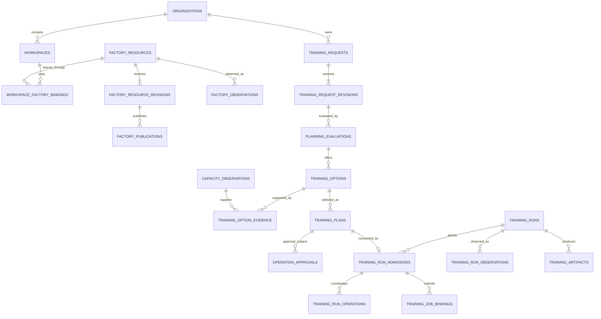

# Superplane database design

Date: 2026-10-15

Status: Proposed schema extensions. This document does not introduce migrations
or claim that the training and factory tables below already exist.

The [architecture overview](README.md) describes the four factories and the
capacity-aware training experience. The [control-plane design](control-plane-and-reconciliation.md)
defines their authority and reconciliation rules. This document maps those rules
to durable data; the companion [API and CLI design](api-design.md) describes how
users and agents interact with it.

Superplane stores user intent, plans, resource ownership and progress in its
PostgreSQL domain schema. It references the existing approval, budget and execution
owners instead of introducing another authority for provisioning. Kubernetes,
cloud providers and artifact stores remain authoritative for the resources they
hold. PostgreSQL records what was requested, what was authorized, the durable
bindings and the latest trustworthy observations.

All examples use symbolic identifiers. Actual provider identities, cluster names,
endpoints, credentials and operational evidence must stay out of public docs.

## 1. Existing storage and what changes

The API currently uses async SQLAlchemy with PostgreSQL/asyncpg, Alembic
migrations and an isolated schema configured through `SUPERPLANE_DB_SCHEMA`.
Some execution and budget journals use dedicated SQL adapters rather than the
API request session. Being in PostgreSQL does not make these owners one
transaction or permit another service to edit their records directly.

| Existing records | Responsibility retained in this design |
| --- | --- |
| `organizations`, `organization_grants`, `workspace_grants` | ADP organization mapping and delegated access. ADP remains the identity authority. |
| `workspaces`, `cloud_accounts`, `clusters`, `cluster_memberships` | Workspace identity, provider environments, cluster inventory and explicit shared-cluster membership. |
| `provider_connections`, `provider_connection_bindings` | Validated ADP credential references and workspace-scoped use. One connection is currently bound to exactly one workspace. |
| `credential_registry`, `cluster_vault_assignments`, `credential_audit_log` | Credential references and access audit, without copying secrets or secret ARNs. |
| `operation_approvals`, `operation_settlement_receipts` | Immutable request approval, expiry/revocation and settlement. Extend the owner for training-plan subjects. |
| `operation_budget_reservations` | Authoritative spending reservation and settlement. Reserved, confirmed and retained exposure all count against the budget. |
| `controller_executions`, `controller_provider_requests`, `provider_operations` | Governed operation, attempt, fencing, dispatch and provider-request identity. |
| `provider_allocations`, `provider_allocation_resources`, `provider_reference_conflicts` | Authoritative allocation/resource inventory and ambiguous ownership detection. |
| `controller_workload_submissions` | Durable Kubernetes submission intent. TrainJob support requires validation and extension of this owner. |
| `observation_receipts`, `observation_leases` | Authenticated observations and fenced observer ownership. Observer leases do not authorize mutations. |
| Lifecycle, bootstrap and partial-apply journals | Existing phase completion, recovery and cleanup evidence. |
| `events` | Existing domain audit events, with added training/factory event types. |

The existing `deployments` model only supports serving and batch types. Training
runs get their own domain records; they must not be inserted into that table by
inventing an unsupported deployment type.

## 2. Keys, tenant boundaries and data types

New domain entities use server-generated UUIDs. Public APIs treat IDs as opaque
strings; `RUN_ID` in an example is a placeholder, not a literal accepted UUID.
Existing operation, approval and provider keys may be strings. Keep their exact
values and use owner-validated mappings; do not cast them into UUIDs.

Every new tenant-owned table includes `org_id`. For new entity tables, define a
primary key `id` and unique `(org_id, id)`; all tenant-owned foreign keys include
`org_id`. Revision tables use `(org_id, entity_id, revision)` as their key. For
workspace-specific children, also constrain the workspace binding so a record
cannot reference another workspace's run, plan, membership or connection.
Organization-owned resources shared across workspaces use explicit authorized
binding rows rather than a fabricated workspace owner.

There are deliberate legacy exceptions: approvals and budget reservations can
precede workspace creation and currently have no workspace foreign key. Keep
these admission semantics. A server-reserved future workspace ID is an intent,
not proof that the workspace exists. Bind it to a real row only through the
authorized creation path. New optional workspace FKs are null until then.

Use the following common conventions:

- `created_at`, `updated_at`, `observed_at`, `received_at` and expiry fields are
  UTC `timestamptz`. Observation time and receipt time are distinct.
- `row_version bigint` supports compare-and-swap on mutable headers. Immutable
  request/plan revisions have a separate revision number and payload digest.
- Typed columns hold tenant/parent keys, state, provider, region, revisions,
  authority references and fields used in policy or list queries. Versioned
  JSONB holds bounded provider-specific specifications, evidence and conditions.
- Validate JSONB against its declared schema version. A schema version is not a
  substitute for relational constraints or authorization.
- Estimate money with `numeric(24,6)` and an explicit ISO currency. Wire amounts
  are decimal strings. Execution envelopes use the existing integer
  `max_cost_micros`; document currency conversion and round reservation ceilings
  upward. Do not use floating-point arithmetic for budget decisions.
- Durations and resource counts are nonnegative integers with explicit units.
  Unknown cost, capacity or timing is null with a reason, never zero.
- References to code, images, profiles and artifacts include immutable versions
  or digests. Canonical plan hashing includes a schema/hash-format version.

Authorization happens on every read and mutation, including idempotent replay.
Tenant-scoped repository queries and composite FKs are mandatory. PostgreSQL
row-level security can add defense in depth after connection-pool and service
roles are tested; this proposal does not claim it is already enabled.

## 3. Provider environments, profiles and shared infrastructure

Extend `cloud_accounts` as the existing provider-environment inventory. Its API
representation can use the neutral term *environment* without renaming the table
or breaking existing consumers in the first migration.

| Record | Proposed fields and constraints |
| --- | --- |
| `cloud_accounts` extension | `scope_kind` (account, subscription, project, tenant or resource group), canonical `parent_scope_key`, create/onboard mode, baseline reference/version, ownership and retention policy. The provider identifier remains protected runtime data. |
| `workspace_environment_bindings` | `(org_id, workspace_id, environment_id, purpose)`; one primary environment per workspace and explicit auxiliary bindings where a profile needs them. FKs enforce tenant membership. |
| `provisioning_profiles` | Immutable `(org_id, id, revision)` records containing allowed providers/locations, account baseline, network/cluster/platform profile versions, creation/reuse permissions and a reference to organization provisioning authority. A separately controlled availability state can disable new use. |
| Existing `clusters` and `cluster_memberships` | Retain cluster sharing and platform eligibility controls, workspace namespace/UID, membership generation and removal evidence. A cluster is not shareable merely because two requests name it. |

The current environment uniqueness is `(org_id, account_identifier)`. Migrate
to a reviewed provider-aware key such as `(org_id, provider, scope_kind,
parent_scope_key, account_identifier)`. Canonicalize parent scope, including a
non-null root sentinel, and backfill/check duplicates before replacing the old
constraint. Preserve the legacy `workspaces.aws_account_id` primary mapping
during migration; do not maintain two independent environment inventories.

Shared account/network resources and workspace-specific credentials are different
concepts. Sharing an environment must not relax the one-workspace provider
connection binding. Organization factory credentials are separately scoped
service authority, resolved through approved profiles and ADP credential owners.
They do not become arbitrary credentials available to a requesting agent.

Before a workspace exists, planning may inspect public catalogues and explicitly
authorized organization inventory. It cannot borrow another workspace's
connection. Store missing account-specific quota as unknown. Once an approved
workspace is created, establish and validate its permitted credential bindings
before dependent work proceeds.

## 4. Training intent, planning and evidence

Planning is a durable read-only evaluation of infrastructure and capacity. It can
write planning records, but cannot create cloud resources, start paid probes or
acquire a billable reservation.

| Proposed table | Important columns and invariants |
| --- | --- |
| `training_requests` | `id`, `org_id`, requester principal, optional existing `workspace_id`, optional provisioning profile identity/revision, current revision and row version. Origin references can point to a GitHub issue without storing its entire private contents. |
| `training_request_revisions` | Request/revision key, schema version, canonical spec and digest, hard constraints, preferences, code/image/data/output references, budget/deadline and retry/checkpoint policy. Append-only; editing intent creates a revision. |
| `planning_evaluations` | `id`, request/revision FK, state (`pending`, `evaluating`, `completed`, `failed`), evaluator and catalogue/policy versions, start/end times, expiry, failure/rejection reasons. Completion publishes an immutable result set. |
| `capacity_observations` | `id`, provider/location, accelerator configuration, scope reference, source, evidence kind, observed/received/valid-until times, availability/quota/pricing facts and a bounded redacted payload. Append-only. |
| `training_options` | `id`, evaluation FK, rank, feasibility (`eligible` or `conditional`), provider/location, workspace reuse or creation intent, resource/profile versions, estimated setup/transfer/queue/run durations, costs, assumptions, blockers and expiry. Immutable after evaluation completes. |
| `training_option_evidence` | `(org_id, option_id, observation_id, purpose)` relates an option to multiple observations without copying them into each option. |
| `training_plans` | `id`, revision (initially 1), option and request/revision FKs, plan digest, selected constraints and fallbacks, resolved dependencies, spend/runtime bounds, cleanup policy, validity, optional `continuation_of_run_id` and expected run version. Immutable executable selection. |

Evidence kinds distinguish `catalogue`, `provider_observation`,
`existing_allocation` and `reservation_receipt`. Only the last records an actual
reservation, acquired under an already authorized operation; normal planning
cannot create one. A catalogue offering is not confirmed free capacity. Evidence
records its scope so quota from one account cannot be reused for another.

Return 2–3 suitable options when available. Zero or one option is a valid completed
evaluation, with rejected-candidate reasons. Conditional options list the checks
that must pass after account creation and the bounded preparation spend that
approval would permit before those checks. Rank preferences only after enforcing
hard location, data access, runtime and policy requirements.

Creating a plan freezes the option, setup/reuse graph, current dependency
generations, intended workspace identity, constraints, approved fallback limits
and failure/cleanup behavior. The digest covers these fields, plan identity and
schema version. It excludes mutable observation projections. Authority binds the
exact plan, not a mutable request header or whichever option is currently ranked
first. Replacing an expired or changed plan creates a new plan ID with a
`supersedes_plan_id`; preserve the original.

## 5. Factory desired state and observations

These proposed tables record all four layers, including maintained platform
applications. They complement the existing cloud inventory and execution ledger.

| Proposed table | Important columns and invariants |
| --- | --- |
| `factory_resources` | `id`, `org_id`, layer, kind, provider, optional location, ownership scope, current desired revision, lifecycle intent, reconciliation-policy reference and row version. A shared resource has organization ownership. |
| `workspace_factory_bindings` | `(org_id, workspace_id, resource_id, purpose)` plus membership state and retention responsibility. Required for shared resources and filtered workspace views. |
| `factory_resource_revisions` | Resource/revision key, schema version, desired spec/digest, source plan, approved change or service-authority reference, profile versions, deletion/retention policy. Append-only. |
| `factory_dependencies` | Consumer resource/revision, dependency resource, required desired revision and readiness predicate. Same-org FKs; reject cycles and unresolved dependencies before publication. A newer dependency revision requires revalidation against the approved plan. |
| `factory_publications` | `id`, resource/revision FK, bundle digest/reference, backend, intended Application binding, publication state and retry metadata. Unique resource/revision/backend; a retry retains the same intent. |
| `factory_operation_bindings` | Resource/revision, operation purpose and stable step key, existing execution-operation reference, governing change/service authority and receipt references. Covers initial preparation, recurring authorized repair and retirement without creating another attempt owner. |
| `factory_object_bindings` | Resource, backend, management or workspace target binding, API group/kind, namespace/name/UID, applied desired revision and Kubernetes generation. Preserve replacement history; one active binding per owned object role. |
| `factory_observations` | `id`, resource and binding references, observed desired revision/generation, source sequence/fence, observed/received times, conditions, provider-inventory references, drift summary and evidence reference. Append-only and deduplicated by authenticated source identity/sequence. |
| `factory_status` | One current projection per resource: last trusted observation, current revision, readiness, freshness, drift, reasons and blocking dependencies. Rebuildable; never grants mutation authority. |

Factory observations reference `provider_operations` and
`provider_allocation_resources` through validated owner mappings. Do not build a
second, independently writable inventory of external resources. Terraform backend
and state references remain protected links to its authoritative remote state;
state contents do not belong in these JSONB columns.

Publication records store the chain from approved desired revision to immutable
bundle, Application and applied object UID/generation. Argo sync alone cannot set
provider readiness. A Ready projection requires a trusted, sufficiently fresh
observation of the current desired revision and its dependencies. A late Ready
event for a previous generation stays in history without unblocking new work.

Separate lifecycle intent (`active`, `retiring`, `retained`, `retired`) from
conditions such as Ready, Reconciling, Drifted, ApprovalRequired and Unknown.
Conditions use `True`, `False` or `Unknown`, with reason, message, transition time
and observed revision. Store Argo sync/health and provider drift independently.
On observer loss, retain the last observed fact and mark freshness stale/unknown;
do not infer resource deletion or authorize recreation.

## 6. Training runs, admission and results

A training run is the user's experiment execution. An execution operation is a
governed infrastructure/workload action beneath it. Their IDs and lifetimes are
different: one run may prepare several factory resources and have multiple
fenced execution attempts.

| Proposed table | Important columns and invariants |
| --- | --- |
| `training_runs` | `id`, org, request/revision, original plan, current admission, requester, optional workspace FK and reserved workspace intent, phase, row version, start/end times, result-verification state, cancellation and cleanup states. |
| `training_run_admissions` | `id`, run, sequence, immutable plan/digest, approval reference, admission state, execution operation and budget-owner receipt references, revalidation evidence, policy versions, exposure disposition and timestamps. Unique `(org_id, run_id, sequence)` and `(org_id, plan_id)`. |
| `training_run_operations` | Run/admission, operation reference, purpose and step key. Links to the existing execution owner without copying its attempts or manufacturing fence tokens. |
| `training_job_bindings` | Run/admission, existing workload-submission reference, cluster membership generation, namespace/UID, kind/name/object UID, governed attempt reference and status. Unique target object identity; at most one live submission for a given run execution step. |
| `training_run_observations` | Run, source identity/sequence, observed and received time, admission/job generation, phase facts, queue/capacity reasons, progress and redacted evidence references. Append-only; source ordering prevents stale updates replacing newer facts. |
| `training_artifacts` | Run, artifact kind, authorized storage reference, digest/version, size, producing job/attempt, retention, verification state/time and access policy reference. Includes checkpoints, final model and evaluation reports. |
| `training_cost_observations` | Run/admission or allocation, source, currency, amount, covered period, observed time and billing-finality flag. A read projection, not a replacement spending ledger. |

Run phases are `admitting`, `preparing`, `queued`, `running`, `replan_required`,
`succeeded`, `failed` and `cancelled`. Blockers are separate structured conditions
so the UI can show which factory or check is waiting. Record
`cancel_requested_at` independently; cancellation state is `not_requested`,
`requested`, `in_progress`, `complete` or `blocked`. Accepting cancellation does
not prove that pods or billable allocations have stopped. A cancellation racing
with completion preserves the observed compute outcome and records whether any
work remained to stop.

Result verification uses `pending`, `verified`, `failed` or `not_required`.
Cleanup uses `not_started`, `in_progress`, `complete`, `retained` or `blocked`.
A succeeded job with missing model artifacts has a successful compute outcome
and failed result verification. A cancelled run with a live allocation has
unfinished cleanup. Do not compress these facts into a single success boolean.

Only one admission can actively execute for a run. One immutable plan can be
claimed by at most one run, even when callers use different submission keys.
An automatic retry permitted by that plan stays under the same run and admission;
the existing execution owner creates attempts. A deliberate new experiment needs
a new plan/approval and run, even if its inputs match a previous experiment.

If capacity changes before training starts, retain the run, original admission,
owned resources and cost exposure. A replacement evaluation uses that inventory;
a new approved plan can continue the same run from `replan_required`. Admission
sequence increases and the old approval is not reused. The new plan explicitly
accounts for reuse, retention or cleanup of earlier resources. Once training has
started, a placement change or checkpoint-based rerun creates a new run linked
by `resumes_run_id` and an authorized verified checkpoint reference.

Large logs, metrics, datasets and model contents stay in their respective stores.
Keep bounded summaries and access-controlled references in PostgreSQL. MLflow
bindings are optional metadata; absence of MLflow cannot prevent run tracking or
artifact verification. Signed download URLs are generated on demand, not stored
as durable artifact identity.

## 7. Relationships at a glance

This logical diagram omits tenant columns and most existing execution tables.
All relationships below still follow the tenant-scoped key rules.

Approval-subject links are validated through the approval owner; the diagram is
not a claim that every cross-owner relationship is a PostgreSQL foreign key.

## 8. Transactions, outbox and recovery

Add `superplane_idempotency_records` and `superplane_outbox` for new domain
commands. These complement, and do not replace, execution dispatch journals.

An idempotency record is unique on `(org_id, principal, action, key)` and stores
the normalized request hash, result-resource reference and acceptance time.
Changing the body for the same key is a conflict. Scope is independent of a
workspace because requests may precede workspace creation. Replays reauthorize
access and return the same resource, with its current status. Keep replay
tombstones at least as long as the linked operation can be recovered; never
silently reuse a key while effects may remain.

An outbox row contains event ID, org, aggregate type/ID/version, event type,
bounded payload, creation/next-attempt time, lease owner/expiry, attempts and
delivery receipt. Uniqueness on aggregate/version/event type prevents duplicate
intent. Delivery is at least once; each consumer deduplicates by event ID and
its own operation key. A delivery receipt is not proof of provider completion.

### Submit a selected plan

1. Authenticate and authorize the selected plan and target scope. Check immutable
   plan validity and resolve its server-owned approval subject.
2. In one domain transaction, claim the idempotency key and unconsumed plan,
   create the `admitting` run/admission and write its admission outbox intent.
   Unique constraints settle concurrent submissions. Commit before network calls.
3. The admission coordinator revalidates authority, capacity, quota, price and
   profile/dependency generations. It uses the existing owner to consume approval,
   reserve budget and create/resolve execution admission under stable keys.
4. Persist owner receipts and the resulting admission decision. Only a confirmed
   governed admission permits desired-state publication or provider dispatch.
   The existing execution service remains the final mutation gate.
5. Factories publish/apply approved declarations in dependency order, while
   observations update projections and the run. Submit the TrainJob through the
   governed workload owner after workspace, data, runtime and capacity checks pass.

There is no claimed ACID transaction spanning domain data, the execution ledger,
Git/OCI, Argo or providers. A crash after an owner accepts work but before the
domain records its receipt is recovered by querying that owner with the same
key. Do not consume approval or reserve money again under a fresh key. If receipt
status is unknown, hold dispatch and reconcile. Release a reservation only after
the authoritative owner establishes no remaining exposure; partial creation may
require retained settlement and cleanup instead.

The budget owner allocates the run's approved envelope across child operations;
each factory does not receive another copy of the full spending ceiling. A
continuation includes confirmed and retained exposure from earlier admissions
when calculating its remaining authorized budget. Estimated/observed cost views
cannot independently increase that envelope or settle reservations.

### Publish and observe

Write the desired revision and publication intent in one transaction. The
publisher creates or finds the immutable bundle, records its digest and updates
the assigned Application with compare-and-swap semantics. After a lost response,
read its intended source/UID before retrying. Old publishers cannot overwrite a
new revision; lease/fence and revision checks apply at the mutation boundary.

Observation ingestion authenticates source and scope, deduplicates delivery and
appends evidence before updating a projection. Use source-specific ordering and
binding generations; clocks alone are not sufficient. Conflicting provider
references enter the existing conflict path and block duplicate creation.

Persist TrainJob submission intent before the Kubernetes call. Recover a lost
response by its stable submission identity, namespace and ownership labels, then
bind its UID. An object-name collision with a different owner is a conflict.
Argo manages platform applications, not these individual run objects, so a sync
cannot recreate completed training.

## 9. Indexes, retention and operations

Start with indexes that support concrete API and controller queries:

| Query | Index or constraint |
| --- | --- |
| List a workspace's runs | `(org_id, workspace_id, created_at DESC, id DESC)`; add phase to a separate index for active-run filtering. |
| List org-level pending requests | `(org_id, requester, created_at DESC, id DESC)` and request/revision uniqueness. |
| Find options or a plan | `(org_id, evaluation_id, rank, id)` and unique plan/admission binding. |
| Reconcile active resources | Partial indexes on active lifecycle resources and undelivered outbox rows ordered by next attempt. |
| Resolve Kubernetes/provider events | Unique active object UID bindings and existing provider inventory lookup keys. |
| Read recent evidence/events | `(org_id, resource_id, observed_at DESC, id DESC)` or equivalent run key; unique authenticated source sequence. |
| Gate dependencies and retirement | Both directions of dependency and workspace-resource binding indexes. |

Use keyset pagination with a stable `(created_at, id)` ordering. Add targeted
JSONB indexes only for measured queries; do not index all evidence payloads.
Bound payload size and retention before enabling high-frequency observations.
Time partition large append-only observation/event tables when volume warrants
it, while preserving deduplication across partition boundaries.

Retention policy separates unselected planning evidence, approved plans and
audit receipts, operational observations, logs and artifacts. Keep every record
needed by an active operation, unresolved cleanup, spend exposure or retained
resource. Archive eligible history under the tenant's policy; compact rebuildable
projections only after retaining the evidence needed for recovery and audit.

Retirement is a lifecycle transition, not cascading SQL deletion. Use restrictive
FK deletion for plans, admissions, resource ownership and result provenance.
Delete a binding only after verified removal or a recorded retention handoff.
Shared environments/clusters and explicitly retained data survive workspace
retirement. Closing an account/subscription/project is a separate governed
operation. Legal or tenant-data deletion requirements need an explicit redaction
and retention workflow without making active infrastructure untraceable.

Encrypt database storage/backups and require verified TLS. Store only opaque ADP
credential references. Provider identities and internal endpoints, where required
at runtime, receive field-level access controls and redacted public responses.
Audit reads of privileged evidence as well as mutations.

Back up the domain database, execution ledger, immutable desired-artifact
references and Terraform state under coordinated recovery procedures. Restoration
starts with mutation disabled: restore bindings, revalidate authority, observe
providers/Kubernetes and reconcile pending outbox/operation receipts before
dispatch resumes. Test point-in-time recovery while creation and training are
in flight. Database restoration alone must not recreate existing resources.

## 10. Migration and implementation gates

1. Inventory current migrations and every SQL writer, including raw journal
   adapters. Define schema ownership and cross-owner receipt contracts first.
2. Add tenant keys, new tables and nullable compatibility fields. Backfill and
   validate provider scope and workspace/cluster bindings before enforcing new
   uniqueness. Do not fabricate observations, readiness or approvals in backfills.
3. Extend approval/admission for immutable training-plan subjects and add outbox
   recovery before enabling any training mutation route.
4. Add factory publication/observation and run projections behind capabilities;
   retain one authoritative writer for each record and resource.
5. Migrate legacy readers before removing old environment fields or constraints.
   Use expand/backfill/validate/contract migrations that tolerate rolling upgrades.

Required acceptance includes cross-tenant FK/query rejection, concurrent plan
claims, same-key/different-body conflicts, approval expiry/revocation, exact money
conversion, lost admission/publication/provider responses, stale Ready events,
crashes at every outbox boundary, duplicate TrainJob delivery, pre-start replanning
with retained exposure, cancelled jobs with live capacity, shared-resource
retirement and restoration with in-flight work. These are implementation gates,
not tests claimed to pass by this documentation change.

## Source references

- [Current database setup](../../../modules/domain-apps/superplane/src/superplane-api/app/database.py), [schema boundary](../../../modules/domain-apps/superplane/src/superplane-api/app/schema_boundary.py) and [Alembic migrations](../../../modules/domain-apps/superplane/src/superplane-api/alembic/)
- [Existing domain models](../../../modules/domain-apps/superplane/src/superplane-api/app/models/)
- [Provider connection binding constraints](../../../modules/domain-apps/superplane/src/superplane-api/app/models/provider_connection.py)
- [Approval records](../../../modules/domain-apps/superplane/src/superplane-api/app/models/operation_approval.py) and [budget ledger adapter](../../../modules/domain-apps/superplane/src/superplane-api/app/adapters/operation_budget_ledger.py)
- [Existing integration contract](../../../modules/domain-apps/superplane/contracts/INTEGRATION-CONTRACT.md)
- [API and ADP CLI design](api-design.md)
