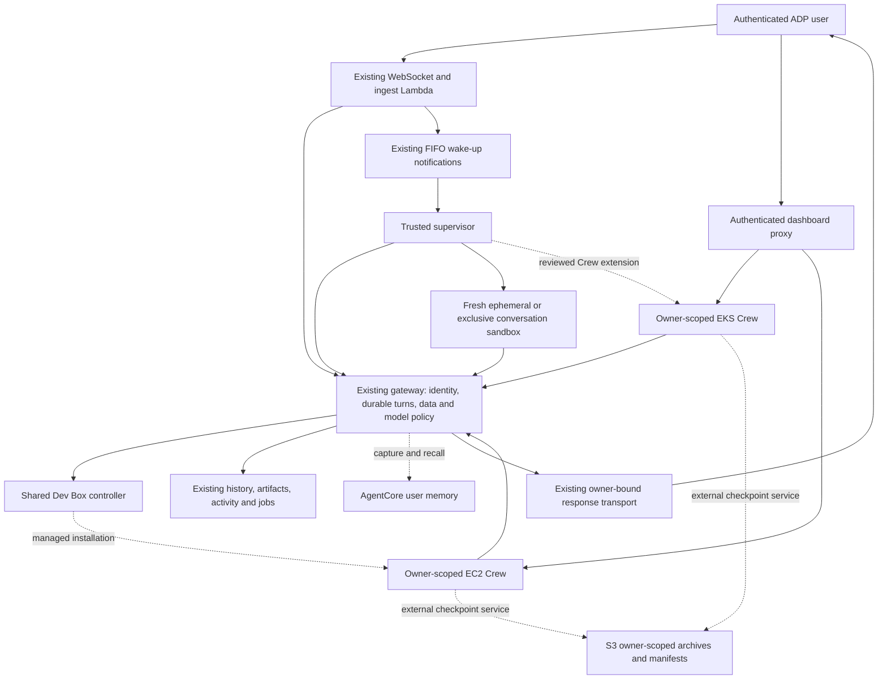
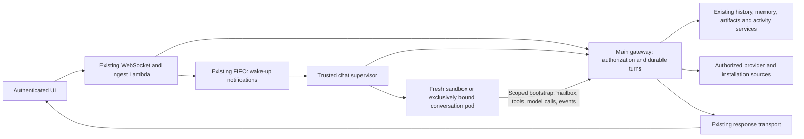
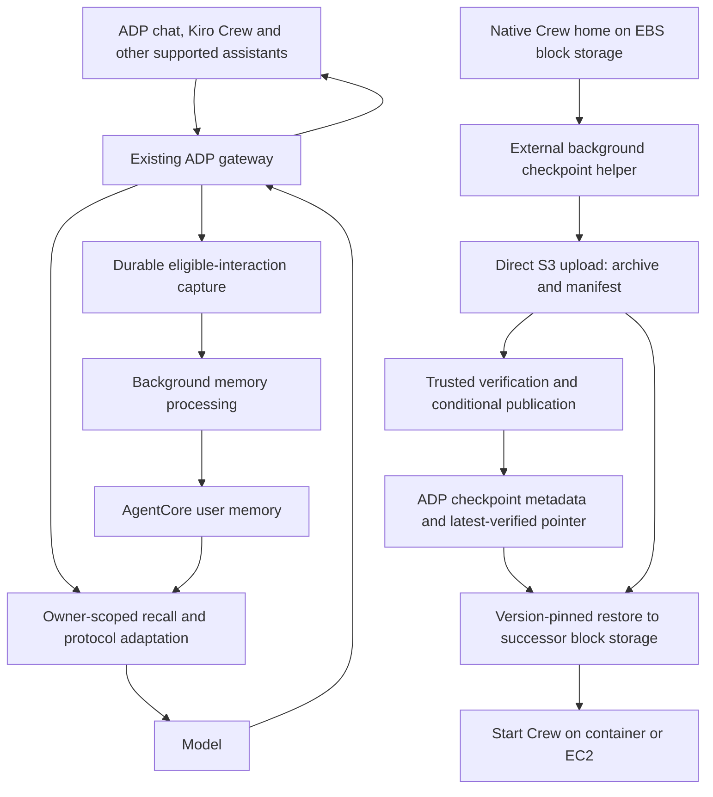

# ADP Assistant / Chief of Staff architecture

Canonical architecture for [epic #7197](https://github.com/aws-e/adp/issues/7197).
Consolidated 11 October 2026; memory direction updated 11 October 2026.
**Status: target architecture; gateway-mediated AgentCore memory and external Crew
checkpointing from block storage directly to S3, tracked by ADP metadata, are
selected designs, not delivered or live-qualified capabilities.
Remaining implementation decisions are listed below.** This document replaces the
separate assistant architecture, runtime-access inventory, external-activity,
deployment-boundary and Kiro memory pages. Maintain architecture here; old paths
contain navigation only. The [manual Dev Box setup runbook](devbox-setup.md) is
operational reference, not proof of the proposed managed service.

## How to read this document

- [Product and shared services](#product-and-shared-services): the complete user journey and ownership.
- [System overview](#system-overview): trusted coordination, execution targets and service boundaries.
- [Decisions required before implementation](#decisions-required-before-implementation): explicit conflicts and owners.
- [Foundation architecture](#foundation-architecture): retained isolation, authorization, data and lifecycle contracts.
- [Runtime and dashboard extensions](#runtime-and-dashboard-extensions): Claude Code, Crew, inventory, identity and access.
- [Memory and continuity](#memory-and-continuity): gateway-mediated AgentCore user memory, block-storage Crew state with direct S3 checkpoints and ADP metadata, and retained Kiro source analysis.
- [Managed EC2 Dev Box](#managed-ec2-dev-box): shared host service and assistant installation.
- [Delivery order and ownership](#delivery-order-and-ownership): completed work, remaining waves and flow migration.
- [Deployment boundary](#deployment-boundary): workflow inventory, dev CD and non-dev guards.
- [Evaluation contract for every story](#evaluation-contract-for-every-story): retained foundation criteria and evidence requirements.
- [Runtime and product acceptance](#runtime-and-product-acceptance): EP-01–EP-06 and the full journey.
- [Source audit and qualification limits](#source-audit-and-qualification-limits): source versus live evidence.
- [Provenance and maintenance](#provenance-and-maintenance): replaced documents and historical receipts.

The foundation contracts were reviewed through PR #6938 and implemented through
separate foundation stories. That does not certify deployed behavior. Runtime,
Crew and managed EC2 statements are target designs until their stories and live
criteria pass. Generic user-agent services remain specified in
[the shared user-scoped agents design](../user-scoped-agents-design.md); this
file owns their Chief-of-Staff application. Deployment commands remain in the
[canonical platform deployment guide](../adp-platform-deployment/deploy-with-agent.md).

## Product and shared services

One assistant per user and tenant helps the owner understand their work, choose
a goal, delegate authorized tasks, verify outcomes, remember corrections and
continue later. The complete journey is: activate → retrieve cited context → set
a goal → delegate bounded work → verify the result → save a correction → resume
in a later session with an accurate progress update.

| Capability | Contract / existing owner to reuse |
|---|---|
| Activation and lifecycle | User-scoped, versioned platform template; preferences, goals, pause/resume/removal, source/action choices, spending limits, consent and permission revalidation. Use shared user-agent lifecycle rather than a second agent service. |
| Context and memory | AgentCore owns portable user memory through the ADP gateway; native Crew state runs on block storage with separate S3 checkpoint recovery tracked by ADP metadata. Private by default; explicitly authorized shared collections; source, confidence, revision, freshness and coverage. Reuse #1287/#1283 personal context and #1345 knowledge; no new graph database prerequisite. |
| Delegation and follow-through | Root human identity, task/run/attempt distinctions, bounded budgets and approvals, cancellation, interruption, retry and unknown-effect reconciliation. Reuse #4912 jobs/approvals, #4191 execution, #4210 readiness and #7245 tools/credentials. |
| Terminal continuity | Bounded cited context with revisions and coverage, consistent between ADP and a supported terminal client; memory cannot grant authority or replay approvals. |
| Proactive operation | Bounded schedules/events, timezone/quiet hours and deduplicated notifications through existing triggers; additional email/calendar/messaging integrations are follow-on unless explicitly included. |
| Product release | Comparative pilot with matched tasks/model and held-out tasks; measure success, corrections, unsupported claims, time/cost and human readability. Agree thresholds before execution. |

User customization narrows the template's declared permissions; it cannot add
undeclared tools, exceed owner/tenant authority or upload an arbitrary platform
service. This is distinct from a reviewed runtime's ability to execute scoped
filesystem tools. Template upgrades are pinned per user with consent and access
revalidation. Runtime readiness alone does not finish the product epic. #6930
still owns bounded decomposition of the remaining product journey.

## System overview

Solid foundation paths describe established contracts, not a live-installation
claim. Crew and managed EC2 are extensions. The ingest Lambda remains the ingress
coordinator; the gateway remains the authorization/data/model boundary. The
supervisor manages execution without running model tools. The Dev Box controller
alone performs host provisioning and EC2 mutations; the assistant consumes its
owner-scoped API. Do not add a second gateway solely for this feature, competing
activity/version stores, a second host controller or a new engine node type.

## Decisions required before implementation

These decisions belong to [#6930](https://github.com/aws-e/adp/issues/6930).
The memory direction in this document supersedes the earlier Crew memory-event
sketch. ARC-03/04 still require concrete coverage, durability and governance
contracts; ARC-07 must reconcile the existing issues and flow before execution.
Dependent stories remain blocked through the epic's dependency graph.

**ARC-01/02 decision:** keep Crew model execution role-free and isolate its
direct-S3 backup helper. The [owner-session/workload contract](runtime-boundaries-6930.md)
specifies the trust, volume, fairness and SES mapping. #7198/#7200 must replace
their proposed in-pod IRSA/proxy before implementation; native compatibility is pending ARC-05.

| Decision | Conflict / required output | Consumers and verification |
|---|---|---|
| ARC-01: Crew workload identity | Foundation model pods have no AWS role. #7198/#7200 propose in-pod IRSA and a signing proxy. Choose/document the Crew trust boundary, reachable credentials, route authority, run binding and stolen-token behavior. A proxy or hidden environment variable cannot isolate credentials from shell tools. | #7198/#7199/#7200; #7214 repository, #7217 EP-03/04. Ephemeral isolation is unchanged. |
| ARC-02: shared owner runtime | Foundation persistence is exclusive to a conversation. #7203 shares an owner's process/files/memory across conversations. Define visibility, permission changes, ordering, fairness, cancellation/end and lease fencing, with an explicit SES criterion mapping. Kiro persona stores are not human tenancy boundaries. | #7203; #6937/#7217 shared-owner checks plus unchanged ephemeral/per-session regression. |
| ARC-03: memory coverage and durability | Implement the selected gateway/AgentCore and block-storage/direct-S3 checkpoint split below. Define durable capture versus extracted-memory acknowledgement, supported API adapters, AgentCore service/region/strategy limits, checkpoint inventory/consistency, checkpoint metadata/atomic publication, EBS/PVC retention, uploader isolation, recovery objectives and migration from existing memory. No Kiro changes, plugin or memory fork. | #7210 gateway memory; #7202 external checkpoints; #7209/#7222 consume recovery; #7215 and EP-02/06. |
| ARC-04: memory governance | Define interaction eligibility, provenance, correction precedence, private-session controls and inspect/export/delete across AgentCore, capture queues, caches and retained checkpoints. Prevent stale requests or restored local content from re-learning deleted shared memory without modifying Crew. Do not claim gateway deletion erases unseen local files. V1 eviction is not V2 retention. | #7210 with #7202 checkpoint retention and product memory controls; stale-content/correction/deletion negatives in #7215/#7217. |
| ARC-05: runtime compatibility | Manual installation verified Crew 0.7.2; memory analysis uses source 68d920b (0.9.0). Pin compatible upstream Crew/ACP/Claude Code/config/embedding and checkpoint versions and upgrade behavior; memory integration must not require a Crew fork. Resolve private-V2 requirements versus the proposed pod sandbox configuration. | #7201/#7209/#7222; real container/tool behavior and fresh install/upgrade evidence. |
| ARC-06: external prerequisites | Identify the real installed-record provider for #6935 and #7175's matched latency baseline/limits. Design #6927 alone is not provider implementation. | #6935/#6937 and affected runtime/product criteria. |
| ARC-07: complete delivery contract | Decompose remaining product work; bind criteria, shared migration/file ownership, evaluation adapters, deployment targets and budgets. Keep the registered runtime amendment aligned; retain foundation qualification ownership and consume its evidence without duplicate dispatch. | #6930; all waves. No duplicated dispatch or discarded receipts. |

## Foundation architecture

The following contracts retain the reviewed foundation design. References to an
exclusive persistent sandbox apply to the foundation conversation executor;
ARC-01/02 must explicitly reconcile the proposed Crew exception before it is
implemented. Shared owner/tenant authorization, revocation and ephemeral isolation
are never waived by selecting another execution target.

### Trusted coordination and sandbox isolation

Separate trusted coordination from arbitrary model execution in **different pods**.
Choose a durable, gateway-owned session mailbox and a small trusted chat supervisor.
The supervisor is a proposed refactoring of the existing queue consumer and
lifecycle plumbing, not another data-access API or a new engine. It consumes queue
notifications, asks the gateway to claim work, creates/deletes sandbox pods and
reconciles leases. It never runs model tools. The existing ingest Lambda retains
classification, validated ingress and routing coordination.

The supervisor's restricted Kubernetes identity may manage only labelled sandbox
resources in the chat namespace, using a fixed template. Namespace RBAC alone does
not constrain pod specifications: an admission policy must reject service-account
substitution, arbitrary images/commands, privileged mode, host mounts/network,
shared writable volumes and unapproved secret/token mounts. It has no GitHub App
secret or general application-store access. The gateway owns data credentials;
ingestion and the response relay retain only their necessary trusted permissions.

The sandbox has a dedicated service account with no AWS role and no Kubernetes
API permissions. Disable default token mounting. A deliberately projected,
short-lived bootstrap token for a dedicated audience may be mounted; it grants
only exchange for that registered pod's assignment. A model can read its own
scoped capability, so security must not depend on hiding it in an environment
variable. It cannot bootstrap another run or use the token at the Kubernetes API.
No trusted coordinator sidecar, shared process namespace, credential directory,
service-account role, reusable home directory or writable persistent volume is
shared with model execution.

Use non-root, read-only root filesystem where practical, dropped capabilities,
seccomp, no host access and fresh bounded scratch storage. Enforce default-deny
network egress with an installed enforcing network implementation: only gateway,
restricted DNS and explicitly authorized content paths are reachable. Block node
metadata, Kubernetes API, service credentials and internal services. Existing
WebFetch/WebSearch/knowledge/vault tools must use scoped gateway adapters or be
unavailable; allowing arbitrary outbound HTTP would undermine this boundary.
Downloads require gateway authorization, URL/redirect validation, size limits and
SSRF controls. Kernel escape is outside the application isolation claim; if the
installation threat model requires a stronger runtime boundary, qualify that
runtime before enablement. A plain unconfined subprocess is never acceptable.

The first delivery uses fresh one-turn sandboxes. #147 extends the same lifecycle
to exclusive conversation pods. #183 initially warms **node/image capacity** while
still creating a fresh executor per assignment. This intentionally avoids a dirty
process pool and per-session SQS queues. Unused prestarted sandbox pods are a later
option only if measurements justify them and their one-time assignment is tested;
they are not required for this epic's initial warm-capacity implementation.

### Identity and authorization contract

1. Ingest authenticates the existing connection, resolves canonical user and tenant
   from verified identity, checks current membership/session ownership and records
   the turn through a trusted gateway operation. No principal comes from prompt,
   tool arguments, forwarded owner headers or a client-supplied session ID.
2. Gateway registers the turn and run against the existing chat root/model policy.
   Trusted launch records bind run, session, user, tenant, sandbox UID, immutable
   image and lease generation. The supervisor cannot select a broader user scope.
3. Sandbox exchanges its workload proof against that launch record. The gateway
   issues a short-lived, audience-bound capability for exactly that run/session,
   tool allowlist and lease generation. Initial capability TTL is five minutes;
   refresh requires a current lease, live root authority and current entitlements.
4. Every tool/model/mailbox request verifies the capability, current lease and
   revocation state. Repository/team/installation access is checked at the gateway
   on each operation, including by-ID reads, pagination and artifact download.
   Membership revocation invalidates subsequent access even before token expiry.
   Authorization-service failure denies access; it does not reuse stale permission.
5. Session end, lease replacement or root expiry invalidates capabilities. Gateway
   audits principal, run, operation, resource scope and outcome without raw tokens,
   sensitive tool arguments or full private prompts. Late events from old leases
   are rejected. Browser tokens and provider secrets never enter model context.

Extend existing authority verification rather than weakening the current IAM and
workload checks on `/internal/v1/agent/chat/model-decision`. New delegated routes
must explicitly support the credential-free sandbox and still enforce the same
model selection, spending, metering and cancellation controls. Missing usage
receipts cannot be treated as zero spending. Ingestion's direct-response path and
summarizer must also remain authorized, metered and unable to bypass tool scope.
A direct response without source retrieval cannot claim to summarize user work.

Personal conversations are private by default. Team sharing requires an explicit
resource ACL and current membership, not mere tenant equality. Shared content
never transfers another user's credential or persistent process. For this epic,
persistent executors have one owner; collaboration uses authorized durable content
and fresh executions rather than multiple users entering the same live sandbox.

### Gateway data and tool contracts

These are foundation operation contracts. Exact implemented routes and deployed availability require source and live evidence respectively. Reuse
underlying services and existing port interfaces. Use one shared authorization
helper for browser and delegated callers; do not fake a browser JWT or internally
call a `/me` route with model-selected identity headers.

| Operation | Inputs the model may provide | Server-owned controls / result |
|---|---|---|
| `history.read`, `history.expand` | Authorized session reference, cursor, summary/message IDs | Check every ID and cursor against session scope; ordered messages/summaries with timestamps and next cursor |
| `history.append` | Current turn content and idempotency key | Actor/session from capability; role and final-state transitions from trusted transport; reject model-created system/other-user roles |
| `memory.search`, `memory.write` | Query or proposed memory content and purpose | Scope to owner and explicitly allowed shared collections; provenance, retention and versioned writes; treat recalled text as untrusted data |
| `artifact.create`, `artifact.read` | File metadata/content or authorized artifact ID | Server-derived object key; bounded upload, content type/size/hash, ownership and scan status; gateway-mediated reads reauthorize each time |
| `activity.adp` | `from`, `to`, IANA timezone, filters and cursor | Canonical user/tenant, `/me/agent-invocations` service semantics and Task read-through; lineage, source links and recorded outcomes |
| `activity.external` | Same time window and allowed repository references | Server resolves connected human identities and current repo entitlement; provider pagination/rate-limit status and event provenance |
| `installation.status` | Authorized installation reference | Explicit installation-read entitlement; current observed versions versus desired/last verified release, freshness and partial failure |
| `installation.failure` | Authorized operation/component reference | Bounded redacted failed-stage evidence; no arbitrary AWS request, log query, Terraform state or secret download |
| `session.state`, `session.end` | Authorized session reference | Actual lifecycle, expiry, pod/run state and idempotent end request; owner checks and revocation |

The trusted coordinator additionally needs `turn.accept`, `lease.claim/renew`,
`run.bind` and `run.reconcile`; sandboxes cannot call these administrator operations.
A bound sandbox can long-poll its own `turn.next`, publish ordered events and
complete the current turn through narrower operations. Browser session creation
and mode changes retain authenticated user controls rather than becoming model
commands.

Each read result carries `status` (`ok`, `empty`, `partial`, `denied`,
`unavailable`), `observed_at`, the requested window/timezone, `coverage`,
`next_cursor` and source references. `coverage` records sources queried, covered
intervals and reasons for omissions. An empty page with a continuation cursor is
not complete. Return structured errors: authentication 401, authorization 403 (or
non-enumerating 404 for resource lookup), stale lease/version 409, rate limit 429,
source outage 503. Never translate these to an empty successful answer.

Cursors are opaque and bound to caller scope, filters and ordering. Use UTC
half-open intervals `[from,to)` after timezone conversion, including DST tests.
Preserve original timestamps and precision. Exact source counts must be computed
from retrieved records; do not have a model guess completeness. Source text is
untrusted and cannot alter identity, tools or authorization.

Preserve existing history ordering, compaction, summary expansion, attachments,
TTL/retention and artifact recovery semantics. Add gateway-backed context/memory/
artifact/draft ports and migrate the worker to them before dropping its store
permissions. Session-keyed DynamoDB records may remain behind the gateway; no
client may use a partition key as authorization. Perform an ownership inventory
and idempotent migration with counts and dry-run output. Missing/mismatched legacy
owners are quarantined, not made public or inferred from the requesting user.
Keep the existing ownership-scoped sweeper behavior. Renew active-session retention
consistently so delayed TTL deletion cannot erase a live conversation; TTL is not
a prompt lifecycle timer. Personal-context and credential tools are included in
this audit; no broad-role fallback when a scoped adapter is missing.

### Activity and deployment answers

ADP activity uses existing user-index queries and Task read-through. Preserve
root/child lineage; deduplicate a displayed issue without discarding its runs.
A trigger by the user is different from a descendant agent action. Invocation
success is a recorded run outcome, not proof the issue is now closed or a release
is deployed. Missing transcript, expired retention, inaccessible index or provider
failure appears in coverage, not as fabricated completion.

External human work means authored commits/PRs, submitted reviews and comments
with source event IDs and times. Assignment alone is not work. Resolve aliases
through verified linked identities, not display-name matching. Intersect provider
connection visibility with the user's current repository rights. If those rights
cannot be established, omit that repository with honest coverage. External reads do not cache provider events or authorization decisions;
each request rechecks current access. Use bounded provider reads through
existing connections; add no new activity store without measured need. Never
accept an arbitrary provider base URL or redirect carrying an installation token.

Deployment tools are read-only projections of existing health/upgrade evidence
and the proposed [#6927 installed contract](https://github.com/aws-e/adp/blob/4671eb1e2797f7f1dd180cef285570a57c1f49da/docs/architecture/component-releases/contracts.md).
That schema is proposed v2, not implemented release state. Consume its desired,
last-fully-verified, component observations and operation failure fields when an
implemented authorized source exists. Show legacy `unknown`, partial application,
stale observation and absent optional modules honestly. A tenant member is not
implicitly an installation administrator. Existing bounded diagnostics can ship
without the ledger; ledger-backed criteria stay blocked until its implementation
and integration tests exist. Do not mark the whole story accepted solely because
mock ledger fixtures pass.

#### External activity read limits

The delegated work summary reads GitHub and GitLab events only after verifying the
chatting person's linked provider identity and current repository membership. It
does not create an activity index. The feature is off unless the gateway has
`ADP_EXTERNAL_ACTIVITY_ENABLED=true`; the worker receives no provider credential.

- A request accepts a timezone-aware window of at most 31 days. It checks at
  most two GitHub installations and ten repositories per installation, or ten
  configured GitLab projects. Limits produce partial coverage, not an empty-work
  claim. The ADP activity index has a separate 30-day retention warning.
- Provider activity uses at most 100 records per page, three pages per endpoint,
  and a shared budget of 50 activity page requests per provider per work-summary
  request. Pagination follows the provider's continuation signal, including
  empty pages with a next page. GitHub commits, PRs, PR reviews and issue
  comments and GitLab commits, MRs and issue/MR events are queried read-only.
  GitLab comments use the nested `Note` payload's issue/MR reference and link
  directly to the note. System notes and assignments are not human work;
  malformed note references produce partial coverage rather than guessed links.
  Authorization, identity, token minting and installation enumeration require
  additional bounded requests outside the activity-page budget.
- Reaching a page/request limit, an unavailable provider or a rate limit leaves
  returned authorized events intact and marks history incomplete. Provider APIs
  can omit older history: GitHub reviews of PRs not updated since the window began, for
  example, are not enumerated. GitLab commits without a confirmed linked email
  are excluded. A provider's own retention and API availability also limit what
  can be observed; neither an empty page nor a current issue state proves no
  earlier activity occurred.
- Provider requests use server-constructed HTTPS destinations and never follow
  redirects. Source links from responses must match the expected provider,
  repository and action path; invalid links are omitted with partial coverage.
  Local and link-local GitLab destinations are rejected even if configured.
- Reads are fresh on the first work-summary page; subsequent ADP cursor pages
  label external coverage `continuation_only`. Each response carries its
  observation time. No provider event or authorization result is cached in ADP;
  each request rechecks access, so revocation cannot expose previously read data.

### Session routing and recovery

Persist turns and leases through the gateway using the existing session storage
where transactional access permits. Add explicit turn IDs, per-session sequence,
mode, owner, lease generation, sandbox UID, lease expiry, turn status and last
acknowledged event sequence. Do not create a second session authority. Ingest must
persist an accepted turn and its notification intent atomically; a small outbox
retry/reconciliation path handles failure between storage and SQS publication.
The trusted consumer acknowledges the notification only after durable acceptance
by the runtime manager. Duplicate notifications are harmless. A periodic pending-
turn scan recovers a lost wake-up; FIFO is transport, not the durability ledger.

The supervisor claims a session with a conditional write and incrementing fencing
generation. A fixed-template sandbox is created with that assignment. The sandbox
long-polls the gateway mailbox **for its assigned session**, never the shared SQS
queue. Gateway verifies owner, pod UID, lease generation and current turn on each
poll/result. A persistent pod waits only for its own conversation; competing
supervisors cannot issue two valid leases. Persist run intent before pod creation
and reconcile by assignment label so a crash between creation and recording does
not launch duplicate authorized workers. Gateway unavailable means visible queued
or recovering state, not fallback to a shared IAM role.

Proposed states: `queued → starting → running → completed` per turn, with explicit
`failed`, `cancelled` or `interrupted` outcomes. Session state is independently
`idle`, `active`, `ending`, `ended` or `recovering`. The UI never infers these from
WebSocket connectivity alone. Acknowledgement means durably accepted, not running.

Initial operational defaults are a 90-second renewable lease, 20-second heartbeat
and 20-second mailbox long poll. Detect expired leases within two minutes including
reconciliation delay. These are infrastructure settings exposed in diagnostics,
not hidden model turn budgets. Persistent mode initially offers a displayed
15-minute idle shutdown, administrator-configurable; warn before idle termination.
Do not carry forward the historical arbitrary two-hour conversation ceiling.
Resource, spend, token/context and provider limits remain explicit platform
controls with clear stop reasons. Measure/tune these defaults during qualification.

On disconnect the owned session continues according to its selected mode. Reconnect
reauthorizes and resumes events after the last durable sequence; if retention no
longer covers the gap, return an explicit history refresh requirement. Serialize
concurrent turns by accepted sequence. End-session stops accepting new work,
revokes tool/model authority, cancels or records the active turn's outcome, and
destroys the pod; durable conversation history follows its retention policy.
Ephemeral-to-persistent takes effect at the next turn. Persistent-to-ephemeral
ends the current executor safely; the next turn gets a fresh pod.

On node loss, lease expiry or rollout, fence the old pod before any successor can
commit. Rehydrate from durable history into a fresh sandbox. Do not promise
exactly-once model execution or silently replay side-effecting tools: persist tool
idempotency keys and receipts, and classify uncertain effects for user recovery.
Foundation external activity/deployment tools are read-only; delegated actions in the product extension use the shared jobs/approval contract; history, memory
and artifacts need idempotent writes. A missing final reply is visibly interrupted
until reconciliation proves a result or offers a safe retry. In-memory/filesystem
state may be lost; durable authorized artifacts survive. End/idle cleanup is an
active reconciler responsibility, not DynamoDB TTL alone.

### Warm capacity and user experience

#183 pre-pulls the reviewed image and maintains bounded schedulable node capacity
with configuration off by default. Fresh sandbox creation and gateway assignment
remain unchanged. Reuse existing balloon/prepull mechanisms after checking their
namespace, image and scheduling fit; do not mistake webhook readiness for chat
readiness. Measure cold, image-warm and node-warm cases independently. Capacity
shortage falls back to a fresh cold sandbox with truthful starting status, never
to insecure legacy execution. Scale-down must not kill a live conversation without
fencing/recovery. Report idle node cost and scheduling benefit before enabling a
standing warm pool. If this cannot meet the latency criterion, report failure and
propose a reviewed disposable-prestart extension rather than silently recycling
model processes.

#6936 extends the existing chat UI: contextual links from authorized activity and
installation pages, server-backed mode selector, immediate acknowledgement,
queued/starting/running states, actual tool events, streamed output, replay and
clear failure/retry. Show timezone/window and coverage with source-linked answers.
Persistent idle time, running state, end action and ongoing capacity/model cost
implications are visible. Navigation and backend enablement remain separately
gated; direct navigation must not bypass authorization. Keep unavailable tools
visible as unavailable where useful. Keyboard, screen-reader and long-response
behavior are part of acceptance.

## Runtime and dashboard extensions

The runtime extends the existing Agent Factory/gateway/harness. These are proposed
contracts owned by existing stories, not evidence that a Crew is installed.

| Owner | Contract |
|---|---|
| #7221: executor inventory | Upstream target/resolver contract: tenant/user, `target_kind` (`eks-pod` or `ec2-instance`), target reference, executor key and generation. Validate inventory and lease generations together; target IDs and caller-supplied tags are not authority. |
| #7198: Crew workload | Separate role-free Crew admission/egress/workload class with bounded resources. Proposed requests 500m/1Gi, limits 2 CPU/6Gi/4Gi ephemeral, scratch 2Gi, termination grace 120 s. Crew home uses an owner-scoped EBS PVC; scratch is not persistent-home sizing. No fixed 900 s Crew deadline; leases/idle/budgets remain bounded. A separate role-free backup helper obtains checkpoint-scoped direct-S3 upload authorization from the gateway. Resolve the deadline mismatch and actual CSI/quiesce compatibility; deny label/service-account/volume substitution and preserve the ephemeral template. Amend the older in-pod IRSA proposal under ARC-01. |
| #7199: run binding | Trusted admission mints a human-rooted run bound to tenant, owner, target and current lease/machine generation. Revoke on end/fence/expiry; every gateway call checks current authority, including cached resolver behavior. TTL cleanup is not revocation. #7371 supplies EC2 machine integration. |
| #7200: gateway transport and executor switch | Replace the proposed in-pod SigV4 signer/IRSA with run-scoped gateway model transport; fail closed if the pinned Crew/Claude Code client cannot use the trusted route. Unknown or unavailable executor selections fail at startup, never silently fall back to a different runtime. #7208, not this switch, owns the turn runner; #7201 validates Crew native compatibility. Amend the older #7200 issue contract under ARC-01. |
| #7208: Claude Code executor | Executes scoped filesystem tools, streams AG-UI events and routes all model calls through owner-attributed gateway budgets. Preserve the existing ≤64 KB ephemeral `model/invoke` contract and per-session behavior. |
| #7201: Crew image | Pin Python/upstream Crew/ACP/Claude Code/config/embedding artifacts; bake the ~610 MB Qwen model into the restricted image. Render owner configuration, start headlessly and check health within the story's 30 s bound. No first-run network download or provider-key fallback. |
| #7209: turn bridge | Map ADP turns/session IDs to Crew, stream results and track cancellation. Coordinate bounded native consolidation and an external checkpoint before normal stop; the three-hour native idle trigger is too late. Do not add a Crew memory hook. Crash recovery uses the last acknowledged checkpoint. |
| #7202/#7210: memory | Selected replacement scope: #7210 owns gateway-mediated AgentCore capture/recall/governance; #7202 owns external checkpoint/restore from native Crew block storage directly to S3 and its gateway-owned metadata. Reuse existing scoped gateway interfaces, with an explicit legacy-provider migration. No Kiro fork, memory plugin, custom MCP tool or application-side publishing hook. Issue bodies and inert flow v6 retain this scope with implemented-product reviews; unresolved ARC-07 contracts remain. |
| #7203: per-owner lease | One Crew lease per `(tenant, user)`, up to the proposed 20 sessions. Keep per-session ordering, fair progress, output routing and cancellation, with one fenced generation. Last-session idle and explicit end follow ARC-02. Never reuse the runtime across users/tenants. |
| #7204/#7205/#7206: dashboard | Custody endpoint, edge hostname and authenticated gateway proxy. Existing dashboard listener is 5476; 5477 is a proposed custody service, not a stock Kiro feature. Bind browser access to the current owner/target/generation; protect HTTP/WebSocket/streaming and deny direct cross-user access. |
| #7207: access UI | Generic target/EKS UI first, with truthful Starting → Restoring memory → Opening/failure states. Backend readiness governs display. #7222 extends this contract for EC2 without a reverse dependency. |

Kiro's per-session MCP processes use stdio and loopback gateway calls; this does
not establish remote dashboard/custody authorization. The gateway owns that
boundary. Human browser/provider secrets do not enter model prompts. A user-owned
EC2 box has a different trust model from an EKS sandbox: make that tenant-policy
choice explicit and qualify each target separately.

## Memory and continuity

### ADP durability and governance contract

#### Selected architecture: user memory and application recovery

**Decision (11 October 2026):** shared memory belongs to the user, independently
of Kiro Crew. Amazon Bedrock AgentCore Memory is its backing service. The existing
ADP gateway captures eligible interactions, retrieves relevant memories and adapts
model requests for every supported assistant route. This must require **no changes
to Kiro Crew**, no memory fork/plugin, no custom Crew MCP tool and no local
publishing hook. Existing model routing/configuration through ADP is the client
prerequisite. Supported gateway protocol adapters, not assistant branding, define
compatibility; arbitrary protocols and calls bypassing ADP are not covered.

Crew's native local state runs on block storage: an EBS-backed PVC on EKS or an
EBS volume on EC2. An external ADP-managed helper creates a consistent backup
archive and manifest, uploads them directly to S3, and restores a verified
checkpoint onto block storage before starting a successor Crew. ADP metadata
tracks each checkpoint and the latest verified checkpoint; no S3 filesystem
mount is required.
This is one-way checkpointing while Crew runs, with restore before startup; it
is not two-way synchronization of live databases. S3 is not an ingestion source
for AgentCore. Gateway capture cannot see a local edit or memory that never
appears in a request. Do not promise automatic
synchronization of all native Crew memories into shared user memory.

| Layer | Authority and purpose |
|---|---|
| AgentCore user memory | Portable preferences, facts, decisions and lessons for the authenticated owner; provenance, revisions, current access and deletion policy govern reuse across assistants. |
| Native Crew state on block storage | Crew's own SQLite stores, markdown, personas, rules and other application state on an EBS-backed PVC or EC2 EBS volume. It remains native and does not become a second authority for shared AgentCore memory. |
| S3 backup contents | Owner-scoped, versioned backup archives and manifests uploaded through S3 APIs. Restore application state after integrity/compatibility validation; do not extract shared user memory from backups. |
| Existing ADP history/artifacts | Exact conversations and saved outputs retain their existing scoped services and retention contracts. Extracted memory is not a transcript or file backup. |
| ADP control metadata | A checkpoint table in the existing gateway control database tracks ownership, generations, status, exact S3 object versions, checksums and timestamps. The canonical owner/executor record holds an atomic latest-verified pointer. Capture/processing metadata for AgentCore remains separate; neither is a competing semantic memory store. |

The [#6930 AgentCore and Crew checkpoint contract](memory-backup-contract-6930.md)
pins the SDK-shaped adapter, identity/visibility and latency obligations, approved
home inventory, single migration owner and transactional cross-store fence. It
records target/resource/strategy and native-compatibility facts still requiring
operator or implementation evidence; the selected direction is not a live claim.

### Gateway capture, recall and learning

1. **Authenticate and scope.** Resolve tenant, human owner and current authority
   from the existing gateway identity/run binding. Derive AgentCore actor/session
   and namespace mappings server-side; a prompt or caller-chosen identifier cannot
   select another user's memory. Shared collections require explicit authorization.
2. **Recall before inference.** Retrieve bounded, relevant, currently authorized
   memory. The gateway protocol adapter inserts a clearly delimited context block
   without elevating recalled text to instructions or changing tool-call semantics.
   Preserve streaming, cancellation, context limits and usage/budget accounting.
   Track the inserted block so it is not learned again on subsequent requests.
3. **Call the model normally.** Return the expected API response to the unchanged
   assistant. Do not require the client to install or invoke a memory tool.
4. **Capture eligible interactions.** Normalize requests and completed responses
   into durable, idempotent processing records. Group by trusted conversation/turn
   where available, distinguish user input from assistant/tool/retrieved content,
   and exclude secrets, private sessions and policy-disallowed material. Repeated
   prompt history, retries, internal consolidation and injected memories must not
   create repeated or self-reinforcing learning.
5. **Learn asynchronously.** Process eligible records into AgentCore with source,
   confidence and correction precedence. Do not store every model payload as a
   lasting memory. Any ADP-initiated extraction model calls use an internal gateway
   purpose that disables recursive capture while preserving authorization and cost
   attribution. AgentCore-managed extraction is service-side processing; account
   for its costs separately rather than claim its internal calls traverse ADP.
6. **Manage in ADP.** Inspect, correct, export and forget through the existing ADP
   identity boundary. An explicit remember request recognized from a verified user
   turn uses the same gateway processing path; ambiguous intent must not be
   presented as a completed memory write. ADP management controls provide an
   unambiguous explicit save/correction/delete path without modifying assistants.

The gateway may see only model messages, not a reliable application-level turn or
private-session marker. Use existing trusted routing/session metadata and adapter
contracts; do not introduce a new mandatory Kiro field. Where provenance or
eligibility cannot be established, skip automatic learning and report its coverage
limit. Define and verify supported API formats and privacy controls before enabling
capture on a route. A retrieved document saying "remember this" is not a user
instruction, and an assistant assertion is not proof of a user preference.

Durable capture must live outside the disposable executor and be retryable after
its loss. Distinguish **captured for processing**, **available for recall**, and
**failed/pending**. A normal model response is not a memory-save acknowledgement.
AgentCore extraction can be asynchronous; do not claim a saved memory is immediately
searchable without checking the reviewed visibility contract. ARC-03 must pin
service limits, strategies, regions, actor/namespace isolation, acknowledgements,
retention and retry behavior rather than assume storage and extraction are one
transaction. Establish latency, context and cost budgets for recall and processing.
An unavailable memory service is never reported as an empty successful recall;
allow an ordinary model response without memory only under explicit route policy,
with visible coverage degradation and no false save receipt.

### External Crew checkpoints and target switching

**Selected storage layout:** keep `KIROCREW_HOME` on block storage. An external
ADP-managed helper creates a consistent archive plus manifest per checkpoint and
uploads them directly through S3 APIs. ADP records checkpoint metadata and the
latest verified checkpoint in its existing gateway control database. No changes
to Crew and no S3 filesystem mount are required.

| Target | Crew working storage | External backup helper |
|---|---|---|
| EKS persistent Crew | Owner-scoped EBS-backed PVC mounted as Crew's home. | Helper with working-volume access and checkpoint-scoped upload authority. |
| EC2 Crew | Owner-scoped EBS volume mounted as Crew's home. | Background service using the same checkpoint/upload/restore contract. |

The two targets need not share or simultaneously attach the same EBS volume.
A successor can restore to its own block volume. Define EBS availability-zone,
PVC reclaim/retention, replacement and billing policy in the existing storage/host
contracts; pod deletion must not imply a hidden volume deletion. A surviving
working volume may retain newer local state than the last checkpoint. These mounts
apply to the reviewed persistent Crew workload, not the fresh ephemeral foundation
sandbox, whose no-persistent-volume invariant remains unchanged.

The operating sequence is:

1. Crew reads and writes its native files and SQLite databases on block storage.
2. The helper schedules background captures after activity and at a bounded
   interval. "Continuous sync" means repeated consistent checkpoints, not copying
   each live database write. Cadence, backpressure and maximum unsynced age are
   explicit configuration; only one capture runs per executor at once. Admit a
   checkpoint through the gateway with a stable retry/idempotency key and a
   server-derived owner/current generation; record its in-progress state.
3. Capture into a local staging area using supported SQLite backup operations and
   coordinated file capture; quiesce Crew externally where needed. Never copy active
   `.db`, `-wal` and `-shm` files independently. Create one validated archive plus
   a manifest with inventory, checksums, capture time and compatibility versions.
4. Upload to unique S3 keys using checkpoint-scoped authority. Complete any
   multipart upload and verify the exact archive/manifest object versions and
   integrity before publishing. A trusted publisher validates the current owner,
   executor generation and checkpoint receipt, then atomically marks the record
   verified and advances the latest-verified pointer. Failed/partial uploads leave
   the previous pointer intact. Retries reconcile the same checkpoint.
5. For a normal target switch, quiesce Crew, finish and verify a final checkpoint,
   fence the old executor/helper, restore/validate on the successor's block storage,
   refresh gateway shared-memory context and then start serving. A failed backup
   keeps the handoff pending or failed. Only one Crew writer is active per owner;
   ending Crew must not stop unrelated developer work on its EC2 host.
6. Show **Syncing**, **Synced**, **Sync failed** and the last verified checkpoint's
   capture/completion times. "Synced" means that captured checkpoint is verified
   in S3, not that newer local writes or AgentCore extraction are complete. Restore
   occurs before startup/recovery; never merge remote files into a running home.

Inventory every relevant home path as **preserved**, **reconstructed**, **excluded**
or **separately managed**. Cover V1 markdown/SQLite, V2 revisions/proposals, lessons,
rules/personas, preferences and project guides. Define Knowledge Library,
transcript and workspace-file coverage explicitly; existing ADP artifacts retain
their service contract. Exclude managed credentials, machine/run identity, sockets
and temporary process state; rebuild eligible indexes/caches. Filename filters or
generic redaction alone cannot prove arbitrary user content contains no secrets.

Native backup is a building block, not a complete backup contract. At reviewed
Kiro revision `68d920b`, [native snapshots omit dashboard conversation files](https://github.com/kirodotdev/KiroCrew/blob/68d920b234d29d9f55e3954f39be6511f7b683d0/src/kiro_crew/snapshot.py#L262)
and some artifact organization state; [outbound credential redaction is off by default](https://github.com/kirodotdev/KiroCrew/blob/68d920b234d29d9f55e3954f39be6511f7b683d0/src/kiro_crew/snapshot_redact.py#L267).
The external helper must supplement approved missing paths, apply explicit managed
secret exclusions and reinject current credentials separately on restore. Validate
omissions and cross-file consistency; fail visibly if the pinned native facilities
cannot meet the contract without modifying Crew.

#### Checkpoint metadata and atomic publication

Use a logical **`crew_checkpoints`** table in the existing gateway control database,
with the canonical owner/executor record holding **`latest_verified_checkpoint_id`**.
These are proposed schema additions, not existing implemented fields. Reuse the
inventory/control database and migration owner; do not add a separate database
service or a parallel executor inventory. The owner-level recovery pointer must
survive runtime/instance replacement and is distinct from an ephemeral lease.

| Metadata | Purpose |
|---|---|
| `checkpoint_id`, `tenant_id`, `user_id`, stable owner/executor reference | Identify the checkpoint and its authenticated owner; derive scope server-side. |
| `executor_generation`, monotonic checkpoint sequence, idempotency key | Reject stale publishers, prevent older captures replacing newer ones and converge retries. |
| `status` | `uploading`, `verified`, `failed`, `deleting`, `deleted`; uploading includes capture/staging. Only verified, compatible checkpoints are eligible for restore. |
| Archive and manifest bucket/key/**version ID** | Identify exact objects, not whichever versions currently occupy those keys. |
| Archive and manifest checksums, size | Verify byte integrity; do not assume a multipart ETag is a content hash. |
| Crew version, checkpoint schema/profile version | Reject incompatible restores or require an explicit migration. |
| `created_at`, `captured_at`, `verified_at`, `updated_at` | Distinguish admission, age of saved state, remote completion and operational progress. |
| Failure details, retry/upload reference, retention/deletion metadata | Surface actionable status; reconcile interrupted uploads and cleanup without storing credentials. |

S3 holds the bytes; database records hold only metadata. The manifest includes the
approved inventory and per-file digests. AgentCore remains independent of both.

**Publication transaction:** after trusted verification of completed object
versions, conditionally validate the current authority/generation and record state,
set the checkpoint to `verified`, and update the owner pointer in one database
transaction. Check the expected previous pointer/sequence so delayed requests
cannot move it backwards. A verified-object receipt alone is not permission for a
retired executor to publish. Do not report Synced until publication is committed.

S3 and the database do not share a transaction. If upload succeeds but metadata
publication fails, leave an unreferenced candidate and retry/reconcile; do not
advertise it as latest or delete it while reconciliation is pending. If an upload
fails, mark the attempt failed without advancing the pointer. Stable IDs and
idempotency make repeated completion requests converge. Reconcile abandoned
multipart uploads and orphaned candidates through existing cleanup ownership.

Restore resolves the owner-scoped pointer, checks verified state/compatibility,
fetches the exact stored S3 versions, validates both manifest and archive, and
stages extraction onto block storage before activation. Pin the selected checkpoint
against retention while restoring; reject unsafe archive paths/links. Missing or
corrupt objects produce a visible recovery failure, not an implicit empty Crew.
Any fallback to an earlier checkpoint must explicitly report its older capture time.

Retention first conditionally marks an eligible checkpoint `deleting`, ensuring it
is neither the latest pointer nor held by a restore/handoff. A trusted retention
service deletes the recorded object versions, reconciles interrupted deletion and
retains a `deleted` tombstone as required. Removing an S3 delete marker is not the
same as deleting old versions. Do not let bucket lifecycle rules silently expire
referenced backup versions; align lifecycle and database retention policy. Coordinate
owner erasure with in-flight uploads so delayed completion cannot resurrect state.

#### Direct S3 durability, access and scope

The helper uploads one immutable archive and its manifest per generation to an
encrypted, versioned, owner-scoped S3 namespace. Validate a supported full-object
checksum or read/hash the exact object version; capture the returned version IDs.
A multipart completion or archive upload alone does not prove that the entire
checkpoint is valid. The trusted publisher must verify all manifest dependencies
before the metadata transaction; checksummed transport does not prove the local
capture was application-consistent.

Separate upload staging authority from published backup authority. Runtime helpers
receive short-lived access only to their admitted candidate keys; they cannot
rewrite/delete accepted versions, edit the latest pointer directly, or remove old
backups. A trusted publisher owns finalization and a separate retention service
owns deletion. Generation checks in ADP do not revoke an already-issued S3 grant:
unique candidate namespaces, expiry, constrained operations and conditional
publication limit stale writers. Pin exact verified versions for restore; reject
late publication and coordinate candidate cleanup. Never grant a developer-owned
host multi-tenant backup administration credentials.

A surviving working volume may hold newer local state; do not silently overwrite
it with an older checkpoint. If the block volume is lost, restore the last verified
checkpoint and report newer unsynced changes as potentially lost. Define volume
retention, upload retry/backoff, capacity, storage/request costs, maximum unsynced
age and restore-time objectives under ARC-03. Verify block-volume loss separately
from ordinary pod restart and from shared AgentCore memory availability.

**S3 Files disposition:** the managed filesystem was evaluated and remains a
possible future choice if shared POSIX file access becomes a requirement. For this
backup-only path, direct S3 upload avoids CSI/NFS mount management and separate
filesystem-versus-bucket export receipts. The former S3 Files mount design is
superseded; it is not an additional required deployment component.

### Corrections, deletion and independent memory authority

The [#6930 governance contract](memory-governance-6930.md) selects a durable
owner/subject correction epoch and deletion tombstone at the gateway, with
capture-source eligibility, inspect/export/forget status and late-ingestion
filtering. It states which managed stores can be checked and which unseen Crew
files cannot be erased through gateway memory controls.

AgentCore shared memory is independent of Crew checkpoint versions. Restoring an
old checkpoint must not roll back shared corrections or republish deleted memory.
The gateway must enforce deletion/correction generations across pending capture,
processing retries and recall caches; preserve explicit user provenance over
inferred preferences. Previously recalled content replayed in a client's prompt
is not a new explicit save. Test that old Crew content cannot silently re-learn a
forgotten shared memory; the concrete suppression/provenance mechanism is ARC-04
work, not an assumed capability of an unchanged client.

Do not claim a gateway delete can erase unseen Crew-local files or databases.
Offer clearly scoped ADP controls for shared memory versus managed Crew state;
checkpoint retention/purge and any restore-time sanitization must be defined and
verified externally without a Crew patch. Where granular cleanup is unsupported,
report that limitation and the available broader reset/purge action. Define when
a genuinely new, explicit user save may reintroduce previously deleted information.

### Superseded proposal, delivery owners and acceptance

The earlier #7202/#7210 sketch replicated selected Crew mutations using a fork,
SQLite outbox, DynamoDB event log and projector. **That is superseded by this
selected architecture.** Its six-row replay example and 20 s replay target do not
establish complete checkpoint recovery; set replacement recovery budgets against
the approved state inventory. No Crew write hooks or direct Crew-to-AgentCore
client are required. Existing DynamoDB/gateway memory implementations remain
historical/current foundation behavior until an explicit, scoped migration; do
not silently copy all legacy records or remove their authorization contracts. The
[current provider factory](../../modules/agent-factory/agent/src/complex-task-chat/memory/factory.ts)
supports `null`, `dynamo` and `gateway`; it does not yet implement AgentCore. Reuse
the gateway boundary when adding the provider rather than giving each assistant
AgentCore credentials.

| Existing owner | Required amended scope |
|---|---|
| #6930 | Resolve ARC-03/04 details, legacy-memory migration/rollback and supported gateway adapters; reconcile acceptance and the full inert delivery amendment. |
| #7210 | Gateway-mediated AgentCore capture, recall, request adaptation, processing, user controls and governance. Reuse existing scoped gateway services. |
| #7202 | External consistent capture, direct S3 upload/verification, checkpoint metadata/API and atomic latest pointer, restore/retention/status. Coordinate additive migrations with #7221's inventory owner; no upstream memory fork. |
| #7209 / #7203 / #7221 | Native lifecycle coordination, one writer, executor generation and target-handoff integration. |
| #7198 / #7201 / #7222 / #7370 / #7372 | Configure EKS PVC and EC2 EBS storage, helper lifecycle, scoped upload access, retention/cost and recovery using existing workload/host owners; no S3 Files deployment or duplicate host controller. |
| #7215 / #7217 / #7223 | Repository and live memory/checkpoint qualification, including EC2 integration. |

The 11 October memory issue amendments recorded this scope in v4; v6 adds product reviews. See
[delivery revision](../delivery-flow/plans/cos-runtime-7197/revisions/2026-10-11-memory/README.md)
for issue hashes, dependencies and explicit retired-to-replacement criterion mappings.
Existing owners remain; prior fork/event-store passes do not accept the new guarantees.
Required verification includes:

- Unmodified Crew and another supported assistant use the same owner memory via
  the gateway; cross-user/tenant reads, writes and forged identities are denied.
- Retry, repeated history, tool/document instructions, internal extraction and
  injected-memory loops do not create duplicate or ungrounded learning; private
  sessions and unsupported/ambiguous capture are excluded.
- Recall/request adaptation preserves tool calls, streaming, cancellation and
  bounded context; service failure has truthful coverage/save status and accounting.
- Accepted capture survives executor loss; distinguish pending extraction from
  completed recall and cover retry, correction and deletion before processing.
- Restore the complete approved Crew inventory through container → EC2 → container,
  including an older nonempty EC2 disk, interrupted upload/restore, concurrent file
  writes, stale checkpoint publication, incompatible versions and excluded secrets.
- Verify unmodified Crew uses block storage while only authorized helpers upload
  candidate archives. Cover PVC/EBS retention/loss, tenant-scoped metadata and S3
  access, multipart interruption, failed integrity checks, native snapshot omissions
  and managed credential exclusion. One-way backup never overwrites the live home.
- Verify failed uploads cannot advance the latest pointer; upload-success/DB-failure
  and duplicate completion converge without orphan loss or duplicate records. Reject
  stale/out-of-order publication; restore pins exact verified versions. Test missing
  objects, incompatible/corrupt archives, restore-versus-retention races, partial
  deletion and late completion after owner erasure. A metadata lease fence alone
  cannot authorize helpers to overwrite or delete accepted backups.
- Loss before checkpoint publication restores the previous complete checkpoint
  without claiming newer local changes survived. Acknowledged shared memory and
  completed checkpoints survive runtime loss; retired writers cannot commit.
- Correction and deletion survive delayed capture and restoration of an old Crew
  backup; retained checkpoint purge, owner controls and cleanup evidence match the
  stated policy. Shared-memory deletion does not falsely report local-file erasure.

### Kiro source behavior and compatibility baseline

The [#6930 native-compatibility and provider pin](native-compatibility-6930.md)
records candidate Crew/ACP/Claude/embedding/checkpoint versions and distinguishes
verified upstream source from untested binaries, #6935's installed-record provider
gap and #7175's missing matched live latency baseline. No runtime is admitted
on a version number or manual installation alone.

The following is the retained Kiro source analysis, not an ADP tenancy or managed
installation certificate. Upstream paths and numbers refer to the named Kiro
revision. Its native local storage behavior is why ARC-03–05 are necessary.

How [Kiro Crew](https://github.com/kirodotdev/KiroCrew) remembers, and what that
means when it runs against the ADP gateway. Written from the Kiro Crew source at
`68d920b` (2026-10-05, `src/kiro_crew/__init__.py` version 0.9.0; the installed
release used in [manual Dev Box setup](devbox-setup.md) is 0.7.2). Primary
sources: `docs/system-specs/modules/memory-skills-hooks.md` (the memory spec),
`docs/architecture/context-management.md`, `docs/system-specs/modules/knowledge.md`,
`docs/system-specs/modules/learn-cron-dashboard.md`, and the code in
`src/kiro_crew/{memory,memory_stores,memory_schema,memory_v2,memory_recall,
vector_memory,embeddings,history,history_consolidation,learn}.py` and
`src/kiro_crew/knowledge/`. File references below are to that repository.

#### In one paragraph

Everything is local to the Kiro Crew gateway process: markdown files plus SQLite
under `~/.kiro/crew/`, embeddings computed in-process by a vendored llama-cpp
runtime (Qwen3-Embedding-0.6B). The agent can only *write* memory through one
explicit tool (`learn_add`); everything else — facts, episodes, daily summaries —
is produced by automatic, model-driven consolidation. Reads happen two ways: a
budgeted block injected at session start, and an on-demand `memory_recall` tool
that runs a hybrid vector + keyword search. There are two store generations
(Global V1 and per-member private V2), a separate Knowledge Library that builds a
local entity graph over documents, and a deliberately single-user security
posture. None of it depends on the agent harness, so it works unchanged with the
`claude` harness that routes model calls through ADP.

#### 1. Layers and stores

The spec names "six memory layers" (`memory-skills-hooks.md:125-186`) and "a
store's three paths" (`:190-245`).

##### Global V1 — the default, shared store

| Store | Path under `~/.kiro/crew/` | Contents | Format |
|---|---|---|---|
| Markdown root | `workspace/memory/` | `preferences.md`, `projects.md`, `history/{date}.md` daily summaries | markdown, owner-editable |
| Vector store | `memory.db` | `semantic_memory` key-value facts (`pref.*`, `project.*`, `user.*`, `lesson.*`; JSON value ≤ 4096 B, confidence-gated); `episodic_memories` (10–2000-char fragments, `embedding` BLOB, tags, importance); `memory_events` audit (≤ 10k rows) | SQLite; FAISS optional and rebuildable, stdlib cosine fallback |
| FTS index | `memory_index.db` | FTS5 over the markdown files | SQLite |
| Lessons fallback | `lessons.jsonl` | used only when the vector store holds no lesson | JSONL |
| Named V1 stores | `memory_stores/<name>/` | same layout per named store | — |

##### Member V2 — private memory per crew member

One SQLite `memory.db` per immutable `member_id`/`store_id` (`memory_schema.py`;
`create_member_database` / `open_member_database` in `vector_memory.py`) holding
facts, permanent rules, episodes, learned daily history (`memory_history`),
revisions, proposals, `memory_fts` and embeddings — no JSONL and no separate FTS
database. The manual persona, permanent rules (`trust/member-rules/`), briefing
(`members/<slug>/briefing.md`), preference/project anchors and project guides stay
owner-managed documents outside the database (`context-management.md:578-597`).
A member cannot read Global V1 or sibling stores (`mcp_tools/learn.py:58-67`).

##### Knowledge Library — a separate subsystem

`workspace/knowledge/knowledge.db`: `items` (chunks with `embedding` BLOB),
`items_fts`, and entity/relation tables. Documents come from watched folders,
uploads, agent artifacts, fetched URLs and connectors. Global scope; searched by
the `local_knowledge_search` tool (`knowledge.md:1-16, 429-510`). See the Knowledge Library entity graph subsection below.

#### 2. Write path — how memories are created

- **Explicit tool: `learn_add`** (`mcp_tools/learn.py:76, 253`) → `POST /api/lessons`
  → `vector_memory.write_lesson()` as `lesson.<md5>` with confidence 1.0 and
  source `user_explicit`; gated by `capabilities.memory_writes` and
  `memory.persistence_enabled` (`learn-cron-dashboard.md:89-100`). Also available
  as `kirocrew learn add|list|remove`. **There is no `memory_save` tool**: the only
  other agent-facing memory tool, `memory_recall`, is read-only.
- **Automatic consolidation** (`history.py` `HistoryConsolidator`, spec `:333-420`)
  — two LLM-summarised paths per session: (a) every 30 messages
  (`_CONSOLIDATION_THRESHOLD`): ≤ 20 semantic facts and, in V1, a rewrite of
  `preferences.md` / `projects.md`; (b) after 3 h idle (`memory.history_idle_hours`):
  append `history/{date}.md`, ≤ 10 episodes, ≤ 10 implicit lessons. V2 commits all
  of it plus a source-span receipt in one SQLite transaction
  (`VectorMemoryStore.apply_consolidation`, `history_consolidation.py`). Facts,
  episodes and summaries are therefore **model-extracted, not verbatim**; only
  `learn_add` lessons are stored as given. Display-only `notice` rows never reach
  the prompt.
- **Operator paths:** `kirocrew consolidate [session_key|--all]` (`cli.py:787-870`)
  forces consolidation and triggers skill extraction; `POST /api/memory/consolidate`;
  `kirocrew memory migrate` (markdown → semantic/episodic) and `import`;
  `POST /api/memory/promote` (episodic patterns → facts); `/api/memory/seed` (owner
  copies V1 rows into a V2 store).
- The spec says correction detection "runs after each ACP response"
  (`learn-cron-dashboard.md:82`); that hook was not located in the code at this
  revision.

#### 3. Read path — what the model sees

##### Injected at session start (Global V1)

`context-management.md:84-176`. Protected blocks: the full `preferences.md`,
`pref.*` facts, lessons (`[Learned corrections]`, scoped by `repo_scope`), a
bounded activity index and a `[Memory tools]` line pointing at `memory_recall`. A
background `[Memory activity]` block (on by default, `memory.inject_activity`):
projects, daily history (14 days in full, decayed summaries to day 180),
query-ranked task facts and episodes (`_EPISODIC_INJECT_CAP`). Each block is
admitted whole or dropped under a character share of `_CONTEXT_BUDGET_BASE`
(`context_assembly/budget.py`): lessons ≈ 22.6 %, history 16 %, semantic and
episodic ≈ 7.7 % each. Warm turns inject nothing new.

##### V2 members

Every turn gets identity, permanent rules, bound persona, admitted project guides
and query-free scoped lessons — **no searched memory block**
(`context-management.md:537-549`, `install.md:84-87`). Facts and episodes come only
through `memory_recall`.

##### `memory_recall` (on demand)

`mcp_tools/learn.py:234-250`: `query` (1–2000 chars) → `GET /api/memory/recall?q=`
with the session's execution context → `recall_json(context_cap=3000)`, 16 KiB
payload cap (`memory_recall.py:13`).

| Policy | V2 (`memory_v2.py`) | V1 |
|---|---|---|
| Score | `0.7·cosine + 0.3·term coverage`, × `(0.85 + 0.15·importance)` | semantic `0.6·vector + 0.4·keyword`; episodic `cosine × (0.7 + 0.3·importance) × e^(−0.03·days)` |
| Admission | cosine floor 0.62 (0.57 for queries > 300 chars); lexical ≥ 50 % of terms and ≥ 2 matches | relevance floors 0.55 / 0.42 |
| Diversity | MMR; age-neutral | MMR λ 0.6; top-8 |
| Output | per-row `retrieval` evidence and a `provisional` operating point | ranked rows |

##### Embeddings

`embeddings.py`, spec `:2218-2555`: Qwen3-Embedding-0.6B Q8_0 GGUF (≈ 610 MB,
1024-dim), sha256-pinned, downloaded in the background to `~/.kiro/crew/models/`
on first gateway start, run in-process via vendored llama-cpp-python 0.3.34 — one
shared singleton for memory and the Knowledge Library.
`memory.embedding_provider` is coerced to `llama_cpp`. Until the model lands (or
on an unsupported CPU) `embed()` returns `None`, retrieval degrades to FTS/keyword,
and rows are back-filled later without a restart.

#### 4. Lifecycle

| Concern | V1 | V2 |
|---|---|---|
| Dedup | episodic cosine > 0.88 (`memory.episodic_dedup_threshold`); lessons substring / topic-overlap ≥ 50 % / cosine > 0.85 | exact text only; never auto-deletes distinct rules (spec `:1632-1720, 3184-3208`) |
| Forgetting | history time tiers, episodic exponential decay, eviction at 10,000 (`memory.episodic_max_count`) (spec `:2190-2216`) | no age decay, no eviction; explicit forgetting / validity intervals only |
| Confidence & provenance | automated semantic writes need ≥ 0.8; `user_explicit` wins; last 20 revisions | conflicting automated updates become owner **proposals**; all revisions kept |
| Audit | `memory_events` | same, plus proposals |
| Injection screening | every write | every write |

Review and edit: dashboard Memory tab (GET/PUT preferences/projects/history,
semantic PUT/DELETE, episodic DELETE, `GET /api/memory/records` with signed
previews via `memory_edit.py`; spec `:2609-2700`) and
`kirocrew memory list|search|show|stats|audit|export|migrate|backup|backups|restore|carve`
(`cli.py:2881-2990`). Writes are gated by session recognition; incognito sessions
are read-only; temporary sessions neither read nor write.

Backups: `memory_backup.py` / `member_memory_backup.py` — online SQLite backup
ZIPs with SHA-256 manifests into `memory_stores/.member-backups/<store>/`, plus
validated staged restore; `kirocrew snapshot` produces a portable backup of its
selected components under `KIROCREW_HOME` (`config/paths.py:262`). It is not a
complete recursive home backup: dashboard sessions and some artifact organization
state are omitted, and credentials require explicit handling as described above.

Privacy: the spec states that "member memory is not an adversarial same-host
confidentiality boundary" (spec `:24-29`). Stores are exposed read-only inside
the agent sandbox; writes go through the gateway. Private V2 turns require
`agent.sandbox=auto` with working Linux/WSL namespaces or macOS Seatbelt; native
Windows, unconfined execution, unsupported MCP backends and Kiro internal
delegation refuse them (`install.md:104-107`).

#### 5. Harness coverage — works with the `claude` harness

`context.py:2452-2466`: every provider, Claude Code included, receives the same
injected memory, lessons and skills context; the only Claude-specific difference
is an extra steering block (because `claude-agent-acp` does not read Kiro agent
`resources`). `memory_recall` and `learn_add` are served by the `kirocrew-core`
MCP server, which the Claude harness mounts unless the agent's tools list is
empty (`claude-code-provider.md:155`). The phrase "pinned to the kiro harness"
does not occur in the repository; the two kiro-only behaviours are
`chat.disableInheritingDefaultResources` handling (spec `:1522-1536`) and the
private-V2 refusal of "Kiro internal delegation". No per-harness memory
capability set exists in `harness-parity.md`.

##### MCP servers

Kiro Crew's built-in MCP servers are subcommands of its own binary —
`kirocrew mcp-core|mcp-cron|mcp-computer|mcp-dashboard|mcp-work|mcp-crew-log|mcp-debug|mcp-panel`
(`cli.py:2684-2727`) — spawned **per session over stdio** (`acp/session_mcp.py:214`)
and listed in the session's `mcpServers`; they live and die with the session and
call back into the gateway's loopback HTTP API. An optional long-running broker
(`src/kiro_crew/mcp_gateway/`) can pool stdio backends behind per-session stubs
and validate tool schemas by digest; it is off by default. Only the dashboard
(`127.0.0.1:5476`) listens on a port.

#### 6. The Knowledge Library's entity graph

Kiro Crew calls the Knowledge Library "a personal knowledge graph"
(`knowledge.md:5`). Ingestion chunks documents and runs `EntityExtractor`
(`knowledge/extractor.py`) — an LLM pass returning `title, entities, relations,
category, summary`, with each untrusted chunk wrapped in nonce-suffixed delimiters
against prompt injection. Items, FTS and the entity/relation tables live in
`knowledge.db` (`knowledge/store.py`). Retrieval (`HybridRetriever`,
`knowledge/retrieval.py`) fuses three legs by reciprocal-rank fusion (k = 60,
vector weighted × 2, recency tie-break): FTS5 keyword, **graph** (query words and
adjacent pairs resolve to entities, expand two hops, rank items by mention
count — the leg that serves multi-hop questions, `knowledge.md:87`), and vector.
A golden-set benchmark exists (`kirocrew bench kb-retrieval`). Conversational
memory (§1–4) is *not* graph-based; no entities are extracted from chats.

#### 7. Posture: single-user by design

Kiro Crew describes itself as "a single-user, self-hosted tool where the pack
installer is the machine owner" (`governance.md:2643`) and says its isolation
"is not the multi-tenant answer" (`cloud.md:355`); it "has no account system of
its own" (`README.md:296-302`). Crew *members* are agent personas, not people;
owner/guest is per-slot sharing within one owner's crew; the "tenancy" tables in
`runtime_ownership.py` concern sandbox processes, not organisations.

#### 8. Implications for running it against ADP

- **Governance comes from ADP, not Kiro Crew.** With the `claude` harness every
  model call — chat, consolidation, subagents, knowledge extraction — is metered,
  budgeted and rate-limited against the one ADP identity the Crew runs as, and
  appears in the ADP usage log. A Kiro Crew instance is therefore **one person's**
  workspace; several people need several Crews, each with its own ADP sign-in.
- **Nothing in memory is harness-specific**, so the ADP wiring in
  [manual Dev Box setup](devbox-setup.md) changes no memory behaviour.
- **The memory store is not pluggable.** `VectorMemoryStore` and `KnowledgeStore`
  open SQLite directly; there is no native remote backend. The selected ADP design
  preserves native Crew state through external, validated checkpoint/restore of
  the approved home-tree inventory. It does not fork the store layer or port
  Crew's memory engine. Shared user memory is independently captured and recalled
  by the gateway through AgentCore; model routing alone does not copy Crew-local
  records. The per-user Crew extension is #7203 under #7197; foundation #147 remains
  conversation-scoped until ARC-02 is resolved.
- **Cold-start cost** when embedded in an ephemeral runtime: the gateway process,
  the 610 MB embedding model (bake into the image) and consolidation that must be
  forced before shutdown, since Kiro Crew's own 3-hour idle trigger never fires in
  a short-lived pod.

## Managed EC2 Dev Box

Use one shared service under `modules/user-services/dev-box/`. The five host
stories are native children of #7197 and the reusable implementation referenced
by #5772; they are not a second assistant-only provisioner. General developer
CLI/SSH/IDE and interactive login UX remain with #5772 and do not gate the
assistant API/dashboard slice.

| Story | Sole implementation responsibility | Required evidence |
|---|---|---|
| #7368 / COS-DB01 | Canonical owner/org/deployment records, logical box/instance/resource/operation identity, versioned API and transactional admission. One gateway schema/migration authority. | Owner and cross-tenant API tests, idempotent admission, quotas/operation fixtures; callers cannot choose an owner or generation. |
| #7369 / COS-DB02 | Clean pinned base image/template, private networking, dedicated IAM/security groups, IMDSv2, encrypted root/workspace storage, SSM management and module CI/deploy/verification. | Artifact/source/template identity and actual network/IAM enforcement; no baked user token/data. Existing gateway deployment does not implicitly deploy this new module. |
| #7370 / COS-DB03 | Durable provisioning, start/stop/replacement/release and resource reconciliation; disk persistence, provider failure and lost-response recovery. | Repeated/uncertain provider operations converge without duplicate instances or forgotten disks; replacements preserve ownership and fence retired generations. |
| #7371 / COS-DB04 | Owner-rooted machine identity, enrollment/run binding and revocation integrated with #7199. | Reject replayed enrollment, wrong instance/owner and retired generation; revoked machines cannot invoke models or receive proxy traffic. No laptop token copying or permanent browser login. |
| #7372 / COS-DB05 | Quotas, whole-box activity/idle/max-lease policy, attributed infrastructure costs and cleanup reconciliation. | Protect active developer work, enforce capacity limits and reconcile retained storage/orphaned resources. Infrastructure cost is separate from model spend. |
| #7222 / COS-S15 | Install/upgrade the pinned Crew profile through the shared host service; integrate memory, custody/proxy, readiness and the EC2 UI/target. | Fresh installation, idempotent rerun, interrupted install/upgrade, owner inference/dashboard, wake, replacement, memory/workspace continuity and revocation. |

The logical box survives instance replacement; each instance and executor has a
fenced generation. Admission checks owner membership and tenant policy before
provisioning. The host never receives the controller's AWS administration role.
Provisioning/wake calls return durable operation references with truthful states:
provisioning → starting machine → installing assistant → restoring Crew checkpoint
→ checking shared-memory availability → ready, or an actionable failure.
Policy-permitted degraded recall must be explicit. An existing eligible owner box may be reused with
profile consent; incompatible ownership/profile cannot create a shadow inventory.

Install as the owner service user, with pinned versions/configuration and the
required systemd/AppArmor profile. A failed upgrade preserves workspace/memory and
restores a compatible profile or reports a blocked migration. Dashboard/custody
ports 5476/5477 remain private behind the owner-authenticated gateway. Managed
machine identity and private gateway access are new implementation; the manual
login/SSH recipe does not prove them.

The **≤120 s** bound applies to waking an already installed stopped box. Measure
fresh provisioning/install separately. Idle Crew does not imply idle developer
machine: stop uses whole-box policy, active work and lease rules. Assistant end
fences its own lease; destructive host release requires the user's explicit choice
and retention policy. Rollback stops new admission while preserving inventory,
workspace, compatible cleanup and revocation; it does not release a user's box.

## Delivery order and ownership

The table retains the memory delivery order; the
[v6 product-review revision](../delivery-flow/plans/cos-runtime-7197/revisions/2026-10-11-product-reviews/README.md)
adds deployed, hands-on checkpoints between its implementation milestones. The
same flow is registered inertly; unresolved ARC contracts remain #6930 prerequisites.

Status reviewed 11 October 2026: #7197 is the single active epic; #4964 and #6929
are closed as superseded, not delivered. Their full product/foundation requirements
remain. There are 45 native children, with eight completed implementation stories
and 37 open design/implementation/evaluation items. Consult GitHub for subsequent
changes; these counts are not readiness evidence.

| Completed foundation implementation | Merged evidence |
|---|---|
| #6931 isolation | PR #7042 |
| #6932 scoped data | PR #6956 |
| #6933 ADP activity | PR #7037 |
| #6934 external activity | PR #7079 |
| #6936 UI | PR #7168 |
| #147 persistence | PR #7152 |
| #183 warming | PR #7150 |
| #6939 harness extension | PR #6940 |

Original design PR #6938 is merged, while #6930 remains open for reconciliation.
#6935 has bounded diagnostics from PR #7040; real installed-provider integration
remains open. #6937 retains every outstanding foundation live criterion and the
#7172–#7175 harness-driver handoffs. Completed code is reused, not reopened or
reimplemented solely because live qualification is pending.

| Stage | Ordered work | Exit evidence |
|---|---|---|
| 0: contracts | #6930 resolves ARC-01–07; #7221 defines inventory before consumers. Prepare #7283 deployment contract in parallel. | Reviewed contracts, source/criterion map and acyclic proposed flow. |
| 1: foundation qualification preparation | Reuse merged foundation; #7172 streaming/source, #7173 isolation, #7174 lifecycle/fault, #7175 latency/cost; finish #6935 when its provider exists. | #6937 qualification against a verified authorized revision, including baseline, cleanup and rollback. |
| 2: Claude Code | #7198 → #7199 (also #7221) → #7200 → #7208. | #7214 repository; #7283 deployment evidence; #7217 EP-01/03/04 live. |
| 3: Crew and memory | #7210 gateway AgentCore follows #6930/completed #6932 independently. #7200 → #7214 → #7201 → #7202 checkpoints/metadata → #7209 bridge → #7203 owner leases (also #7208/#7221). | #7215 repository; EP-02 shared-memory and checkpoint evidence, plus concurrency/fencing live. |
| 4a: dashboard / EKS | #7204 after #7198/#7201, #7205 independently; #7206 after both and #7203/#7221 → #7207. | #7216 repository; EP-05 dashboard/streaming/wake. |
| 4b: shared host branch | #7368 → #7369 → #7370 → #7371 (also #7199) and #7372. May progress alongside runtime after its own prerequisites. | Host repository checks, then #7223/#7217 managed-host proof. |
| 4c: EC2 assistant | #7222 consumes #7370/#7371/#7372, #7221, #7209/#7202 and #7206/#7207. | #7223 integrated repository → #7217 EP-06 fresh installation, replacement, identity, cost and cleanup. |
| 5: full personal-assistant journey | #6930 decomposes lifecycle/preferences/goals, governed memory/context, delegation/follow-through and terminal continuity using existing service owners. | Goal → delegated task → verified outcome → correction → later-session continuation; cancellation/retry/budget negatives. Not yet fully executable. |
| 6: proactive operation and release | Remaining schedules/events, quiet hours, notification deduplication, pilot and rollout decomposition under #6930. | Full product acceptance, comparative pilot, latency/cost and rollback. Runtime-only success cannot close the epic. |

GitHub native blockers are hard implementation/repository dependencies; independent
branches can progress after their own prerequisites. Deploy/live gates are distinct.
#6930's [native-blocker and full-product audit](delivery-reconciliation-6930.md)
maps current blocker edges to the inert graph and lists bounded product gaps that
must become reviewed children before any later product-flow amendment. An edge
or source receipt alone is not product acceptance.
#7221 precedes #7199/#7203; #7207 precedes #7222 with no reverse UI dependency.
The revised #7202 blockers are #6930/#7221/#7201; #7209 consumes its checkpoint
contract, and #7203 consumes #7209. #7210 is independent of checkpoint capture.
#7214 now also requires #6930 and #7172–#7175 repository driver evidence.
#7370 owns all EC2 mutations and #7371 the machine binding; #7222 installs and consumes those services.

### Implemented-product review checkpoints

The product owner reviews working behaviour, not a design document or code-merge
report. Each milestone follows **repository evidence → operator deployment handoff
→ live evaluation → human product review**. No design-review gate is added.

| Human checkpoint | Live evidence | What can be tried | Dependent work held |
|---|---|---|---|
| 1. Review working chat | #7400 after #7214 | Persistent chat, actual tools, reconnect and owner isolation | #7201 Crew profile and #7210 shared memory |
| 2. Review memory and recovery | #7401 after #7215 | Cross-client memory, correction/deletion, restart and checkpoint failure/recovery | #7206 dashboard integration |
| 3. Review container and Crew dashboard | #7402 after #7216 | Open my Crew, native dashboard, sync state and idle/reopen | #7222 EC2 integration |
| 4. Review EC2 assistant | #7403 after #7223 | Fresh installation, stopped-box wake, container/EC2 handoff, costs and access | Final live readiness |
| 5. Accept integrated chat/container/EC2 journey | Existing #7217 EP-01–EP-06 | Integrated deployed experience, failure cases and cleanup | Runtime journey acceptance |

Every review requires private ordinary-user access, exact deployed release, a short
walkthrough, live evidence, limitations and review expiry/cleanup. Request changes
holds dependent work. Independent preparation may continue with concurrency five.

Deployment nodes are explicit **operator handoff gates**: an authorized operator
uses existing workflows and confirms observed deployment/access. A gate does not
deploy, and this code-only replan grants no cloud authority. The subsequent live
evaluation independently checks the release and behaviour. Bind target, source/profile/
schema and workflow revisions, implemented scenarios, budget and cleanup before each
run. Missing bindings block live work; repository evidence cannot substitute.

### Registered flow reconciliation

The [#6930 ownership and evaluation handoff](ownership-handoff-6930.md) records
updated story/evaluator body hashes, one migration owner, proposed versus existing
selectors, workflow guards and budget/registration limits. These issue edits are
reviewable contracts; the unregistered candidate remains separate from the v6
submission and cannot activate a workflow or close the full product scope.

The 11 October product-review amendment saved `cos-runtime-7197`
(`9a67bcca-0cb1-4fe1-aa20-ff5b834e45e5`) as **v6** from v5. It has 48 effective nodes:
26 implementation stories, nine evaluations and 13 gates, including five product
reviews and five deployment handoffs. Its plan hash is
`7723b67171ec4e8db8bd3b208436578a1a00b9356476b811778f3aa38d16473f`.
The original acceptance gate remains pending, execution paused and policy inactive.

The proposed v5 bounds remain $1,500 / seven days / three attempts / concurrency
five, expiring `2026-10-22T11:30:42Z`. Only four human evaluation entries were added.
No operations action, environment connection or cloud budget was granted. Existing
host stories are reused; four run-only intermediate evaluations #7400–#7403 add
feedback before existing final #7217 qualification.

Foundation flow `adp-assistant-6929`
(`7e5ddb5d-0fc2-40e8-abbc-553a7db2bed8`) retains its 11 passed nodes, waiting
live-readiness gate and pending #6937. The primary foundation-receipt gate consumes
compatible accepted #6937 evidence and requires resolution of #6935's provider gap.
It never redispatches #6937 or inherits that flow's budget. No retirement is implied.

The [v6 revision record](../delivery-flow/plans/cos-runtime-7197/revisions/2026-10-11-product-reviews/README.md)
contains the exact graph, review contracts, issue mappings, policy and actual
registration. [v4 memory artifacts](../delivery-flow/plans/cos-runtime-7197/revisions/2026-10-11-memory/README.md)
and earlier [foundation](../delivery-flow/plans/adp-assistant-6929/README.md)/runtime
snapshots remain historical. #6930 stays open for ARC-01–07, executable bindings and
broader product decomposition. Final runtime review alone cannot close #7197.

## Deployment boundary

This section is the canonical assistant workflow inventory and rollout policy.
It supersedes older blanket “merge cannot deploy” / “manual only” wording. Filing
or editing a story does not dispatch it; merging implementation can trigger
workflows. A flow's code-only policy cannot prevent GitHub push deployment.
Deployment, engine authority, feature exposure and live acceptance are distinct.

Components audited and their source roots:

| Component | Source roots |
|---|---|
| gateway | `modules/gateway/src/**` |
| chat worker | `modules/agent-factory/agent/**` |
| chat IAM/runtime | `modules/agent-factory/infra/chat-*.tf`, `modules/agent-factory/infra/gateway-chat-*.tf`, `modules/agent-factory/infra/gateway-main.tf` |
| agent-worker image | `modules/agent-factory/agent/**`, `modules/agent-factory/agent-worker-image/**`, `modules/agent-factory/codex-reviewer/**`, `modules/agent-factory/codex-harness/**` |
| frontend | `modules/gateway/frontend/**` |

### Workflow inventory

The table covers push-triggered workflows for the audited roots and the
manual agent-factory Terraform apply that can change assistant IAM. Push-only
checks use `on.push.paths`; manual apply has no merge-triggered execution.

| Workflow | Trigger paths (component-relevant) | Mutates | Guard decision |
|---|---|---|---|
| `gateway-deploy.yml` | `modules/gateway/src/**` | `deploy-backend`: builds `adp-gateway` via CodeBuild, runs Alembic, rolls the image onto EKS namespace `adp-gateway`; `deploy-frontend` runs on `workflow_dispatch` only | Guarded outside dev, component `gateway`, target `adp-gateway-deploy-<env>`; manual frontend publication also guarded, component `frontend`, target `adp-frontend-deploy-<env>` |
| `chat-agent-deploy.yml` | `modules/agent-factory/agent/**` | `build-and-deploy`: builds separate supervisor and restricted sandbox images via CodeBuild; pins their digests in the supervisor ScaledJob and crew template in `adp-gateway-agents`; publishes engine context and release artifacts | Guarded outside dev, component `chat-worker`, target `adp-chat-deploy-dev`; engine source/definition inputs checked before cluster action |
| `agent-factory-infra-apply.yml` | Manual dispatch only; chat IAM/runtime Terraform files | `apply`: applies Terraform in the protected target environment | Guarded outside dev, component `chat-infra`, target `adp-deploy-<env>`; requires recorded target approval or one-run approved revision before credentials |
| `agent-worker-image.yml` | `modules/agent-factory/agent/**`, `modules/agent-factory/agent-worker-image/**`, `modules/agent-factory/codex-reviewer/**`, `modules/agent-factory/codex-harness/**` | `build`: builds `adp-agent-runtime` via CodeBuild (build only); `deploy`: `rollout-worker-image.py` pins the digest in SSM and patches `agent-scaledjob` in `adp-agents` | Guarded outside dev on the `deploy` job only, component `agent-worker`, target `adp-worker-deploy-<env>`; build and test jobs stay unguarded |
| `gateway-frontend-deploy.yml` | `modules/gateway/frontend/**` | `publish`: builds the SPA, syncs S3, invalidates CloudFront | Guarded outside dev for push and manual dispatch, component `frontend`, target `adp-frontend-deploy-<env>`; requires target approval or a one-run approved revision before credentials |
| `gateway-ci.yml` | `modules/gateway/src/**`, `modules/agent-factory/agent/src/complex-task-chat/**`, `modules/agent-factory/agent/package*.json`, `modules/agent-factory/codex-reviewer/package.json` | Lint and tests; `build` runs the smoke buildspec under the non-publishing PR CodeBuild role (no image is published, nothing deployed) | Build-only / test-only, no guard |
| `dev-box-ci.yml` | `modules/gateway/src/cloud_desktop/**` | Lint, lifecycle/controller and assistant harness tests with fake providers; Terraform validation and tests with a mocked provider; nothing deployed | Test-only, no guard |
| `e2e-chat-playwright.yml` | `modules/gateway/frontend/**`, `modules/agent-factory/agent/**` | Runs Playwright against the already-deployed environment with read-only `trusted-checks` identity | No mutation, no guard |
| `gitlab-integration-tests.yml` | `modules/agent-factory/**` | Contract and live-fleet tests with read-only `trusted-checks` identity | No mutation, no guard |
| `platform-upgrade-tests.yml` | `modules/agent-factory/agent/k8s/deploy-chat-scaledjob.sh`, `modules/agent-factory/agent/k8s/chat-scaledjob.yaml`, `modules/agent-factory/agent/package*.json`, `modules/agent-factory/agent/src/complex-task-chat/sweepers/**`, `modules/agent-factory/agent-worker-image/entrypoint.py` | Unit and Terraform contract tests with a mocked AWS provider | Test-only, no guard |
| `codex-harness-tests.yml` | `modules/agent-factory/codex-harness/**`, `modules/agent-factory/agent-worker-image/lib/task*.py`, `modules/agent-factory/agent-worker-image/lib/codex*.py`, `modules/agent-factory/agent-worker-image/Dockerfile`, `modules/gateway/src/agentauth/task*.py`, `modules/gateway/src/tasks/**` | Unit tests | Test-only, no guard |
| `orchestration-review-contract-tests.yml` | `modules/agent-factory/agent-worker-image/lib/review*`, `modules/agent-factory/agent-worker-image/entrypoint.py`, `modules/gateway/src/orchestration/review*`, `modules/gateway/src/agentauth/artifact_service.py`, `modules/gateway/src/agentauth/review_upload.py` | Unit tests | Test-only, no guard |

`modules/gateway/tests/orchestration/test_assistant_deploy_boundary.py` derives
this set from the workflow files at test time and fails when a workflow covering
one of the roots is missing from this table.

### Dev continuous delivery

Dev no longer requires a separate assistant revision approval or a previously
deployed baseline. The exact component/target pairs are:

| Component | Dev target |
|---|---|
| gateway | `adp-gateway-deploy-dev` |
| chat-worker | `adp-chat-deploy-dev` |
| agent-worker | `adp-worker-deploy-dev` |
| frontend | `adp-frontend-deploy-dev` |
| chat-infra | `adp-deploy-dev` |

These targets accept push or manual dispatch from `refs/heads/main`, with an
immutable candidate matching the checkout and belonging to the dispatched main
history. Stale or absent assistant approval variables do not hold dev updates.
Gateway and worker baseline resolution is skipped for dev; the dev-only chat
workflow no longer performs that lookup. An older failed or missing deployment
receipt therefore does not prevent a dev repair from reaching the build.

This changes only the assistant source-approval hold. Main-only deployment
identities, target-account validation, engine source/definition correlation,
Terraform plan/apply controls, readiness, migrations, evidence publication and
rollout checks continue to run. The manual infrastructure workflow remains
manual. No GitHub environment policies, IAM grants or feature flags are changed.
Non-dev targets retain the approval and baseline policy described below; an
arbitrary environment name ending in `dev` does not receive this exception.

### Non-dev approval guard

`scripts/check-assistant-deploy-boundary.sh` runs in each guarded job after
checkout (`fetch-depth: 0`) and before any AWS credential or kubeconfig step. It
receives the component (`gateway`, `chat-worker`, `agent-worker`, `chat-infra`, `frontend`), the exact
deployment environment name as `ADP_ASSISTANT_DEPLOY_TARGET`, the candidate
commit, and the approval inputs below. Each component has its own protected path
list in the script; `agent-worker` protects
`modules/agent-factory/agent/src/complex-task-chat` and
`modules/agent-factory/agent/k8s/chat-*`, the assistant surfaces that ship inside
the shared worker image.

The frontend component protects all of `modules/gateway/frontend`, including
shared routing, dependencies and build configuration that can change the shipped
assistant. Both frontend publishers load the guard from the workflow revision,
not a manually selected historical source. For non-dev targets, they require target-specific approval
or the `adp_approved_revision` manual input before obtaining AWS credentials.
Neither publisher currently resolves a verified frontend deployment baseline, so
both explicitly leave that input empty and fail closed without approval, even
for unrelated frontend updates. After approval, later commits may publish only
when the protected frontend files still match the approved revision. A held
change remains held when carried by a later commit. This boundary is independent
of `FEATURE_ASSISTANT_UI_ENABLED`: keep that flag off until security/data
qualification, and do not treat a code merge as permission to record approval.

Approval is granted per target by setting two variables on the protected GitHub
deployment environment after the source has been approved for that target:
`ADP_ASSISTANT_APPROVED_TARGET` (the environment name) and
`ADP_ASSISTANT_APPROVED_REVISION` (a full 40-hex commit). The approval must be
an available ancestor of the candidate, and the candidate's protected files must
be identical to the approved revision's; otherwise the job fails with
"Candidate contains held assistant changes". A later unrelated push therefore
cannot carry an earlier held assistant change.

For non-dev targets, a `workflow_dispatch` has no approval bypass. It passes either on the persistent approval
above or on the `adp_approved_revision` input (full 40-hex commit), which the
workflows forward as `ADP_ASSISTANT_DISPATCH_APPROVED_REVISION`; the input
authorizes that run only and does not update the persistent approval.

When no approval applies to the target, the guard does not disable the workflow
globally. A step before the guard resolves `ADP_DEPLOYED_BASELINE` with the job's
`GITHUB_TOKEN`. For non-dev worker deployments (`actions: read`), it lists the last ten successful runs of the
same workflow file on the target branch and, querying each run's jobs in order,
takes the `head_sha` of the first run whose guarded deploy job (`Build TS Image and Update Chat ScaledJob` with its `Update chat
ScaledJob manifest` step, or `Roll out Agent Runtime Image`) concluded `success`.
A successful run whose deploy job or rollout step was skipped is not a deployment
and is passed over. If no protected file changed between that baseline and
the candidate, the guard prints "No assistant changes in this candidate ...
unrelated deployment continues" and exits 0; otherwise it refuses. Because the
baseline is what was deployed rather than the previous push, a refused push
cannot be carried live by a later unrelated push. An empty, malformed or
non-ancestor baseline refuses with a message that the deployed baseline is
unknown and that recording `ADP_ASSISTANT_APPROVED_*` (or dispatching with
`adp_approved_revision`) is the way forward; the previous push revision is never a fallback baseline.

Outside dev, the manual agent-factory apply has no push deployment baseline. It requires a
target-matched persistent approval or a full approved revision on this dispatch
before the workflow obtains deployment credentials. Its separate plan workflow
does not apply changes. An unrelated manual apply may proceed when its approved
revision matches the protected chat IAM files; absent approval fails closed.

Non-dev bootstrap: the first run of a brand-new workflow has no successful deploy job and
therefore no baseline. The operator records `ADP_ASSISTANT_APPROVED_*` on the
target environment or dispatches once with `adp_approved_revision`; the code
does not special-case this.

### Gateway source selection and deployment evidence

`gateway-deploy.yml` accepts a separate `manual_source_revision` dispatch input:
an exact lowercase 40-character commit, already an ancestor of the dispatched
`main` revision. It cannot accompany any engine correlation/source/definition
input. Engine delivery retains its complete validated tuple. Every checkout,
CodeBuild source, image tag, reusable migration input and release record uses the
selected revision. Jobs retain their main-only protected environments and OIDC
roles. For non-dev targets, selecting an ancestor does not approve held assistant changes: the
assistant guard compares that candidate against the verified deployed
source, or against a normal explicit target-specific approval.

The Gateway loads its guard, receipt resolver and backend evidence writer from
`github.workflow_sha` into runner temporary storage. A historical source cannot
supply an obsolete or missing guard. The source checkout remains the selected
commit, with full history for ancestry checks.

The Gateway baseline resolver examines actual backend jobs, including successful
backend jobs in runs whose later frontend/migration jobs failed. It uses the
exact run attempt, requires a successful rollout and completed backend job, and
refuses a later incomplete rollout instead of using an older baseline. Lookup is
bounded to 1,000 records per collection; exhaustion refuses. A different target
in that history also refuses rather than silently guessing a baseline.

New backend releases finish by writing a GitHub Deployment with task
`adp-gateway-source-v1`, the protected environment, exact source SHA, and the
release evidence payload. Its successful status links the exact run attempt.
The durable payload binds repository, run, attempt, workflow path and definition,
account, region, cluster/namespace, source, and image digest. Publication compares
the digest with the deployed release output. Baseline resolution checks those
bindings and the completed backend job, independently of Actions artifact expiry.
`deployments: write` is confined to that protected backend job.

A legacy workflow without the receipt publication step can resolve its existing
`adp-release-gateway-backend-<attempt>` Actions artifact. Exactly one nonexpired,
bounded artifact must have the authenticated run/repository/head metadata, its
GitHub SHA-256 digest must match the downloaded archive, and its sole
`release.json` must satisfy the same release bindings. A maintained workflow
missing its durable receipt cannot fall back to this legacy path. Missing,
ambiguous, expired, or mismatched evidence refuses; the workflow's `head_sha`
is never substituted for deployed source. Neither a receipt nor an artifact
constitutes assistant rollout approval.

A normal explicit assistant approval skips baseline lookup and is independently
validated by the guard, preserving the documented first-deployment bootstrap.
Do not provide that approval merely to recover missing evidence. Inspect the
failed rollout or recover its authenticated deployment evidence first.

#7283 adds an engine contract to the push and manual `chat-agent-deploy.yml`
workflow. Engine dispatch binds `adp_correlation`, `adp_source_revision` and
`adp_definition_revision` to the actual workflow definition before checkout or
credentials; manual dispatch may instead supply `manual_source_revision`. The
selected source must be an ancestor of the dispatched main revision. Named-dev
delivery retains `adp-chat-deploy-dev` environment protections and does not add
an assistant approval requirement.

For engine dispatches, the protected environment supplies
`ADP_DEPLOYMENT_GATEWAY_URL`. The workflow loads the `adp-cred deployment`
client from its trusted definition revision, validates the server-approved source,
inputs and target, and configures an AWS `credential_process` before checking out
the selected source. The gateway accepts a dedicated GitHub OIDC audience only
for the tenant App's live, engine-dispatched job. It rechecks the current plan,
claim, selected connection and exclusive target lease on credential refresh;
the first verified run is pinned to the deployment action. A manually replayed
correlation, rerun, changed role or revoked grant cannot obtain a new session.

AWS authority comes from that user's connected role, using the existing vault
ownership, secret-version and STS checks. No credentials travel in workflow
inputs or artifacts, and there is no fallback to the worker or platform role.
The selected role must already permit the deployment operations. The shared
legacy customer-bootstrap loader remains disabled; validated engine credentials
use its top-level account and region inputs. Ordinary push CD retains its
protected deployment environment identity. This does not enable a new account
bootstrap or grant additional IAM privileges. A gateway with this credential
route must be deployed before enabling the manifest entry.

The retired credentialed model worker is never deployed. The rollout pins distinct
supervisor and restricted sandbox image digests, applies the crew template,
admission policies and NetworkPolicy, and uploads per-component `release.json`
artifacts (`adp-release-agent-worker-<attempt>` and
`adp-release-chat-worker-<attempt>`). The `crew-pod-verification` adapter compares
their source/definition, digests and hashed live objects, checks for the
session-aware admission deadline guard, and requires a probe inside a running
sandbox that can reach the approved internal endpoint but cannot reach external
egress. A generic health check is not a D3 receipt. The engine manifest entry
remains unresolved until an operator verifies the dev connection, deployment
surface and reviewed revisions. Live acceptance needs a post-merge engine
dispatch and recorded NetworkPolicy enforcement evidence; do not infer it from
offline fixtures or assume a protected environment has a reviewer without
checking its actual policy.

#7369 owns the separate Dev Box module pipeline; the five named dev exceptions
above do not automatically apply to a new pipeline.

## Evaluation contract for every story

Use the existing repository tests and CI checks. Add missing tests as part of the
owning story. No new evaluation agent is required. The developer provides evidence;
the reviewer independently checks the changed behavior and evidence at the final
PR head, fixes failures, and preserves repository merge requirements.

Each story must publish a criterion-to-evidence table containing: issue and
criterion ID, exact source SHA, test command, fixture definition, expected result,
actual pass/fail/blocked/not-run status, CI run/job and artifact links. Live entries
also record authorized target reference, deployed image/source, observed effective
policy, time, cleanup result and reviewer/acceptance decision. Store sensitive
fixture identities and logs in restricted artifacts; issue summaries are redacted.
A report is ordinary CI evidence, not a newly invented engine completion receipt.
Missing or skipped required cases remain outstanding. Tests must exercise observable
behavior, not merely assert that a configuration string exists.

Common fixtures: users A1 and A2 in tenant A, B1 in tenant B, an explicit shared
resource, private repositories, revoked membership, an installation administrator
and an ordinary member. Use synthetic canary data and credentials. Never use real
customer secrets to test disclosure. Positive owner access must pass alongside
negative cross-user/cross-tenant tests. Tests must distinguish denied, empty,
partial and unavailable sources.

The sections below retain foundation story-specific acceptance; the Crew exception
requires the explicit ARC-01/02 mapping and cannot silently rewrite SEC/SES criteria; they are also the source for
the issue amendments. Suggested test locations are additions to existing suites,
not claims that those tests exist today.

### Story 6930

Reconcile this consolidated design, ARC-01–07, issue-level implementation/evaluation
contracts and the full proposed delivery amendment. The original design was delivered
in PR #6938; document consolidation alone does not complete #6930.

- **D01 — source grounding:** reviewer traces ingress, worker context, IAM, model
  routing, activity, UI and deploy claims to the pinned source. Record differences
  if main advances; no source claim is accepted as live proof.
- **D02 — architecture walkthrough:** trace forged principal, stolen sandbox token,
  concurrent persistent turns, lost wake-up, crash after pod creation, old-lease
  commit, revocation, reconnect and end-session. Each has a specified enforcement
  point, visible outcome and owning implementation story.
- **D03 — completeness:** all foundation criteria and consolidated runtime/host/product children have
  dependencies, positive and negative acceptance, evidence requirements and a
  live/source boundary. Missing product decomposition remains an open prerequisite. Explicitly resolve
  the #147/#183 contradictions and the unavailable #6927 ledger implementation.
- **D04 — reviewability:** Markdown/local-link/public-doc checks pass; design PR
  review validates scope and merge effects. Acceptance is the reviewed merged
  design and updated issues, not a claimed working assistant.

### Story 6932

Implement delegated identity/data authorization and gateway-backed history, memory,
artifact and draft ports; preserve the existing context interfaces. Own the scoped
bootstrap contract shared with #6931 and the initial deployment-trigger audit/guard
prerequisite before the first implementation merge. Add explicit migration/quarantine reporting.

- **DATA01:** A1 reads/appends own ordered history, expands a summary, retrieves
  memory and uploads/downloads an artifact. Retrying the same write has one effect;
  conflicting versions fail. Verify attachment/compaction/retention behavior.
- **DATA02:** A2 and B1 cannot read/write A1's guessed session/message/summary,
  artifact or memory IDs, cursor or object path. Explicitly shared data succeeds
  only for current ACL members; revoked members and expired/wrong-audience/run
  capabilities fail. Model-supplied user/tenant headers do not widen scope.
- **DATA03:** seed legacy missing-owner, valid-owner and conflicting-owner records;
  dry-run and rerun migration preserve counts, quarantine ambiguity and grant no
  access by inference. Scoped sweeper deletes only eligible owned data.
- **DATA04:** empty, denied, missing source and partial pagination yield different
  responses. Direct object URLs cannot bypass gateway authorization. Gateway-port
  integration tests exercise real storage emulators/test instances, not only mocks.
- **Live evidence:** repeat owner/cross-scope/revocation and download cases using
  issued sandbox credentials in the authorized qualification target. Repository
  tests alone do not prove effective credential isolation.

### Story 6931

Implement the trusted supervisor and fresh one-turn sandbox boundary, fixed-template
admission, delegated model/tool transport, lifecycle fencing and effective access
inventory. Include the deployment-trigger audit/guard prerequisite above. Required
scoped ports land first; remove broad permissions from model execution without
breaking legitimate model, context or response paths. Do not put privileged
coordinator code into an accessible sidecar.

- **SEC01:** run shell probes for environment, `/proc`, projected files, AWS SDK/CLI
  providers, STS, S3/DynamoDB/Secrets, node metadata, Kubernetes API and network
  routes. Own scoped token may be visible; platform/provider/other-user credentials
  and data must be inaccessible. Probe via direct SDK calls, not only model refusal.
- **SEC02:** use a valid sandbox token with forged principal/run/session/generation
  and against admin routes; all broadened access fails. Admission rejects malicious
  pod templates and service-account substitution. Verify actual network enforcement.
- **SEC03:** legitimate owner model calls, summarization, history/artifact operations,
  streaming and cancellation work with expected model accounting. Direct Bedrock
  and broader model-authority bootstrap remain denied; no credential fallback.
- **SEC04:** leave canary files/background processes, end execution, then run A2 and
  B1; no residue or process survives into their sandboxes. Kill a worker before
  result commit: reconcile to visible interrupted/retryable state, reject old lease.
- **SEC05:** enumerate touched-path deployment workflows and demonstrate unauthorized
  rollout cannot occur through merge. Test build/guard behavior without cloud mutation.
- **Live evidence:** effective IAM, mounted identity, admission and network probes
  on deployed image; verify #6928 rollout plus old-pod draining and issued-credential
  expiry/revocation. Source policy review cannot substitute for this evidence.

### Story 6933

Wrap existing activity services with delegated scope and a structured work-summary
result. Do not introduce another activity store or treat run status as issue state.

- **ACT01:** seed a three-day timeline with root/child agents, duplicate issue links,
  mixed legacy/Task records, failures and missing transcripts. Assert exact record
  IDs, chain attribution, deduplicated presentation and retained evidence links.
- **ACT02:** test UTC/DST boundaries and continuation after an empty filtered page;
  all and only authorized records in `[from,to)` are returned. Forged user/tenant
  filters and cross-scope transcript lookup fail.
- **ACT03:** missing index, expired retention and Task/provider failure produce
  partial/unavailable coverage, never "no work". Synthetic natural-language answers
  cite every asserted completion and clearly separate personal triggers/agent work.
- **Live evidence:** a controlled recorded invocation plus Task record is retrievable
  only by the entitled user with correct links/window; validate rendered citations.

### Story 6934

Resolve verified external identities and repository permissions server-side. Merge
bounded provider events with ADP summaries while preserving historical provenance.

- **EXT01:** fixture authored commit/PR, review, comment, assignment-only and bot
  events across aliases/orgs; include the first four as human work, exclude assignment
  as proof, and retain bot/agent attribution without double counting source events.
- **EXT02:** test private repos visible to the app but not the user, revoked repo
  membership, disconnected provider and changed aliases; no unauthorized activity
  or cached data leaks. Same-tenant membership is not enough.
- **EXT03:** exhaust provider pages; simulate 429, outage, missing history and mixed
  provider availability. Coverage is accurate and partial authorized results survive.
  Reject malicious provider URLs/redirects and verify credentials never reach output.
- **Live evidence:** controlled GitHub and GitLab fixtures with known human/bot events
  and a denied repository. An unavailable provider is blocked for its criterion,
  not silently waived because the other provider works.

### Story 6935

Implement bounded installation diagnostics and an adapter to the existing release
state contract when available. Do not implement a competing ledger in this story.

- **DEP01:** ordinary tenant member and cross-installation admin cannot obtain target
  diagnostics; entitled installation reader succeeds. Logs and errors redact seeded
  secrets and internal credential references; arbitrary AWS/state reads are rejected.
- **DEP02:** fixture mixed upgrade with desired new release, old last-verified release,
  one applied-unverified component and failed stage: answer preserves those differences
  with timestamps/evidence. Stale health, unknown legacy version and absent optional
  module are explicit, never guessed from repo main or a successful build.
- **DEP03:** contract tests consume the implemented installed-record provider with
  supported version validation. Until available, show capability unavailable and
  report this criterion blocked; mock v2 examples are only design compatibility tests.
- **Live evidence:** observe an authorized installation's actual status and bounded
  failure evidence; negative access and redaction verified. No deployment or fault
  injection is implied by read-only diagnostics testing.

### Story 147

Implement exclusive persistent sessions using the gateway mailbox and fencing,
not session-selective SQS polling. Persist selected mode server-side; renew authority
without keeping another user's process or silently widening the root grant.

- **SES01:** two sessions with interleaved/concurrent turns execute in per-session
  sequence on their own bound pods; A1 cannot enter A2/B1 sessions. Follow-up retains
  useful same-session context and mode/health survives browser reload.
- **SES02:** duplicate notification/result and supervisor restart do not duplicate
  committed turns. Crash after launch intent/pod creation is reconciled. Old pod
  cannot write after lease replacement; lost notifications are recovered from storage.
- **SES03:** disconnect/reconnect replays ordered events without missing/duplicating
  committed output; replay retention gap is explicit. Node loss preserves durable
  history and reports uncertain effects rather than replaying unsafe operations.
- **SES04:** explicit end, mode switch, idle expiry, authority expiry and revoked
  membership revoke access and destroy the sandbox. Cleanup meets the two-minute
  reconciliation target; failure is surfaced and measured, not hidden by TTL.
- **Live evidence:** run the concurrency/crash/cleanup matrix with real pod loss and
  response transport, plus the follow-up latency protocol below. An in-memory mock
  does not qualify pod affinity, fencing or recovery.

### Story 183

Implement optional node/image warming, preserving fresh sandbox creation. Remove
the historical shared warm-process recipe from implementation consideration. Reuse
existing capacity/prepull machinery only after validating its chat applicability.

- **WARM01:** feature off produces no new warm resources or routing difference;
  compare rendered manifests/isolated Terraform plans. On maintains configured
  bounded capacity and approved image readiness without polling-job churn.
- **WARM02:** consecutive A1/A2/B1 requests receive distinct fresh sandboxes; canary
  files/processes and tokens never transfer. Full/failed capacity uses isolated cold
  execution, preserving authorization and visible starting state.
- **WARM03:** cancellation and scale-down account for assigned work and preserve
  fencing/recovery; no silently lost accepted turns or orphaned warm resources.
- **Live evidence:** measured cold versus image-warm/node-warm p50/p95 latency,
  actual idle capacity/cost and safe scale-down. Failed performance target remains
  a failed criterion even if all manifests applied successfully.

### Story 6936

Integrate the scoped tools and real lifecycle with the existing UI behind gates.
A local toggle never claims an executor is alive. Runtime availability and optional
ledger/provider capabilities come from the backend.

- **UI01:** component/Playwright tests cover authorized contextual entry, denied direct
  navigation and feature off. Persistent selection, idle warning and end action match
  backend state; ordinary users do not see installation-admin data.
- **UI02:** acknowledgement, queued/starting/running, actual tool events, streamed
  answer and final outcome are shown in order. Drop/reconnect transport, crash worker
  and expire session; preserve user input and present one actionable recovery path.
- **UI03:** answers show source links, explicit window/timezone, freshness and coverage.
  Empty, permission denied, source unavailable and partial results are distinguishable.
  Long content, keyboard flow, focus after reconnect and screen-reader announcements pass.
- **Live evidence:** representative personal/agent/installation answers and the latency
  protocol; no UI/navigation enablement before security/data qualification passes.

### Story 6937

Use the existing nightly EC2 harness extended by #6939 and maintain the integrated qualification
runbook; final acceptance waits for all required stories and external ledger capability.
#6939 owns assistant extensions to existing clients/fixtures/reporting; feature stories own their
scenarios. #6936 retains browser navigation, rendering, accessibility and UI controls. Reuse
existing E2E and API tests, with explicit two-user/two-tenant fixtures, independently
recorded expected data and cleanup. Harness creation is code work; dispatch is a
separately authorized live action.

- **QUAL01:** collect every story criterion with repository and live evidence. Fail
  if required criteria are missing, skipped, stale-source, redacted beyond verification
  or inconsistent with deployed artifacts. Design-only D criteria require review,
  not a fabricated runtime test.
- **QUAL02:** adversarial prompts plus direct tool/process probes cover credentials,
  cross-scope reads/writes, stale files/processes, session takeover and revocation.
  Positive authorized paths still pass. Use synthetic secrets/canaries.
- **QUAL03:** duplicate delivery, parallel turns, queue outage, supervisor/worker/node
  loss, interrupted rollout, idle/end cleanup and reconnect yield no silently lost
  accepted turns; unknown side effects are identified. Independently verify cleanup.
- **QUAL04:** execute latency/cost protocol and cite sample data, settings and p50/p95.
  Restore feature/capacity settings and remove only run-owned test resources.
- **QUAL05:** record target-specific authorization, release identity, staged exposure,
  observability and rollback rehearsal. Ordinary users remain gated until security
  and authorized release acceptance. A green build or merge is not this verdict.

### Story 6939

[Assistant headless coverage](https://github.com/aws-e/adp/issues/6939) extends the
existing Nightly CLI Regression / CLI Uplift harness. Do not create another runner,
EC2 provisioner, schedule, fixture ledger or verdict contract. Reuse
`tests/e2e/cli_uplift/` (case/config registry, preflight, stages, runner, remote
bundle/dispatcher, state store, report and cleanup) and `tests/e2e/cli_regression/`
(nightly preparation and combined verdict). Maintain the existing
[regression runbook](../regression-testing/nightly-cli-regression.md).

Add assistant cases and missing HTTP/WebSocket adapters to these extension points.
The existing `remote/hosted_chat.py` diagnostic exercises two-turn CLI Task chat;
it is not evidence of the assistant WebSocket ingress or persistent sandbox path.
Feature stories supply their cases; #6937 owns final qualification. Missing fixtures
are blocked; missing implementation is failed/unimplemented, matching current
harness grading. A successful named suite never proves full-platform acceptance.

Preserve scoped OIDC, deployed-revision checks, run-owned disposable EC2 provisioning,
SSM execution, inventory/recovery, independent cleanup and nightly sequencing/locks.
Ordinary-user clients must not inherit controller AWS/provider permissions. Extend
fixtures and permissions only where required; use synthetic canaries. Reuse existing
preflight/run/resume/cleanup commands and evidence formats. No browser dependency.
Keep the single existing schedule and current nightly selection unchanged initially;
new expensive/faulting cases are opt-in until fixtures, authority and costs are
approved for inclusion. Offline PR guards must not launch live runs.

Cover authenticated assistant streaming, source IDs/citations/coverage, scoped
activity and installation diagnostics, two-user/two-tenant access, persistent and
concurrent sessions, reconnect/replay, duplicates, worker loss, cleanup and latency.
Process isolation requires probes through the actual sandbox tool path and trusted
independent observations, not solely HTTP denial tests. Browser login/PKCE,
navigation, rendering, accessibility and controls remain in #6936. Headless latency
is protocol-client latency, not browser paint time.

Implementation uses `agent-codex-developer` with the existing reviewer and merge
flow. Authorized operators or the existing `operations` persona may dispatch the
existing reusable workflow with the assistant suite once implemented. Creating the
story does not authorize a live run. Existing engine adapters do not automatically
admit this new suite; initial live evidence can feed human acceptance without
inventing another harness or evaluation persona.

- **HEAD01 — reproducible harness:** using the existing harness on a clean supported Linux environment with no browser/Playwright installed, run its offline guards and the new assistant client/fixture tests. Verify existing suites still select, bundle, dispatch and grade correctly. Collection/offline guards make no network calls; existing preflight performs only its allowed read-only discovery and no fixture provisioning, model calls or chat messages. Verify malformed target/configuration and missing permissions produce actionable failures.
- **HEAD02 — meaningful oracles:** intentionally feed out-of-order/missing/duplicate events, an unauthorized record, wrong citation, leaked synthetic secret, incomplete source and a required skipped case. The harness must reject the corresponding result and never emit an overall pass. Include legitimate empty/paginated results and successful authorized paths to catch false failures.
- **HEAD03 — credential separation:** demonstrate that ordinary-user client processes lack privileged AWS/provider credentials and exercise the same authentication/authorization boundary as users. Test expired user credentials, denied fixture access and forbidden fault requests without granting broader access as a workaround.
- **HEAD04 — recovery/evidence:** interrupt a fixture run, resume it, then repeat cleanup. Verify inventory, bounded resource ownership, redacted artifacts and accurate remaining-resource/failure reporting. An incomplete cleanup is visible and prevents a clean qualification verdict.
- **HEAD05 — bounded live proof:** through the existing disposable-EC2 workflow on an explicitly authorized target, run a baseline against currently supported deployed chat behavior with actual authenticated user clients. Record source/image and evidence. Missing features stay blocked. Use the existing run-owned EC2 provisioning and cleanup only when a live run is authorized; do not introduce new provisioning infrastructure, deploy the platform or expose the UI. If target access/spending has not been approved, report this criterion pending rather than fabricating a pass.
- **HEAD06 — feature coverage contract:** prove the existing nightly defaults, locks, cleanup gates and report semantics remain intact, and publish a matrix mapping the scenarios to DATA/SEC/ACT/EXT/DEP/SES/WARM/UI/QUAL criteria from the unified design, identifying headless coverage versus browser/operator-only evidence. Each feature story owns completing its scenario implementation; #6937 cannot accept required placeholder cases.

Provide exact test commands, fixture definitions, expected/actual outputs, final PR SHA, CI/job/artifact links and any live authority/cleanup evidence. Harness code can be reviewed and merged independently of final feature qualification; do not represent that merge as full assistant acceptance.

### Latency and evaluation execution protocol

Capture baseline before changing runtime in an authorized isolated test cohort;
this does not authorize reopening the hidden UI to general users. Use the same
region, client path, model/version, prompt set, output-size class, concurrency and
fixture state for baseline/candidate. Measure at least 30 completed first turns and
30 follow-ups per tested mode, recording all failed/time-out attempts separately
in the denominator. Reuse the same scripted prompts; include deterministic transport
fixtures and representative real-model turns. Report sample count and variability;
30 samples are an initial release check, not a high-confidence long-term SLO claim.

Measure browser send-to-durable-ack, accepted-to-scheduled, image/start/bootstrap,
model first-token, first useful output, completion, reconnect recovery and idle
capacity time. Do not substitute ACK/"thinking" for useful output. Initial release
criteria: p95 durable ACK <= 3 seconds; warm first-useful-output and persistent
follow-up p95 each improve by at least 20% against their matched baseline, with no
more than 10% p50 regression; zero authorization/data-loss failures in the test
matrix. Report real-model latency separately so routing improvements cannot hide a
model regression. Record model spend and node idle cost per measured hour; capacity
must remain within the separately approved target budget. If baseline or comparable
samples are unavailable, latency acceptance is blocked, not assumed. Changes to
these criteria need an explicit issue/design amendment before measuring the verdict.

Repository evaluation can use existing CI checks/artifacts. The foundation design recorded repository evidence contracts and bounded live
adapters at its audit revision: the generic
orchestration harness targets its registered workflow, and workflow evaluation is
then restricted to CLI knowledge qualification. Recheck current adapter support
while resolving ARC-07; this historical observation is not a new platform audit. Neither proves support for
this assistant suite. Initially attach the reviewed chat CI and manually authorized
live evidence to human evaluation acceptance. If automated engine dispatch is wanted
later, verify/extend an existing adapter and receipt contract in an explicit scoped
change; do not claim that adding arbitrary workflow names to a plan makes them run.
The later engine plan must select concrete check names, app identities, immutable
revisions and evaluation criteria after the harness exists. Per-story evidence can
be aggregated by wave; it does not require a new engine node type per test.

## Rollout and rollback

1. Review/merge the design and issue contracts. Audit changed-path deployment effects
   against the target policy before implementation merges. Prepare harness, fixtures and baseline.
2. Deliver scoped gateway operations and migration reports with new behavior disabled.
   Deploy under the target policy above, including named-dev CD; prove ownership/data paths first.
3. Deliver one-turn isolated execution. Verify effective workload/role/network policy,
   model accounting and old-pod/credential drain. Canary only authorized test users.
4. Add scoped sources, persistent sessions and optional warm capacity; qualify each
   against its originating story before integrating user-facing controls.
5. Run full #6937 evidence review. Enable a limited entitled cohort, observe failures,
   coverage, latency and spend, then separately approve wider exposure.

Rollback disables new admissions/navigation, fences sessions, drains or explicitly
interrupts work and preserves durable outcomes. Turn off warming and persistent
mode independently. Roll back to a previously qualified isolated image and compatible
schema; if unavailable, keep chat disabled. Never restore shared credentials or
cross-user execution as a fallback. Ownership migration keeps audit/quarantine data;
no destructive downgrade is a routine rollback. Alert on aged queued/starting turns,
lease expiry, repeated recovery, access-denial anomalies, unreported model usage,
cleanup failures and unexpected deployment triggers. The runbook must identify the
operator recovery action for each visible blocked/failed state.

## Runtime and product acceptance

#7214/#7215/#7216/#7223 evaluate executable repository behavior and exact-source
evidence. Implementing stories supply scenarios; evaluation issues run them.
Source-text occurrences and generic health responses are insufficient integration
proof. #7217 runs live checks after repository prerequisites, #6937 and verified
target deployment, using the existing assistant EC2 harness and cleanup contract.
Missing fixtures, authority or scenario implementation are blocked/not-run and
prevent the affected acceptance; they are never silently skipped into a pass.

| Outcome | Required live evidence |
|---|---|
| EP-01 | Claude Code performs filesystem tools with correct root human/model/run usage attribution. |
| EP-02 | Unmodified Crew and another supported assistant share owner-scoped AgentCore memory through the gateway. Verify durable capture/async visibility, correction/deletion and no re-learning from stale prompts. Direct S3 archives plus checkpoint metadata restore the approved block-storage state inventory across container/EC2. Verify atomic latest-pointer publication, interrupted uploads/DB completion, exact-version integrity, loss before sync, stale nonempty disk and retention/deletion races. Distinguish acknowledged remote state from unsynced local loss; use the detailed memory verification contract above. |
| EP-03 | Actual shell/tool probes establish the reviewed EKS identity/egress boundary; forged, expired, cross-owner, stolen and revoked run credentials fail. A proxy hiding credentials or an IAM simulation alone is not live proof. |
| EP-04 | Ephemeral and exclusive per-session behavior retain isolation/recovery. Run the explicit reviewed per-owner SES mapping separately, including shared state, fairness, end/cancel and stale-generation fencing. |
| EP-05 | Owner-only HTTPS dashboard, streaming, idle wake and rehydration work; another user cannot access it. Existing story limits include 30 s EKS open/wake under the specified fixture. |
| EP-06 | Fresh managed Dev Box provisioning/install, idempotent and interrupted operations, owner-only inference/dashboard, installed-box wake ≤120 s, workspace/memory retention, host replacement, revocation, quotas/idle policy, attributed infrastructure costs and independently verified cleanup. Time fresh setup separately. |

All live evidence names source/image/template/controller/profile/gateway revisions,
target, fixture users, observations and cleanup. Verify actual private routing and
old-machine denial, not just new-host health. A manually prepared box cannot pass
fresh managed-install acceptance. EKS outcomes may be recorded independently;
EC2 remains required epic scope and incomplete EP-06 prevents full acceptance.

Product acceptance additionally requires the complete activation/goal/delegation/
verified-outcome/correction/continuation journey, user-owned template and memory
controls, shared terminal context, bounded proactive schedules and comparative
pilot. Include authority changes, interruption, unknown consequential effects,
retry without duplicate actions/approvals, cancellation and budget/concurrency
limits. Keep latency/cost and rollback evidence with the release. Explicitly
record any later scope disposition rather than treating runtime-only success as
completion of #7197.

## Source audit and qualification limits

This is a **source audit**, **not an observation of a running pod**. The historical
#6931 inventory accumulated incremental implementation notes; later completion
receipts superseded earlier “unfinished” notes. The durable contract below retains
their enforcement boundaries. Original chronological evidence is linked under
provenance, and cannot substitute for #6937 live qualification.

| Surface | Source/contract boundary | Live qualification |
|---|---|---|
| Retired credentialed worker | The source entrypoint refuses startup and its deploy helper refuses the old installation path. Its Terraform role is queue-depth only, with explicit model, owner-store and gateway denies. Old tooling source does not prove an active entrypoint. | Verify installed policies/attachments, old pods/images and issued-credential drain. |
| Workload and mounts | Legacy ScaledJob uses `adp-agent` and an `adp-agent-bootstrap` projected token, without disabling default token mounting. Foundation sandbox uses role-free `adp-chat-sandbox`, no default mount, pinned approved image and scoped bootstrap. | Inspect mounted tokens, audiences, environment, `/proc`, provider chains and admission/RBAC. Do not add an AWS role to make foundation bootstrap pass; Crew changes require ARC-01. |
| Shell/tools/network | Denial probes deliberately include AWS CLI/SDK, Bash and curl so isolation cannot depend on missing tools. | Probe STS, S3, DynamoDB, Secrets Manager, direct Bedrock, Kubernetes API and node metadata; test permitted gateway traffic and denied destinations. Check background processes and A1/A2/B1 file/process canaries after destruction. |
| Result candidate | `chat_turn_result.py` conditionally binds an immutable `result_candidate` to input, execution, grant and current lease; the receipt explicitly remains nonterminal. It cannot prove teardown, final browser receipt or queue acknowledgement. | Exercise result/cancel races, lost replies and stale-generation rejection. |
| Cancellation | `chat_cancellation.py` uses protected owner routing and fences both pod binding and lease admission against cancellation races. Buffered cancellation is intent, not completion or proof of no pod. | Verify positive owner cancellation, denied takeover and no lost buffered work. |
| Trusted response | `gateway-chat-response-access.tf` grants only the gateway the exact response-queue publishing permission. Recipients come from registered owner/session metadata, not model input. Terminal delivery is distinct from input acknowledgement. | Exercise owner delivery, chunk/delivery-ID deduplication, reconnect and lost transport receipts; sandbox has no direct response-queue permission. |
| Finalization and completion | Positive UID-bound exit plus Kubernetes absence precede removal proof. Durable outcome/revocation/delivery intent, owner-fenced response receipt and trusted completion are separate steps. Only matching completion releases the lock and permits acknowledging the current notification. | Kill workers and lose each receipt in turn; retries preserve the same outcome, do not release newer locks and never silently repeat inference. |
| Pending input | Protected retained registration and exact-envelope handoff preserve ordered successors. Expiry/cancellation can use terminal-only outcomes without fabricating a lease or model usage. Queue acceptance is not browser receipt. | Test buffered follow-ups, registration/publish loss, consecutive expired/cancelled inputs and owner/session replacement. |
| Creation reservation | Single-use reservation fixes pod name/image before create. Discovery of a positively terminated reserved pod can recover UID-bound cleanup. Missing pod or lost reservation response does not prove creation never occurred. | Never-observed reservations remain held/fail-closed with intervention; automatic recovery is not claimed. Preserve this limitation in #6937 QUAL03. |
| Accounting | Unknown effects/reservations remain visible. No missing usage receipt becomes zero spend or permission for automatic replay. | Correlate model/run/attempt usage and verify safe user recovery. |

PR #7042's implementation review recorded 17 local denial probes on the restricted
image, no host credentials/network, inert token fixture and fresh A1/A2/B1 process/
file isolation. That established local container behavior, not EKS IAM/admission,
CNI enforcement, real delegated inference or installed lifecycle enforcement.
The original review used source `4f1c627dfd73c8fa2d92d256f99378d11f75cb1f`.
Preserve its receipt with the PR, and keep the deployed security/fault checks in
#6937. Subsequent runtime/EC2 qualification must use the actual new target and
revision; neither this source audit nor green repository tests activate a runtime.

The [#6930 pinned source/claim matrix](source-audit-6930.md) separates native
identity, model, data and workflow paths from proposed AgentCore/Crew integration
and the separately required deployed evidence.

The [#6930 boundary walkthrough](boundary-walkthrough-6930.md) maps successful
save and forged identity, concurrent turn, stale writer, partial backup, restart
and late-memory failures to enforcement points, observable outcomes and owners.

## Provenance and maintenance

Consolidated from repository `d0210545337b9adbfd3e0d69ec40cc619d9173a0` and the 11 October 2026
[epic architecture review](https://github.com/aws-e/adp/issues/7197). The foundation
source audit was at `0ff2ff15d5b818554684b594a59eb93d1b09517a`; Kiro source analysis
was at upstream `68d920b`. These dates/revisions describe evidence, not deployed
state. Story bodies and native dependencies remain the execution backlog; this
file is the architectural authority and records unresolved choices explicitly.

| Previous document | Destination / retained history |
|---|---|
| `docs/architecture/adp-assistant-6929.md` | Foundation contracts and all D/DATA/SEC/ACT/EXT/DEP/SES/WARM/UI/QUAL/HEAD criteria here; [original](https://github.com/aws-e/adp/blob/d0210545337b9adbfd3e0d69ec40cc619d9173a0/docs/architecture/adp-assistant-6929.md). |
| `docs/architecture/assistant-deploy-boundary.md` | Deployment boundary and full workflow inventory here; [original](https://github.com/aws-e/adp/blob/d0210545337b9adbfd3e0d69ec40cc619d9173a0/docs/architecture/assistant-deploy-boundary.md). |
| `docs/architecture/assistant-external-activity.md` | External activity read limits here; [original](https://github.com/aws-e/adp/blob/d0210545337b9adbfd3e0d69ec40cc619d9173a0/docs/architecture/assistant-external-activity.md). |
| `docs/architecture/assistant-runtime-access-inventory.md` | Source audit/qualification limits here; [chronological audit](https://github.com/aws-e/adp/blob/d0210545337b9adbfd3e0d69ec40cc619d9173a0/docs/architecture/assistant-runtime-access-inventory.md). |
| `docs/kiro-crew/memory-architecture.md` | Memory source analysis and ADP continuity contract here; [original](https://github.com/aws-e/adp/blob/d0210545337b9adbfd3e0d69ec40cc619d9173a0/docs/kiro-crew/memory-architecture.md). |
| `docs/kiro-crew/setup-on-adp-devbox.md` | [Manual setup runbook](devbox-setup.md), kept distinct from managed-install acceptance. |
| `docs/user-scoped-agents-design.md` | Remains the shared service design for all user agents; its Chief-of-Staff application points here. |

Update architecture, affected stories and criterion/evidence mapping together.
A reviewed resolution to ARC-01–07 must replace the conflicting proposal and name
its implementation/evaluation owners. Do not mark a decision resolved merely
because its text was moved here. Do not rewrite pinned historical plan/evaluation
artifacts; amended delivery plans should reference a newly reviewed revision.
