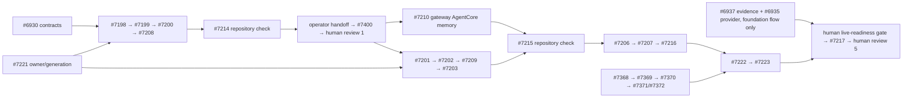

# Chief-of-Staff #6930: native blocker and product-scope audit (D03)

This is a **repository and GitHub issue-graph audit**, not an execution authorization. Compare the authored, inert [v6 product-review graph](../delivery-flow/plans/cos-runtime-7197/revisions/2026-10-11-product-reviews/proposal.authored.json) with native `blocked_by` on each of its 26 story issues. At the reviewed revision the authored graph has 47 nodes and 147 edges; the server adds/preserves its original acceptance gate. The graph is acyclic. The v6 [submission](../delivery-flow/plans/cos-runtime-7197/revisions/2026-10-11-product-reviews/submission.json) is registration evidence only; read the current server base again before any further edit.

## Native blockers and graph edges

| Boundary | Native blockers and graph result | Owner and remaining condition |
|---|---|---|
| #7202 → #7209 → #7203 | #7202 is blocked by #6930, #7221, #7201, **not** the former reverse #7209/#7210 dependencies. #7209 depends on #7202; #7203 depends on #7209. These edges exist in the authored graph. | #7202 owns the additive `crew_checkpoints` migration, upload API/helper and recovery pointer; #7221 owns the stable executor inventory/generation; #7209 owns capture/end/restore orchestration, #7203 owner sessions. One control database and one migration owner, no second executor inventory. |
| #7210 shared memory | Native blockers #6930, completed #6932 and live review #7400; the graph contains #6930/#7400. Completed #6932 is external history, not a missing executable node. | #7210 owns gateway AgentCore adapter and migration from existing scoped memory, separately from #7202's backup/metadata. It may progress without waiting for Crew backup; #7400 live gate remains necessary. |
| #7214 runtime repository evaluation | Native blockers include #6930, #7198/#7199/#7200/#7208, #7221, #7283 and #7172–#7175, all represented as direct graph inputs. | Evaluation owners execute source-specific checks; repo evidence cannot satisfy the later operator deployment handoff or EP-01–EP-06. |
| Closed foundation prerequisites | Native blockers not drawn as direct v6 edges: #7198 ← #147/#6931; #7221 ← #147; #7172 ← #6933/#6934/#6936/#6939; #7173 ← #6931/#6939; #7174 ← #147/#6931/#6939; #7175 ← #147/#183/#6939. Every omitted issue was **closed** at audit. | Preserve their merged receipts, do not reschedule or claim they qualify live behavior. If any is reopened or its receipt invalidated, reconcile the graph before authorizing dependent work. No other native blocker of the 26 story nodes was missing from direct issue-bearing graph edges. |
| Foundation qualification | #6937 remains open in the separate foundation flow; its 11 passed foundation nodes and pending criteria stay there. #6935 remains open despite its passed foundation node: its installed-record provider gap still needs resolution. The v6 `foundation-receipt` gate references both and feeds final live readiness; it does not dispatch either story again. | Foundation evidence owner #6937; provider owner #6935; runtime flow author #6930 consumes their dated, version-compatible evidence at a human gate. No second qualification owner. |
| Deployment and host | #7283 supplies explicit deployment conditions. Existing #7368 → #7369 → #7370 → #7371/#7372 feed #7222/#7223. #7214/#7215/#7216/#7223 are repository evaluations; #7400–#7403 and #7217 require verified targets and operator handoffs. | Operator binds target, exact workflow/source/image/schema revisions, fixtures, spend/time limits and cleanup. Named-dev CD is not engine permission; source merge, code-only budget or an inert gate cannot authorize cloud spend. |

Representative dependency DAG (the linked proposal is the full authoritative address/edge inventory):

The diagram omits intermediate operator/live/product gates for readability; **it does not bypass** the four staged reviews or original acceptance gate in the saved flow. Shared ownership and gate receipts are explicit in the v6 [review contract](../delivery-flow/plans/cos-runtime-7197/revisions/2026-10-11-product-reviews/review-contracts.json). A graph edge is not a successful check or a deployment.

## Retained full-product scope: not executable in this runtime graph

#7197 cannot close on EP-01–EP-06 alone. #4964 is closed as superseded, **not accepted as delivered**. The following bounded decomposition is owned by **#6930's author before any later product-flow amendment**. The named shared issues supply existing capabilities; they are not automatically completed child stories of #7197. Create/review properly linked bounded children with independent tests and explicit product gates before adding executable graph nodes. Until then these rows are **open planning gaps**, not green criteria.

| Bounded missing result and negative check | Reuse / accountable planning and implementation owner | Required evidence before product acceptance |
|---|---|---|
| Activate, pause, resume and remove the user-owned assistant with versioned preferences, goals, consent, source/action settings and budgets; revoked membership or old preferences cannot authorize later work. | #6930 author decomposes; shared user-agent lifecycle and #1287 personal-context owner integrate. | Repository lifecycle/denial tests; deployed owner walkthrough and removal receipt. |
| Retrieve governed context with citations, revisions, freshness, coverage and explicit correction/forget precedence; cross-owner, stale and restored-deleted content must not leak or reappear. | #6930 author decomposes; #1287/#1283 personal context, #1345 knowledge and #7210 memory owners implement their distinct stores. | Source/coverage oracle, export/delete and late-ingestion negatives across gateway and supported assistants. |
| Delegate a bounded task from a user goal, approve consequential actions, inspect task/run/attempt progress and verify outcomes; interrupted/unknown-effect retries must not duplicate actions or approvals. | #6930 author decomposes; #4912 jobs/approvals and #7245 tools/credentials owners supply shared services. | End-to-end goal → delegated task → verified outcome → correction → later-session status, with cancel, retry and budget negatives. |
| Continue from a supported terminal client with the same bounded cited context, corrections and current owner authority; terminal recall must not replay approvals or obtain another client's private session. | #6930 author decomposes; #1283/#1345 context and #7245 client-tool owners integrate. | Independent ADP/terminal recall comparison, authority-denial and correction regression at bound revisions. |
| Schedule limited follow-through by timezone and quiet hours, deduplicate notifications and stop after pause/revocation; no unrequested provider integration is assumed. | #6930 author decomposes; reuse shared trigger/jobs/approvals under #4912. | Deterministic clock/timezone checks, duplicate/revocation negatives and deployed opt-in review. |
| Agree comparative pilot thresholds and bound rollout/rollback, matched tasks/model, time/spend and held-out cases; a source-only performance pass cannot stand in for measured product benefit. | #6930 author and product reviewer define acceptance; #7175 owns runtime baseline, operator supplies live target/limits. | Accepted pilot measurement and human-readable result review with attributable costs and cleanup, separate from #7217 runtime qualification. |

Audit method: query `gh api repos/aws-e/adp/issues/<N>/dependencies/blocked_by` for each graph story, compare issue-bearing incoming `from_address` edges, and check any omitted blockers' native state. Validate all edge endpoints and run a topological sort; group evaluation/gate prerequisites separately because a human gate is **not** an issue blocker. This is a dated source/issue check, not evidence that those checks ran on an installed service. Recheck native state and saved-plan version when registering D04; later issue edits may invalidate this snapshot.
