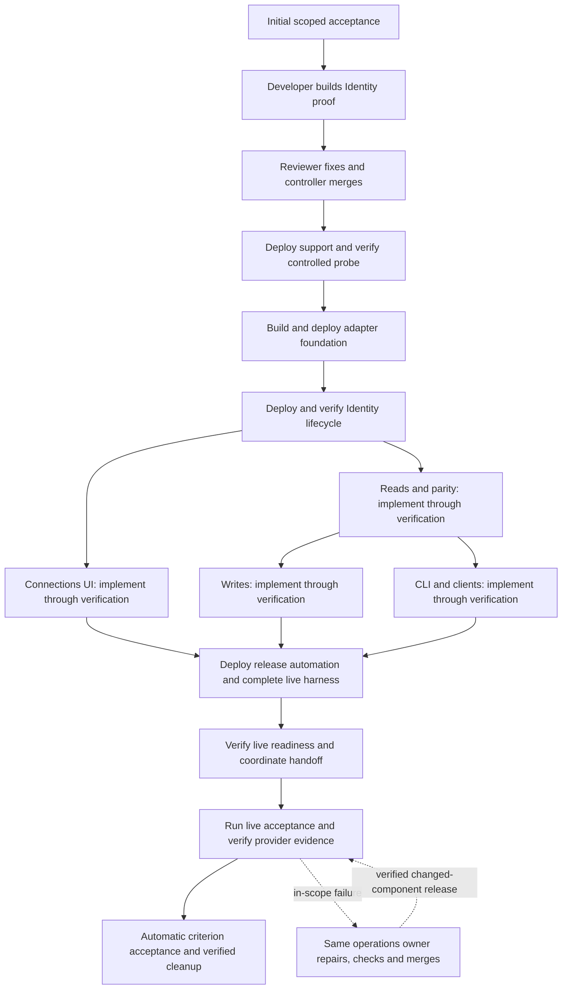

# Autonomous delivery flow: Atlassian and shared adapters #8445

> **Current execution strategy:** [Complete code, then qualify one compatible release](batch-completion.md). The sequence below describes the original flow design, not the current deployment state. PR tests, review and CI precede the protected release; runtime acceptance belongs to the combined final campaign. For the two shared Jira identities, follow the [release and verification guide](shared-jira-release.md).

Prepared for [epic #8445](https://github.com/aws-e/adp/issues/8445), revised
2026-10-21 for autonomous execution based on the agents' actual capabilities.
The original replacement draft and archived two-action draft are historical
registration records, not a statement that execution has not started. See the
[registration record](submission.json). Shared Jira implementation is merged in
[#9278](https://github.com/aws-e/adp/pull/9278) and
[#9427](https://github.com/aws-e/adp/pull/9427); a merge alone does not prove
that Forge, the adapter and the installed CLI serve the same release.
Architecture remains [design v5](../../../tools/atlassian-mcp-contract.md).
Engine/agent source was inspected at `c8c42938888bcec577965d517acaeb7ff86d4914`.

After initial scoped acceptance, agents own implementation, review/repair, merge,
deployment, live verification and cleanup. Stage progression and final evidence
acceptance are automatic. Human intervention is reserved for a real external
prerequisite or a change outside the accepted authority. The
[agent capability audit](agent-capabilities.md) identifies supported tools,
limits, authority and the small integrations still needed. It is the basis of
this plan; a green JSON preview alone does not establish autonomy.

Development uses agent-generated test data; live provider access is discovered,
not assumed. See the [test-data strategy](test-data-strategy.md) and the
[stage-by-stage verification table](#stage-by-stage-verification).

## Execution order

| Stage | Existing owner and execution | Required handoff |
|---|---|---|
| `w01` | #8446: Codex developer, then Codex reviewer/controller | Reviewed probe/dispatch implementation and existing Tools/Gateway CI. |
| `w02` | #8446: operations deploys the bounded proof support; protected workflow runs generated probe cases | Verify controlled AC-01–03 phase coverage, deployed proof support and cleanup. Authenticated provider compatibility remains pending until access exists; it gates activation, not foundation development. |
| `w03` / `w03b` | #8447: developer/reviewer, explicit core bootstrap then adapter operations | Deploy minimum release/receipt/stage support before the adapter; verify setup/recovery, shared deployment/evidence lease, fixture isolation and the deployed standalone foundation. No #8453 reverse dependency. |
| `w04` | #8448: developer/reviewer plus existing deployment lifecycle | Deploy Identity lifecycle/admission changes and verify current owner/site authority before dependent work. |
| `w05` / `w05b` | #8449 reads and #8451 UI: independent developer/reviewer and deployment lifecycles | Both start after verified lifecycle. Each has its own phase evaluator. Verified reads release writes and CLI immediately, even while UI continues. Serialize shared runtime releases. |
| `w06` / `w06b` | #8450 writes and #8452 CLI: independent developer/reviewer and deployment lifecycles | Both start after verified reads. Each deploys and verifies its own phase evidence; neither waits for UI. Release automation joins all three verified leaves: UI, writes and CLI. |
| `w07` | #8453: developer/reviewer plus deployment lifecycle | Deploy release automation; qualify the real operations repair/merge/redeploy path and coordinated release machinery before handoff. |
| `w08` | #8454: developer/reviewer plus deployment lifecycle | Install the full live harness and durable continuation/cleanup consumers. Construction evidence does not accept later live clauses. |
| `w09` | #8453: six sequential operations components | Verify/publish core, facade, interceptor, frontend, adapter and platform; verify actual provider/Identity and parity prerequisites before moving all four routes together; retain the final owner through live qualification and repair. |
| `w10` | Protected workflow and machine evidence reader | Verify the full existing live contract, exact release, provider effects and cleanup. |
| `w11` | Machine rollup and idempotent completion consumer | Require every original story AC and EC-01–06, compatible evidence and cleanup, then close eligible issues automatically. No final human evidence gate. |

Repair arrows describe the existing operations lifecycle, not graph cycles.
The revised authored DAG has **32 nodes, 60 edges and 14 waves**, with all 14 native
story dependencies preserved. It has **14 machine evaluations and no human
evaluations**. Registration adds the single initial acceptance gate.
The nine existing stories remain the requirements owners.

Only #8446/#8447 bootstrap build nodes use `code_only`; mandatory operations and
machine proof follow them. The seven later development nodes use the existing
full delivery lifecycle, including deployment and runtime verification. Issue
closure still waits for all its live obligations. Reviewers accept current code;
they are not asked to perform deployment acceptance outside their capability.

## Parallel execution

The revised proposal permits **three concurrent story actions**, the maximum independent
story set in this DAG. After lifecycle verification, reads and UI start together.
As soon as reads pass their own evaluation, writes and CLI start; UI can still be
running. UI, writes and CLI each publish separate evidence before the release
automation join. Wave labels group work; graph edges determine readiness, so
`w05b` does not have to finish before `w06` or `w06b` starts. Existing `w05-reads-ui`
and `w06-writes-clients` addresses are retained for the reads and writes lanes;
their display titles now describe their narrower scope.

| Work | Parallelism and release condition | Collision prevention |
|---|---|---|
| Implementation, CI and review | Reads + UI first; then up to UI + writes + CLI. Each lane progresses on its own evidence. | Separate branches/worktrees. One owner for shared contracts and each file change; rebase and rerun affected CI before protected merge. CLI owns launcher/config files, UI owns presentation, writes owns adapter/journal changes. |
| Generated phase checks | Independent suites may run concurrently when each has an isolated test runtime and fixture namespace. | Use exact reviewed artifacts, separate databases/identities and run-owned cleanup. Shared runtime checks queue instead of racing. Foundation #8447 supplies the minimum isolation and deployment/evidence lease before the fork. |
| Live client and provider checks | #8454 fans out eligible reads and separate client fixtures inside the existing protected workflow. Schedule from discovered capabilities; unavailable cases do not stop independent ones. | Provider quota bounds, one issue per client, ordered create → read/update/comment/transition → cleanup for each owned fixture. Shared account revocation, outage, routing and rollback cases run exclusively. |
| Shared deployment and verification | Build artifacts and review PRs concurrently; serialize mutations and revision-sensitive observations on the same target. | Existing workflow concurrency is per workflow/component and is insufficient for a cross-workflow critical section. #8447 implements/qualifies the minimum shared lease; #8453 extends it for coordinated release. Verify source ancestry and installed revisions; reverify affected observations after an intervening release. |
| Final component release and cutover | Core → facade → interceptor → frontend → adapter → platform stays ordered. | All six operations share #8453 and the target; the schema requires same-issue ordering. Check actual four-route destinations before reopening traffic. |

Three is a scheduling ceiling, not a claim that three workers are available or a
throughput estimate. The inspected engine counts running story nodes and
reauthorizes review within the existing node; its own machine readers are excluded
from that running-action count. Tenant/worker capacity, Actions runners and provider
quotas still apply. #8447 qualifies the shared lease before dependent development reaches deployment.
Actual three-worker dispatch remains to be observed when the fork executes. The workflow test
fan-out is implementation work for #8454; it is not another flow-level worker limit.
No native story prerequisite, verification gate or live criterion is removed.

## Deployment and automatic live handoff

Use existing deployment workflows and `tools-live-evaluation.yml`. No new
standalone workflow or scheduled maintenance window. Foundation owns the minimum
adapter release support earlier; #8453 owns the complete coordinated migration.
Explicit operation nodes bind verified predecessor merges through
`operational_release_binding`; all six final operations use the nine story merges.
Repair merge receipts advance the source through the existing verified journal.
Do not guess future SHAs, replay an old release as a fix or accept arbitrary main.

Build and deploy each compatible increment with new routes gated. Exercise
generated data in isolated candidate runtimes; collect available live evidence
separately without duplicating real writes. The final route handoff still
moves Atlassian MCP, GitHub, Slack and legacy Jira together. Door, browser,
interpreter and web search retain their runtimes. Preserve grants and operation IDs.

Resolve exact component source/definition/artifacts from receipts; serialize
rollout and revision-sensitive verification on the registered dev target. Observe
matching push deployments before dispatching a missing workflow. Read back actual
images, assets, schemas, recovery consumers and destinations. An unrelated release
invalidates affected observations and requires re-verification.

The operations agent cannot pass arbitrary workflow inputs or run browsers from
its tool surface. #8446/#8447 implement bounded tools-workflow invocation with
server-bound source/definition, gateway revision, phase, requirements and private
fixture references. #8453 uses that path for full post-release qualification.
Preserve provenance and lost-acknowledgement reconciliation; the machine observer
is a reader, not the missing workflow producer.

The final operations owner remains active until required live evidence and cleanup
pass. A runtime-only success must not release that owner while tests are failing.
#8453 integrates this condition and changed-component redeployment with the
existing repair tools; #8454 supplies the runnable checks/reader and completion
consumer. This is planned integration, not an already shipped guarantee.

## Verification and recovery

Every deployable increment follows **develop → review/repair → merge → deploy →
verify**. A green CI run or an agent-written “pass” is insufficient. The following
checks are required design outcomes, not results already achieved. The probe,
stage-workflow integration, full live harness and completion consumer still need
implementation by their assigned stories.

| Check at each stage | Who performs it | What must be established |
|---|---|---|
| Code and CI | Codex developer, reviewer and existing merge controller | The implementation and its checks are reviewed; real required CI passes at the exact revision being merged. |
| Deployed version | Operations and the existing deployment controller | Actual installed artifacts, configuration, migrations and recovery consumers match the reviewed release. A successful deployment workflow alone is insufficient. |
| Product behavior | Operations dispatches a protected workflow; its browser, installed-client and provider drivers execute the checks | Controlled integration uses generated data and the reviewed artifacts in an isolated runtime. Real provider calls require discovered access and separate live evidence. Operations has no general shell/browser or raw provider credentials. |
| Independent evidence | The workflow's independent reader, then the machine repository evaluator | Provider/runtime observations support each required assertion, belong to the correct release and include cleanup. The evaluator reads evidence; it does not dispatch tests or repair code. |
| Failure and progression | The same operations owner, then the machine evaluator | In-scope failures are diagnosed, repaired, checked, merged, redeployed and verified. Only passing evidence releases the next stage automatically. |

Before development, verify repository/CI access and the accepted deployment
authority. Do not require provider accounts, consented second users, projects,
channels or prepared test data. Agents build the missing generators and execute
controlled integration; operations still verifies each actual dev deployment.
Live discovery uses existing authorized connections and records unavailable
capabilities once. It does not ask people to prepare datasets or block unrelated
implementation. Provider-dependent activation and final acceptance retain their
real proof requirements.

### Stage-by-stage verification

These **ten logical stages** map to the existing plan step IDs above: stage 1
includes `w01` and `w02`, while stage 2 includes `w03` and `w03b`. Stages 4 and 5
overlap: reads/UI and writes/CLI have separate evaluators, not stage-wide barriers.
The table adds no acceptance/scenario IDs. AC means an existing story
acceptance criterion; EC means an existing epic criterion. A stage passes only
the clauses due in that phase, not a later live obligation of the same criterion.

| Logical stage and requirement owners | Verification agents can build/run without provider data | Additional live proof when access exists | What advances / what stays pending |
|---|---|---|---|
| **1. Identity contract and probe** #8446, `w01` / `w02` AC-01–03 | Build the probe, capability discovery and generated Identity/provider cases. Check role separation, owner/state/replay handling, SDK error handling, no ADP token persistence, cleanup and deployed probe support. Treat publicly documented schemas as provisional. | Actual consent, authenticated catalogue, token retrieval/restart, real expiry/refresh and supported revocation. | Controlled phase passes release foundation development. Real Identity/Atlassian compatibility remains unproven until the authenticated probe passes; activation stays disabled. |
| **2. Foundation** #8447, `w03` / `w03b` AC-01–04 | Run setup twice against a controlled provider and migrated test DB; count registrations. Inject failure after registration and restart the real recovery worker. Verify competing releases queue under a fenced lease, recover owner loss and isolate phase fixtures. Require `shared_release_lease_verified` and `fixture_isolation_verified`. Boot the adapter independently; verify deployed digest, health, role/network configuration and denial of unauthenticated calls. | Repeat setup/recovery against actual Identity registration with existing authorized access. | Correct deployment and controlled setup/recovery advance development. Real registration proof stays pending separately. |
| **3. Connection lifecycle** #8448, `w04` AC-01–04 | Generate two ADP users, tenants/sites and grants inside the isolated test runtime. Exercise real ADP routes for wrong owner/site, replay, stale generation, reconnect races, disconnect during a simulated outage and cancelled migration. Independently inspect state/dispatch records. | Real user-to-provider binding, site permissions, managed refresh and revocation. A second real identity is needed only for the live cross-account claim. | Controlled ownership/recovery behavior and deployed runtime pass. No human is asked to create a second provider account for development. |
| **4. Reads and Connections UI** #8449 / #8451, `w05` / `w05b` AC-01–05 / AC-01–03 | Generate known issues/pages, search membership, pagination and errors. Exercise real adapter/ADP paths and browser states against controlled external boundaries. Capture legacy expectations from existing source/catalogue; verify names/schemas/grants/receipts with generated responses. | Read one permitted existing or agent-created Jira issue and Confluence page; compare provider IDs/content/version. Run accessible legacy connector cases and the real consent journey. | Reads/parity and UI pass independently; verified reads release writes/CLI without waiting for UI. Missing pages, projects or Slack data do not block it or count as live passes. |
| **5. Writes and clients** #8450 / #8452, `w06` / `w06b` AC-01–04 / AC-01–03 | Generate write state; test exact approval, zero denied effects, lost replies, same-ID recovery, changed-payload conflict and reconciler restart through the real ADP journal. Test client config/bridge behavior with generated MCP data and no AWS credentials. Qualify installed clients/model access separately. | Using an existing authorized project, create one issue per client, then search/get/update/comment/transition and clean up. Verify real named calls and model-facing schema bytes separately for Claude/Codex. | Writes and clients each verify their own controlled phase and deployed artifacts; the release join also waits for UI evidence. Provider effects, actual model calls and the 128 KiB eager-loading bound need their own observations; configuration tests cannot establish them. |
| **6. Release automation** #8453, `w07` AC-01–04 phase clauses | Use an owned dev rehearsal and generated provider data. Exercise actual operations repair → PR → required CI → protected merge → corrected deployment → runtime verification → automatic successor. Test worker restart, lost dispatch acknowledgement, adapter-only selection, partial routing and rollback. | Provider-specific behavior on candidate routes where actual access exists. | Agent execution and real infrastructure receipts prove automation. Jira/Confluence content is not a prerequisite for this rehearsal. |
| **7. Harness and automatic data lifecycle** #8454, `w08` Construction clauses | Assemble generators, drivers, capability discovery, independent reader, durable resume and cleanup. Reject missing/duplicate/stale/forged evidence and synthetic-as-live claims. Interrupt a generated-data run and cleanup; resume without repeated effects. | Automatically discover existing access, create minimal authorized content, run an available connection/read checkpoint and clean up. | Controlled harness/recovery passes without a live account. Each unavailable capability is recorded once in the live ledger, not converted into a setup task for a human. |
| **8. Coordinated cutover** #8453, `w09` Live AC-01/02/04 clauses | Continue gated deployment; read actual six-component digests/config, migrations and consumers. Rehearse route fencing/recovery with controlled data in isolated resources. | Before shared routing changes, verify actual Identity/provider contract, required parity for affected configured routes and rollback readiness. Switch four destinations together; independently read routes and correlate adapter execution. | Missing essential live proof holds activation/handoff only. It does not undo completed development or authorize simulator-backed connector traffic. |
| **9. Live acceptance and repairs** #8454, `w10` Live AC-01–06 | Retain controlled coverage and run every eligible live case as capability becomes available. Repair code and redeploy without waiting for unrelated data. | Eight verbs × two actual clients; legacy inventory; real owner/site/expiry/revoke behavior; adapter outage; rollback/redeployment; uncertain writes; runner loss and provider cleanup. Use minimal agent-created content and bounded resume. | Report available live passes and exact pending cases separately. A partial run never becomes a full-matrix pass or silently reduces the required inventory. |
| **10. Completion and cleanup** All stories / #8445, `w11` 36 ACs + EC-01–06 | Retain reviewed implementation, deployment and controlled-test evidence and cleanup as completed work. | Independently verify every required live clause at compatible revisions, final candidate state, provider cleanup and no unresolved operations/prerequisites. | Full epic completion and issue closure require all 42 criteria. Missing live proof remains explicit; it does not erase delivered code or trigger repeated fixture requests. |

Stage 9's required client matrix is explicit; every catalogue name below is
invoked independently from **both** supported installed clients:

| Operation | Exact tool name | Clients required |
|---|---|---|
| Search Jira | `atlassian___search_jira` | Claude and Codex |
| Get Jira issue | `atlassian___get_jira_issue` | Claude and Codex |
| Search Confluence | `atlassian___search_confluence` | Claude and Codex |
| Get Confluence page | `atlassian___get_confluence_page` | Claude and Codex |
| Create Jira issue | `atlassian___create_jira_issue` | Claude and Codex |
| Update Jira issue | `atlassian___update_jira_issue` | Claude and Codex |
| Comment on Jira issue | `atlassian___comment_jira_issue` | Claude and Codex |
| Transition Jira issue | `atlassian___transition_jira_issue` | Claude and Codex |

### Evidence, retries and completion

[Live testing](live-testing.md) supplies the detailed fixture, failure-injection
and independent-reader contract. It retains all existing scenario IDs, the full
legacy verb inventory and 21 previously specified case groups. Phase reports use
the original issue/AC keys in [story-mapping.json](story-mapping.json), with
`phase_status` and the exact clauses due at that stage. Stages 1–7 explicitly
report `verification_level: controlled_integration`, `fixture_source: generated`,
`provider_live_attestation: false` and `test_runtime_artifacts_match: true`.
The reader checks actual isolated execution and artifact identity; these fields
alone do not prove a pass. Live observations and `pending_live_checks` remain
separate. Earlier stories implement their own phase checks; stage 7 assembles
and qualifies the complete harness. See the [data strategy](test-data-strategy.md).

Every stage records expected/actual values, requirement/source/runtime revisions,
workflow run/attempt, client and fixture versions, independent observation
references, failures/retries, unresolved operations and cleanup status. Evidence
stays private. Passes from incompatible releases cannot be combined; changed
code requires a newly verified deployment and fresh affected-test evidence.

The current live-workflow job limit is 60 minutes. Actual provider expiry can
take longer: persist the qualification ID and fixture ledger, schedule a bounded
follow-up, then resume. Neither a simulated clock nor a sleeping workflow proves
live refresh. Reads use bounded retries; uncertain writes must be reconciled
before retry, retain their original operation ID/payload and must never be blindly
resubmitted. Exact write approval and fixture cleanup remain required.

The independent workflow reader verifies raw evidence and full AC clause coverage.
The engine checks its protected artifact contract. Repository receipts retain
`live_attestation: false`; do not relabel that flag as proof of the product journey.
Machine acceptance is explicitly delegated to the reviewed live reader plus exact
artifact/criterion predicates. Final acceptance requires every original criterion,
not a producer-written aggregate pass. The completion consumer closes issues only
after that machine decision and rechecks current requirement revisions.

For in-scope operational defects, the same operations owner diagnoses, repairs,
publishes, waits for CI, merges and redeploys under the existing accepted tools.
Uncertain writes are reconciled before retry. Required missing/skipped/unknown
results stay incomplete. A repair outside the admitted file/workflow/authority
scope is a named exception; no agent can widen its own grant.

## Historical activation proposal and bounds

The 2026-10-21 proposal described routine review, repair, merge, deployment and
verification and proposed **$10,000 shared, six attempts per lifecycle stage,
three concurrent actions and seven days**. These figures are historical proposal
bounds, not current permission or a completion estimate. Check the actual
accepted policy and expiry before a protected action; provider, Actions and
infrastructure lifetimes remain separately bounded.

At registration time, the draft-edit API rejected inline runtime evaluation definitions,
including those already stored by draft creation. Its response is
`invalid_draft_revision`: “Runtime evaluation specifications require the
evaluation acceptance path.” That binding path requires an active execution
policy and cannot edit an inert draft. The complete plan was therefore submitted
through the supported draft-creation API under a replacement flow slug. Server
preview and registration hashes matched; historical readback confirmed all 14
evaluation definitions, one unanswered initial gate, no active execution policy
and zero executions **at that time**. This is not a current status check.

The public proposal deliberately uses `example-org`, `bind-*` targets and no real
environment connections. For a protected release, privately verify the actual tenant,
registered connection/role delegation, manifests, workflow definitions,
accountable owner, exact repair files and real CI checks. Verify the selected
operations runtime and the automatic handoff/repair path described in the
[capability audit](agent-capabilities.md). Discover actual provider capabilities
before scheduling dependent live checks.
Any unavoidable account-owner consent/policy step belongs to provider activation,
not a prerequisite for all development. Do not add routine stage approvals or
manual test-data preparation.

Verify the installed engine digest and preview the fully bound plan. The original
proposal called for one initial gate; do not infer current gate state from this
archived record. Design PR review and authenticated proof are not fabricated by
the preview. Ordinary successful stage progression never waits
for the user; missing deployment credentials, new scope, revoked authority or
exhausted bounds retain progress with a specific required action. Missing provider data only holds
the dependent live checks and activation; independent work continues.

Artifacts: [proposal](proposal.authored.json), [story/criterion mapping](story-mapping.json),
[agent capability audit](agent-capabilities.md), [live protocol](live-testing.md),
and [validation record](validation.json). The replacement registration changes no running flow,
including the older #8063 flow.
