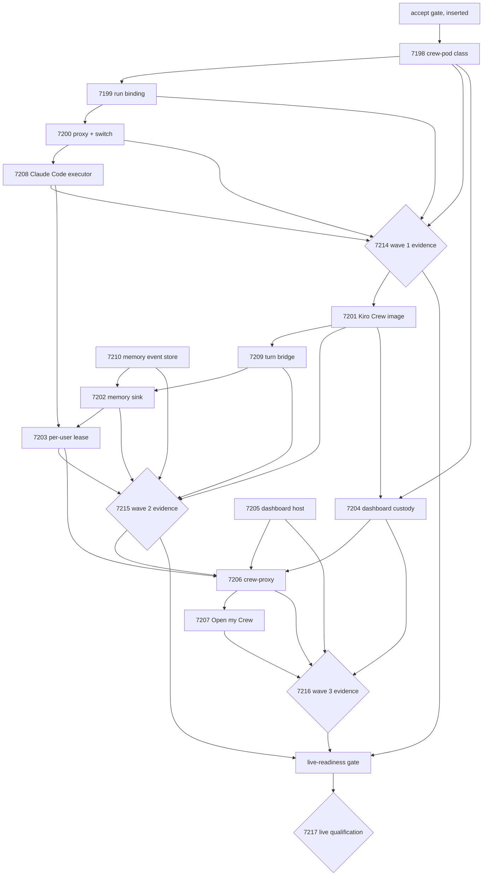

# Engine plan proposal: Chief-of-Staff runtime on the persistent chat worker (#7197)

Current architecture: [Chief of Staff / ADP Assistant](../../../chief-of-staff/architecture.md).
The current registered revision is [v6: five implemented-product reviews](revisions/2026-10-11-product-reviews/README.md),
saved inertly on 11 October 2026 with concurrency five. Its original acceptance gate
remains pending. Working chat, memory/recovery, container dashboard, EC2 and the
integrated journey each require deployed evidence and a human product decision.
[v4 memory recovery](revisions/2026-10-11-memory/README.md) and the root-level v2
artifacts below remain historical records. #6930 retains unresolved architecture
and broader product work.

Prepared 2026-10-08 from epic #7197 (parent #4964; builds on #6929 children #6931 and #147), its
thirteen stories #7198–#7210 and four evaluation issues #7214–#7217. **Plan v2** (replanned the same
day) passes `.github/scripts/validate_loop_proposal.py`: 18 nodes as written — 13 stories, 4 evals,
1 live-readiness gate — and 35 edges; the engine inserts the plan-acceptance gate at
`cos-runtime-7197/epic-7197/runtime/accept`. Validation proves graph structure, not readiness.

## Why v2

v1 had two waves whose evaluations claimed live outcomes under a code-only policy, and a nine-story
first wave. v2 follows the evaluation guidance (see `docs/delivery-flow/README.md` §7a): three waves of
code, each concluded by a **run-only repository-evidence evaluation issue** (human acceptance), then a
**live-readiness gate** and a **live qualification evaluation issue** in dev. Wave 1 alone returns a real
harness (Claude Code) to persistent sessions.

## Sequence

Waves: `runtime` (foundation), `kirocrew`, `dashboard`, `qualification`. Story nodes propose
`agent-codex-developer` with role `develop`; review/repair/merge use the existing controller. Eval
nodes reference their evaluation issue; specifications are bound later via evaluation acceptance.

## Bounds and bindings

`policy-intent.json` proposes $1,500 shared agent spend, 7 days wall clock, 3 attempts per node,
concurrency 2, explicit expiry. Proposed values are not authorization. Unresolved bindings are listed
in `policy-intent.json` and in the stories' prerequisite tables.

## Submission

`submission.json`: flow `9a67bcca-0cb1-4fe1-aa20-ff5b834e45e5`, plan v2 (hash `d48dcf14f84b5624…`),
registered inert; v1 superseded. Nothing runs until the owner accepts the gate.

## Files

- `proposal.authored.json` — plan v2 as filed through the draft revision routes.
- `policy-intent.json` — proposed roles, limits, evaluation acceptance and unresolved bindings.
- `submission.json` — registration record.
