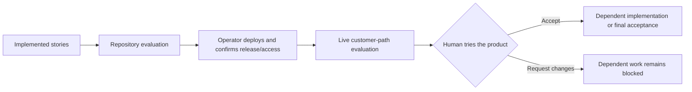

# Chief-of-Staff: five implemented-product review checkpoints

Flow `cos-runtime-7197` is saved inertly as **v6**, replacing v5. The owner requested
human reviews at working milestones, not design/document sign-off. The existing
implementation and repository evaluations remain; four intermediate live evaluations
and five explicit product gates now interrupt delivery before the next dependent stage.

## What the owner can try

| Checkpoint | Repository evidence | Operator deployment handoff → live evaluation | Human decision releases |
|---|---|---|---|
| 1. Working chat | #7214 | Deploy/confirm gateway, chat worker and assistant UI → [#7400](https://github.com/aws-e/adp/issues/7400): real tool execution, persistent conversation/reconnect, owner isolation | **Review working chat** → #7201 Crew profile and #7210 AgentCore memory |
| 2. Memory and recovery | #7215 | Deploy/confirm AgentCore integration, checkpoint DB/S3 and EBS/PVC Crew → [#7401](https://github.com/aws-e/adp/issues/7401): cross-client memory, corrections/deletion, restart/volume recovery and failed backups | **Review memory and recovery** → #7206 dashboard integration |
| 3. Container and Crew dashboard | #7216 | Deploy/confirm gateway/frontend/private edge and container runtime → [#7402](https://github.com/aws-e/adp/issues/7402): Open my Crew, native dashboard, sync status, idle/reopen | **Review container and Crew dashboard** → #7222 EC2 integration |
| 4. EC2 assistant | #7223 | Deploy/confirm existing shared host service/profile → [#7403](https://github.com/aws-e/adp/issues/7403): fresh installation, stop/wake, container–EC2 handoff, costs and ownership | **Review EC2 assistant** → final live-readiness gate |
| 5. Integrated journey | All above; original foundation receipt/readiness | Confirm integrated review release → existing [#7217](https://github.com/aws-e/adp/issues/7217) live EP-01–EP-06 | **Accept integrated chat, container and EC2 journey** → runtime journey acceptance |

The five product gates are named **Human checkpoint 1** through **Human checkpoint 5**
in the graph. [review-contracts.json](review-contracts.json) records their exact addresses,
evidence owners, criteria and downstream holds. No design-review gate was added.
#6930 remains a contract story; its merge alone never establishes a working milestone.

Unrelated preparation can continue: deployment/driver work and shared host preparation
retain their existing dependencies. The **five-action concurrency limit** is unchanged.
Every implementation story ultimately feeds the final product gate. Gate edges are
additional barriers; an issue closing or an evaluator accepting evidence cannot substitute
for the product owner's decision.

## How deployment and review actually happen

Each **Deploy … review environment — operator handoff** node is a human gate. It records
an authorized operator's completed deployment, exact release and working access; **the
node itself does not deploy**. This is the supported external-operator path, not an
unimplemented automatic operations executor. The live evaluator independently checks
that deployment and customer behaviour before the product review becomes eligible.

Use the existing workflow inventory in the
[architecture](../../../../../chief-of-staff/architecture.md#workflow-inventory):
`gateway-deploy.yml`, `chat-agent-deploy.yml`, frontend publication when required,
and the host pipeline delivered by #7369. Do not guess a host workflow name. Existing
workflows expose `adp_approved_revision`, which engine operations workers cannot dispatch.
An authorized operator uses the supported route; automated deployment would need a
separate bounded amendment and supported adapter. Merge-triggered dev CD may supply a
deployment receipt but is not sufficient on its own to satisfy the handoff or product gate.

Before any live run, its operator must bind the real target/connection, exact source and
workflow-definition revisions, deployed component/profile/schema versions, reviewed
scenario commands, ordinary-user fixtures, bounded run/time/spend and cleanup/retention.
This replan grants none of those authorities. Missing bindings keep the live step blocked;
there are no invented commands, test passes, future commit SHAs or deployment receipts.
#7283 and the existing implementation owners supply executable contracts. Managed evaluation
execution additionally requires its supported accepted evaluation specification.

The new issues reuse the existing #6939/#6937 harness and source-specific scenario owners.
They do not dispatch #6937 again. Four stage checks provide early feedback; #7217 remains
the final integrated regression, including all required EC2 and failure cases. An early
memory demo uses deployed ADP chat and another supported unchanged client; it does not
wait for the later native dashboard or claim EC2 portability before milestone 4.

## What each reviewer receives

The preceding live evaluation publishes an access-controlled review pack with:

1. A working ordinary-user entry URL and access instructions.
2. The exact deployed release and a 5–10 minute customer walkthrough.
3. Live results and service/storage/usage receipts, with pass/fail/blocked/not-run rows.
4. Known limitations and reproducible failure/recovery behaviour.
5. Review expiry, costs, fixture retention/cleanup and the next work acceptance releases.

Reviewers use the existing **Approve / Request changes** control and record the pack/release
reference in the decision note. Review access and raw evidence remain private; public
issues can reference the protected pack without publishing credentials or environment URLs.
The existing UI/issue evidence links are reused; no new review dashboard is claimed here.
A document, screenshot, health result or recording alone cannot replace working access.

Keep the reviewed release stable. If access expires, the deployed release changes or
required evidence becomes stale before the decision, the operator restores access and
reruns compatible checks before acceptance. This is an explicit operator/reviewer contract,
not a claim that the engine automatically invalidates old decisions. If a previously accepted
milestone needs reopening, use the supported plan amendment and preserve its old decision.
Request changes holds successors; it does not automatically launch a repair agent.

## Preserved scope, authority and history

The same flow and original plan-acceptance gate are retained. All existing v5 node addresses
remain; the old live-readiness → #7217 edge is replaced by an explicit final deployment
handoff. v6 has **48 effective nodes and 153 edges**: 26 implementation stories, nine
evaluations and 13 gates (five product reviews, five deployment handoffs, original acceptance,
foundation receipt and final readiness). Earlier superseded history remains visible.

Four live evaluation issues #7400–#7403 were created; ten existing issues and five native
blocker sets were revised. Original repository evaluations #7214/#7215/#7216/#7223 remain
technical acceptance prerequisites. They are not product reviews. Stable existing criteria
remain, with new milestone-local live IDs and explicit mappings to the original owners.

The foundation flow retains its 11 passed nodes and sole #6937 execution ownership; #6935's
remaining provider gap still blocks final qualification evidence. No foundation budget is
inherited. Broader lifecycle/goals, delegation, scheduling, terminal continuity and pilot
requirements remain #6930/#7197 work. Final runtime acceptance does not close the whole epic.

[policy-intent.json](policy-intent.json) preserves v5 code actions, $1,500, seven days,
three attempts, concurrency five and expiry `2026-10-22T11:30:42Z`. Only the four additional
human evaluation entries were added to the proposed policy. No `operate` action or environment
connection was added, no policy activated, and no gate approved or live work dispatched.

## Validation and registration

[proposal.authored.json](proposal.authored.json) is the 47-node authored proposal; the server
inserts the existing acceptance gate. [submission.json](submission.json) records actual
version/hash and preview binding. Local schema/DAG and server preview passed. Readback
checks exact saved proposal, gate/history retention and inactive policy. Graph checks verify
all five review barriers and final rollup; GitHub readback checks parent links, dependencies
and issue hashes. Public-doc, local-link and whitespace checks also run before publication.
These checks validate the replan, not the future deployed products.
