# Delivery plan: Product-grounded epic flows

Updated 2026-10-21 for [epic #8394](https://github.com/aws-e/adp/issues/8394).
**Draft only: no delivery flow registered, accepted or started.** The user requested
this staged plan and the supporting stories; design/plan acceptance and live
execution are separate actions.

The outcome is one Product-bound flow, normally delivering an epic in planning
repo C, with native child stories and their PRs in code repos A/B. GitHub remains
the work tracker; ADP orchestrates execution and presents status and evidence.
There is no new Project workflow or Product-to-repository catalog.

## Stages and observable outcomes

Each implementation stage follows **reviewed code → repository/CI evidence →
deploy to dev → integration checks → human outcome review**. The next stage
cannot begin until the previous outcome is accepted. The operator collects the
results; the reviewer assesses a concise packet with links to full evidence.

| Stage | Implementation stories | Deployment/integration owner | What the human reviews |
|---|---|---|---|
| 0 — Dev baseline | Existing fixture baseline; no feature implementation | [MR-15 #8516](https://github.com/aws-e/adp/issues/8516) | Reachable health API on the selected dev target, actual CLI output, independent API assertion, source/image/target and retention record |
| 1 — Product and repository foundation | [MR-01 #8395](https://github.com/aws-e/adp/issues/8395), [MR-02 #8396](https://github.com/aws-e/adp/issues/8396), [MR-09 #8403](https://github.com/aws-e/adp/issues/8403) | [MR-16 #8517](https://github.com/aws-e/adp/issues/8517) | Deployed Product/draft/identity API evidence, denied-input checks, acceptance integration logs and legacy compatibility |
| 2 — GitHub-to-delivery journey | [MR-03 #8397](https://github.com/aws-e/adp/issues/8397), [MR-04 #8398](https://github.com/aws-e/adp/issues/8398), [MR-05 #8399](https://github.com/aws-e/adp/issues/8399), [MR-06 #8400](https://github.com/aws-e/adp/issues/8400), [MR-07 #8401](https://github.com/aws-e/adp/issues/8401), [MR-08 #8402](https://github.com/aws-e/adp/issues/8402) | [MR-17 #8518](https://github.com/aws-e/adp/issues/8518) | Native GitHub hierarchy and ADP UI/CLI, correctly routed API/client PRs, deployed version endpoint and real CLI result, publication/restart recovery |
| 3 — Evidence and corrections | [MR-10 #8404](https://github.com/aws-e/adp/issues/8404), [MR-11 #8405](https://github.com/aws-e/adp/issues/8405) | [MR-18 #8519](https://github.com/aws-e/adp/issues/8519) | Passing exact-revision evidence, required negative cases, a correction in the right repo and a passing deployed retest |
| 4 — Full qualification and compatibility | [MR-12 #8406](https://github.com/aws-e/adp/issues/8406), [MR-13 #8407](https://github.com/aws-e/adp/issues/8407) | Existing [MR-14 #8408](https://github.com/aws-e/adp/issues/8408) | Complete live fault/recovery matrix, legacy behavior, UI/CLI/API evidence and cleanup/retention acceptance |

```mermaid
flowchart LR
  A[Initial plan acceptance] --> B[0: Deploy and verify baseline]
  B --> H0[Human review]
  H0 --> S1[1: Foundation build and dev checks]
  S1 --> H1[Human review]
  H1 --> S2[2: GitHub-to-delivery build and dev journey]
  S2 --> H2[Human review]
  H2 --> S3[3: Evidence and correction build and dev checks]
  S3 --> H3[Human review]
  H3 --> S4[4: Compatibility and full live qualification]
  S4 --> H4[Final human acceptance]
```

The existing 14 medium stories are retained. Four medium operational stories are
added, making 18 native children in `aws-e/adp`. No reviewer-only stories are
created. The parallelism review replaces MR-13's wait for MR-12 with the stage-3
completion dependency, and explicitly makes MR-14 wait for both. There are now
36 native dependencies; 18 of the original 19 feature dependencies remain.
The graph also enforces the human outcome barriers. Native issue closure alone
cannot substitute for the accepted graph's human decision.

## Parallel implementation

The [dependency review](parallelism-review.md) identifies one removable wait:
MR-12 migration/config work and MR-13 qualification-harness work run concurrently
after stage 3 is accepted. MR-14 and the stage-4 code evaluation join both merges.
MR-14 runs the full offline matrix against the combined candidate before final live qualification. Migration tooling/configuration belongs to
MR-12; harness/scenario files and their two workflows belong to MR-13.

Stage build concurrency is **2 / 3 / 1 / 2**, previously **2 / 3 / 1 / 1**.
The graph still peaks at three independent stories; the proposed cap remains four
concurrent actions. A free slot does not override prerequisites or shared-file
ownership. No cross-stage human review is bypassed. This reduces a final-stage
implementation dependency, not a measured wall-clock duration.

## Test setup already completed

See [fixture setup and evidence](fixture-setup.md). The reusable Product exists;
private planning/API/client repos, native epic/story links and agent access are
verified. Baseline CI and local API-to-CLI integration passed. All three developer
agents came online for separate smoke requests; API/client tests passed. Those
smoke runs did not establish dev deployment or Product-bound flow behavior.

The smoke exposed the developer's PR-required completion contract. Two task-board
PRs were closed unmerged; the client run was marked failed despite passing checks.
Therefore inspection/deployment evidence tasks use the operator/operations path,
not a developer invocation that manufactures a PR merely to finish.

Stage 0 supplies the missing dev baseline. It reuses the existing API Dockerfile
and CLI. The operator selects and records the authorized target, workload scope,
image/registry, runtime manifest, owner, expiry and finite limits before applying
anything. This plan does not invent credentials or add a provisioning platform.
An actual fixture code/workflow defect is repaired in that code repository.

The prepared sample epic asks for a version endpoint in A and its CLI command in B.
Those feature stories remain unstarted until stage 2. For repeated delivery or
ADP intake/link-recovery tests, use fresh run-owned issues; do not pretend that a
completed sample story is new work. Pre-created GitHub links do not prove ADP's
own authoring path, so stage 2 includes a fresh intake/CLI publication case.

The prepared Product and repos are **pre-existing reusable inputs**. Record their
actual IDs in private run config and verify actor access on the selected target.
A consuming run must not delete them. Inventory new dev workloads, temporary
issues/branches and fault fixtures separately, with ownership and cleanup rules.

## Engine representation and bootstrap

The authored proposal uses the current engine contract to implement the feature.
It does not inject an unsupported `product_id` into its own legacy plan. After
compatible implementation is deployed, stage 2 creates actual Product-bound
fixture flows using the retained Product. Preserve the implementing flow's
accepted bytes/hash and legacy Product absence through every intermediate rollout.

Stage 0 is an operator task linked to MR-15 and represented by a **human evaluation
node**. The current engine has no general human story executor or qualified runtime
receipt for this sample API, so the proposal does not invent either. The operator
performs the deployment/checks described in #8516 and supplies evidence before the
reviewer accepts this node. It is an explicit manual step, not automatic dispatch.

Stages 1–4 each have a build wave and a live wave. The build wave's machine
repository evaluation verifies reviewed merges and required checks. The live wave
has the existing supported operations executor plus a human evaluation. Its
`runtime_verified:gateway-backend` receipt covers that component only: the named
operator still supplies API/client/frontend/CLI and all other required stage
observations. No backend receipt can stand in for the complete outcome packet.

Actual environment connections, release bindings, approved workflow definitions
and receipt handoff must be supplied before activating these operations nodes.
The draft has none of those grants. If the selected deployment requires a manual
operator path, represent that explicitly through a reviewed draft revision;
never force a worker to complete using a fake runtime receipt or a filler PR.

Stage 1 proves the foundation, not a complete user journey. Product/identity
validation and acceptance-persistence tests are required, but any execution path
intentionally withheld until routing readers are compatible stays disabled and
its refusal is recorded. Stage 2 proves the installed end-to-end flow. MR-09's new
evidence adapters remain unavailable until MR-10/11 are integrated in stage 3.

Main merges may automatically deploy via existing workflows. Observe and verify
those releases when they contain the required commits; `code_only` does not disable
push-to-main deployment. Intermediate releases must preserve current consumers.
If a hosting-runtime change alters the pinned repository verifier, review and
accept an amendment for unfinished evaluations; do not rewrite accepted hashes
or disable digest checks. No extra controller platform is introduced here.

## Evidence, review and recovery

MR-01–13 retain their reviewed-merge/pre-merge-AC completion boundaries. Their
stage remains incomplete until its deployed checks and human outcome review pass.
MR-15–18 and MR-14 close only after their stage evidence is accepted. Keep the
epic open until the final review accepts all mandatory outcomes.

Each stage packet records:

- Expected/actual result for every required stage AC, with pass/fail/blocked/not-run.
- Exact implementation, fixture API/client, workflow, image, schema and relevant
  gateway/tick/worker/frontend/installed CLI revisions and tested configuration.
- Deployment/runtime receipt; independent API/provider reads; CLI stdout, stderr
  and exit codes; UI screenshots where that stage introduces a user journey.
- Test selectors, failed attempts, recovery result, run-owned inventory and retained
  resources. A missing required check or unverified cleanup is incomplete.
- An attributed human decision bound to the evidence and tested revisions.

MR-01–12 require Gateway CI's Lint, Test, Frontend Unit Tests and Build Container
at their reviewed PR revision. MR-13 requires Qualification harness unit tests
(offline). Existing branch protections still apply. Green CI alone is not live
proof. Stages 1–4 use the current repository-evaluation/v1 family to check their
own implementation; the new combined family is the stage-3 deliverable.

The final report maps the original 56 child ACs/56 scenarios, the 16 new operational
ACs/16 scenarios, and all six epic ECs: **72 ACs, 72 scenarios, six ECs**. Preserve
original identifiers and earlier attempts. Early stage evidence supports the final
report but cannot replace the final release's full compatibility/fault checks.

A failed check returns to the owning existing story; code repairs use the normal
reviewed PR lifecycle in the repository being changed. Human reviews do not merely
approve queued or failed work. Evidence-only operator tasks do not use the
PR-required developer persona.

**Preserve manual launch of orchestration-live-tests.yml.** MR-13 builds the full
scenario and MR-14's named operator reviews the configuration and launches
preflight/run/resume/cleanup, restoring the originating inventory as needed.
Early stages use existing entry points and targeted procedures, not an invented
second runner or a claim that MR-13's future scenario already exists.

## Proposed limits and remaining bindings

The planning defaults remain $1,500 shared agent execution, four concurrent actions,
three attempts per node and a seven-day window. They are proposals, not approved
spend or an estimate. Refresh the expiry at acceptance. Fixture flows, Actions and
infrastructure need their own finite bounds; the outer flow does not cover them.

Before activation, name the delivery operator and human reviewers, resolve the
actual tenant, and accept the reviewed design/plan and limits. Bind the dev target,
connection/credential authority, workflow definition scope, compatible releases
and rollback owner. Recheck fixture access and Product readback. A node dependency
establishes ordering, not credential authority or release provenance.

The public proposal retains example-org, empty environment connection IDs and
only proposed_execution_policy. Its outer repository scope is aws-e/adp. Stage-2/3
fixture execution requires a separately accepted bounded A/B/C scope. Do not expand
the outer policy implicitly or copy authority from product-onboarding-8141.

## Artifacts and validation

- [delivery-stages.json](delivery-stages.json): four outcomes plus baseline,
  operational ownership and the manual/automatic boundaries.
- [proposal.authored.json](proposal.authored.json): 26 nodes/92 edges; registration
  inserts initial acceptance for 27 nodes/93 edges. Nine engine waves implement
  five visible checkpoints, with four machine evaluations and five human reviews.
- [story-mapping.json](story-mapping.json): all 18 issues, sizes, AC/SCN IDs, stages,
  node roles and 36 native dependencies.
- [validation.json](validation.json): schema/graph/coverage checks and pure server
  preview. Structural validity is not execution readiness or approval.

This supersedes the earlier nine-build-wave/one-final-live-review draft. The
[canonical feature architecture](https://github.com/aws-e/adp/blob/df61f74723fb2d78107166fbf8f5793d463b5445/docs/design/story-bound-repositories/architecture.md)
remains the implementation contract; this bundle updates delivery sequencing and
adds the four operational outcomes. Source/schema reference: 44b8e127deb53d5e014030994b1780f490f747db.
