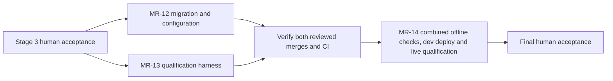

# Parallelism review — epic 8394

Reviewed 2026-10-21 against source `44b8e127deb53d5e014030994b1780f490f747db`
and the staged draft published at `c3318e1d2560cd52b7d6dd1a4248185fb20aa66c`.
This is a draft dependency amendment. No flow registration, worker dispatch or
deployment occurs through this review.

## Decision

Run [MR-12 #8406](https://github.com/aws-e/adp/issues/8406) and
[MR-13 #8407](https://github.com/aws-e/adp/issues/8407) in parallel after stage 3's
human acceptance. MR-13 consumes the delivery/publication/evidence behavior
delivered in stages 1–3; its criteria do not require MR-12's new migration CLI.
Legacy Product absence is already required by MR-01. MR-12 owns migration
classification/apply/rollback and fresh/upgrade configuration tests.

Remove native dependency #8406 → #8407. Add #8519 → #8407 for stage entry and
#8406 → #8408 so final qualification explicitly waits for migration as well as
the existing #8407 prerequisite. The accepted graph's separate human review
edge remains mandatory: closing #8519 alone does not accept stage 3.

The graph retains its 26 authored nodes and 92 edges (27/93 after registration),
five human outcome reviews and four repository evaluations. Native dependencies
change from 35 to 36. All 18 stories, 72 ACs/72 scenarios and six ECs remain.
No acceptance assertion is removed or converted into an optional check.

## Ownership and integration

| Owner | Exclusive implementation scope and handoff |
|---|---|
| MR-12 | Stored-record inventory/dry-run/apply, production compatibility readers, infrastructure/deployment/upgrade config and their migration/rollback tests. Audit the entire reader inventory, but route qualification-package changes to MR-13. |
| MR-13 | `tests/e2e/orchestration/`, scenario/provider/config/inventory/report/cleanup code, and `orchestration-harness-ci.yml` / `orchestration-live-tests.yml`. Preserve the manual live launch. Reuse existing handlers/transport boundaries; do not introduce a second engine or runner. |
| MR-14 | Join both reviewed merges; pin one compatible candidate containing both; run the complete offline lifecycle/fault matrix plus migration/config/rollback regressions before final live qualification. Then perform the existing dev/live checks and human acceptance. |

MR-13 still needs its complete offline AC evidence before merge, including real
gateway/worker entry points with stubs only at external transport boundaries.
Config/preflight tests alone, a scripted successful engine response, or skipped
required cases cannot close the story. MR-12 retains all four existing criteria.
Their combined candidate must pass again at MR-14; separate PR-head results do
not prove integration. Record exact selectors, revisions, failures and recovery.
Missing dependencies or a failing mandatory check block that join. Existing
main-branch workflows may deploy earlier merges automatically; the operator must
verify any already-deployed candidate against the same combined offline evidence
before starting final live qualification.

The delivery coordinator names owners before dispatch and assigns each shared
contract/file edit to one owner. Neither parallel story rewrites the other's
scope. If a production change is needed by the harness, MR-12 supplies it and
MR-13 validates against its reviewed revision; dependent work waits or the draft
is amended. A concurrency slot never authorizes competing ownership.

## Dependencies retained after review

| Dependency | Why the existing completion boundary still needs it |
|---|---|
| MR-01 → MR-02 / MR-09 | Resolver acceptance uses Product/repository persistence; the evidence-contract story's API assertions include the Product-bound proposal. |
| MR-02 → MR-03 / MR-06 | Dispatch and command/tracker operations consume verified repository/connection resolution. |
| MR-03 → MR-04 / MR-05 | Lifecycle recovery and coordinator dispatch consume the frozen assignment and protected dispatch contract. |
| MR-06 → MR-07 | Native issue publication needs verified parent/tracker references. |
| MR-07 → MR-08 | UI readiness consumes persisted issue-created/parent-link-confirmed state. Current publisher records do not yet provide the new link-progress contract; mocks would not prove the required API/UI behavior. |
| MR-04 / MR-09 → MR-10 → MR-11 | Repository evidence needs exact PR lineage and the versioned contract; deployed evaluation consumes complete source receipts and shares controller integration. |
| MR-07 → MR-11 | Correction publication reuses the issue/native-link recovery path. |
| MR-05 / MR-06 / MR-08 / MR-11 → MR-12 | Global configuration cannot be retired until the affected readers and consumers support bound identity. |

Earlier-stage construction stays behind the preceding human outcome review.
Speculative UI preparation can occur outside execution, but is not represented as
a completed, independently dispatchable story. No extra split stories, second
runner, weaker acceptance or speculative cross-stage execution are introduced.

## Graph and runtime limits

| Stage | Before: independent build stories | Revised |
|---|---:|---:|
| 1 — Foundation | 2 | 2 |
| 2 — Delivery journey | 3 | 3 |
| 3 — Evidence/corrections | 1 | 1 |
| 4 — Qualification/compatibility | 1 | 2 |

Peak graph concurrency remains three independent stories; the proposed shared
action cap of four remains unchanged. The tick checks node predecessors rather
than serializing stories by their wave display order. Dispatch selects ready
nodes; policy capacity, per-tick limits, worker availability, work claims and
shared-file ownership may further constrain actual overlap. The graph is an
upper bound, not a measured throughput or a guarantee that four workers stay busy.

Source anchors: `modules/gateway/src/orchestration/tick.py` predecessor/readiness
checks; `dispatch_pass.py::_fetch_ready_nodes`; `execution_policy.py` concurrency
admission; `amendment_issue_publisher.py` current publication state;
`tests/e2e/orchestration/{conftest,run}.py` and existing scenario transport seams.
The code paths were inspected; no feature implementation or live performance test
was run for this documentation change.
