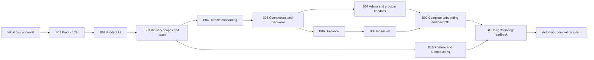
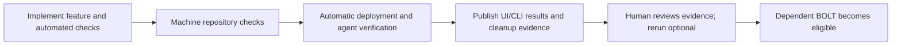

# Product Profile and onboarding delivery flow

**Historical plan and sanitized registration example.** The owner reviewed the
proposal and requested creation on 2026-10-19. It contains the
[filed 11 BOLTs / 38 stories](../../../product-onboarding/delivery/README.md) for
[#8141](https://github.com/aws-e/adp/issues/8141) and its bounded peer integration.
The [public registration example](submission.json) preserves the shape and counts:
75 nodes / 249 edges, including the initial acceptance gate and edge.

Runtime IDs, tenant, exact registration times and plan hash are illustrative,
following [the public documentation policy](../../../PUBLISHING.md). The payload
digest identifies the sanitized public file. These artifacts are not operational
provenance and do not report the flow's current state or accepted authority.
Use the private ADP flow record for current execution, decisions and evidence.

```sh
adp --tenant example-org flow show 00000000-0000-0000-0000-000000000000
```

The reviewed proposal uses a **$2,000 budget and eight concurrent actions**.
The technical binding requirements below remain part of its execution contract;
creation alone does not satisfy them, substitute human gates or relax machine
checks.

One flow can coordinate all of this work. Keep B01–B09 under Product #8141,
B10 under Context #8149 and B11 under Insights #7295 in GitHub. The flow references
their existing story issues; it does not move, duplicate or replace their ownership.
The flow contains only the bounded catalog/Insights integration in these BOLTs,
not the entirety of those peer epics.

## Proposed sequence and what the user gets



Each arrow between BOLTs means the predecessor's **deployed, live-verified outcome
has been accepted**. B10 can progress after B03 while onboarding continues.
B06 and B07 can progress after B05. Their shared files and deployment target must
be reconciled before concurrent work; independence in the diagram alone is not
proof that two changes can safely edit or deploy the same surface together.

| Milestone | Existing native BOLT | Observable outcome | Live verification issues |
|---|---|---|---|
| B01 | [#8229](https://github.com/aws-e/adp/issues/8229) | Installed CLI creates, reads, updates and archives/restores a Product | #8243 API; #8247 CLI |
| B02 | [#8230](https://github.com/aws-e/adp/issues/8230) | Served browser creates/edits the simple three-field Product | #8246 |
| B03 | [#8231](https://github.com/aws-e/adp/issues/8231) | UI/CLI switch delivery scopes while sharing Product identity/team | #8250 |
| B04 | [#8232](https://github.com/aws-e/adp/issues/8232) | Onboarding resumes between UI and CLI with saved progress | #8252 |
| B05 | [#8233](https://github.com/aws-e/adp/issues/8233) | UI/CLI discover, select and verify connections; expose expired/revoked access | #8256 |
| B06 | [#8234](https://github.com/aws-e/adp/issues/8234) | Guidance and direct forms preserve authorized, reviewable choices | #8258 |
| B07 | [#8235](https://github.com/aws-e/adp/issues/8235) | Admin/provider handoffs resume and display the actual outcome | #8261 |
| B08 | [#8236](https://github.com/aws-e/adp/issues/8236) | Financial edits and selective suggestions preserve confirmed amounts/provenance | #8264 |
| B09 | [#8237](https://github.com/aws-e/adp/issues/8237) | Complete UI/CLI journeys and truthful downstream handoff/result status | #8267 CLI; #8268 UI |
| B10 | [#8238](https://github.com/aws-e/adp/issues/8238) | Optional Portfolio membership and Contribution relationships in UI | #8273 |
| B11 | [#8239](https://github.com/aws-e/adp/issues/8239) | Installed Insights CLI reads dated lineage, coverage and deduplicated costs | #8276, including AC-04 |

No new first-save field is introduced by this orchestration. The first useful
increment remains the Product CLI, followed by the browser workspace.

## Human decisions and the BOLT lifecycle

**12 routine human decisions: one initial ADP flow approval and 11 BOLT evidence
reviews.** Remove all 15 authored design/readiness/release/final gates. The engine
still handles code review, findings, repair, re-review and merge automatically.
There are no extra review stories. Exceptional scope/authority/budget changes are
outside this routine count; retries do not create another kind of approval gate.



The business view is 11 BOLTs. Each has two engine waves because merged code and
verified deployed behavior are different completion boundaries:

| Engine stage | Mapping and completion rule |
|---|---|
| Build wave | Existing implementation/contract issues use `develop`. D01 and V01–V13 also build their workflow/check code here. Engine review/repair/merge completes this phase; live criteria remain pending. |
| Repository evaluation | One machine eval per build wave, directly consuming every build story's verified merge/CI evidence. Bind real provider/workflow/check identities and verifier digest before activation. |
| Automatic delivery and live wave | After machine conditions pass, D01/V owners deploy or observe an eligible automatic run, prove its runtime revision, execute actual clients and clean their fixtures. No release-readiness approval. Qualify the automatic receipt handoff described below before activation. |
| BOLT evidence review | One human eval reads the existing V stories' packet and accepts/rejects their deployed outcome and BOLT EC-01–04. Agents have already run the journeys; reviewer reruns are optional. Missing/failed/skipped required results or failed cleanup keep acceptance incomplete. |

The [evidence review procedure](human-checks.md) specifies a short expected/actual
report, UI screenshots/video, CLI commands/output/exit codes, independent readback,
release identity, criterion/run links and cleanup. No mandatory manual demo or
reviewer-owned fixture is required. These requirements are part of the existing
verification stories, not new review issues. B01 combines V01/V03 into one decision;
B09 combines V10/V11. The other nine BOLTs each have one V story.

D01/V story nodes reuse their existing issue identities in ordered build/run phases.
The operation node finishes after execution and evidence publication, allowing its
successor human eval to run; the GitHub story remains open until its BOLT evidence
is accepted. Use `Refs` on implementation PRs. A rejected packet returns findings
to the named delivery owner and preserves prior attempts.

Eval nodes intentionally have no `issue_ref`: accepted-policy managed evaluations
run before legacy issue-worker routing in `dispatch_pass.py`. The mapping names
the existing V issues and qualified evidence ACs; decisions are recorded in ADP
and linked from those stories. Bind these contracts explicitly rather than falling
back to a legacy worker evaluation that requires a separate issue.

D01 #8242 owns B01's rollout; V01/V03 verify the same release. Later verification
owners reuse existing workflows. In B09, V10 owns the rollout and V11 consumes its
receipt. New deployment stories are needed only for demonstrated pipeline/runtime
gaps. Module completion rolls up all 11 accepted BOLT outcomes and the existing
#8141 EC-01–15 coverage, with no additional final sign-off. It does not close the
entire Context or Insights epic.

## Automatic deployment: support and remaining work

Source inspected at main `ecf16bb8de4132249c555df790721f654fcf9cf0` on 2026-10-19.
The deployed engine configuration has not been inspected.

| Source finding | Consequence |
|---|---|
| The proposal schema supports one DAG, ordered issue reuse and managed evaluations | Keep 22 story-containing waves with one eval each, preserving native GitHub ownership. |
| Exact gateway/frontend dev targets permit reviewed main without per-release assistant approval | Remove the previous proposal's blanket protected-workflow approval claim. Use the initially accepted dev scope and automatic conditions. |
| D2 can derive source from merge receipts, observe automatic runs and dispatch admitted workflows; D3 verifies runtime | Bind the actual target/manifest/workflows and evidence paths. Green Actions is not deployed acceptance. Gateway/migration have controller transport; other surfaces need qualified automatic observation or transport. |
| Operations workers cannot dispatch workflows declaring `adp_approved_revision` | Use the authorized controller or matching automatic runs, not a worker bypass or recurring human dispatch. |
| Literal SHA inputs and the typed predecessor-release binding are different contracts; a `node:` edge alone only checks predecessor completion | Require reviewed implementation and D01 live qualification before activating the automatic handoff. Do not claim an edge resolves revisions or substitute human amendments. |
| Machine repository evidence is supported, while live adapters are specialized to other suites | Bind machine code evals; agents run Product checks and humans review their evidence. Do not relabel Product runs as an existing unrelated suite. |
| Catalog placement belongs to C01; Insights read-runtime selection belongs to I23 | Keep actual deployment coverage explicit. B11 requires emitter, read-service and installed CLI proof. |

[automatic-deployment.md](automatic-deployment.md) defines the passing conditions,
existing controller/worker boundary and a bounded platform prerequisite for durable,
verified receipt resolution. D01 owns configuration and first-rollout qualification;
it does not silently absorb a general engine extension. #5411 must reconcile the
prerequisite's owner and include any added work in this budgeted plan before
activation. No new prerequisite issue has been filed in this revision.
This is an engineering dependency, not a human readiness gate. The registered
draft is not ready to activate. Its proposed policy explicitly selects machine
code evaluations; unresolved specifications cannot fall back to human evaluation.
The empty deployment connection list grants no target authority.

## Peer dependencies and lineage

The existing #8153/#8155 design merge is observed as an ordinary repository
prerequisite; there is no separate human design/readiness gate. C01's
reviewed catalog contract feeds I17's contract work explicitly. I17 and I21 retain
their first owned peer-contract checkpoints before dependent code; contract/test
work can proceed before the real peer services are available.

Agents check the following external capabilities before their live integration
checks, using the existing integration and verification story owners:

- B09 live acceptance needs the actual scoped Context #8149 and L5 #8150 handoff
  services, receipts and fixtures. A truthful unavailable state remains useful but
  does not satisfy the mandatory successful handoff scenario.
- B11 live acceptance needs the relevant #7299 emitter and #7304 infrastructure
  capabilities, plus their contract prerequisites. #7299 explicitly depends on
  #7298/EI-S03 Project binding for attributed flow events; unresolved records must
  remain quarantined. Reconcile their current delivery owners and evidence before
  adding work to this flow. Whole peer epics are not implied dependencies.

These peer issues were open at inspection. Open status alone establishes neither
missing implementation nor an available live capability. Before activation,
check existing flows/PR claims: consume already-owned evidence; if an essential
capability has no delivery owner, propose adding its bounded existing issue to this
flow rather than dispatching a duplicate or leaving an unexplained wait.

The current proposal schema does **not** accept `product_id`, `portfolio_id` or
`project_id`. Do not invent those fields or use the Roadmap project ID as runtime
identity. Resolve the authenticated ADP tenant for registration; preserve qualified
GitHub issue IDs, revisions and evidence now. Bind this flow to the real ADP delivery
Project through #7298's supported mechanism when it is available. Completing B11
requires valid Project-scoped source lineage; this graph is not proof that today's
engine already emits it.

## Operating limits

The owner selected a **$2,000 budget shared across the flow's agent execution** and
**up to eight concurrent engine actions**, subject to dependencies and controls for
shared resources. [policy-intent.json](policy-intent.json) records these limits and proposes
one approved dev target and three attempts per stage. The initial execution window
is seven days, the current policy
schema's maximum; this is not a completion estimate for 38 stories. An extension
requires an authorized revision of the same flow, with existing receipts retained.
These limits are recorded in the proposed policy; no permissions are active.
The initial proposed expiry is 2026-10-26 11:36:41 UTC; refresh it before activation
if the engineering prerequisites outlast that window. Separate provider/model, Actions, infrastructure
and fixture bounds must be established for the live runs.

Development/review/repair/merge and authorized operations/deployment/evaluation are
proposed capabilities. Bind the dev authority once at initial flow acceptance;
deploy automatically within it. Serialize rollouts and revision-sensitive checks
on the shared target and use separate run-owned fixtures. The module owner
retains scope/acceptance; #5411 resolves the executor and peer-owner assignments.

## Review artifacts and validation

- [graph.review.json](graph.review.json): historical pre-creation review graph,
  74 nodes, 248 edges and 22 waves
  containing stories. It covers all 38 existing story issues; 14 build/run issues
  have ordered nodes. Its historical unresolved fields are retained for comparison.
- [proposal.submitted.json](proposal.submitted.json): sanitized example of the authored
  registration payload, with an illustrative tenant and expiry and the bounded
  proposed policy. It is not the exact operational submission.
- [submission.json](submission.json): sanitized registration example with zero-filled
  IDs/hash, illustrative timestamps, historical readback checks, proposed limits
  and activation prerequisites. It is not a live receipt.
- [bolt-mapping.json](bolt-mapping.json): each native BOLT, story phase, rollout owner,
  eval node and qualified verification AC. This preserves the live checkpoint after
  every BOLT and makes the two phases of D01/V stories reviewable.
- [human-checks.md](human-checks.md): agent-executed UI/CLI journeys, evidence packet
  and human review procedure, with optional reruns.
- [automatic-deployment.md](automatic-deployment.md): automatic conditions and the
  bounded release-handoff prerequisite with testable acceptance cases.
- [source-manifest.json](source-manifest.json): inspected source revisions, 49 existing
  issue-body hashes, review graph counts and a sanitized registration reference.
  Registration does not claim a deployment or live verification receipt.

Validate the review graph with the existing advisory validator:

```sh
python .github/scripts/validate_loop_proposal.py --authored \
  docs/delivery-flow/plans/product-onboarding-8141/graph.review.json
python .github/scripts/validate_loop_proposal.py \
  docs/delivery-flow/plans/product-onboarding-8141/proposal.submitted.json
```

Local validation checks address/schema rules, dependency cycles, ordered issue
reuse, one eval per story-containing wave, all story mappings and all 11 live
barriers. It does not establish server readiness, policy admission, deployment
authority or successful UI/CLI tests.

The historical proposal requires qualification of the automatic release handoff,
repository evidence and dev/runtime authority, peer/executor scope and a valid
expiry. The single revision-bound initial acceptance controls activation; no
additional design/readiness/release/final human gates are introduced.
