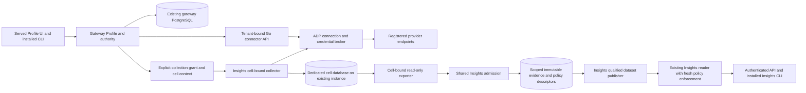

# DevLake connector POC: canonical architecture

Status: **baseline merged in PR #9075; this revision incorporates the owner-requested optional deployment, batched delivery and unattended execution amendments dated 2026-10-27.** Earlier independent review corrections are recorded in [review amendments](review-amendments.md). S01 must still resolve named prerequisites before affected execution. This package completes architecture/design planning for [#8887](https://github.com/aws-e/adp/issues/8887), not the epic's live pilot. No system is implemented, deployed or activated by it. All new interfaces, paths and resources below are proposed unless explicitly labelled existing. This authorization does not approve #7295's requirements gate or rescind the V13 live deferral.

## 1. Purpose, evidence and authority

**2026-11-01 connection-reuse refinement:** ADP already supports GitHub and Jira.
The POC must reuse its current connections and adapter authority; the collector's
basic-auth-only Jira path is an implementation gap. The
[existing-connection integration contract](existing-connection-reuse.md) records
current paths, the required bridge, file ownership and verification. Its detailed
implementation remains under review in #9437. References below to a newly
supported Profile provider describe the optional DevLake-backed path, not a
requirement to create another Jira integration or add a third tool.

The primary outcome is reusable tool connectors for ADP Profile onboarding. Users should connect the selected engineering tools once, discover their permitted resources and enrich a saved Product Profile. The same registered sources may subsequently supply governed engineering evidence, but saving Profile must not depend on Insights. Apache DevLake supplies actual reusable Go provider code and normalized domain models, not ADP identity, credentials, authorization, acceptance or business semantics. Connector reuse must be independently installable and usable with historical collection absent. The owner's subsequent requirement for a deployment switch and separate optional infrastructure is specified below; [optional deployment verification](optional-deployment.md) records the amendment and story coverage.

The authoritative POC design is this file. [Story designs and implementation backlog](backlog.md), [source and deployment audit](audit.md), [requirement traceability](traceability.md) and [verification procedure](verification.md) defer to it. They do not override the existing [Profile architecture](../../product-onboarding/design/architecture.md), [Insights architecture](../architecture.md) or [immutable lineage contracts](../lineage-schema.md). Section 10 explicitly reconciles their planning differences; external owners retain their decisions and gates.

Inspected ADP revision: `aeba89070ec685b41a4902a4441bfe47449e48ba`. Inspected Apache DevLake release `v1.0.3-beta18`: `6502e549f58eb40c40ccbcd39aab9bc8eea6616f`; compared current upstream HEAD `eba2b5b84b0595cec4434500f457aae8d007bcec` on 2026-10-27. The tag is an evaluation candidate, not an adopted supported version. Prior review findings were rechecked against source rather than relying on unpublished documents. Audit references pin these revisions. No live credentials, provider fixtures, database version/capacity, deployed images or current service health were checked. Missing live facts do not prevent this documentation work.

**Provider selection amendments (2026-11-01 and 2026-11-04):** [SonarQube, Jenkins, Argo CD, GitLab, PagerDuty, Linear and Slack](provider-expansion.md) supersede the earlier primary GitHub/Jira candidate pair. S14 owns implementation and fresh acceptance integration; native GitHub/Jira remain compatibility and native-evidence paths. Legacy machine contracts must be migrated by S14 before live admission; their old passes do not prove the changed scope.

**Normalized model clarification (2026-11-04):** Reuse DevLake's actual raw/tool/domain task chain and shared domain types for collection, with ADP retaining authority and lineage. [The source-backed reuse contract](normalization-reuse.md) identifies the converters, tenant boundary, Slack limitation and required proof. Discovery observations are not a replacement engineering data model.

**Bounded scope:** one primary registered Product/Project, seven selected tools, seven primary connections/seven leaf scopes, 30-day lookback, two concurrent collections, 14-day expiry; interactive discovery at most 100 records/page, five pages and 30 seconds per operation. These are ceilings, not completeness guarantees. S01 separately budgets adversarial fixtures: at least two tenants, two Projects within one tenant and shared/private evidence within a Project. At least four distinct cells are needed for that matrix; they do not authorize extra production sources or an increase in simultaneous collections. Budget, fixture identities, accountable people, module/feature catalog IDs and target configuration remain private S01 inputs.

## 2. Components and ownership



| Component | Existing starting point | Proposed responsibility and owner |
|---|---|---|
| Profile and authority | `modules/gateway/src/products/`, `product_onboarding/`, `shared/identity/` | S11 extends typed enrichment; S12 extends scope authority. Gateway retains all transactions, bindings, generations, leases and user-facing progress. |
| Connections and credentials | Gateway `admin/org_connections/`, `auth/`, `internal/credential_*`, vault service | S10 adapts the existing broker with operation-bound delegation; ADP alone stores secrets, refreshes OAuth and mints GitHub installation tokens. |
| Generic Go provider library and discovery | No ADP DevLake service exists at the inspected revision | S09/S10: `modules/connectors/devlake/`, including `cmd/connector-api`, versioned extraction patches and typed adapter packages. Stateless, tenant-bound process; no DevLake connection database or full plugin initialization. |
| Historical collector and normalization | Upstream tasks, DAL, migrations and domain models | S03: `modules/insights/poc/devlake/cmd/collector-worker`; imports pinned generic libraries but owns collection scheduling, checkpoints, source-policy filtering and model-fit reports. |
| Cell provisioning and IAM connection factory | Existing shared PostgreSQL and platform workload admission patterns | S02 owns generic discovery runtime under connectors and cell runtime/infra under Insights, in collaboration with #8375. One authoritative infrastructure state owns each resource. |
| Immutable admission and catalog | I21 adapter, #8374 durable admission; #8373 provenance | S04 contributes DevLake mapping/export, not another admission service. `modules/insights/poc/devlake/` owns POC-specific evidence code. |
| Requirement/test evidence | Existing lineage v1/v2 schemas | S05 supplies missing native capture and exact joins; it neither creates a general acceptance engine nor replaces #7300 distillation. |
| Work/cost and serving | `modules/insights/projection.py`, `results.py`; gateway `insights_results/routes.py`; installed CLI | S06 supplies real publication; S13 extends shared reader authorization. Gateway hosts only the existing bounded integration, not an analytical engine. |
| Build and release | Insights, gateway and frontend CI/deployment workflows; platform image publishing | S09 owns source recipe/provenance. Generic connector workflow invokes connector build code; Insights workflow invokes Insights worker build code. S02/#8375 own separately authorized digest rollout. |

Decision 8 of #7295 applies to **every Insights-specific job, schema, resource and pipeline implementation**. The `.github/workflows/` entry wrappers remain repository workflow entry points; Insights-specific build/deployment logic belongs in `modules/insights`. This corrects S03/S09's former collector placement under connectors. No application files are moved in this design PR.

### 2.1 Optional deployment and connector reuse

The proposed master flag is `FEATURE_DEVLAKE_CONNECTORS_ENABLED`, default `false`. Historical collection has a separate `DEVLAKE_COLLECTION_ENABLED`, also default `false`; its effective value requires the master flag too. These are deployment controls, separate from Product/Project/source authorization and from existing native connector features. Only an explicit case-insensitive `true` enables either flag; absent, empty or invalid values stay off. No implicit enabling through Profile use, image availability, source binding or a shared Insights installation.

| Deployment configuration | Required behavior |
|---|---|
| Both absent/false | Ordinary ADP installation and Profile/native tools work without DevLake images, endpoints, provider credentials or optional infrastructure outputs. A fresh installation provisions no DevLake workloads, roles, DBs, buckets or repositories. |
| Connectors true, collection false | The optional stateless Go connector service supports Profile discovery/enrichment. It has broker access, no DB client, and no dependency on Insights infrastructure, historical workers or evidence storage. |
| Both true | Explicitly install the optional Insights collection extension; current grants, cell policy, IAM/TLS and existing shared-capability readiness still govern jobs. |
| Connectors false, collection true | Reject activation as invalid configuration; effective discovery/collection remain off. Do not install resources, start jobs or silently enable connectors. |

**Dedicated infrastructure:** S02 delivers the independently invoked Terraform root `modules/connectors/devlake/infra/`, module-local deploy/verify tooling, and its own state key `<environment>/modules/connectors/devlake/terraform.tfstate`. It owns only connector workloads/service/namespace, workload IAM and egress policies. S09 owns publication resources in its artifact ledger; the runtime root consumes image digests without adopting those resources. It consumes versioned cluster/network/broker references without managing those shared resources. No nesting under the gateway/core Terraform state and no mandatory invocation from ordinary ADP deployment or upgrades.

Historical cell workloads, IAM/SQL grants and POC evidence integration use a second optional root, `modules/insights/poc/devlake/infra/`, with state key `<environment>/modules/insights/devlake/terraform.tfstate` and Insights-owned deploy/verify tooling. This preserves Decision 8. Reuse the existing PostgreSQL instance and Evidence Lake only when this extension is selected. Gateway metadata migrations and inert integration/configuration code may ship with the normal gateway release; disabled mode must not require a cell DB, external connector startup, or its health checks to boot ADP. Every resource has one state/ledger owner; neither root adopts or destroys the shared cluster, gateway, PostgreSQL instance or Evidence Lake.

The proposed configuration source is the existing protected deployment parameter mechanism: `/adp/<environment>/connectors/devlake/enabled` and `/adp/<environment>/insights/devlake/collection-enabled`. S02 renders the same normalized booleans into gateway, broker and relevant workloads through both gateway workflow and launcher paths. Configuration lookup failure blocks optional activation; it never turns the feature on. Core deployment may continue with the optional integration disabled. Module-only deploy wrappers default to a disabled/skip receipt unless explicitly selected and enabled; absent modules must not require Terraform initialization, module outputs or provider credentials. Enabling a flag does not claim readiness or provision resources by itself.

Expose additive `devlake_connectors` and `devlake_collection` booleans through the existing authenticated `/features` endpoint; frontend defaults are false while fetching, on errors, or when older gateways omit fields. Extend installed CLI capability discovery using existing supported/enabled/permitted/ready semantics. S10 gates gateway dispatch, direct Go calls and broker actions; S03 gates scheduling and collection. Authenticate callers and preserve foreign-scope concealment, then return HTTP 503 with code `feature_disabled` and no automatic retry hint for an otherwise authorized disabled operation. Direct calls cannot bypass the flag, and no provider request, new job or imported mutation may occur. Enabled-but-unavailable remains a distinct readiness failure. Existing native provider implementations keep their behavior; never silently substitute one for a selected DevLake operation.

**Disable lifecycle:** this is deployment configuration, not a promise of instantaneous hot reload. S02's disable procedure closes admission/scheduling, rolls out false flags, uses S12 to revoke module operation contexts/leases and fence active generations, then drains/cancels module work within the S01 deadline. S10/S11 reject late provider pages at Profile commit; S03 stops new requests/persistence and new exports while retaining recoverable sealed evidence. Verify all serving/worker replicas and broker gates before reporting disable complete; a stalled rollout stays incomplete. No replay resumes simply because flags later become true: re-enable verifies readiness, current source permissions, versions and explicit resume/new grants. Connector flag off also makes historical collection ineffective.

Disabling retains saved Profile decisions, connection/vault records and governed historical evidence. It does not run Terraform destroy or convert retained resources to `count = 0`; retained storage may still cost money. Explicit module removal uses the independent finalizer and exact ownership ledger, including retention/hold checks. Finalization, revocation and cleanup remain callable while feature flags are off. An installation that never opted in requires no DevLake cleanup scheduler or artifact publication; after opt-in, keep finalizer authority until owned resources are reconciled.

## 3. Identity, policy and control-plane data

### 3.1 Existing identity is not replaced

Use authenticated `tenant_id`; adapt legacy `org_id` only at existing boundaries. Personal GitHub tenant anchors remain `user-<numeric-id>` and organization anchors remain their registered login. Product/Project identities are resolved through current registry and team visibility, never invented from repository slugs or request bodies. Product, Initiative or Portfolio membership grants no source or evidence access.

An evidence reference remains exactly:

```text
(tenant_id, project_id, source_connection_id,
 record_type, record_id, record_revision)
```

Cell IDs, policy realms, dataset IDs and Product memberships are **not extra identity fields**. A physical copy in another authorized cell remains the same fact. Native provider namespace is encoded by the registered connection/resource mapping, not a numeric ID alone. Preserve distinct source event, record revision, relationship version, mapping version, schema version and dataset version.

### 3.2 Cell authority

A cell is `(tenant_id, project_id, policy_realm_id)`. A realm identifies an immutable version of a compatible **sharing policy expression**, not a snapshot of users. Its descriptor references current source-reader policy and execution-evidence policy authorities. Audience compatibility means that data is releasable under the same declared conditions; equality of today's reader lists is insufficient.

The policy required to read a derived record is the conjunction of all contributing dependencies, including nested references, source payloads, CI reports, artifacts, execution-cost records and mapping facts. An asserted producer classification cannot widen that policy. Unknown classification is rejected before persistence, or sent to an explicitly authorized restricted cell; there is no public quarantine. Mixed private/shared inputs cannot change shared totals, denominators, freshness/coverage markers or pointer/publication status. Rejected private work is recorded only in its restricted operating journal.

S12 extends gateway-owned relational authority. The complete migration inventory is in the audit; inspected models/migrations have Profile bindings/operations/snapshots but no ingestion-cell or policy-realm registry. Proposed tables, with migration numbering assigned against the then-current Alembic heads:

| Proposed record | Minimum data and invariant |
|---|---|
| `connector_policy_realms` | Tenant/Project, opaque realm ID, immutable descriptor revision/digest, policy authority refs, lifecycle, timestamps. Changes append revisions; membership changes are resolved live. |
| `connector_cells` | Tenant/Project/realm revision, opaque cell ID, approved DB/role/object-prefix references, workload/audience, active/retired state, routing revision. Unique cell tuple; no request-supplied destination. |
| `connector_collection_grants` | Existing binding ID/generation, cell, consumer/purpose, explicit source selections, granting actor, policy revision, expiry/revocation. Profile selection alone never grants collection. |
| Operation context extension | Reuse `product_operations` leases/idempotency where applicable; bind context to operation/attempt, tenant/Project/source/cell, purpose, audience, expiry, source generation and current policy epoch. No credentials or raw evidence. |

Use tenant-qualified foreign keys, uniqueness and existing optimistic revision checks. Policy history is append-only; active routing/grant transitions are transactional. Do not reuse a retired cell ID for a new policy. S12 must reject a scope change under an old idempotency key without disclosing the old result. Only an authorized metadata API exposes this state to connector/Insights services; no direct gateway table reads.

### 3.3 Deployment authority is separate

The scope resolver authorizes an operation; it cannot create IAM roles or DBs. S12 accepts with controlled, registered destination references and real gateway authentication before S02 provisions live cells. Workload registration uses existing machine/IRSA identity and capability checks; a header, role name, registry label or service identity alone is not delegation to a user's connections. Storage role assumption selects only operator-admitted roles and verifies the expected workload/tenant/cell/purpose. No wildcard role selector or fallback to ambient credentials.

Proposed S12 metadata API `POST /internal/v1/connector-contexts/resolve` accepts existing binding/operation/attempt, capability/purpose and selected resource refs; authenticated transport supplies actor/workload. It returns `context_version`, opaque expiring handle and non-secret operation/status metadata, not credentials or arbitrary routable destinations. Workload-only context readback resolves that handle to the registered scope/route/epochs. Proposed collection-grant create/revoke operations sit under the existing gateway Project/source binding authority, with expected binding/Profile revision and idempotency key; only explicit authorized consumer selection creates the grant. Errors preserve existing concealment (foreign scope 404), invalid shape 400, expired/stale generation 409 and authority outage unavailable/fail-closed. S12's versioned schema defines exact fields before consumers compile; additive migration precedes activating these routes.

## 4. Discovery and Profile contracts

### 4.1 Extract actual Go provider code

Reuse upstream GitHub `listGithubRemoteScopes` and its installation/user/owner traversal helpers, and Jira `queryJiraAgileBoards` / `listJiraRemoteScopes`, plus necessary pagination/response/model helpers. These functions are currently unexported and their API package initialization wires global database-backed helpers. S09's extraction patch exposes narrow packages with injected `plugin.ApiClient`, config and sanitized logger. It must not import/run plugin `Init` or `runner.CreateBasicRes` merely to discover a board. GitHub installation enumeration must retain its distinct path; a generic PAT call is not equivalent to ADP installation authority.

The earlier baseline proposed GitHub plus Jira. The owner-selected [provider amendment](provider-expansion.md) now requires SonarQube, Jenkins, Argo CD, GitLab, PagerDuty, Linear and Slack; S14 records their actual upstream helpers, authority and fresh acceptance. GitHub/Jira remain native compatibility paths. Existing source credentials and transport must be reused wherever those tools contribute native evidence. No claim is made that raw upstream packages compile independently today.

### 4.2 Interactive authorization sequence

```text
1. UI/CLI calls existing gateway startOnboarding/discoverSources/source binding APIs.
2. Gateway authenticates actor, refreshes tenant/Project/team/source permission,
   verifies If-Profile-Revision and acquires a durable operation lease.
3. S12 issues an opaque operation-bound context for the tenant-bound Go service.
4. Go calls the ADP proxy through an injected provider client, not with a saved token.
5. Broker revalidates workload + context + actor/consumer + connection generation;
   selects the registered endpoint and current credential for each provider request.
6. Go bounds/parses the response in memory and returns one typed page.
7. Gateway rechecks lease, binding generation and current policy, then atomically
   saves the authorized page/cursor/provenance. Late revoked results are discarded.
8. Profile save completes independently of any Insights collection/runtime status.
```

**Proposed internal API** `POST /internal/v1/connector-discovery/pages`: request fields `contract_version`, opaque `context_handle`, `operation_id`, `attempt`, `capability`, optional opaque `cursor`, `limit`; gateway-issued context supplies scope, connection and allowed resource namespace. Neither endpoint URLs nor credentials, DBs, buckets, roles or arbitrary provider paths are accepted. Response: same operation/attempt, `items` (kind, native ID, namespace, typed facts, source revision/digest, observation time), `next_cursor`, `coverage` (`complete`, `partial`, `unavailable`) and sanitized error class. A handle is authorization-bearing and must not appear in logs.

Schema ownership: S10 places versioned JSON/OpenAPI contract with the generic connector library; S12 owns its authority context contract; gateway adapters validate both. The proposed extension to the existing credential proxy accepts only allowlisted discovery/collection actions bound to that context. Broker injection keeps raw credentials out of Go, images and Profile. Provider redirects, pagination URLs and relative paths are canonicalized against the registered host/action allowlist; deny private-network/metadata egress and cross-host redirects. This is not a general URL proxy.

Errors: authentication failures 401; authenticated forbidden operations 403 or existing not-found concealment; stale context/generation/revision 409; unsupported capability explicit 422; upstream throttling 429 with bounded retry timing; source unavailable 503. Never return unauthorized payload or claim complete discovery after truncation. Preserve legacy numeric-page clients through an explicit version adapter. Cursors bind tenant/Project/connection generation, operation, selected namespace, contract version and expiry. Gateway persists cursor state; Go never owns cross-request mutable credential/cursor state. Resume outside the 30-second execution window through a new authorized attempt, not an unbounded request.

### 4.3 Enrichment does not erase user decisions

Extend existing Product source pickers and onboarding workspace; do not introduce a DevLake Config UI. Connection setup returns to the saved ADP session. Resource selection produces existing canonical bindings. Versioned typed facts contain source reference/revision, observation time, coverage and field-map version. Only unique authoritative facts may fill unconfirmed empty fields **when permitted in the shared Profile metadata policy**. Private source content is not copied into the common Product record. Descriptions, inferred ownership and business interpretations remain suggestions; changed observations on confirmed/manual fields create conflicts. Stale `If-Profile-Revision` fails; refresh/unlink fences pending results. Existing financial proposal confirmation is not silently reused for all enrichment types.

### 4.4 Candidate field and semantic map

This concrete source-backed candidate map is part of the design, not verified live field coverage. S01 pins exact provider/auth/version/nullable-field behavior and permitted Profile destinations; it cannot widen the rules below. Tool-local connection IDs/Project IDs remain DevLake ingestion keys, never ADP authority.

| Native input | Typed/common output and provenance | Deliberate limit / oracle |
|---|---|---|
| GitHub `GithubRepo.GithubId`, `Name`, `FullName`, `HTMLUrl` | Repository binding: string native ID, registered installation/owner namespace, display name/URL and observed source revision | Rename does not change identity; namespace permission and resource ID independently checked. |
| GitHub `Description`, `Language`, nullable `CreatedDate`/`UpdatedDate` | Sourced metadata facts, nullable timestamps; optional typed repository-language suggestion | Description is not approved Product intent. Absence stays unknown; no timestamp fabricated from collection time. |
| Jira `JiraBoard.BoardId`, `Name`, `Type`, `ProjectId` | Tracker-board selection, native board/type and native provider-project reference | Native ProjectId is not ADP Project. Do not place board JQL/SubQuery/private source content in common Profile. |
| GitHub issue `GithubId`/`RepoId`/`Number`, `Title`/`Body`, `State`/`Type` | Qualified native issue observation plus title/description and native/common status/type | Preserve stable ID versus display number, original values and source connection. ADP Story/acceptance is not inferred from an issue label. |
| Jira issue `IssueId`/`IssueKey`, `Summary`, `StatusName`/`StatusKey`, `Type` | Same common issue query with source-preserved keys, original status/type and mapping version | Map to DevLake `Issue.OriginalStatus`/`OriginalType` plus common status/type; unmatched statuses explicit. No equal-title cross-tool merge. |
| Both issue tools' created/updated/resolution dates and optional estimates/points | Observed timestamps, native estimate/point units and missingness | Story points and time estimates are not actual cost or measured human effort; cross-tool comparability requires declared units. |
| PR `CreatedDate`, nullable `MergedDate`, `Status`/`OriginalStatus`, `MergeCommitSha`/`HeadCommitSha` | Independent PR cycle-time/throughput population and exact code references | No Jira PR population invented. Upstream PR-to-incident conversion is not production incident evidence and is excluded from ADP qualification. |
| CI summary versus native selection/test reports | Summary stays run-level; direct authorized native reports supply exact v2 test instances/attempts | Missing test-level data stays a gap; a green run cannot produce invented tests or acceptance. |
| Native execution/charge ledger | Qualified work-bound cost with currency, correction revision and actual/estimated basis | No cost generated from points, PR count or bot authorship; unknown actor/cost remains unknown. |

Source models: [GitHub repository](https://github.com/apache/devlake/blob/6502e549f58eb40c40ccbcd39aab9bc8eea6616f/backend/plugins/github/models/repo.go#L30), [Jira board](https://github.com/apache/devlake/blob/6502e549f58eb40c40ccbcd39aab9bc8eea6616f/backend/plugins/jira/models/board.go#L29), [GitHub issue](https://github.com/apache/devlake/blob/6502e549f58eb40c40ccbcd39aab9bc8eea6616f/backend/plugins/github/models/issue.go#L26), [Jira issue](https://github.com/apache/devlake/blob/6502e549f58eb40c40ccbcd39aab9bc8eea6616f/backend/plugins/jira/models/issue.go#L26), [common issue](https://github.com/apache/devlake/blob/6502e549f58eb40c40ccbcd39aab9bc8eea6616f/backend/core/models/domainlayer/ticket/issue.go#L26), [common PR](https://github.com/apache/devlake/blob/6502e549f58eb40c40ccbcd39aab9bc8eea6616f/backend/core/models/domainlayer/code/pull_request.go#L34). All discovery/enrichment facts also carry registered source reference, exact observed revision/digest, observation time, coverage and field-map version. Provider responses without a true revision use the retained observation digest with explicit observation-only provenance, never an invented source history.

## 5. Historical collection, IAM and raw storage

### 5.1 Collection admission and persistence

S03 starts only when both deployment flags in §2.1 are effective, with explicit collection grant plus S12 cell context from S11 bindings. Disabled scheduling rejects before job creation. It persists a job/attempt/checkpoint before acknowledging submission. A cell-bound worker validates destination and source/evidence classification **before raw rows, HTTP diagnostics, queue payloads or logs are written**. Broker credentials refresh per request; grant/generation and deployment admission are rechecked before each source request and persistence/export boundary. Durable queues carry opaque references, not unclassified payloads.

A cell worker never switches DB/tenant/policy by request field; one process/pool is bound to one cell for its lifetime. PostgreSQL raw/tool/domain tables are mutable ingestion state, not immutable evidence. Preserve native status/type/value next to common mappings, explicit exclusions and unmatched populations. Do not synthesize Story links, source history, production deployment/incident causality or test-level evidence from run summaries.

**Durable handoff owned by S03:** serialize collection generations within each cell; the two-job ceiling permits concurrency across cells. Before every workspace write, all selected DAL/bulk/delete paths must acquire the cell-generation row lock in the same transaction and verify the active generation and collecting state. Migration-owned guards enforce this on all worker-writable tables, including dynamic raw tables. A lease alone or a process-local mutex is insufficient: takeover advances the durable generation under the same lock, so a stale writer cannot commit afterward.

At collection completion, stop scheduling and drain tasks, then call a migration-owned sealing routine. It locks the generation row, rechecks completeness, source grant/policy and the S01 byte/row limits, and copies the bounded native payloads, normalized values, exact relationships, source revisions/times, binding generation, mapping/schema revisions and policy closure into proposed cell-local `collection_batch_items` and `collection_batch_manifests`. Each item has a stable batch-local key, exact bytes and digest; the manifest pins item count/order and a content digest. The copy and transition to `sealed` commit atomically. The routine reads a stable workspace because every writer uses the same generation lock. Only this commit makes the batch exportable; incomplete/over-budget batches never report completed.

Ordinary workers cannot directly insert/update/delete sealed data; exporters have SELECT only. The migration-owned routine permits one seal per batch ID and rejects different content on retry. Lifecycle/acknowledgement state is separate from immutable payloads. A crash before seal commit leaves an incomplete generation to resume or explicitly abandon; after commit, retries read the same sealed bytes. Later generations may update/delete workspace rows without affecting sealed batches. Staging remains inside the same policy cell with the same retention restrictions. Normal retirement requires authenticated admission acknowledgement matching the complete manifest plus the approved retention rule; terminal abandonment uses the explicit finalizer disposition in §9 and never records successful admission.

S03 defines merged-PR throughput as the number of distinct native PR identities merged in a fixed half-open UTC interval, and PR cycle time as merge timestamp minus creation timestamp for that population (excluding invalid/missing timestamps with explicit restricted-scope quality reporting). Keep decimal/duration rounding fixed in S01. Jira work contributes common issue entities, not fabricated PRs. Two-tool model comparison must distinguish overlapping concepts from provider-only populations. DevLake/DORA dashboard labels are not ADP outcome qualification.

### 5.2 PostgreSQL on the existing instance

Choose database-per-cell with three non-superuser roles: migration owner, collection writer and read-only exporter. Reuse the existing PostgreSQL **instance**, never ADP gateway tables or credentials. Revoke `PUBLIC CONNECT` and public schema creation on owned cell DBs; grant CONNECT only to approved roles, schema/table/sequence privileges by job, and default privileges for future tables. Writer/exporter cannot become migration owner or another cell role. Disable role inheritance across cells, extension/server-file/network escape capabilities and unused public functions. For legacy databases, verify that cell roles cannot access protected schemas/objects/roles even if a legacy PUBLIC CONNECT grant permits login; do not claim every legacy login fails.

S09 supplies a versioned schema manifest for the selected raw/tool/domain tables, dynamic table-name rules, generation guards and batch staging/routines. S02's migration-only runner resolves registered scopes into exact allowlisted table names, serializes provisioning/upgrades and records the applied manifest digest before admitting jobs. Patch upstream `ensureRawTable`/`AutoMigrate` and equivalent selected runtime DDL paths into read-only schema/version checks. Missing/incompatible tables or guards return `migration_required` before provider requests or data mutation. New scopes needing new tables wait for a migrator receipt; workers never inherit migration credentials or schema ownership. The restricted sealing routine has a fixed search path, qualified objects, no caller-supplied SQL and narrowly granted EXECUTE. S02 proves CREATE/ALTER/DROP denied to workers; S03 proves first-run/new-scope collection succeeds after migration and fails safely before it.

IAM grants exact `rds-db:connect` resource IDs and DB usernames; IAM does not constrain the SQL database name or grant table access. DB grants must independently deny foreign-cell and ADP object access. Operator validates exact account/role, existing engine/version and IAM support under the canonical deployment procedure before any target operation. S01 must budget total connections across roles/jobs and the shared database headroom; S02 must stop rather than relax the bound.

Every deployed DB client uses the selected workload's renewable AWS SDK credential provider and generates an IAM token on **new physical connection establishment**, not startup or Pod restart. For Go, patch/inject a `database/sql` connector using the pinned pgx driver's per-connect hook, then pass that handle to GORM's PostgreSQL dialector. The exact pgx API/version is checked by S09's package build; no driver upgrade is assumed. Require the RDS CA bundle, hostname verification and TLS (`verify-full` equivalent). Remove password DSN/environment/config fallback in deployed artifacts; token error messages must not include a connection string. Reconnect tests include sessions older than 15 minutes and refreshed STS credentials. Existing gateway asyncpg password callback is a reuse pattern, not proof for Go or Alembic.

| Client | Selected POC treatment / proof owner |
|---|---|
| Tenant discovery API | No database client at all. S09 startup/package test without DSN; S10 provider trace. |
| Go cell worker and its task/DAL pools | S02 patch the shared new-connection factory and audit secondary factories; S03 uses it exclusively. |
| Go migration runner/bootstrap DB client | S02 same renewable factory, migration-only role, advisory serialization and version receipt; no shell password export. |
| SQL exporter / dataset SQL readback | S04 read-only cell connection through qualified factory. If integrated in worker image, role/process remains separate. |
| Gateway asyncpg / gateway Alembic for S12/S11 | Existing clients remain IAM in deployed mode; S02 verifies callback/CA configuration, S12 qualifies migration reconnects. Alembic currently constructs a token URL for its engine, so renewal on a later connection needs a hook or a bounded fresh-engine strategy before qualification. |
| Grafana and Config UI | Excluded from initial deployment. Grafana datasource provisioning writes passwords; optional admission needs a separately qualified renewable IAM datasource AND internal metadata DB client if PostgreSQL is used. No exemption for a dashboard. |
| Upstream Python IPC/plugins | Excluded; IPC creates a separate SQLAlchemy engine. Adding any Python plugin requires its own renewable connection path and client proof. |
| Local SQL diagnostics, backup/restore/cleanup tools | Operator-only, ledgered clients; fresh IAM on every new session/reconnect, verified TLS, no persistent token file. Shared managed backups are retention dependencies, not POC-created clients. |

S09 records package/image closure so excluded components cannot quietly start through an upstream entrypoint. Static discovery of every tracked build artifact and database callsite is preserved in the audit. It does not substitute for compiling or running the selected custom images.

### 5.3 Storage and network isolation

Use cell-specific IRSA/workload roles. Generic discovery has only broker access, no DB/S3/KMS authority. Each worker/migrator/exporter has exact role trust, DB user and cell object prefixes. Only trusted routing resolves destinations; no broad ambient Insights role is used as fallback. Namespace isolation and NetworkPolicies are defense in depth, not the tenancy proof; inspect the union of effective policies, including #7316's additive-policy risk.

Retain the existing Evidence Lake bucket and layout prefix, with proposed policy-qualified suffix `assurance/v1/tenant=<tenant>/project=<project>/insights/cells/<cell>/...`. Immutable evidence keys include record/mapping versions and digests; manifests pin actual S3 object version IDs/checksums. S04/#8375 jointly version this suffix and admission descriptor; old paths remain read-only under their existing compatible policies.

Scope S3 list to exact cell prefix and Get/GetObjectVersion/Put to exact allowed objects/prefixes; deny overwrite of accepted identities using conditional creation and verified immutable comparison. Evidence retention and S3 versioning do not themselves prevent malicious new versions; readers require the manifest's exact version/hash. Existing component-wide emitter/distiller policies cannot serve as the cell isolation boundary. A dedicated cell workload must have no ability to assume a broader shared role.

Scope KMS to exact key and S3 service, with compatible encryption-context conditions. Existing bucket keys use a bucket-level context, so an object-prefix encryption-context restriction cannot simply be added and claimed effective. Proposed POC cell writes disable bucket keys and bind object ARN context, validated with actual encrypt/decrypt negatives; alternatively an owner-reviewed per-cell key strategy is required. Bucket policy, key policy, IAM boundary and any session policy must all agree. Actual DB, S3 object-version/list and KMS negative probes use the deployed workload identity, not an admin simulator.

## 6. Immutable admission and exact lineage

S04 exports only S03's durable sealed batch items/manifest, never current raw/tool/domain rows. Before the first page it persists an export job with batch/manifest digest, exact mapper artifact/schema versions, item ordering and checkpoint in the Insights-owned journal; its cell SQL credential remains read-only. Retries use the same sealed bytes and pinned mapper, so B2 edits/deletes cannot change B1. Unavailable mapper versions block recovery rather than silently remapping; intentional remapping creates a separately versioned export. Revalidate current source/grant/policy at export and admission; retained sealed bytes confer no continuing authorization.

The shared #8374 sink authenticates the publisher and revalidates nested reference authority before admission and readback. It commits immutable bytes (or restricted durable quarantine with reason), then the export checkpoint. Crash after object commit but before acknowledgement is reconciled by identity/hash comparison; conflicting bytes at the same identity never become a successful replay. A gap remains explicit and cannot be skipped by advancing the cursor. Completion requires independently verified acknowledgements for the entire manifest; authenticated receipt readback authorizes S03 lifecycle reconciliation, not exporter SQL write privileges. Quarantine remains an explicit disposition, not a falsely accepted fact.

Keep registry admission schema for registry facts; it is not a universal DevLake event envelope. Proposed observation/policy schemas are separately versioned under `modules/insights/schemas/`. Use fixed lineage v1 only when its required semantics exist (Task and Commit/PR require Story linkage). Unlinked native observations stay in the common observation model. Direct native captures supply requirement snapshots and detailed CI data absent from DevLake; they pass the same pre-persistence policy boundary.

Proposed `devlake-observation/1.0` schema carries exact `subject_ref`, original source event/revision or explicit observation-only status, source snapshot artifact/version/hash, native payload plus typed common values, source/effective/recorded/ingested times, mapping version and relation classification. Proposed `evidence-policy/1.0` descriptor separately binds the observation/dataset hash to tenant/Project/cell/realm revision, full dependency refs, policy authority/epoch and immutable descriptor digest. Shared admission resolves/rechecks those refs rather than trusting an embedded list. Schema/mapper revision mismatch is explicit quarantine/rejection; it is not successful empty admission.

S05's chain pins Story revision → criterion revision → scenario/test mapping → intended run selection → planned instance → each result attempt → code/artifact digest → actual environment receipt, plus a separately attributed acceptance assessment. Preserve source IDs and effective/recorded/ingested times; missing history, actor or selection is unknown, not reconstructed from current text. Editing a criterion creates a new unassessed revision. A retry does not erase a failed attempt; a planned instance with no result is not a pass. A development deployment is not production shipment. Private run reports/artifacts/costs retain restrictions through every edge.

## 7. Qualified publication and current read authorization

### 7.1 Publication

S06 selects one intended revision per logical work/charge identity for the declared `as_of` policy, using observed source ordering/correction provenance. First select logical revisions (the first five identity fields), then aggregate full six-field references with existing I22 deduplication. Do not count every historical revision or every realm/Portfolio copy. Contradictory copies of one qualified identity fail publication. Distinct source-native facts are not merged merely because their titles match. Decimal amounts retain currency and actual/estimated cost basis; unknown cost is not zero and estimates are not additional charges.

Keep dated Product mappings, Contributions, allocation versions and original event time; current regrouping is separately labelled. Historical catalog-dependent expansion requires #8373. A quality report separate from the fixed `business_context` schema records coverage/freshness/cost basis, under the exact same dataset audience policy. Preserve unallocated remainder semantics; do not infer hidden values by subtracting a private allocation.

Publish immutable dataset + policy descriptor + quality report, verify all versions/hashes, then compare-and-swap the complete pointer. Persist a pending-publication record before side effects; retry via an owned scheduled reconciler until independent pointer/object readback or terminal restricted failure. A report over 2 MiB, incomplete input, policy mismatch or private-to-shared attempt leaves the prior valid shared pointer **and its visible status** unchanged.

### 7.2 Compatibility choice

The existing gateway loads `results/v1/{tenant_id}/{project_id}/published.json`. It is valid only for one proven compatible audience. Do not reinterpret it as a union of private realms. Proposed v2 internal selector: a gateway-authorized opaque dataset handle resolves `(tenant, Project, realm, dataset_version, descriptor_digest, policy_epoch)` to `results/v2/<tenant>/<project>/<realm>/...`; this is server-owned metadata, never a caller-supplied S3 path. Existing `business_context` response remains unchanged where compatible; additive dataset selection requires explicit API/CLI contract version negotiation. Existing unqualified private/mixed data fails closed. Legacy v1 may continue only after the owner qualifies its audience and descriptor.

S13 introduces descriptor-aware reading and backward-compatible qualification before S06 publishes real data. Its acceptance uses controlled admitted fixtures through the real authority/storage/reader boundary; it does not depend on S06's eventual publisher. This is the deliberate acyclic boundary.

Proposed negotiated read request retains `GET /engineering-insights/v1/projects/{project_id}/results` and existing query parameters, adding `dataset_handle` only with `X-Insights-Read-Version: 2`; installed CLI adds an explicit `--dataset` selector and sends that version. A compatible v1 default remains unchanged. The new gateway acknowledges `X-Insights-Read-Version: 2` in its response; the CLI verifies that acknowledgement before displaying a selected dataset. An older gateway that ignores the new header/selector therefore produces an unsupported-selection client error, never an apparently correct default result. The trusted descriptor determines realm/version, never the handle text itself. Unknown/foreign handles use existing concealed not-found behavior, stale query/cursor shape is invalid request, absent publication remains pending and authority outage is unavailable/incomplete without leaked source details. `results/1.0` business-context response fields are retained when semantically identical; a changed response shape requires a new schema version rather than hidden extension.

### 7.3 Serving sequence and revocation

```text
1. Authenticate viewer; resolve current tenant/Project/source/evidence authority.
2. Resolve the trusted dataset descriptor and its full dependency closure.
3. Obtain cell-scoped storage access; fetch only pinned, bounded objects.
4. Compute the entire bounded response without releasing any bytes.
5. Resolve current authority again from the authoritative services/state, including
   Project membership, source connection/grant generation and evidence policy epoch.
6. If any dependency or epoch is denied/stale/unavailable, discard the response.
   Otherwise commit the final authorization decision and release the buffered body.
7. Reauthorize every subsequent page, historical version, artifact and export.
```

Replace the gateway closure over a once-loaded `allowed` set; another invocation of that closure is not a fresh check. Avoid a long-lived repeatable-read transaction hiding membership changes. Define the final authorization decision as the release linearization point: revocation committed before that decision must prevent release; revocation afterward prevents subsequent reads but cannot recall bytes already sent. S13's deterministic barrier revokes during load and verifies zero response bytes before the final decision. Keep authorization epoch/version in the audit without exposing private policy membership.

Cursors/cache keys bind viewer, tenant, Project, full policy epoch, dataset/descriptor version, query/as-of and contract version. Cache hits still authorize current dependencies; old cursors never confer read authority. No direct presigned downloads whose lifetime bypasses the required final access check; bounded protected downloads/exports use the same server-controlled path. Authority outages fail closed. Deny the affected report without leaking hidden source IDs/counts; do not silently return a partial aggregate or reveal private-source presence through shared status.

## 8. Build, deployment and compatibility ordering

S09 creates source locks for upstream commit, extraction patch digest, customization commit, Go/OS/base image digests, dependency locks, plugins and target architecture. The release also pins the schema manifest, dynamic name rules and patches removing runtime DDL; later consumer patches update this manifest through the same pipeline. Two clean builds must contain the same declared code and dependency closure; bit-identical OCI images are not assumed. Preserve upstream LICENSE/NOTICE. Produce SBOM/license/secret scans, tests and signed/verified provenance as supported by the existing publisher. Publish immutable ECR artifacts and resolve them by digest; no deployable receipt after failed checks or interrupted upload. S02 never builds source in Pods.

Deploy only after existing target/authority gates, in this order:

1. S01 owner-approved scope/policies/limits and explicit optional mode; S09 build baseline; S12 gateway authority accepts controlled registered fixtures independently.
2. Operator selects the dedicated connector module and admits exact workload roles/boundaries and approved routes. S02 registers and verifies the independent finalizer/ledger/authority in §9, then installs APIs by digest. Only separately selected collection mode creates owned cell DBs/grants, applies the schema manifest and installs cell execution harnesses. S02 can prove IAM/routing with a bounded harness before S10 provider or S03 history exists; its connector-only acceptance also proves no DB/Insights dependency.
3. S10 provider adapters and broker extension, then S11 gateway/frontend/installed CLI. Profile stays usable with workers and Insights disabled.
4. S03 collection; #8374/#8375 durable admission/runtime handoff enables S04. S12 policy descriptors apply throughout.
5. S05 exact lineage and S13 fixture-qualified serving can progress independently after S04. S06 real publication follows S13; then S07 integration/soak, S08 decisions and cleanup.

Use existing `.github/workflows/gateway-deploy.yml`, `gateway-frontend-deploy.yml`, `insights-ci.yml`, `insights-deploy.yml`, `modules/insights/deploy.sh` and protected workload admission. Current Insights deploy stages are infra/emitter/distiller/verify; there is **no existing POC worker stage or custom connector image pipeline**. S09/S02 add explicit build/rollout entries and receipt contracts; #8375 owns shared changes. Root launcher `--insights-only` is an existing route to shared infrastructure, not a POC installer. No delivery flow is registered for #8887 and this PR does not register one.

Reuse existing gateway/frontend release paths for inert integration and flag propagation. Add proposed manual module wrappers `.github/workflows/devlake-connectors-deploy.yml` and `.github/workflows/insights-devlake-deploy.yml` invoking their respective module-local scripts. Existing `insights-deploy.yml` has a push-to-main trigger, so placing POC files under `modules/insights` must not implicitly activate or provision the extension. S02/S09 require explicit module selection, enabled configuration and operator-admitted target for apply/publication; CI may build/test offline without installing or publishing target resources. No new add-on is appended unconditionally to deploy-all, ordinary updates, shared Insights apply or shared teardown. Collection-extension, connector-only and no-add-on receipts remain distinguishable.

Migration compatibility: additive gateway metadata first; old Profile clients continue using existing sources. Fail closed for unknown authority/descriptor/cursor versions. Mixed-version rollout must not let old readers consume restricted v2 pointers. Retain old schemas/payloads and required dual readers until cutover evidence passes. Quiesce writers, record checkpoint/schema versions and verify backup/restore before destructive migrations; reverting an image alone cannot undo DB changes. Failed provider extraction or dialect tests block that artifact rather than selecting MySQL/password fallback. S07 tests a second pinned upstream revision and restores compatible prior images with retained data; adoption remains S08's evidence-based decision.

### 8.1 Batched POC delivery

The [POC delivery flow](delivery-flow/README.md)
separates source delivery from final story acceptance. Complete compatible code,
focused tests, CI, independent review and verified merges without per-story
deployment gates. Build each changed component once from the final integrated
revision, then run one coordinated release and cumulative acceptance campaign.
Native dependencies remain; predecessor code/interfaces unblock source work,
while every original live AC/SCN remains a later acceptance obligation. Earlier
references to after-deploy checks specify evidence timing, not a demand for a
separate story deployment. Feature issues remain open until their full criteria pass.

The campaign observes default-off absence, proves connector-only Profile use,
then explicitly opts into collection using the already built artifacts. Preserve
the S12 controlled-context, S02 bounded runtime and S13 controlled-admission
boundaries and their functional order. Required flag transitions, aged IAM,
upstream upgrade/rollback and necessary component repairs remain real measured
mutations. Existing shared deployment workflows continue normally; do not freeze
main or overwrite unrelated changes. Source/workflow/image/schema/configuration
receipts must identify a coherent candidate.

S07 owns the shared campaign wrapper, scenario integration, private fixture ledger
and independent reader; each story contributes its own acceptance scenarios.
The flow's file groups name planned ownership and serialize shared writers.
Three machine evaluations using the existing repository evidence reader close
code readiness, pilot acceptance and final recommendations/cleanup respectively. They implement no missing harnesses and confer
no deployment authority. Independent failure/abort/expiry finalization remains
available before first publication/provisioning, outside the success DAG. S08's
normal decision/cleanup follows S07; failure cleanup does not wait for it.

### 8.2 Unattended execution

Follow the [unattended flow contract](delivery-flow/unattended-execution.md).
Before initial scoped acceptance resolve private bindings/consents, actual owners,
rubric, delegated independent review and retention/removal. S01 verifies these
accepted inputs. There are no routine human evaluations, per-wave approval gates,
manual response-field edits or final keep/delete questions. S08 produces reviewed
recommendations against that rubric; later business adoption is outside POC execution.

S09 supplies CI coverage for explicit version-3 repair paths. Operations retains
ownership through diagnosis, checked repair merges, changed-component release
and independent acceptance; it cannot finish on health alone. S07 qualifies the
actual worker/controller repair and restart path, durable checkpoints and the
short-job credential renewal and >=56-hour workflow/engine campaign window before relying on them.
This reserves runner capacity/cost in the launch budget; it does not add a new
deployment stage. Its completion consumer closes matching current issues only
after final machine acceptance. Finalizer authority/ledger remains independent
of the success DAG. Revocation, exhausted bounds and out-of-scope work are explicit
exceptions with authorized cleanup, never fabricated passes or expanded authority.

## 9. Failure, retention and cleanup

| Failure | Required behavior and durable recovery owner |
|---|---|
| Broker/source outage or 429 | Bounded retry-after, explicit partial state; gateway operation or S03 cell journal resumes; no credential fallback. |
| Credential rotation, membership/source revocation | Fresh per-request authority; fence late generation results and revoke contexts; retain evidence under policy, not automatically delete it. |
| DB token/session expiry | Renew on physical connection; no restart/password workaround; migration/exporter/worker individually measured. |
| Crash before/after batch seal or export checkpoint/ack | S03 resumes incomplete generation or reuses committed seal; S04/#8374 reconcile pinned immutable content, never current workspace or skipped input. |
| Publication interruption/reporting failure | Pending record + scheduled reconciliation; prior complete audience-qualified pointer retained; S06. |
| Shared DB pressure/budget/expiry limit | Stop new collection, cancel owned work safely, preserve checkpoints and Profile availability; S02/S03 operator. |
| Invalid policy/storage authority | Reject before persistence and before release; restricted diagnostics only; S12/S13. |
| Partial install, terminal failure, abort or expiry | Independent S02 finalizer requests/drains cleanup even before S07; original failed/not-run outcomes retained. |
| Cleanup interruption or authority loss | S02 finalizer resumes ledger; missing authority stays blocked and escalates to named operator. S08 consumes independent absence/retention receipts. |

Revocation, retention expiry and offboarding are different actions. Inventory raw/tool/domain databases, sealed batch copies/manifests, job/checkpoint tables, temporary payloads, object versions/delete markers, manifests and old pointers, curated datasets, projections, quality reports, API caches, downloads/exports, quarantine, query spill, logs/traces, volumes, registry images, source fixtures and managed backups. Every retained copy has an owner, classification, purpose, retention/hold and expiry; deletion includes old versions and caches, while backup-retained bytes remain inaccessible and expire under the shared backup owner. Do not claim immediate physical deletion from shared RDS backups.

**Independent finalization owned by S02/operator:** use a thin proposed `.github/workflows/insights-poc-finalize.yml` scheduled/manual wrapper invoking `modules/insights/poc/devlake/finalize` through existing protected operator authentication. S09 delivers the bootstrap wrapper/ledger and artifact cleanup before its first publication; S02 adds and qualifies runtime/database cleanup before provisioning. This capability split does not require S02 acceptance before S09. Before the first owned resource creation, register the pilot, pinned finalizer revision, protected ledger location outside removable cell resources, expiry, polling/deadline bounds and accountable operator; verify scheduled and manual execution plus authority for that resource class. Missing scheduler, ledger or cleanup authority blocks provisioning/publication. The wrapper is a new implementation deliverable, not an existing or activated workflow.

Installation/CI failures after resource creation and exhausted retries mark `finalization_requested`; an authenticated operator can explicitly abort or reject reuse, and the scheduler independently detects expiry even when delivery has stalled. Polling reads only the protected ledger, never arbitrary issue-supplied targets. Scheduler delays are measured against S01 bounds and escalate to the manual operator path. No new delivery-engine feature, forced-passed node or successful S07 dependency is required. A lease/checkpoint serializes resumable finalizer attempts; reconcile resources created between intent and receipt using pre-recorded exact names/idempotency keys and ownership, never broad deletion by label.

The finalizer fences new grants/jobs and stale generations, drains/cancels owned work, reconciles evidence and holds, retires routes/roles and removes only ledger-owned resources. Record per-resource attempts, independent absence/retention checks and remaining cost; loss of authority remains blocked with operator escalation, never 'cleaned by TTL'. Unacknowledged batches are retained or explicitly abandoned under the approved retention/hold rule with missing evidence still incomplete. Preserve shared PostgreSQL instance/ADP DBs, connections/vault, shared Evidence Lake and retained authorized evidence. Never use `platform/scripts/undeploy.sh --insights-only`: its shared teardown purges evidence versions. No blanket namespace/account deletion.

S08's normal adoption review still follows S07, reusing this finalizer and its receipts. Cleanup must also execute for partial S02 failure, pre-S07 failure, abort, expiry or early rejection, without waiting for S08 acceptance. A reject reuse decision is valid; missing required live checks or unverified cleanup remain incomplete. Original failed/not-run outcomes are retained, even when compensation succeeds.

## 10. Insights reconciliation and owner decisions

| Topic | Reconciled POC decision | Existing owner / unresolved action |
|---|---|---|
| Decision 8 / S03 placement | Generic discovery under connectors; Insights collection, export, evidence, schema, resource and pipeline logic under Insights. | POC story amendments implement this design correction; #7295 owner retains shared boundary. |
| Iceberg/Athena versus Parquet/DuckDB | Use existing bounded JSON snapshot for S06; immutable JSONL/S3 admission and optional curated Parquet follow later architecture §3.1. No new full query service, Iceberg cluster or claim to satisfy W2's original store requirement. | #7295 architecture owner must reconcile its older W2 wording through the pending requirements gate; POC does not silently remove it. |
| Gateway export-only wording versus I23 | Preserve current bounded gateway read adapter; extend authorization there and in canonical Insights reader. No direct gateway-table access by Insights and no general analytical gateway endpoints. | Owner accepts this documented compatibility clarification; I23/#8294 remains the integration owner, not a new gateway analytics project. |
| B11 says not deferred; V13 later deferred | Treat later explicit #8276 deferral and #8775 `live_acceptance: false` as absence of live Insights acceptance; #8776's V04–V12 does not cover V13. | #8375 AC-05 still requires V13 execution when its existing flow permits. #8239/#7295 owners reconcile handoff wording; no deferral or gate is rescinded here. |
| Shared infrastructure success | Neither #7304 skeleton nor a release health receipt proves #8374 admission or S06 real data publication. | #8374/#8375 own their evidence and delivery gates; POC consumes explicit compatible handoffs. |
| Full outcomes and learning | Six ROI metrics, general acceptance, production/HA, reverse ETL and learning loop stay with #7295. S05 is a bounded evidence chain, not #7300's generated delivery record. | No duplicate stories or ownership transfers. |

**Remaining readiness decisions:** the requesting owner authorized merging this design with review corrections. Existing owners still resolve #7295/#8239/#8375 handoffs at their gates. S01 names the accountable lead and component/operator/acceptance people, registers identities, selects accessible second provider/auth mode and freezes policy/field maps, limits and measured oracles before affected implementation/live steps. These facts are unresolved, not assumed absent. No new blanket owner-approval gate is added to Profile editing or existing delivery flows. Design authorization does not establish implementation or live acceptance.
