# DevLake POC delivery flow — epic #8887

## Current provider amendments (2026-11-01 and 2026-11-04)

[The approved parallel recovery](parallel-recovery.md) separates #9449 connector
integration from #9437 campaign repair after the shared served API merges. Both
remain prerequisites of the existing release. It supersedes the earlier serial
ordering below; the baseline proposal remains historical.

The owner selected SonarQube, Jenkins and Argo CD with disposable instances,
then added GitLab, PagerDuty, Linear and Slack. GitLab and SaaS live qualification
require consented test scopes; synthetic fixtures do not provision these services. [The scope amendment](../provider-expansion.md) and
[S14 implementation #9449](../stories/s14.md) add a code-only step after #9437 and
before the existing release/qualify node. Keep the original 15 passed nodes,
attempts, receipts, budget supplements and exposure holds. The accepted effective
budget is $2,500 total/$500 per run; older authored limits below are historical.

The authored proposal below is the original baseline, not a file to replay over
the live flow. Apply this change to the current accepted plan through a native
amendment. One coordinated campaign must consume the seven-provider supplement
as well as the original 44 criteria; both pilot and closure evaluators must reject
missing/stale expansion evidence. S14 owns executable manifest/mapping/consumer
updates before release. It does not reset old passes or imply live acceptance.
For a blocked execution whose reviewer has exited failed, use the
[owner settlement procedure](failed-review-settlement.md) before replanning.

**Prepare and merge the compatible code, then qualify one coordinated release.**
There are no per-story deployment gates. Initial acceptance starts repository
code work; private launch bindings remain mandatory before live operations.
The initial registration incorrectly made S01 depend on a placeholder environment
connection. The corrected proposal makes S01 consume the repository design and
record unresolved launch facts without blocking independent implementation. See the
[registration and parallel execution contract](parallel-execution.md).
The 13 existing feature stories keep their acceptance criteria and native links.
Three machine evaluations conclude the three waves. Code delivery is unattended
after initial acceptance; live execution also requires scoped launch admission. See the
[unattended execution contract](unattended-execution.md).

Evaluations: [code readiness #9110](https://github.com/aws-e/adp/issues/9110),
[pilot acceptance #9111](https://github.com/aws-e/adp/issues/9111), and
[decisions/cleanup #9112](https://github.com/aws-e/adp/issues/9112).

The primary outcome is optional reuse of DevLake connector code in ADP Product
Profile onboarding. Historical collection is a separate opt-in. The
[canonical architecture](../architecture.md)
and [optional deployment contract](../optional-deployment.md)
remain authoritative. Dashboard and added SSO work remain outside this POC.

| Stage | Work | Release effect | Completion |
|---|---|---|---|
| 1. Implement and integrate | S01 scopes contracts; S09 builds extraction/packaging and S12 authority in parallel; S02 runtime; S10 connectors; S11 Profile; S03 normalization; S04 export; S05 lineage and S13 authorization in parallel; S06 publication; S07 integrates the harness. | No story-specific deployment. Focused tests, CI, independent review and verified merges. | Machine code evaluation checks all 12 merges and required CI; the operations preflight checks the accepted launch prerequisites. Passing it does not close live acceptance criteria. |
| 2. Release and qualify | One final integrated revision; build each changed component once; run the accumulated checks against coherent artifacts. | One coordinated campaign using existing component workflows and the optional module entrypoints. | All 41 non-S08 ACs, including controlled authority checks, real provider/Profile use, IAM renewal, isolation, lineage, publication, the 48-hour soak and upgrade/rollback. |
| 3. Decide and finalize | S08 publishes independently reviewed recommendations from the accepted rubric; operations applies the preaccepted cleanup disposition. | Disable/removal and independent absence/retention verification; no new application release. | S08's three ACs and all ten epic criteria; gaps remain explicit. |

```mermaid
flowchart LR
  S01["S01 Scope and contracts"] --> S09["S09 Pinned builds"]
  S01 --> S12["S12 Cell authority"]
  S09 --> S02["S02 Runtime and optional modules"]
  S12 --> S02
  S02 --> S10["S10 Reused connectors"] --> S11["S11 Profile enrichment"]
  S11 --> S03["S03 Collection and sealing"] --> S04["S04 Evidence admission"]
  S04 --> S05["S05 Lineage"]
  S04 --> S13["S13 Current read authority"] --> S06["S06 Work and cost"]
  S05 --> S07["S07 Shared acceptance harness"]
  S06 --> S07
  S07 --> E1["Code evaluation"] --> R["One release and acceptance campaign"]
  R --> E2["Pilot evaluation"] --> S08["S08 Decisions and cleanup"] --> E3["Final evaluation"]
```

The diagram abbreviates transitive and shared-capability edges; the
[proposal JSON](proposal.authored.json) is the exact graph. Nodes in the build
wave start when their own predecessors are ready; the wave is not a global
barrier between developers. S07 may prepare its harness interfaces early, but its
integrated implementation completes after its named inputs. S02 accepts its
bounded runtime harness without depending on S10/S11; S12 uses controlled
registered fixtures; S13 uses controlled admitted fixtures before S06 publication.

## Minimize release work

One campaign is not one shell command. The campaign first observes the default-off
state, enables connector-only mode and proves onboarding with no Insights/cell DB,
then separately enables collection using the already built artifacts. It serializes
schema migrations and physical target writes, observes compatible automatic
deployments before dispatching duplicates, and reuses installed artifacts for
verification. The required upgrade/rollback and disable/re-enable scenarios remain
real, measured changes. Repair deploys only components affected by a concrete defect.

Do not freeze shared main-branch deployment workflows or restore an older shared
gateway image over unrelated changes. Bind every observed result to the source,
workflow, image, schema, configuration and source-fixture revisions actually used.
An intervening incompatible deployment invalidates affected observations.

The pattern follows these recent repository precedents:

- [Atlassian #8445 batch completion](../../../delivery-flow/plans/atlassian-adapters-8445/batch-completion.md): code first, one coordinated release, cumulative acceptance. Its newer strategy supersedes its earlier per-story deployment graph.
- [Superplane factories](../../../delivery-flow/plans/superplane-factories-20261026/parallelism-review.md): grouped releases, verification reusing installed artifacts, shared-file and target serialization.
- [Product epic delivery #8394](../../../delivery-flow/plans/product-epic-delivery-8394/parallelism-review.md): explicit code/deployment/acceptance boundaries and capability handoffs.
- [Product onboarding #8141](../../../delivery-flow/plans/product-onboarding-8141/automatic-deployment.md): release lineage and source ownership. Its repeated operations are not copied into this POC.

## Reviewable artifacts

| Artifact | Purpose |
|---|---|
| [Proposal](proposal.authored.json) | Engine-schema graph, three evaluations, bounded proposed policy, story `file_groups` for the UI's Planned files panel. |
| [Planned files](planned-files.md) | Readable file ownership, create/modify/modify-after distinctions. These are future implementation changes, not files changed by this documentation PR. |
| [Story mapping](story-mapping.json) | All 13 issues, canonical designs, native dependencies and separate code/acceptance nodes. |
| [Acceptance mapping](acceptance-mapping.json) | All 44 AC/SCN pairs and ten epic criteria; every result starts `not-run`. |
| [Delivery stages](delivery-stages.json) | Campaign sections and independent compensation contract. |
| [Parallelism review](parallelism-review.md) | Shared writers, source ownership and phase-qualified dependency handling. |
| [Verification](verification.md) | Evidence, evaluation commands, shared harness ownership and operating/cleanup handoff. |
| [Policy intent](policy-intent.json) | Proposed limits, machine acceptance and bounded repair authority. |
| [Unattended execution](unattended-execution.md) | Initial launch admission, recovery, soak, recommendations and automatic closure. |
| [Launch contract](launch-contract.json) | Required private bindings and owner decisions; unresolved runtime facts block operations, not independent code work. |
| [Repair scope](repair-scope.json) | Exact allowed files, required CI and exclusions enforced by mediated repair. |
| [Validation](validation-results.md) | Executed authoring checks and their limits. |

## Before registration and execution

Registration may bind the verified tenant, Product/Project and repository while
leaving runtime inputs explicitly unresolved. Initial approval admits repository
code work only where its prerequisites are satisfied. The private receipt records the real flow ID and plan
hash; neither is fabricated or published as example configuration.

Before initial acceptance, verify tenant, Product/Project, repository and code
actor identity. S01 records the scope, field maps, measurement plan and explicit
readiness gaps. Before dependent live work, resolve catalog identities, component,
integration, operator and delegated acceptance owners, provider consents,
evaluation rubric and default retention/removal. Implementation generates
disposable fixtures only under those verified consents.
Do not derive access from an issue comment or substitute another flow's targets.
The public proposal intentionally has blank `org_id`, omits unresolved `product_id`
and has no authorized environment connection. `org-resolved-at-registration` in
the proposed policy is only an authoring sentinel; replace it and root `org_id`
with the same verified tenant before submission. No `submission.json` or flow ID
is invented.

The two operations bindings name `unresolved-poc-target`. Before live admission,
replace it and the generic v2 contract sentinels with actual registered target,
connection, resource and private launch-manifest references. Both operations now
carry complete contract templates and resolve future workflow definitions through
verified predecessor receipts. Qualify the operations executor and durable
continuation across gateway, worker and scheduler, and the existing self-hosted
runner pool for short jobs and the workflow/engine for the 56-hour campaign window. S07 delivers the runner/checker and its CI/permission preflight before cloud
effects; the actual repair/resumption exercise runs inside the admitted campaign
before the timed soak and final acceptance. If code work was accepted with runtime
bindings unresolved, use the native amendment path to bind the verified launch
context without resetting progress or assuming new authority.

S01 checks existing RDS IAM support/headroom, current #8373/#8374/#8375 capability
readiness, #7295 requirements decisions and V13 live deferral. This flow does not
waive those gates or require completing their whole epics. Unresolved capability
proof blocks the affected runtime action; reviewed interfaces can still unblock
code work. The deployment operator confirms the AWS account and existing approval
under the canonical deployment guide before any cloud mutation.

Proposed bounds are $1,500 aggregate agent spend, 14 days, two concurrent actions,
three attempts per node stage and explicit expiry on 2026-11-10. These are review
ceilings, not approved spend or delivery estimates. S01 separately sets cloud,
provider and DB load budgets and resource expiry. Refresh expired bounds through
a reviewed plan revision. Registration supplies the initial acceptance gate;
the authored graph does not duplicate it. All evaluations now use the existing
contract-compatible repository evidence reader. Readiness must verify no per-wave
automatic human gates, no external branch/environment approval requirement and
actual delegated actor capability. Static validation alone is not that proof.

Failure/abort/expiry cleanup is available through the S09/S02 protected finalizer
before any owned resource is created. It sits outside this success graph; it does
not wait for S07/S08 or pretend the engine has a `finally` edge. Normal S08 cleanup
reuses that finalizer. No failed or unrun check is marked successful to reach cleanup.
