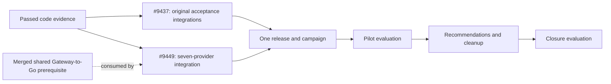

# Parallel completion of the DevLake POC

The owner approved this recovery on 2026-11-04. Reuse the existing stories and
one release campaign. The seven-provider discovery foundation is merged in
[#9554](https://github.com/aws-e/adp/pull/9554) at
`cc4aaeeb43901c37d900adfbcf92b7b56a46750d`.

## Work and ownership

| Work | Owner / story | Completion and integration order |
|---|---|---|
| Shared Profile Gateway-to-Go discovery | Connector lane, partial #9449 implementation extracted from #9439 | Review and merge the served authority contract first. Preserve foundation dispatch/staging and native GitHub/Jira. This prerequisite does not close #9449. |
| Seven-provider Profile and normalized collection | #9449 | Extend the shared served contract and selected-job Jenkins path, registration, UI/API/CLI and existing collection worker. Reuse the prerequisite's actual upstream Jenkins/GitLab converters. |
| Original pilot/closure acceptance producers | #9437 | Finish executable source-to-oracle-to-consumer integrations, grouped by existing source family. Preserve all original criteria and the cleanup success requirement. |
| Expansion evidence integration | #9449, coordinated with #9437 | Develop provider-specific code/tests independently. Serialize edits to shared campaign consumers and workflow wrappers, then test the combined revision. |
| Live qualification and cleanup | Existing #8894/#9111/#8895/#9112 nodes | Both code stories merge before one coordinated campaign. Existing private target/source/finalizer prerequisites remain. |

The shared service extraction owns `cmd/connector-api/main.go`, its focused
tests, Gateway Profile discovery/authority, route registration and the necessary
current-connection checks. Collection normalization owns upstream model/task
staging, cell-worker adapters and converter tests. Campaign repair owns existing
source producers, `verify_campaign.py`, lifecycle and workflow integration.
The coordinator serializes any overlap in source locks, build scripts, Gateway
contracts, campaign consumers and workflows; parallel work uses separate branches.

## Existing flow amendment

Apply the amendment only after the shared served integration has a verified
merge. Retain all existing node addresses, states, attempts, PR bindings,
accepted evaluations, spending, budget supplements and expiry.

- Remove only `pilot-evidence-integration -> provider-expansion`.
- Keep `code-evidence -> provider-expansion`.
- Keep both `pilot-evidence-integration -> release-and-qualify` and
  `provider-expansion -> release-and-qualify`.
- Refresh #9449's title and planned files for seven providers and actual
  upstream normalization. Remove requests to recreate the merged foundation
  or build a separate fixture framework.

The engine graph remains 22 nodes. No new story, gate, deployment, budget
increase or acceptance waiver is introduced. The complete accepted amendment
and its before/after receipt stay in the private flow record. Do not replay the
historical authored proposal over the accepted flow.

## Bounded implementation tasks

Each task finishes an observable behavior through the real entry point, includes
an independent expected result and at least the relevant failure case, and names
its source files. A task is done when its source, oracle and consumer work
together; another inventory, refusal-only test or status report does not finish
missing implementation. Preserve existing AC/SCN identities and do not create
one new story per acceptance row.

The prerequisite supplies a selected-job Jenkins path through the actual Go
process and Profile, plus real Jenkins/GitLab converter tests querying the common
upstream CI/CD model. #9449 extends those paths to the remaining providers,
finishes onboarding setup and governed collection, and integrates expansion
evidence. The API-first Jenkins slice has no inventory picker or live
qualification. Slack remains tool-layer at the pinned upstream revision.

For #9437, group remaining work by existing source family: Profile/authority,
IAM/cell/collection, lineage/publication, operation measurements, and
recommendations/cleanup. Complete a positive and negative producer-to-consumer
slice before requesting another review. Controlled authority checks keep their
accepted classification; offline success cannot substitute for required live
provider, storage, soak or cleanup observations.

## Release boundary

The master feature flag remains off by default. Connector discovery needs no
Insights database or collection grant; historical collection remains separately
optional and uses the governed cell/IAM path. Reuse the separate connector and
Insights infrastructure modules and existing campaign ledger/finalizer.

The 41 original pilot criteria, 44 closure criteria, seven-provider supplement,
at least 48-hour campaign and 20 updates remain required. Bind consented source
scopes, reviewed target, reader credentials and independent cleanup ownership
before live effects. Code can progress while those live inputs are unresolved.
