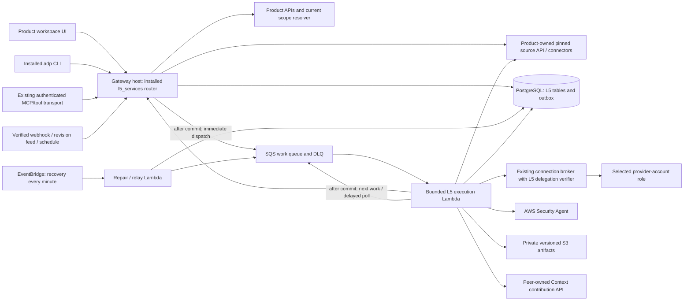
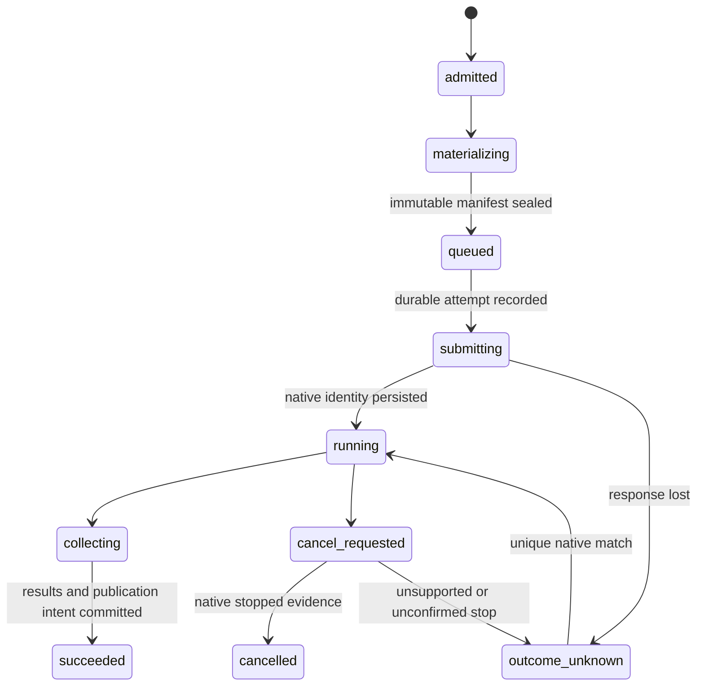
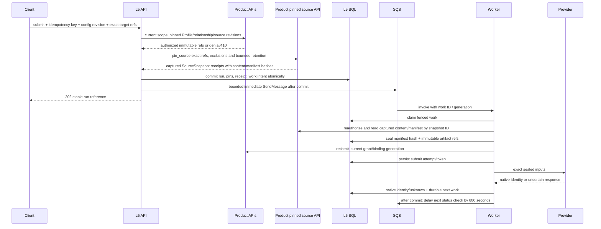

# L5 Services architecture — v1 proposal

Deployment ownership follows the [shared modular deployment contract](modular-deployment-design.md):
independent L5 service roots and state, shared CI/CD, and service-specific qualification.
This supersedes earlier references to deploying L5 through gateway Terraform.

## Status and decisions

This is the canonical **proposed** architecture for [Security #8682](https://github.com/aws-e/adp/issues/8682)
and its shared foundation in [L5 #8150](https://github.com/aws-e/adp/issues/8150).
It is ready for design review, not evidence of an implemented or approved service.
The governing revision is the immutable design commit linked from those issues.
After normal repository review, the delivery owner records the accepted commit and
actual review URL in their Design sections; until then, no “Approved design” claim
is valid. No extra approval process is introduced. This assignment does not deploy,
run paid assessments, dispatch implementers or close implementation stories.

Security initially supports architecture-document threat modeling and static code
review. Later services reuse the foundation, not Security-specific fields. No
pentest, automatic fix, Step Functions, general scheduler, permissions engine,
billing engine, replacement nightly scan or implementation of other providers.

| Decision | Choice and reason |
|---|---|
| D1 Ownership | Runtime: `modules/L5-services/`, Python `l5_services`; documentation and contract sources: `docs/l5-services/`. One domain package prevents gateway/Lambda drift. Shared clients stay in their hosts. |
| D2 Hosting | Gateway mounts the installed domain router; orchestration runs in bounded Lambdas. No additional public load balancer or server. |
| D3 State | L5-owned relational tables in existing PostgreSQL; S3 for large immutable artifacts. Transactional admission needs stronger coupling than existing Task DynamoDB dispatch. |
| D4 Delivery | Commit SQL work intent, then immediately publish to SQS standard queue. Bounded execution Lambda schedules ten-minute status checks with delayed messages; a shared EventBridge repair sweep recovers missed work. |
| D5 Authority | Verified platform service identity **and** current scoped delegation; attribution alone never grants access. Product reads always use Product APIs. |
| D6 Inputs | Resolve immutable source identities at admission; workers only materialize those identities and seal the manifest before provider calls. |
| D7 Lifecycle | Persistent configuration/bindings/models are distinct from setup operations, assessment runs and publication. |
| D8 Clients | One OpenAPI and complete lifecycle matrix for UI, installed CLI and MCP. Thin clients never submit provider jobs directly. |

## Evidence baseline

Repository audit baseline: `31148f8edfda23f162cf4b4705b7820710621a66` (fetched main,
2026-10-24). [The audit](audit.md) enumerates every tracked artifact, workflow,
build/deployment entry and gateway migration, not a representative sample.
References below are source observations at that revision, not live-state claims.

- Profile references already include tenant, Project, connection, record type,
  native identity and immutable revision; `CapabilitySelection.configuration_ref`
  exists in `modules/gateway/src/products/configuration.py:37` and `:133`.
- Product routes expose current/revision/change reads, but L5 peer requests return
  unavailable: `modules/gateway/src/products/routes.py:51`, `:934`, `:1009`.
  `modules/gateway/src/shared/identity/product_scope.py:12` rejects nonhuman accounts.
- Verified internal IAM identity and service-operation entitlements exist in
  `modules/gateway/src/internal/auth_deps.py:34` and `service_authorization.py:6`.
  The reusable final STS delivery function is `assume_bound_role` in
  `modules/gateway/src/internal/assume_role_routes.py:189`; current worker binding
  validation is not an L5 delegation contract.
- SQL fenced leases exist in `modules/gateway/src/products/verification_operations.py:71`;
  durable publication storage exists in `modules/gateway/alembic/versions/126_tracker_publication_outbox.py:17`.
  Neither is an arbitrary paid-job dispatcher. Reuse their techniques, not foreign tables.
- Task access/artifact integrations exist in `modules/gateway/src/tasks/routes.py:43`,
  `artifacts.py:1`, `internal_artifacts.py:1`. Task lineage is not execution authority.
- The nightly driver documents ZIP archives, space role/bucket registration ordering,
  native job scoping and static-only settings in `.github/scripts/code_review_request.py:1`.
  Its fixed nightly profile and role-name restrictions must **not** become Product defaults.
- [Threat-model spike PR #7984](https://github.com/aws-e/adp/pull/7984), revision
  `499eade9a8e1376a3f5bcfdcd61c16aa0bbf835d`, reports a completed document assessment.
  [Code-review spike PR #8022](https://github.com/aws-e/adp/pull/8022), revision
  `24338ad0eb533613df3354bf65e342bd5c12d2b9`, reports source-access failure. Both
  remain open. This run inspected source/reports; it did not independently repeat
  provider execution. Historical grants, targets and spend allowances are not renewed.
- [Profile design](../product-onboarding/design/architecture.md),
  [Context model](../product-context/README.md), and
  [scope #8148](https://github.com/aws-e/adp/issues/8148) constrain integration.
  Context snapshot schema is not a deployed contribution API.

## Components and hosting

The gateway's public origin/prefix remains unchanged; routes below are relative
to its configured API base. `src/app.py` currently discovers modules from its
`UNIT_MODULES` list; add a bounded `src/l5_integration.py` shim that imports the
installed package and injects platform dependencies. It owns no domain models.
Package `adp-l5-services` supplies `api`, `models`, `migrations`, `workers`,
`adapters/security`, `product_client`, and contracts. Gateway supplies database
session, current principal/scope resolution, broker and artifact adapters through
explicit protocols, not imports back into checkout-relative `src`.

All L5 design documents, contract specifications, audit evidence and offline
validators live under `docs/l5-services/`. Module runtime code, infrastructure,
migrations and implementation tests remain under `modules/L5-services/`. SA15
packages the versioned schemas from `docs/l5-services/contracts/v1/` into the wheel;
deployed code reads package resources, never a checkout-relative documentation path.

Workers use the same wheel digest, their own narrowly scoped DB role, and the
Product API client. Do not give the worker SELECT on Product/Profile tables.
Task/flow references are optional validated links to existing native records;
a standalone manual run needs no invented story or agent Task. When a Task exists,
emit idempotent status/artifact references through the existing Task owner rather
than modifying its DynamoDB records directly.

## Configuration and Profile handoff

Identity is `(tenant_id, product_id, project_id, service_id)`. V1 has one current
configuration per identity; Security capabilities are `threat_model` and
`code_review`. Multiple persistent bindings can exist, but every run selects one
explicit binding. Product is the user-facing container; tenant/Project remain
authority boundaries. Resolve the Product–Project relationship via APIs.

Configuration stores immutable Profile/source references, inherited field values,
explicit overrides, selected sources/exclusions, connection references, Region,
capabilities, trigger policies, visibility and limits. No credentials or mutable
Product registry copy. Options derive only from currently authorized sources;
multiple valid choices remain unresolved, never “first account/space wins.”

Security provider input ownership is explicit; these references are candidates for
current authorization, not provider identifiers or credentials:

| Input | Required for | Owner and admission rule |
|---|---|---|
| Pinned `profile_ref`, purpose and classification | Both capabilities | Profile owns the source record; L5 captures its immutable revision and explicit configuration overrides. |
| `sources` with `record_type: document` | `threat_model` | Product owns document bytes/revision; L5 pins a `SourceSnapshot` before execution. Repository-based threat models remain unavailable pending SA07 qualification. |
| `sources` with `record_type: repository_commit`; optional paired `pr_base`/`pr_head` | `code_review` | Product owns exact repository revision and PR event identity; L5 pins bounded ZIP bytes. PR revisions must be resolved to authorized immutable source snapshots. |
| `binding_id`, configuration revision, visibility, exclusions, limits and monitoring | Both capabilities | L5 owns selection and admission; binding must belong to the same configuration and be ready under current delegation. Monitoring defaults become an effective admission policy. |
| Selected connection, Region, provider role/session and native space/job references | Both capabilities | Product/broker supply an authorized connection and transient session; Security adapter resolves native IDs from the selected binding and records provider outcomes. Callers cannot supply native or account-wide requirements as product-local overrides. |

The provider request mapping is document snapshot → persistent model job for
`threat_model`, and repository ZIP snapshot → registered space + static code-review
job for `code_review`. Provider eligibility, registration and the SDK operation
shapes need SA04/SA07/SA08 qualification; neither the schema nor a fixture asserts
that an account, region, role, bucket or native space exists.

Each enabled saved trigger names one `capability` and one `binding_id`; both must
be present together. Disabled drafts may omit both until setup completes. Save
checks capability membership, binding ownership by this configuration and source
selection compatibility. Enabled policies require at least one selected source.
The configuration can be saved with triggers disabled before any binding exists;
enabling requires a ready compatible binding and current execution delegation.
Schedules require a schedule expression. Run admission rechecks readiness and
authority; it never chooses a different binding when the selected one is unavailable.

Refresh creates a proposed next version from a pinned Profile revision. Inherited
fields update; explicit overrides survive. Changed inherited scope or conflicts
make readiness `needs_input` until acknowledged. Refresh cannot silently add a
repository, broaden source paths, enable a trigger or activate a provider. Every
effective save appends a version and updates current revision by compare-and-swap.

Profile owns `selected_capabilities` and the `configuration_ref`; L5 owns the
referenced record. SA03 adds an idempotent handoff using Profile's conditional
configuration API, not SQL. Save L5 first, then link Profile using its ETag; a
conflict leaves a visible `handoff_pending` receipt and retries only that link.
The reference uses the existing six-field RecordRef with the authorized platform
source-connection identity supplied by Product APIs, not an invented connection.
Unlink the handoff explicitly; never erase unrelated capability selections.
Profile's current unavailable peer response remains until this integration is
deployed. Configuration state and provider readiness remain separate.
Coordinate that adapter with [Product handoff story #8266](https://github.com/aws-e/adp/issues/8266),
which explicitly depends on available Context/L5 interfaces rather than whole epic closure.

## API and client contract

[OpenAPI](contracts/v1/openapi.json), [strict schemas](contracts/v1/schemas.json)
and [the complete operation matrix](contracts/v1/operations.tsv) are normative
alongside this document. All route shapes are proposed. No internal delegation or
tenant authority can be supplied as a public tool argument.

- Scope prefix: `/v1/products/{product_id}/projects/{project_id}/services/{service_id}`.
- GET returns a strong ETag for mutable resources. PUT and mutation POST require
  `Idempotency-Key`; changing existing configuration/binding/triage also requires
  `If-Match`. First configuration PUT uses `If-None-Match: *`.
- Idempotency scope is current authenticated tenant + Product/Project + service +
  operation + principal + key. Canonical JSON (RFC 8785) request hash includes
  the precondition. Same key/body returns the original receipt; changed body is
  `409 idempotency_conflict`. Reauthorize even a replay. Keep tombstoned keys for
  at least resource retention; never silently reuse an expired uncertain key.
- `202` means durable accepted intent, **not** provider success. Read-only checks
  of configuration do not call providers; binding verification is explicit queued
  setup work. Errors use `{code,message,retryable,request_id}` plus optional
  `operation_ref`; never include secret/provider debug output.
- `401` authentication; non-enumerating `404` unknown or inaccessible target;
  `403` forbidden action on an already authorized resource; `409` state/scope/
  idempotency conflict; `410` expired pinned revision; `412` stale ETag; `422`
  malformed/unsupported choice; `429` bounded admission; `503` peer/capability
  unavailable. A binding not ready is `409 binding_not_ready`, not a queued run.
- Lists use opaque authenticated cursors bound to filters, principal and scope,
  limit 1–100 (default 25). Current visibility filters apply **before** counts,
  ordering and pagination. No public provider-native ID lookup endpoint.
- CLI prefix is proposed `adp service`; always specify Product, Project and service
  (or an explicitly selected workspace). `--json`, `--idempotency-key`,
  `--if-match`, `--file` and bounded `--wait-seconds` are shared conventions.
  Exit 0 means successful read/write acceptance, 2 invalid input, 3 denied,
  4 conflict, 5 unavailable, 6 failed terminal operation, 7 bounded wait elapsed
  with the durable operation reference. A timeout never resubmits.
- MCP tools use `l5___` + snake-case operation ID and the same strict schemas; binding action
  variants include **create, link, check, update, suspend, resume, unlink, cleanup**.
  This explicitly closes SA14's narrower original enumeration. Read-only versus
  mutation annotations are in the matrix; annotations are not access controls.
  This matches `modules/tools/facade/tools_facade/server.py:48`. The installed
  `modules/gateway/cli/adp-mcp.py:175` rejects top-level `run_id` authority
  arguments, so tools use `assessment_ref` as a target handle mapped to the
  authorized HTTP run path. Do not weaken that global guard. Tool input includes
  explicit scope selectors, typed `input`, idempotency key and conditional-write
  metadata; none confers authority. [MCP schemas](contracts/v1/mcp-tools.json)
  enumerate every tool and its HTTP mapping. Binary downloads return bounded
  `ArtifactRef` metadata over MCP; use artifact access/download for bytes.

MCP success returns `structuredContent = {data, http_status, etag?}` matching each
tool's `outputSchema`, plus a text content block containing the same JSON for
existing JSON-only clients. The gateway adapter copies the HTTP ETag header
**verbatim**, including quotes, into `etag`; clients never derive it from revision.
ETag is required on Configuration, Binding, Triage and TriageList replies and any
corresponding HTTP response. An absent required token is a transport contract
failure, not an invitation to perform an unconditional edit. Other replies copy
the header when present. The token refers to the returned resource; an Operation
token cannot update its binding. Read `getBinding` before an existing binding edit.
`listTriage` returns the token of the current triage head, independent of page/cursor,
including an empty head before the first decision. First triage PUT uses that
token. New configuration alone uses `create_only=true` / `If-None-Match: *`.
Errors return `isError=true` with the same JSON text/structured content of
`McpError {http_status,error}`; error envelopes do not use the success output schema.
SA14 preserves this envelope through shared MCP/CLI transports; SA12/SA13 use the
same HTTP tokens. A stale edit returns 412 and requires a fresh read and explicit
new edit/key; the client must not silently overwrite after conflict.
The installed MCP client saves each run submission and its verified transport binding
before dispatch. If its response is lost, `adp___operation_status` reads a known
`assessment_ref` without resubmitting; `adp___operation_retry` replays the
original submission and idempotency key only after an explicit request and
current authority check. An unknown run ID is not evidence of failure or
permission to invent a new key.

UI mounts a Services area in the existing Product workspace, with Security as the
only available tab. It exposes every matrix operation, including recovery,
unlink and separately confirmed owned cleanup. Show inherited/overridden values,
exact source revision, binding readiness, run state, provider state and publication
state independently. Reuse host accessibility/layout and denied-workspace behavior;
do not treat a hidden button as authorization. CLI/UI edits conflict via the same
ETag. Discovery reports unavailable future services rather than fabricated tabs.
Run detail also shows the native job status, available phases/task counts, last
successful check, next check and monitoring freshness. A suspected stall is an
advisory alongside the run outcome; missing progress data appears unavailable.
UI/CLI/MCP expose the same monitoring policy and observations from the L5 API.

## State machines

All transitions append an audit event and increment row version with a fenced
compare-and-swap. Terminal data is not overwritten by late worker responses.

| Entity | States and transition owner |
|---|---|
| Configuration | API: `draft → needs_input / ready`; save/refresh recomputes readiness; explicit disable → `disabled`; re-enable revalidates to `ready / needs_input`. Version history immutable. |
| Binding | setup worker: `unconfigured → checking / provisioning → ready / blocked / outcome_unknown`; explicit lifecycle API fences generation before `suspended / unlinking`; worker → `unlinked`; owned cleanup → `cleanup_pending → cleaned / cleanup_failed`. Resume rechecks, never directly trusts old readiness. |
| Setup operation | API inserts `accepted`; worker lease → `running`; → `waiting / succeeded / blocked / failed / outcome_unknown`; reconciler alone recovers unknown to waiting/terminal after native readback. No ready binding prerequisite for setup. |
| Assessment | API inserts `admitted`; worker → `materializing → queued → submitting → running → collecting → succeeded / partial / failed`; cancellation/deadline/revocation fences effects and yields `cancel_requested → cancelled / outcome_unknown`, or `expired / blocked`. Unknown submit is never a failed-no-effect assumption. |
| Publication | result transaction inserts `pending`; publisher → `publishing → published / retry_wait / unavailable`; invalidation → `invalidated`; receipt required for published. Retrying publication never re-enters assessment states. |

The following boundaries pin ownership across two assessments of one binding:

| Event | State owner and immutable consequence |
|---|---|
| First admission | L5 admission API freezes a numbered configuration, binding generation, source revision and snapshot receipt in run A; execution worker owns its later run states and one durable provider attempt. |
| Source update | Product owns the new source revision; a new configuration version and admission create run B. Neither a worker nor a refresh rewrites run A's source, attempt or assessment result. |
| Binding suspension or grant revocation | Lifecycle API fences the binding generation and future work before the setup worker reconciles native state; already admitted runs retain original inputs, but revocation stops new provider effects and private publication. |
| Result commit and publication failure | Execution worker commits the immutable result and a separate publication intent once. Publication worker owns retry, receipt and invalidation. A lost consumer response is reconciled by contribution identity; no publication path re-enters provider submission. |

Account-wide provider requirements remain owned by the provider account. The
`Override.field` allowlist contains only L5 configuration fields inherited from
Profile (`purpose`, `classification`, `visibility`, `source_refs`, `connection_ref`,
`region`) with field-specific value types; an organization/agent-space requirement
cannot be passed through a generic override. Even allowed source/connection changes
must pass current Product authorization, source and binding checks at save and
admission. The API never uses a provider-wide mutation to save Product settings.

`provider_state` (`not_started`, `running`, `stopped`, `completed`, `failed`, `unknown`) is
separate from local terminal state. Deadline expiry stops new work but can leave
remote status unknown. Reconciliation can append observations after termination,
not silently change source/config pins. Client retry of a proven failed-no-effect
run creates a **new** run with `retry_of`; unknown-submit recovery keeps the original.
Changing inputs always creates a new explicit assessment.

Setup execution uses the immutable [SetupIntent handoff](contracts/v1/peer-contracts.md#durable-setup-intent),
not `Operation` status. SA04 persists the original request, selected native resource,
configuration revision, effective binding generation and verified authorization;
SA06 supplies that intent and current attempt to adapters. Recovery retains the
same target. Cleanup additionally carries the original ADP creation receipt.

Suspend fences new effects by binding generation; it does not assert remote jobs
stopped. Unlink preserves linked customer assets and result history. Cleanup is a
separate authorized operation over recorded ADP-owned resources, refused while
remote use is unresolved. Prove native absence before marking cleaned. Never
delete by a broad account prefix or by ownership tags alone; match the creation
receipt, native ID, selected account/role and current authorization.

## Storage and concurrency

All proposed tables are L5-owned. Use UUID identifiers, UTC timestamps, `tenant_id`
(not new `org_id` columns), composite same-scope foreign keys, row revisions and
append-only event history. No migration reads Profile rows to infer ownership.

| Table | Keys, relationships and retained content |
|---|---|
| `l5_service_configurations` | PK tenant/id; unique tenant/Product/Project/service; current version FK, readiness, enabled, owner/visibility, Profile handoff receipt. |
| `l5_service_config_versions` | PK tenant/config/version; immutable payload, Profile ref, field provenance/overrides, policy refs and canonical hash. |
| `l5_service_bindings` | PK tenant/id; configuration FK; native account/Region/resource refs, selected connection, ownership receipt, state, generation, last verified sources. Unique live native resource per scope. |
| `l5_service_setup_operations` | PK tenant/id; optional binding FK (create starts without one), configuration-version FK, immutable `SetupIntent` including original request/authorization/cleanup receipt and its hash; separate attempt/native refs, lease/fence/deadline, public `Operation` outcome. |
| `l5_service_runs` | PK tenant/id; configuration-version and binding FKs/generation; admission snapshot including effective monitoring policy, manifest ref/hash, capability, event identity, delegation ref, Task/flow refs, deadline, provider/local state, `RunMonitoring` snapshot, retry_of. Immutable observation artifacts and audit events retain polling history. |
| `l5_service_results` | PK tenant/id; unique tenant/run/result-version; normalized envelope, immutable report/artifact refs, observed coverage, validation and costs. Large findings live in artifacts plus indexed finding rows. |
| `l5_service_findings` / `l5_service_triage` | Finding PK tenant/result/native ID; triage append-only PK tenant/finding/revision. Provider severity immutable; human decision/actor/reason/current ETag separate. |
| `l5_service_publications` | PK tenant/id; unique result/version/destination/schema; contribution hash, receipt, attempts, next due, invalidation watermark. |
| `l5_service_work` | PK tenant/id; unique entity/kind/generation/step; payload ref, due_at, short dispatch claim, last_enqueued_at/redeliver_after, separate execution lease_owner/until/fence, attempts, completion and last error. Authoritative outbox and repair index. |
| `l5_service_receipts` | PK scoped idempotency tuple; request hash, resource ref, outcome and expiry/tombstone. Same SQL transaction as accepted effect intent. |
| `l5_service_events` | Unique tenant/source/event ID/trigger; immutable source ordering, causal origin, cursor, superseded-by, admission or rejection receipt. |

Current gateway migrations have branches/merges; [the inventory](migrations.tsv)
orders the complete DAG. Never allocate a numeric migration against a guessed
head. Add a separate named `l5_services` Alembic branch/version location in the
wheel, after the inspected host head, and register its metadata explicitly with
the shared runner. A dedicated L5 metadata collection avoids importing gateway
models. The host migration runner upgrades `heads` under its existing deployment
serialization before either host or workers roll forward. Keep L5 table ownership
in the package; gateway changes only runner registration/version-location glue.
The first L5 revision uses `down_revision=None`, `branch_labels=("l5_services",)`
and `depends_on` the reviewed host head (currently
`133_merge_dev_box_conversations`); subsequent L5 revisions link within that
branch. Use globally unique L5 revision IDs, not a guessed next gateway number.
Deployment readers/proof checks that assume one Alembic head must be made
multi-head aware as part of SA15, not only the migration command itself.

SQL is selected over Task DynamoDB because configuration, run, receipt and work
intent must commit together. Task tables remain owned by Task service. No new
Secrets Manager namespace stores L5 credential copies. Private artifact objects
reuse the platform artifact access layer and bucket policy conventions, with an
L5-specific prefix and narrowly scoped KMS/S3 grants. Artifact references carry
opaque ID, version, media type, size and SHA-256; raw S3 URLs are never authority.

## Admission and immutable inputs

At admission pin: authenticated scope/relationship revision, immutable configuration
version, capability, binding generation, selected connection revision, delegation
ID/version, exact repository native ID and commit (PR base/head), exact document
revision, explicit includes/excludes, visibility/classification, trigger/event
identity, lineage, adapter/schema revision and deadline/cost/attempt ceilings.
Reject moving aliases (`latest`, branch-only target, unversioned document) rather
than deferring their resolution to Lambda. Source selection resolves a branch/PR
before submission; admission and the pinned-content interface accept only exact
revisions. Product's existing Profile/source-selection routes do not serve bytes.
SA02 implements the proposed Product-owned `source-snapshots` interface defined
in [peer contracts](contracts/v1/peer-contracts.md#pinned-source-content), with
connector-owned credentials. For each selected source, capture and hash authorized
bytes before admission completes or return `422 immutable_source_required`.
`Admission.source_snapshots` preserves the exact receipts in source order and
retention covering the run deadline. Snapshot retention/failed-admission cleanup
belongs to Product; authorization remains current on every read. Workers use the
snapshot read/content/manifest API with current delegated operation/attempt/fence.
They verify immutable refs, archive and file hashes, size/expansion bounds and
exclusions. `Manifest.source_snapshot_ids` and admission hash retain this lineage.
Workers may download, normalize and ZIP pinned bytes; they cannot repin to newer
content. The final immutable manifest includes per-file/document hashes, archive
hash, exclusions with reasons, provider coverage mode, source relationships and
materializer version. Seal it before *any* provider create/update/start that
consumes assessment sources. Failed hash/revision validation blocks submission.
Source archives exclude secrets, generated/dependency output and unsafe paths;
symlinks/submodules/LFS require an explicit qualified materializer or exclusion.

## Durable dispatch and recovery

API admission and every worker transition commit next-work intent in the same SQL
transaction. **After commit**, the EKS-hosted gateway API immediately attempts a
bounded SQS publish through the shared L5 dispatcher. New runs, setup work and
cancel/reconcile requests do not wait for an EventBridge tick. Workers use the
same dispatcher after committing next work. Send only opaque work ID/generation;
no credentials, source text or caller assertions. The API returns `202` for the
durable accepted run even if publishing fails; failed/uncertain sends remain owed
in SQL for repair. Never publish before commit or change a committed admission to
an apparent rejection because SQS is unavailable. A lost send acknowledgment may
duplicate messages but cannot create another logical run or provider attempt.

The dispatcher claims eligible rows with `FOR UPDATE SKIP LOCKED` and a short
dispatch lease separate from the worker's execution lease. Record enqueue success
and a bounded `redeliver_after` time; sending is not completion. Immediate work
uses `DelaySeconds=0`. Future work within the SQS 900-second limit uses
`ceil(max(0, due_at - now))`, so a normal ten-minute poll uses 600 seconds. Work
outside that window remains durable until the relay can enqueue it; SQL `due_at`
is authoritative. Gateway, worker and relay identities need `sqs:SendMessage` only
on the module's queue. No public caller gets queue credentials or a queue selector.

The execution Lambda re-reads and claims SQL state. SQS is transport, not truth.
Use partial batch failure reporting, small batches and visibility timeout greater
than invocation timeout plus bounded request margin. Acknowledge only after a
durable terminal or next-work transaction; stale fences cannot commit. An early
message cannot execute before `due_at`: retain owed work and reschedule its wakeup.
Messages for completed or superseded work are harmless. No Lambda sleeps awaiting
provider work. Fast dispatch and repair must use the same deduplication/lease rules.

A repair Lambda, invoked once per minute using the existing EventBridge pattern
(`modules/agent-factory/webhook-ingress/infra/task-recovery.tf:1`), scans due/unleased
work, unsent work within the message-delay window and expired leases, including
rows whose messages were acknowledged, lost or
dead-lettered. Respect `redeliver_after` for already-enqueued work; do not send every
pending poll on every sweep. Set that bound from due time plus queue visibility and
processing margin, and reclaim abandoned dispatch claims. The sweep is recovery,
not the normal start path or the provider polling interval. It can enqueue a due
deadline/recovery check; it never calls Security Agent itself. It retries transient
repair errors on the next tick. DLQ alarms and bounded re-drive retain the work
identity; poison work becomes explicit
`blocked` with an operator action, not an infinite retry loop. Fair per-tenant
batching and configuration concurrency ceilings prevent one stuck run monopolizing
workers. Index `due_at`, lease expiry and incomplete status; measure oldest owed work.

Before submit persist an attempt and provider idempotency token **if supported**.
On timeout or crash, reconcile by token or unique native resource/job identity
and attempt time/input identity. Ambiguous or unavailable enumeration stays
`outcome_unknown`, blocks new submissions, and requires readback/owner repair.
Do not claim exactly-once provider execution where provider APIs cannot prove it.
`retry` is allowed only after definitive no-effect/failure classification and
fresh authority/budget; `reconcile` never blindly calls start again.

## Polling and assessment monitoring

Security assessments can take hours. By default, once a native job ID is recorded,
schedule the first status check 600 seconds later; after each completed check,
schedule the next one 600 seconds later while the native job remains active. Use
the pinned interval when an authorized override exists. Each check is a
short invocation of the same execution Lambda, using the same run/native job ID.
SQL work is committed before its delayed SQS message is published. On `COMPLETED`,
queue result collection immediately; retain failure/stop evidence for other terminal
outcomes. Polling does not create a new run;
a periodic assessment trigger creates a separate run each time it fires.

`ConfigurationInput.monitoring` holds optional `MonitoringPolicy` overrides:

| Field | Default and validation | Meaning |
|---|---|---|
| `poll_interval_seconds` | 600; integer 60–900, subject to service policy | Delay between normal provider status checks. Ten minutes is the Security default. |
| `poll_grace_seconds` | 300; integer 60–900 | Lateness tolerance after the scheduled check, used to flag monitoring overdue. |
| `stall_after_seconds` | Absent: inactivity alerts disabled; if supplied, 600–86400 and at least twice the polling interval | Opt-in advisory threshold for lack of observed progress; never an automatic failure or restart rule. |

These are ADP policy defaults, not AWS timing or heartbeat guarantees.
SA03 applies defaults on save/refresh, persists the effective values in the config
version/hash and checks cross-field constraints. SA05 pins them as
`Admission.monitoring_policy` (`EffectiveMonitoringPolicy`); JSON Schema defaults
alone do not populate fields. The existing `limits.deadline_seconds` and
`limits.max_polls` bound total work independently. Admission rejects an enabled
stall threshold beyond the run deadline. No universal duration proves a stall;
SA07/SA08 qualify thresholds per capability/workload before recommending them.

Schedule work at the earlier of next poll and deadline. A deadline wakeup expires
local work and performs only authorized cancellation/reconciliation, rather than
starting another ordinary poll cycle. Poll count exhaustion also expires the local
run with an explicit limit reason and stops normal polling; retain unresolved
provider state for authorized reconciliation. Current cancel/disable/revocation requests
fence old work and dispatch immediately, even while a delayed poll is queued.
Count each job-status API attempt, including failures/retries, against `max_polls`;
task-detail pagination has separate bounded adapter limits. Read failures retry
after the polling interval or longer provider backoff, subject to the deadline.
They do not manufacture a native failure or replay a submission.

### Verified AWS observation contract

Checked 2026-10-25 against official API documentation and the
[botocore 1.43.114 service model](https://github.com/boto/botocore/blob/1.43.114/botocore/data/securityagent/2025-09-06/service-2.json)
(API `2025-09-06`, SHA-256 `f516c07bdbfe72583c21c1a421bd760319157dea26446b33bb3f61bb8c028fcb`).
This is static contract evidence; cadence/population still needs live qualification.

| Read | Documented signals used by the adapter |
|---|---|
| [BatchGetCodeReviewJobs](https://docs.aws.amazon.com/securityagent/latest/APIReference/API_BatchGetCodeReviewJobs.html) | Job `status`, `createdAt`/`updatedAt`, `steps` with names/status/update times, `errorInformation`, execution context and log configuration. Static-only review uses the supported preflight/static-analysis/finalizing phases; never enable validation/remediation to obtain extra signals. |
| [BatchGetThreatModelJobs](https://docs.aws.amazon.com/securityagent/latest/APIReference/API_BatchGetThreatModelJobs.html) | Job `status`, `createdAt`/`updatedAt`, `executionStartTime`/`executionEndTime` and `errorInformation`. The job shape does not expose the code-review `steps` array. |
| [ListCodeReviewJobTasks](https://docs.aws.amazon.com/securityagent/latest/APIReference/API_ListCodeReviewJobTasks.html) and [ListThreatModelJobTasks](https://docs.aws.amazon.com/securityagent/latest/APIReference/API_ListThreatModelJobTasks.html), with corresponding batch-get task APIs | Explicit job-scoped, paginated task execution status/update times and available diagnostic log references. Task states include `IN_PROGRESS`, `ABORTED`, `COMPLETED`, `INTERNAL_ERROR`, `FAILED`. Task availability in each mode must be qualified. |

Both job APIs use `IN_PROGRESS`, `STOPPING`, `STOPPED`, `FAILED`, `COMPLETED`.
`errorInformation` can carry code/message; documented codes include `CLIENT_ERROR`,
`INTERNAL_ERROR`, `STOPPED_BY_USER`. Fields are optional: missing timestamps/tasks
are unavailable data, not proof of a stall. No heartbeat cadence, percent-complete
guarantee or authoritative stuck status was found in these contracts. `updatedAt`
is a record update time, not a guaranteed heartbeat. Code review's documented
`maxTaskHours` concerns cumulative billable task hours, not elapsed wall-clock time.

SA07/SA08 `observe` returns `ProviderObservation` through `AdapterOutcome`:
native identity/status, local observation time, available provider timestamps,
phase/task summary, redacted error and scoped details artifact. Use explicit job
filters and bounded pagination; mark coverage partial/unavailable when incomplete.
Raw provider messages/log handles belong in authorized diagnostic artifacts and
must pass the existing redaction/source-visibility rules before any public display.

SA06 persists the observation/audit event and next work atomically, and projects
`Run.monitoring` (`RunMonitoring`) to every client. Store poll attempts/errors,
last attempt, last successful read, next check, last observed progress and the
latest native observation separately. A successful unchanged read refreshes
monitoring freshness without claiming progress. Progress fingerprints use stable
job/phase/task identities and actual status/completion changes from comparable
complete snapshots; exclude local poll timestamps and general metadata changes.
Set `progress_baseline_at` at the first complete observation; advance
`last_progress_at` only for an observed change. Partial/unavailable snapshots
yield progress unknown and reset the inactivity comparison baseline; they cannot
establish a stall. Task details stay in bounded artifacts; counts alone are not a
percentage because the task population may grow during a run.

The following outcome transitions apply to active assessments. Late observations
after local termination append native evidence without overwriting the protected
local terminal outcome.

| Observation | Classification and action |
|---|---|
| AWS job `FAILED` | Native failure: provider state `failed`, run `failed`, retain reason/evidence. An individual failed task alone does not fail the entire assessment. |
| AWS job `COMPLETED` | Provider completed; collect results immediately. ADP success/partial still depends on complete result collection. |
| AWS job `STOPPED` | Provider stopped; local cancelled only for a corresponding cancel intent, expired for a local limit, otherwise failed with a stop reason. Never infer success. |
| AWS `IN_PROGRESS`/`STOPPING` with fresh reads | Continue bounded observation; `STOPPING` is not confirmed cancellation. |
| Missing job, unknown status or failed status request | Native outcome unknown/monitoring degraded; retain last known observation, retry/reconcile within bounds, never start a replacement job. |
| Check not successfully completed by scheduled time plus grace | Monitoring overdue (or degraded if a read failed); recover the poll work without declaring the provider failed. |
| At least two fresh complete reads show no progress across an explicitly enabled threshold, measured from the later of baseline/last progress | Progress `suspected_stalled`; advisory only. New progress clears it; normal deadline/cancel policy remains authoritative. |
| Expired worker lease | Recover the same work with a new fence. A worker crash is not a provider failure. |

`RunMonitoring.state` describes observation freshness; `progress_state` describes
progress evidence; neither replaces run/provider state. Before the first poll it
is `not_started`; a fresh successful read is `current`, read failure is `degraded`,
missed due time is `overdue`, and ended normal monitoring is `finished`. Keep the
last observation and any unresolved remote state visible after local expiry.
Use structured alerts for overdue/degraded monitoring, suspected stalls and owed
work age. A suspected stall never authorizes another paid job or resource cleanup.

## Delegation, visibility and credential transport

SA02 extends the existing Product authorization resolver with a **separate verified
service branch**; preserve current human behavior. Authentication is existing
SigV4 → identity-verifying API edge → registered service principal. Never trust
an arbitrary `X-Caller-Identity`, shared API key, root human ID, queue payload or
requested tenant. The internal routes must be covered by the existing route
authority manifest and edge provenance checks.

The shared Lambda may process several tenants, but must not receive the generic
`internal:cross-tenant` entitlement. The existing `service_tenant` helper binds
ordinary services to one registry tenant. SA02 adds a dedicated verified L5
delegation resolver: first authenticate the registered service; then resolve a
stored grant whose service ID matches, derive its tenant/Product/Project, and
check the requested resource/operation against that grant and current Product
authority. Never infer tenant from a queue field or accept an arbitrary requested
tenant. Keep the generic helper and ingress-only cross-tenant grant unchanged.

Reuse the platform's credential-delegation owner/storage, extending its bounded
grant with: service principal, tenant/Product/Project, permitted operations and
capabilities, source/connection allowlist, visibility ceiling, expiry/revocation
version, binding generation and (for assessment) run/attempt. No new general
permissions engine. A human grants setup and/or trigger execution explicitly;
enabling a schedule stores this delegation, not the human's reusable access token.

The existing `credential_workspace_delegations` migration
(`modules/gateway/alembic/versions/066_credential_evidence_and_delegation.py:43`)
only binds credential to workspace; it is insufficient by itself. SA02 adds an
identity-owned companion `credential_service_delegations` table, keyed by
tenant/delegation UUID with credential FK, registered service ID, Product/Project,
operation/source/capability allowlists, visibility ceiling, creator, expiry,
revoked_at and monotonic revision. Unique active grant identity plus ETag protects
updates; connection ownership/workspace delegation remain necessary upstream
checks. The connection/identity owner implements and reviews this bounded grant
extension, not a new L5 policy engine. Source/operation and lifecycle references
are revalidated, never trusted merely because a row exists.
The identity owner mints an operation-bound grant for an explicitly authorized
setup/run action, and a bounded renewable trigger grant only for explicit trigger
enablement with disclosed scope/expiry. Generic configuration save/refresh does
not mint one. Renewal rechecks the current grantor/connection/source rights;
disabling the trigger revokes its grant revision. UI confirmation and CLI/MCP
enablement express the same intent; caller-selected grant IDs cannot widen scope.

Transport contract: Lambda authenticates with its registered execution role and
requests a short-lived credential session from a new L5-scoped broker route under
`/internal/v1/l5/credential-session`. SA02's verifier resolves the stored grant and
run/setup operation, rechecks Product/source/connection rights, then calls the
existing `assume_bound_role` delivery function. Public APIs never return that
session. Session credentials stay in memory and are scoped to the selected
connection; verify STS account **and exact role**, supported Region and source
registration. Do not give Lambda direct secret-store access or fall back to its
hosting-account credentials for provider work. Refresh via the same verifier.
This is proposed integration, not a claim the current worker-only binding route
already accepts Lambda. Register a distinct service identity; do not impersonate
an agent run to satisfy its checks.

Hosting account, selected provider account and workload/source accounts are
separate. The platform role gets only queue, L5 DB/artifact, logging and internal
invoke rights; the selected provider role gets capability-specific resources.
Resource-scoped IAM includes S3/KMS and provider resource policies, plus exact
`iam:PassRole` service constraints where required. If a provider action requires
wildcard resource scope, SA04 must document that API limitation and bounded
conditions before eligibility; do not silently substitute account-wide grants.

Every effect and every read checks current rights, not only admission-time rights.
Pinned historical references prove what was assessed, not continuing access.
`Only me` is owner-only; `Product team` uses current Product membership plus source
entitlements. Do not invent an admin bypass. Scope defaults to `Only me`; widening
requires explicit current sharing permission and cannot exceed source classification.
The #8148 owner must confirm the common resolver contract before integration.
List/count/export/artifact/comparison paths and Context-derived answers enforce
the same rules. Recheck access at artifact download, not merely link issuance;
prefer authenticated streaming for revocable material over long-lived presigned URLs.
If revocation prevents remote cancellation, report remote unknown and require an
authorized operator; revocation never justifies recovering a former credential.

## Provider adapter and Security qualification

Adapter protocol is service-neutral: `capabilities`, `check_binding`,
`prepare_binding`, `reconcile_setup`, `materialize_inputs`, `submit`,
`reconcile_submit`, `observe`, `collect`, `cancel`, `cleanup_owned`.
Inputs are typed configuration version, scoped credential session, binding,
sealed manifest and effect attempt. Outputs are typed native references,
readiness/gaps, coverage, next-poll time, cancellation support and structured
outcomes (`accepted`, `definitive_failure`, `outcome_unknown`). No local journal,
sleep loop, hidden provider client construction or git-history import is allowed
in the deployed adapter. Unsupported operations are advertised explicitly.

Security adapter qualifications:

1. Pin a boto3/botocore pair whose `securityagent` model actually contains every
   used operation/member. Gateway's current boto3 pin does not prove that. Build
   records SDK/service-model hash; a package test asserts required shape names.
   Spike dependency declarations are evidence to inspect, not an automatic upgrade.
   The inspected code-review spike pins `boto3==1.43.114` and `PyYAML==6.0.3`;
   gateway currently pins boto3 `1.43.111`. Use `1.43.114` as the initial adapter
   compatibility-test candidate, with its resolved botocore version/model digest
   locked by SA07/SA08. No provider call or package-install test here establishes
   that candidate as live-qualified. The spike only verified `us-east-1`;
   advertise other Regions unavailable pending qualification.
2. Setup verifies provider eligibility, account, role and Region from the selected
   connection. Link a compatible authorized space or explicitly create one with
   a durable ownership receipt. Organization-wide requirements are a separate
   provider authority; linking a space cannot overwrite them.
3. Threat-model document path uses persistent space/artifact/model, bounded
   `start_threat_model_job`, complete native job/threat pagination and job-scoped
   evidence. Reuse spike mechanics only after removing fixed target/budget
   assumptions. Repository-based threat modeling is unavailable until qualified.
4. Code review uses a ZIP of the exact admitted source. Register the supported
   service role and staging bucket through `UpdateAgentSpace` **before**
   `CreateCodeReview`; preserve required existing name. Then start/observe the
   job with its space identity. Existing nightly protocol describes these
   requirements; the Product spike still failed source access. SA04/SA08 must
   establish native role registration, S3 object/KMS access and actual source
   consumption using a current authorized fixture before marking eligible.
   A newly created space remains blocked until a setup check observes exactly
   one role in the selected account and one staging bucket on that space. The
   readback is retained with the binding for at most 15 minutes; missing,
   ambiguous, foreign-account or stale registrations stop admission. The
   installer does not infer a service role or bucket from caller input, and a
   native registration readback alone does not prove source consumption.
   PR #8022 reports acknowledged create-time source-access validation failures,
   **no submitted review job**. Its time-conditioned role boundary is a reported
   hypothesis, not a proven cause; policy simulation success did not prove native
   source consumption. Do not remove boundaries to manufacture a passing check.
5. `validationMode=DISABLED` and `codeRemediationStrategy=DISABLED` are fixed
   adapter invariants. Reject caller overrides. No endpoint probing/pentesting
   or fix PR creation. PR-triggered snapshot review is labeled `full_snapshot`,
   not diff-only; subset review reports the selected files and exclusions.
6. Bound invocation requests, polls, wall-clock deadline, concurrency and provider
   attempts. Admission requires an authorized cost ceiling and fresh estimate or
   explicit policy permission for unknown cost. AWS billing need not support a
   hard in-flight cap: stopping local polling does not stop provider charges.
   Record estimate, observed charge or unknown separately and reserve cleanup time.
7. Cancellation support is discovered per capability. Unsupported or unconfirmed
   cancel remains remote unknown/running; do not fabricate success. Collect all
   pages after provider completion, recording page completeness and partial errors.

## Results, triage and Context

Results preserve run/native job/source/config/manifest revisions, adapter/model
version, observation time, native finding identity, provider severity, location,
candidate claim, citations, assumptions, mitigation, coverage and uncertainty.
`candidate`, `supported`, `contradicted`, `unverified` validation is separate from
human triage (`open`, `accepted_risk`, `false_positive`, `resolved`). Threats are
not confirmed vulnerabilities. Normalization reuses nightly field handling but
adds tenant/Product/Project/run scoping; native IDs remain primary identity.

Comparisons require compatible capability, provider/rule version, repository native
identity, source selection and completed coverage. Changed/unscanned files produce
`incomparable` or `partial`, never “fixed.” Zero findings only describes completed
submitted coverage; an independent known-control check is required for live
qualification. Results survive publication failure and remain readable subject
to current authorization.

The [contribution schema](contracts/v1/schemas.json) is an L5 producer envelope,
not a replacement for Context's snapshot schema. SA11 and #8149 agree the concrete
consumer endpoint/receipt before integration; the exact proposed interface is
in [peer contracts](contracts/v1/peer-contracts.md). Submit idempotently by
`tenant/result/version/destination/schema`, preserve producer/source IDs, scope,
classification, visibility, candidate status, causal origin and evidence refs.
The consumer returns durable receipt ID, admitted schema, record IDs and revision;
transport 200 without that receipt is not `published`.

Invalidation uses a monotonic source-access watermark and original contribution
identity; Context acknowledgments must cover affected derived records and reads.
Until consumer invalidation is available, no publication of revocable private
source content is enabled. Producer retries publication/invalidation from SQL;
it never re-runs the assessment. A later authorized Context/Door query must return
the attributable contribution (and omit it after revocation) to satisfy EC-07.
The existing Context Door alone is not proof of this contract. Insights #7295
requires its own admitted event adapter; never label findings as passed tests.
The inspected Context snapshot v1 record enum does not include Security findings;
its `contribution` means business Initiative × Product × Project, not this producer
payload. #8149 must admit a versioned security-assessment/claim representation
without coercing evidence into that business record. Until then return unavailable.

## Events and ordering

SA09 adapters all call the same admission function: authenticated PR open/update,
selected document/security-strategy revision, configured schedule and manual.
At first receipt, freeze the selected configuration revision and trigger target;
copy its `capability` and `binding_id` into `RunInput` with the selected exact source
refs. For PR/document events, only replace the matching selected source's revision
with the authenticated event revision; other source pins remain unchanged. Scheduled
runs use the saved exact refs (no implicit latest-branch lookup). Manual API calls
already supply the explicit target; a saved manual policy uses the same mapping.
Validate capability membership, same-configuration binding, compatible sources,
current generation/readiness and grant at admission. A removed/disabled trigger,
stale configuration, revoked grant or unavailable binding produces an explicit
rejection receipt, never selection of another target. Configuration edits invalidate
pending admissions; an already admitted run keeps its pins, subject to current
revocation/disable fencing. To run both capabilities, configure two trigger IDs
with explicit targets. Dedup retains the original receipt/configuration on replay,
even if the saved policy is subsequently edited.
Native source event IDs plus trigger identity are durable semantic dedup keys;
config version and exact source pins are preserved in the admission receipt.
Schedule identity is trigger ID + scheduled UTC instant, not arrival time.
Retain source cursors/order only where provider-defined; otherwise re-read exact
revision and store an explicit incomparable ordering marker.

V1 defaults to no coalescing. Optional configured debounce may replace only
not-yet-admitted events from the same trigger/source; retain all receipts and
`superseded_by`. Never alter an admitted PR base/head or silently drop required
scope. Disabled/revoked policies fence future effects. Profile changes refresh
configuration only; an assessment requires an enabled matching policy and grant.
Unavailable connector revision feeds remain unavailable; use explicitly enabled
bounded revision reconciliation through existing scheduling, not an invented
universal document webhook. Ignore own Context causal lineage to prevent loops.

## Deployment and compatibility

The [source-audited integration matrix](contracts/v1/compatibility.json) names
existing entry-point evidence, exact-case proposed package/host paths, the owner
and the checkpoint at which each connection must work. `core` owns configuration,
run state and fenced dispatch; the worker-only Security `adapter` owns native
requests; host integrations own Profile/Product/broker, Task, API, CLI and MCP;
module migrations own L5 tables while SA15 connects migration and release
selection. No proposed target path is evidence that code or a registry entry exists.

The selected provider session flows from an authorized L5 Lambda work identity
through the verified gateway broker and Product's selected connection, never the
Lambda's ambient role. Gateway receives an explicit send-only queue grant; worker
and relay roles get separately scoped queue, database, broker and artifact rights.
The existing `.zip` archive check is source evidence for the nightly code-review
path, not qualification of Product source access. Gateway's pinned boto3
`1.43.111` remains unchanged; `1.43.114` is only a worker-model candidate until
SA07/SA08 lock the botocore service model, archive/source access and Region checks.
Module/Feature registry IDs stay unmapped until SA01 and PranavSharma1000 verify
real entries; dependent teams can build against these versioned interfaces without
waiting for every sibling epic, but cannot enable affected capabilities or invent IDs.

See [the entry-by-entry change matrix](audit.md#deployment-change-matrix) and
[SA15 backlog](backlog.md#sa15-deployment). L5 infrastructure uses independently executable service roots under
`modules/L5-services/infra/`, with separate state and shared reusable modules.
It owns worker/relay functions, SQS/DLQ, EventBridge repair rule, roles, alarms,
artifact prefix grants, VPC/subnet/DB connectivity and private API/broker egress.
Keep admissions disabled by default. Provider setup is **not** infrastructure deployment.

Build one wheel once, record SHA-256 and dependency lock; stage that exact wheel
into gateway's existing module-local Docker context and the Lambda artifact.
Do not change every build to repository-root context. CI must test isolated wheel
installation outside the checkout for both consumers, include migrations/contracts,
and prove an L5-only diff selects backend/worker/migration release paths. SDK pin
compatibility is tested independently for both packages. Workers can use a
container artifact if qualified source packaging exceeds ZIP limits; SA15 must
freeze the selected packaging before rollout, not improvise a runtime download.

Build/release selection includes consumed schema changes under
`docs/l5-services/contracts/v1/`; documentation checks cover the entire
`docs/l5-services/` tree. Prose-only changes do not require a runtime rollout.
V1 preferred worker packaging is a ZIP plus locked dependencies and the shared wheel.
Keep Security SDK dependencies in the wheel's worker-only `security` extra;
gateway imports API/core without eagerly importing provider adapters. This avoids
forcing the spike's boto3 candidate over the gateway's different existing pin.
Both consume the same L5 wheel digest with separately recorded host/worker locks;
SA07/SA08 qualify the worker SDK pair and SA15 tests both installation layouts.

Rollout order: (1) contract/host authorization support with flag off; (2) additive
L5 migrations; (3) manual reviewed infra apply; (4) deploy same-digest workers/relay
with dispatch disabled and verify identity/imports; (5) gateway/CLI and separate
frontend/MCP host publication; (6) synthetic recovery qualification; (7) explicit
current target/delegation/budget checks; (8) enable one fixture and run SA16.
Follow the existing deployment guide and protected target authority. No main-only
live evaluation is a precondition for reviewing its enabling code PR.

Rollback: disable admissions/triggers first; preserve leases/receipts, observe or
cancel authorized remote work, drain/retain owed work, then roll back to a reader
compatible with additive tables and queue schema v1. Keep compatible repair and
publication consumers running. Do not drop tables while work/results remain or
delete linked provider assets. Destructive schema contraction is a separately
reviewed later migration after retention/drain; code revert alone is not data rollback.

## Prerequisites and completion

| Prerequisite | Owner and affected phase |
|---|---|
| Actual review approval and canonical accepted revision | PranavSharma1000 + normal repository reviewer; design acceptance, not claimed here. |
| Real Module/Feature registry IDs | SA01 + PranavSharma1000 before implementation dispatch. No authoritative L5 registration was found in source; live registry was not queried. Directory names are not IDs. |
| Product delegated reads/current visibility and broker verifier | SA02 with #8148/#7245 owners; host integration before real setup/run. |
| Pinned repository/document content API and connector credentials | SA02 with Product/source owner implements the specified peer API; SA06/SA07/SA08 verify captured hashes/retention before source capabilities are enabled. |
| Profile configuration handoff source reference | SA03 + #8141 owner; link integration. Save must still work with pending handoff. |
| Security SDK/eligibility/source registration and cancellation qualification | SA04/SA07/SA08; before affected provider capability is enabled. Code-review source access remains unproven. |
| Context consumer receipt/read/invalidation endpoint | SA11 + #8149 owner; publication/private reuse and EC-07. Frozen producer fixtures permit independent work. |
| Selected hosting/provider targets, role grants, fixture owner, limits and current spend authority | SA15/SA16 + integrator; live deployment/assessment only, private configuration. |

The [backlog](backlog.md) and [verification plan](verification.md) map every story
and EC-01–09. The design review can complete before live prerequisites; the
implementation epic cannot. Security live success does not accept DevOps,
Well-Architected, FinOps or Transform in the parent L5 epic.
