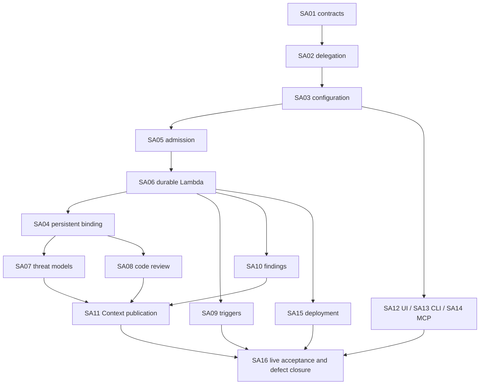

# Security implementation backlog

This is the implementation map for the **existing** 16 native children of
[Security #8682](https://github.com/aws-e/adp/issues/8682). No issue is closed or
dispatched by publishing this plan. PranavSharma1000 assigns implementers and
owns integration/acceptance. The [canonical architecture](architecture.md) is the
single behavioral authority; summaries here allocate work, not alternate designs.
Paths below are **proposed** unless identified as existing host integration points.
The [per-story file plan](story-files.md) expands these ownership boundaries into
grouped create/modify lists, predecessor-owned edits and preserved test selectors.

## Sequencing and ownership

The [delivery plan](delivery-plan.md) groups these dependencies into five waves.
Development waves finish on reviewed code and machine checks; gateway/frontend
auto-deployments continue independently. SA15 prepares release tooling alongside
backend work, then owns one coordinated L5 release and recovery through SA16's
live qualification. Construction evidence does not close live acceptance clauses.

The graph shows the main sequence, not every dependency; each slice lists its
complete dependencies below. SA04 depends on SA06 execution machinery, not a
ready assessment binding. SA06 depends on SA05 admission contracts, not a working
Security provider. Frozen fixtures permit parallel implementation; real integration
waits for interface checkpoints, not whole Profile/Context epic closure.
Shared-file conflicts are coordinated by the delivery owner: SA02 owns Product
resolver/broker verification, SA12 frontend, SA13 CLI manifest/installer, SA14 tool
catalogue, SA15 build/infra/migration-runner glue. Domain changes stay in L5.

## SA01 contracts

[Story #8683](https://github.com/aws-e/adp/issues/8683), EC-01; AC-01–03 / SCN-01–03.
Own `docs/l5-services/` (architecture, contract specifications, audit and mappings)
and the module README pointer. Input:
Profile/Task/connection contracts and both Security spikes. Output: strict API,
input/provider/visibility/recovery contracts and executable fixtures. Validate
unknown fields, cross-scope references, unsupported capabilities and lifecycle
separation. Record SDK candidate and source-access gaps rather than inventing
qualified availability. Dependencies: none; publish contract checkpoint first.
This PR supplies the architecture portion; normal review acceptance remains open.
Freeze trigger target, `SourceSnapshot`, `SetupIntent` and MCP response contracts
together; keep their independent examples in the contract validation command.
Offline design tests live in `docs/l5-services/contracts/v1/test_contracts.py`.
The planned handler/compatibility integration tests belong in
`modules/L5-services/tests/contracts/test_contracts.py`; they remain implementation work.

## SA02 Product delegation

[Story #8684](https://github.com/aws-e/adp/issues/8684), EC-02; AC-01–03 / SCN-01–03.
Own proposed `src/l5_services/product_client.py` and gateway integration in existing
`src/shared/identity/product_scope.py`, `src/internal/` authority/broker transport.
Input: verified registered service plus stored scoped delegation. Output: filtered
Product current/revision/source reads and short-lived selected connection sessions.
Implement the Product-owned pinned-content routes and connector credential boundary
in [peer contracts](contracts/v1/peer-contracts.md#pinned-source-content), including
snapshot retention/expiry, bounded streams and the injected L5 work-authorizer.
Test exact repository/document revision capture and revoke-between-pin/read denial.
Preserve human behavior/410 expiry; test forged tenant/root-human selectors,
revocation, mismatched role and source permissions. No direct Profile SQL or
ambient provider credentials. Depends on SA01 and concrete #8148/#7245 interfaces.

## SA03 configuration

[Story #8685](https://github.com/aws-e/adp/issues/8685), EC-01; AC-01–03 / SCN-01–03.
Own proposed `src/l5_services/api/configuration.py`, `models/configuration.py`,
L5 configuration/version migrations and Profile handoff adapter. Input: authorized
Profile refs and explicit user choices. Output: immutable versions/readiness,
conditional saves, options/check/refresh and recoverable configuration_ref handoff.
Assert provider-call count zero for save/refresh, override preservation, no implicit
scope widening, one winner in ETag races and saved-state retention during outage.
Persist explicit capability/binding targets for each enabled trigger; validate
same-configuration membership and support disabled drafts before binding setup.
Resolve monitoring defaults (600-second polling, 300-second grace, stall advisory
disabled unless explicitly configured); validate thresholds and pin effective values.
Depends on SA01/SA02 and #8141 conditional configuration API, not whole epic closure.

## SA04 provider binding

[Story #8686](https://github.com/aws-e/adp/issues/8686), EC-02; AC-01–03 / SCN-01–03.
Own proposed `api/bindings.py`, `models/binding.py`, `adapters/security/binding.py`
under `src/l5_services/` and setup/binding migrations. Input: config revision,
authorized connection and explicit create/link/check/update/suspend/resume/unlink/
cleanup action. Output: durable setup receipt, generation-fenced persistent binding,
native readiness and ownership. Setup is possible before assessment readiness.
Prove uncertain creation reconciliation, no duplicate space, linked-resource
preservation and owned-only cleanup. Qualify source/role registration jointly with
SA08. Depends on SA01/SA02/SA03/SA06.
Persist immutable `SetupIntent` with original `BindingInput`, pinned configuration,
effective binding generation, verified authorization and cleanup ownership receipt.
Round-trip links to two different spaces and reject cleanup missing proof or grant.
Publish setup/control work through SA06's shared dispatcher immediately after commit.

## SA05 execution API

[Story #8687](https://github.com/aws-e/adp/issues/8687), EC-03; AC-01–03 / SCN-01–03.
Own proposed `api/runs.py`, `admission.py`, `models/run.py`, receipt/work migrations.
Input: enabled config, ready binding, exact source revisions and current scope.
Output: atomic immutable admission snapshot + run + idempotency receipt + work
intent. Implement get/list/cancel/reconcile/retry; retry only after definitive
no-effect proof, with a new linked run. Verify lost-response replay, SQL rollback,
410 source expiry, denied target, stable PR base/head and no Security provider call at
admission. Depends on SA01/SA02/SA03.
Pin through SA02's content API and persist full `SourceSnapshot` receipts in source
order before admission commits; require retention through the deadline. Validate
trigger-to-RunInput targeting and source membership; no fallback binding or repinning.
Dispatch immediately after commit via SA06's publisher; retain 202 and owed work
on a failed send. Test commit-before-send, no tick dependency and same-key replay
after ack loss. Pin effective monitoring policy and expose the stored run projection.

## SA06 Lambda recovery

[Story #8688](https://github.com/aws-e/adp/issues/8688), EC-03; AC-01–03 / SCN-01–03.
Own proposed `workers/execution.py`, `workers/relay.py`, `workers/recovery.py`,
`adapters/protocol.py` and fenced work storage. Input: opaque SQL work identity
delivered by SQS. Output: one bounded transition, durable next work/native identity,
immutable materialized manifest and eventual stored result. Test duplicate delivery,
worker death before/after submit, lost provider response, acknowledged-but-owed
work, failed repair tick, stale lease and cancellation/deadline/revocation. No sleep
loop, duplicate paid submission or Task-table reuse. Depends on SA01/SA02/SA05.
Load `SetupIntent` and the original attempt for setup adapters; public `Operation`
is status only. Fetch snapshot bytes/manifest using current attempt/fence; verify
digests, exact source refs, exclusions and expansion limits before manifest sealing.
Own the common post-commit dispatcher, delayed SQS polling and distinct execution/
dispatch leases. Preserve SQL due time, suppress premature/duplicate work and repair
missed sends without another provider submission. Persist `ProviderObservation` and
`RunMonitoring`; test fresh unchanged reads, native failures, read errors, partial
task pages, future statuses, optional fields, suspected stalls and deadline wakeups.
Use a fake clock and transport faults for pre-merge checks; live queue timing remains
SA15/SA16 work. Follow [the monitoring contract](architecture.md#polling-and-assessment-monitoring).

## SA07 threat models

[Story #8689](https://github.com/aws-e/adp/issues/8689), EC-04; AC-01–03 / SCN-01–03.
Own proposed `adapters/security/threat_model.py` and provider-specific tests. Input:
sealed pinned architecture documents, ready space/model and scoped session. Output:
native job/threat readback, complete page coverage, candidate claims/citations and
validation uncertainty. Package spike mechanics without local state/git-history
imports or prior fixture grants. Preserve persistent models and confirmed human
constraints. Qualify document path first; code path unavailable until demonstrated.
Depends on SA01/SA04/SA06.
Consume document `SourceSnapshot` bytes through the shared source client; test a
changed document revision and expired/revoked receipt without provider submission.
Map verified threat-model job/task statuses, errors and timestamps to
`ProviderObservation`; qualify actual field availability/update frequency. No
code-review phase array or heartbeat cadence may be assumed for threat models.

## SA08 code review

[Story #8690](https://github.com/aws-e/adp/issues/8690), EC-05; AC-01–03 / SCN-01–03.
Own proposed `adapters/security/code_review.py`, `source_archive.py` and static
invariant tests. Input: exact repository native ID/commit and PR base/head, sealed
ZIP/manifest and source-ready binding. Output: native job-scoped findings and
truthful full-snapshot/selected-file coverage. Port protocol/normalization from
nightly without changing its profile, workflow or role ownership. Assert both
provider modes remain DISABLED. Resolve #8022 native source access with SA04;
policy simulation alone is not proof. Depends on SA01/SA04/SA06.
Qualify SA02's exact-commit connector and SA06's source manifest/archive verifier,
including mismatched hashes, unsafe archive entries and expansion limits. Do not
reuse the AWS provider session as GitHub/document connector authorization.
Read full job status, available phases/tasks and diagnostics rather than the nightly
helper's status-only projection. Keep static-only settings; qualify task availability
and timestamp changes. Individual failed tasks do not imply whole-job failure.

## SA09 triggers

[Story #8691](https://github.com/aws-e/adp/issues/8691), EC-03; AC-01–03 / SCN-01–03.
Own proposed `events/` adapters/event storage plus bounded existing webhook/feed
integration. Input: authenticated PR/document/schedule/manual identity and enabled
policy/delegation. Output: semantic event receipt and SA05 admission (or explicit
disabled/stale/superseded outcome). Preserve exact source order/pins, default no
coalescing, opt-in bounded debounce and Context causal loop prevention. Missing
revision feeds advertise unavailable. Tests assert one semantic run, not one SQS
delivery. Depends on SA01/SA03/SA05/SA06.
Freeze the configured capability/binding/source target at first receipt. Test two
capabilities/two bindings, explicit target rejection, policy edits and duplicate
events; copy targets into SA05 RunInput, never infer them from list ordering.
One-off/event/scheduled admission uses the same immediate dispatch path. Recurring
assessments create distinct runs; polling an existing native job never creates one.

## SA10 findings

[Story #8692](https://github.com/aws-e/adp/issues/8692), EC-06; AC-01–03 / SCN-01–03.
Own proposed `api/results.py`, `findings.py`, `triage.py`, result/finding/triage
migrations and artifact integration. Input: complete/partial provider result and
sealed manifest. Output: scoped lists/detail/artifacts, append-only human triage
and compatible comparison. Independently assert filtering before counts/pagination,
current source revocation, private visibility, unknown-cost preservation and no
fixed finding claim from unscanned files. Depends on SA01/SA05/SA06.

## SA11 Context publication

[Story #8693](https://github.com/aws-e/adp/issues/8693), EC-07; AC-01–03 / SCN-01–03.
Own proposed `publication/`, contribution schema and publication-work migrations.
Input: immutable stored result, visibility/source lineage and consumer contract.
Output: idempotent contribution + durable receipt, retry or explicit unavailable;
invalidation propagates current source revocation. Assert publication outage does
not delete results or repeat assessment; restart repairs owed publication; later
authorized retrieval cites exact evidence. Do not reuse Insights test-result
admission for findings. Depends on SA01/SA07/SA08/SA10 and #8149 receipt/read/
invalidation interface. Consumer availability blocks live reuse, not producer fixtures.

## SA12 UI

[Story #8694](https://github.com/aws-e/adp/issues/8694), EC-08; AC-01–03 / SCN-01–03.
Own gateway frontend Product workspace integration and typed API client only.
Input: same operation matrix and server-derived availability/choices. Output:
Services/Security configuration, lifecycle, source selection, runs, results,
triage, comparison, publication recovery and owned-cleanup controls. Display
configured/operational/completed independently. Exercise the served UI, accessibility,
wrong-scope denial and UI/CLI ETag conflict; hidden controls are not security.
Depends on SA01/SA03/SA04/SA05/SA10.
Expose each trigger's capability and binding selections and the same returned
ETag tokens as CLI/MCP; present stale edits without automatically overwriting them.
Show native status, available phases/task counts, last/next check and separate
monitoring freshness/stall advisories. Configure the shared monitoring policy.

## SA13 CLI

[Story #8695](https://github.com/aws-e/adp/issues/8695), EC-08; AC-01–03 / SCN-01–03.
Own proposed `modules/gateway/cli/adp-service.py` plus existing `adp`,
`command-manifest.json` and installer integration. Input: noninteractive explicit
scope, JSON files, ETag/idempotency key. Output: every matrix operation, stable
exit codes and bounded wait returning the existing receipt. Test installed CLI,
quoted/newline input, missing choices, old-server unavailability, retry after
lost response and cross-client round trips. Depends on SA01/SA03/SA04/SA05/SA10.
Preserve opaque quoted ETags in JSON output and `--if-match`; accept explicit
trigger targets in configuration files. Test a read/edit/stale-edit exchange.
Accept monitoring policy through the same configuration input; surface the complete
stored run-monitoring projection in status/JSON output without direct provider calls.

## SA14 MCP

[Story #8696](https://github.com/aws-e/adp/issues/8696), EC-08; AC-01–03 / SCN-01–03.
Own L5 thin gateway/tool integration and the existing shared tool catalogue/Task
transport registration, not a second backend. Input: authenticated tool caller and
strict arguments. Output: **all** matrix operations, including binding update,
suspend/resume/unlink/owned cleanup, reconciliation, triage and publication retry.
Read/mutation annotations must match HTTP semantics. Test actual discovery/dispatch,
forged authority arguments, revoked artifact access, bounded results, same-key
replay and unsupported-server advertisement. Depends on SA01/SA02/SA03/SA04/SA05/SA10.
Return the specified `structuredContent` plus identical JSON text envelope with
HTTP ETag copied verbatim. Exercise read/edit/stale-edit with the actual transport,
empty triage head and existing-binding edits; never derive a token from revision.
Preserve typed monitoring policy and native observation fields through tool results;
missing progress data is explicit, never an invented completion percentage.

## SA15 deployment

[Story #8698](https://github.com/aws-e/adp/issues/8698), EC-09; AC-01–03 / SCN-01–03.
Own module `infra/`, packaging, migration integration and the exact host/launcher/
release change matrix in [the audit](audit.md#deployment-change-matrix). Input:
reviewed wheel/dependency digest and protected target/role configuration. Output:
compatible gateway/Lambda artifacts, additive migrations, durable queue/repair,
scoped identity, alarms and disabled-by-default admission. Test L5-only path
detection and isolated package imports pre-merge; actual queued Lambda invocation,
recovery across rollback and privilege-expansion rejection are live checks.
Keep module-owned infra and migrations; do not put domain code in gateway.
Package the schema artifacts from `docs/l5-services/contracts/v1/` into the L5
wheel and include consumed-contract changes in build/release selection. Runtime
uses packaged resources; prose-only changes require documentation checks.
Grant gateway, worker and relay queue-specific send access; configure zero default
queue delay, per-message poll delay and one shared minute recovery rule. Verify a
new run starts without a repair tick, a poll cannot execute early, a lost send is
recovered, and no message/lease race duplicates a provider effect.
Depends on SA01/SA02/SA03/SA05/SA06; SA16 supplies combined provider qualification.

## SA16 live qualification

[Story #8699](https://github.com/aws-e/adp/issues/8699), EC-04/05/07/08/09;
AC-01–04 / SCN-01–04. Own proposed `tests/live/` plus cross-client evaluation and
in-scope defect closure. Input: deployed compatible revisions, authorized private
two-tenant/Product fixtures, current provider access, spend/deadline/attempt limits
and Context consumer. Output: EC → child AC/scenario → revisions → all attempts,
native source/job/result evidence and cleanup/retention record. Run both real
capabilities; inspect all findings if fewer than three, otherwise at least three
using a recorded independent rubric. Zero findings still needs completed source
coverage and known controls. A later agent must actually reuse one real Context
contribution. Blocked cases remain incomplete. Depends on SA04/SA07/SA08/SA09/
SA10/SA11/SA12/SA13/SA14/SA15.
Observe real code-review/threat-model phase/task field availability and update
cadence with static-only settings. Record diagnostic gaps and long-running phases;
do not turn a guessed inactivity threshold into evidence of provider failure.

## Catalog and acceptance boundaries

Module/Feature IDs remain unmapped pending authoritative registry read/admission by
SA01 and PranavSharma1000 before implementation dispatch. Source inspection found
Portfolio/Initiative catalog records, not a verified L5 Module/Feature registration.
Do not substitute `modules/L5-services/`, GitHub Project number or invented IDs.

Every existing AC/SCN identity and native parent link must survive issue refinement.
The issue-format check is an authoring check, not scope, approval or live acceptance.
Tests named in the issues remain planned until implemented/executed. The design
fixtures cover contracts, not the host/infrastructure/provider assertions above.
