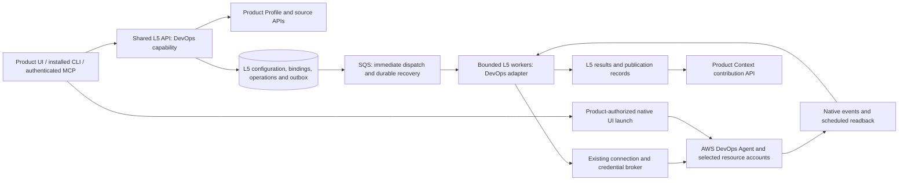
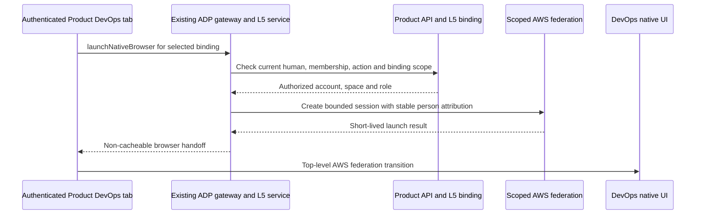

# Product DevOps Agent architecture

Deployment ownership follows the [shared modular deployment contract](../modular-deployment-design.md):
independent L5 service roots and state, shared CI/CD, and service-specific qualification.
This supersedes earlier references to deploying L5 through gateway Terraform.

Status: authoritative implementation design, requirements R3 (secure native UI
ingress), 2026-10-26. R3 incorporates the requested SSO security correction into
DA08, DA18 and DA19; the R2 project-portability requirements remain in force.
This is the common design for the DevOps backlog, not a claim of deployed
functionality or approved live access. DA01's merged contract (#8897), including
`launchNativeBrowser`, remains the interface baseline.

This extends the [shared L5 architecture](../architecture.md) and
[versioned contracts](../contracts/v1/README.md). The [configuration manual](configuration/README.md)
and [Profile mapping](configuration/product-profile-mapping.md) remain the setup
and input references. Runtime code belongs in `modules/L5-services/`; all related
documentation belongs in `docs/l5-services/`. New paths and commands below are
proposed deliverables, not existing interfaces.

## Outcome and committed scope

A team for any onboarded Product/project configures DevOps from its Profile,
obtains a scoped native Agent Space and UI access, investigates an incident using its actual code
and telemetry, and reuses verified results through Product Context. The committed
capabilities are investigation, release readiness, release verification and
recurring prevention. AWS/GitHub/CloudWatch are the initial integrations; each
capability declares its supported sources and prerequisites.
Additional telemetry, ticketing and private-tool connectors have explicit
extension points; their implementation is outside this first epic.

Persistent spaces, associations, instructions, skills and provider learning have
a lifecycle independent of any investigation. ADP Lambdas perform bounded setup,
submit, observe and synchronization actions; AWS hosts the managed agents and
their work. No long-running Lambda, new workflow engine or duplicate Profile,
identity, credential, billing or Context service is introduced. Autonomous
production remediation and unrestricted custom-agent execution are outside scope.

## Project portability contract

ADP supplies the shared service implementation. The consuming Product/project
supplies its configuration. The ADP repository, roadmap and engineering owners in
issue lineage identify where this capability is built; they never select the
customer workload, grant runtime access or supply fallback values.

Every onboarded Product/project can discover, save and check DevOps configuration
through the same UI, installed CLI and MCP APIs. Runtime identity comes from its
authorized Product/Project relationship. Profile and source APIs supply candidates;
explicit selections and typed overrides resolve ambiguity. Resolve accounts,
Regions, roles, repositories, branches, pipelines, deployment targets, telemetry,
people, instructions, policies and budgets for that scope. Do not embed the ADP
Product ID, repository, operator allowlist, AWS profile, account, namespace, source
layout, application language or release workflow in service defaults or adapters.
UI navigation and CLI/MCP requests must preserve Product **and** Project scope,
including two projects within one Product. Recheck current authority on use.

One versioned platform artifact serves multiple projects. Enabling another project
uses configuration/binding APIs to create or adopt its native assets and selected
resource access. It requires no platform source edit, per-project platform build,
copied platform Terraform stack or platform redeployment. Parameterized setup may
provision project-owned roles and associations in selected accounts; those are
customer resource setup, distinct from deploying the shared L5 runtime. Names and
idempotency keys are derived from scoped identity and operation receipts, never
from a fixed project name. Existing assets may be adopted with verified scope.

AWS still hosts DevOps Agent. Generic project support does not imply every cloud,
repository provider or telemetry connector is implemented. DA01 publishes the
versioned capability/connector matrix; unknown or unsupported selections have
explicit readiness reasons. Missing prerequisites affect only dependent
capabilities. Do not require GitHub, EKS or a particular CI system to save a
configuration, open an authorized native UI, or run an operation that does not
use that integration. Shared story dependencies sequence implementation; they do
not make every integration a runtime prerequisite.

| Selected capability | Conditional inputs |
|---|---|
| Native UI access | Scoped space, current Product membership and qualified session/action policy; no repository or EKS prerequisite |
| AWS investigation | Selected workload accounts/resources and readable telemetry; code/deployment sources when requested by the investigation |
| Kubernetes investigation | EKS cluster/namespace/network access in addition to AWS access, only for selected EKS workloads |
| Release readiness | Supported repository integration, exact base/head and any required native eligibility; no assumed ADP layout or EKS deployment |
| Release verification | Supported source/deployment linkage, isolated target, credential reference and scenarios; no fixed GitHub Actions workflow or deployment URL |
| Prevention and knowledge | Inputs declared by the selected native prevention mode or publication contract; only relevant missing inputs block readiness |

Non-EKS workloads use selected supported AWS resource discovery and telemetry.
DA05/DA19 qualify a real non-EKS fixture, such as Lambda or ECS, against the current
provider contract. Unimplemented connector kinds stay unavailable without
preventing configuration or unrelated supported operations. Provider capabilities
described in the manual are not automatically implemented ADP adapters.

DA19 must qualify **two non-ADP onboarded Products/projects** using the identical
deployed platform artifact set, with distinct repositories, teams, policies and
environment selections; at least one workload must be non-EKS. Each must complete
configuration, a real supported operation/result and subsequent scoped Context
reuse using only configuration changes. Include authorized cross-account resource
access and foreign Product/project denial. The independent verifier compares
artifact digests and records distinct configuration/native scope, results and
cleanup. ADP may be an additional fixture; ADP-only evidence cannot pass EC-10.
All other committed capabilities still require their mapped live qualification.

The [offline portability fixtures](portable-fixtures.json) include two non-ADP
Products, sibling projects within a Product, EKS and non-EKS workloads. They
exercise input readiness only; the matrix's `blocked_live` status remains until
native provider qualification. Readiness reason codes and checked configuration/
binding revisions are returned per capability, not as one misleading global
ready flag. Missing GitHub affects release readiness/verification, missing EKS
fields affects EKS investigation only, and absent inputs never prevent saving a
configuration. The authenticated Product/project and selected binding must be
verified on every read/write; schema shape cannot prove that scope comparison.

## Evidence and remaining qualification

| Evidence | Established | Still required / owner |
|---|---|---|
| [Shared SA01 PR #8803](https://github.com/aws-e/adp/pull/8803) | Versioned L5 contracts merged | DevOps extensions and catalog mapping: DA01 |
| [SA02 PR #8808](https://github.com/aws-e/adp/pull/8808) | Delegated Product/source implementation under review | Compatible merged API and work authorization: shared SA02/SA06 and DA03 |
| [SSO POC #8817](https://github.com/aws-e/adp/pull/8817) | One GitHub-backed ADP session reached native UI through scoped IAM federation; custom OIDC provider `ADP` was rejected | Production policy, two real users, refresh/revocation and console-route stability: DA08 |
| [S3 context #7973](https://github.com/aws-e/adp/issues/7973) | Live source reads and refreshed marker observed | Indexing, complete citations and topology quality: DA06/DA07/DA19 |
| [Release readiness #8012](https://github.com/aws-e/adp/issues/8012) | Reusable driver and offline tests | Native task permission denied; no real result: DA11 |
| [Release testing #8017](https://github.com/aws-e/adp/issues/8017) | Reusable driver and offline tests | Isolated fixture and deployment identity absent; no native job: DA12/DA19 |

An empty space, successful login, green schema check or uploaded archive is not
operational readiness. A blocked committed capability keeps its live acceptance
incomplete. Do not relabel unsupported capability output as success.

The [DA01 capability and catalog qualification matrix](capability-matrix.md)
records the source-backed status, per-capability prerequisites and concrete
owners/enablement phases for all remaining unknowns. Module/Feature IDs remain
unresolved pending authoritative registry verification before dependent dispatch;
this does not block schema preparation and does not select a runtime Product.

## Ownership and topology

| Owner | Data and responsibility |
|---|---|
| Product/Profile | Product/Project identity, people, purpose, source selections, environment labels, policy references and immutable revisions |
| Existing connections/broker | Credentials, selected-role sessions, current source rights and delegated use |
| Shared L5 core | Configuration versions, persistent bindings, setup operations, runs/attempts, outbox, results, artifacts and publication retries |
| DevOps adapter | Provider request mapping; account/space/association/asset IDs; readiness observations; native event and result translation |
| AWS DevOps Agent | Managed execution, topology, investigation data, native memories/skills and native sessions |
| Product Context | Scoped contributions, provenance, freshness, invalidation and later authorized retrieval |

Keep the shared identity `(tenant_id, product_id, project_id, service_id)` with
`service_id=devops`. One current configuration may have multiple explicit bindings,
each selecting an account, Region and native space. Every operation selects a
binding. A binding may include multiple explicitly selected workload environments
within that Product/Project. Never choose the first account or space implicitly.
Do not bind the same native space to different Product/Project scopes; shared
provider context cannot be isolated by hiding an ADP navigation link.

## Configuration and API contract

Use the shared configuration, options, binding-operation, run, result, artifact
and publication operation IDs in `../contracts/v1/operations.tsv`. DA01 extends
the versioned schemas and generated API/CLI/MCP mapping; consumers do not invent
parallel `devops` CRUD routes. DA01 freezes `launchNativeBrowser` under the same service/binding boundary;
DA08 implements it after identity qualification. The short-lived launch URL
is returned only to the authorized first-party UI, never to CLI/MCP or ordinary logs.
`listBindingEvents` provides scoped native-event receipts separately from ADP
run history. DA13 adds typed prevention policy/status controls where the
shared trigger representation cannot express native managed schedules.

The DevOps configuration contains:

- `profile_ref`, inherited values, typed explicit overrides and selected source
  references; Profile revision plus binding generation establish provenance.
- `hosting_connection_ref`, `region`, `space_mode` (`create` or `adopt`),
  and explicit `existing_space_id` for adoption; native IDs are verified.
  `binding_id` selects one of several bindings **at operation time**, not a
  platform default or a single binding baked into reusable configuration.
- `accounts[]` with monitor/source purpose, resource role and selected environment
  refs; workload kind and resource/Region boundaries; EKS cluster/namespace only
  where applicable. Non-EKS configuration must not require Kubernetes fields.
- `integrations[]` with kind, connection ref, selected repositories/workflows or
  telemetry resources, access mode, event support and native association identity.
  Provider-specific payloads use versioned adapters; each capability states its
  supported integration kinds and required evidence, independent of project name.
- `access_policy_ref`, permitted native actions, and configured authentication
  mode; secrets remain credential references.
- `knowledge_policy` with source revisions, visibility, publication selection,
  instruction/skill scope and refresh behavior.
- `capabilities`, typed `trigger_policies`, `prevention_policy`, result retention,
  monitoring and existing execution/budget-policy references.

DA01 freezes exact wire names and discriminated request/response schemas before
implementation. Unknown fields or unsupported modes fail validation; secrets
are never returned. Save/refresh use ETags and the shared conditional-write
contract. Creation is idempotent; changed payload with a reused key conflicts.
Use shared error meanings: non-enumerating scope denial, conflict/stale revision,
expired pinned input, validation failure and temporarily unavailable dependency.

Saving configuration does not activate AWS resources or paid work. Authorized
setup/enable operations do. Defaults keep automatic review, verification,
prevention and inbound incident triggers disabled. AWS defaults must be read and
reconciled before a space is declared ready; an empty custom-trigger list does
not prove that weekly prevention is paused.

Profile refresh proposes changes, preserves overrides and never widens authority
or enables automation. DA02 normalizes legacy `basic.environments` into the typed
`advanced.environments` path with provenance and conflict handling; until then,
use the authorized source-binding API. An AWS connection with
`permission_tier: unknown` is a candidate, not verified DevOps/EKS access.

Readiness is per capability, with `ready`, `needs_input`, `verifying`, `blocked`
and `degraded` observations, reason codes, checked revisions and freshness. Show
human-access, resource, source, telemetry, knowledge and trigger readiness
separately. Expired verification, revoked access and changed scope invalidate
affected capabilities without inventing readiness for others.

## Persistent setup and recovery

Use shared `Binding` and `BindingOperation` state, plus additive DevOps-owned
association/asset observations where necessary. DA03 owns schema integration;
other stories extend through reviewed migrations without allocating revision
numbers in advance. DA04 is the sole owner of create/adopt/update/suspend/resume/
unlink/retire behavior and coordination with provider-side changes.

Persist intent and correlation before calling AWS. Record account/Region/native
IDs and ownership receipts after readback. On uncertain create/associate outcome,
reconcile the original operation; never blindly issue another create. Recovery
survives acknowledgement, reporting failure and worker loss via the shared outbox
and repair worker. Serialize conflicting setup for one binding.

Resource roles for AWS DevOps, ADP setup roles and native UI operator roles have
different purposes. Verify actual trust, selected resources and current delegated
authority independently. Provider registrations may be shared at account level;
linking one must not mutate or delete another Product's configuration. Adoption
does not establish creation ownership. Retirement stops owned automation, drains
or records ongoing work, invalidates contributions, and removes only resources
covered by verified ownership and the accepted cleanup policy. Preserve adopted
spaces and external credentials by default.

### Contract transition owners

`configuration_api` saves settings without provider effects; `setup_worker`
persists the intent, verifies the provider response and reconciles the original
operation on uncertainty. `lifecycle_api` retains adopted/shared assets and only
removes ADP-created assets with verified ownership receipts. `native_event_ingress`
persists a scoped, deduplicated native receipt; `monitoring_worker` obtains native
readback and may import a `Run` with `origin=native` and no ADP admission or
manifest. It never submits another provider job for this receipt. `publication_worker`
retries Context publication independently of setup and native execution.

An uncertain setup operation has no success readback; a native timeout preserves
`outcome_unknown` and unknown cost instead of inventing completion. Native
terminal outcomes require provider readback, with an evidence reference for a
completed result. The [offline lifecycle fixtures](../contracts/v1/lifecycle-fixtures.json)
exercise these boundaries; they do not qualify a live connector.

## Human access

DA08 implements the existing `launchNativeBrowser` operation: authenticated
`POST /v1/products/{product_id}/projects/{project_id}/services/{service_id}/bindings/{binding_id}/browser-launch`.
The normal Product DevOps tab calls the shared L5 router through ADP's existing
gateway. Reuse the POC's scoped federation logic, not its separate ingress.

**Required ingress boundary:** no SSO Lambda Function URL (including `AWS_IAM`),
standalone public launcher endpoint, or dedicated CloudFront-to-Lambda behavior.
Run the federation adapter in the existing L5 service using the platform's scoped
credential path and existing AWS client dependencies. If a helper Lambda is
justified for isolation, invoke it only server-to-server through the AWS SDK with
an exact service-role/function permission and no Function URL or public resource
grant. If network-private SDK transit is required, use the Lambda API interface
endpoint and qualify its policy. A Lambda VPC attachment does not make a Function
URL private; CloudFront OAC authenticates the origin request, not the end user.

Require a current human ADP session, Product/project membership, DevOps launch
action permission and an active binding in that exact scope before obtaining
provider credentials or minting a session. Fail closed on missing, invalid,
expired, revoked or unavailable authorization. Resolve account, space, role and
destination server-side from the authorized binding; caller-supplied identity,
role ARN or redirect cannot broaden access. Apply request-size, request-rate and
CSRF controls through the existing platform ingress/session model before provider
work; CORS or an Origin header is not authentication. Keep launch and native
operator permissions separate and least-privileged.

Return the short-lived handoff only to the first-party UI with `Cache-Control:
no-store` and `Referrer-Policy: no-referrer`. Never place credentials or launch
tickets in Profile, logs, traces, analytics, artifacts or ordinary CLI/MCP output.
Audit stable person identity, scope and outcome without secrets. Use a top-level
browser transition and existing ADP sign-in; do not build another identity provider
or assume arbitrary OIDC issuers are supported.

Persist stable per-person provider attribution and explicit action policy. Test
two real users, cross-Product denial, repeat sessions, expiry, logout and membership
removal. Resolve people and roles from the selected Product/project; the POC's
operator allowlist must not ship. Measure native session revocation latency;
blocking a new launch does not revoke an existing AWS session. The observed console deep link needs a
versioned compatibility probe and operational failure state. If its support or
required identity isolation cannot be qualified, DA08 records a concrete blocker
and a reviewed supported alternative before native access is enabled; unrelated
backend work continues. An authenticated empty UI shell is insufficient.

DA08's AC-01/SCN-01 and AC-02/SCN-02 cover this entry point, denials before any
provider call and destination/scope tampering. DA18's AC-02/SCN-02 independently
checks the complete Terraform plan and effective permissions for the forbidden
ingress above, including aliases and any helper role. DA19's AC-01/SCN-01 and
AC-02/SCN-02 verify deployed ingress, unauthorized/throttled requests causing no
provider session, and cleanup of superseded owned POC routes without changing
other routes or retained spaces. Existing two-user, cross-Product and session
lifecycle evidence is still required.

DA19 emits `requirements_revision: R3-secure-native-ui-ingress` and independent
`live_checks` entries `sso-gateway-only-ingress` and `sso-denial-before-federation`,
alongside every existing check. The final evaluator must require both entries and
the R3 revision. Preserve all 63 AC/SCN pairs and ten epic criteria. The
[security review](sso-security-review.md) records the POC evidence and rationale;
its historical public endpoint is not an implementation precedent.

## Operations, monitoring and result semantics

DA09 uses shared admission, idempotency, immutable input snapshots and immediate
post-commit SQS dispatch for manual and event-driven investigations. Events carry
the verified tenant/Product/binding, source-event identity, capability and pinned
configuration. Deduplicate retries and reject forged or stale bindings before
any provider effect. Retain the distinction between one recurring policy and its
individual executions.

Submitted DevOps results preserve the run's pinned admission and identify the
provider outcome; completed outcomes require provider evidence. AWS-only work
with no Product source snapshots can return a result without a Product archive
manifest. Source-backed DevOps work retains its manifest requirement, as does
Security. Result collection must verify scope and admission equality with the
stored run; schema validation alone cannot establish that association.

DA10 maps provider events and readback into shared run/attempt/result records.
Use documented EventBridge investigation/mitigation lifecycle events where
available. Custom work and prevention need separately qualified readback; do not
claim that those events cover every native agent. Schedule bounded reconciliation
with persisted `next_check_at`, freshness and deadlines; choose cadence from the
qualified provider contract, not Security's ten-minute default. Separate provider
failure from monitoring failure or suspected lack of progress. A missing event
or local timeout cannot establish native terminal failure or cancellation.

Native-UI/provider-started work is imported with `origin=native`, stable provider
IDs and truthful attribution/usage, without fabricating an ADP admission receipt.
ADP hard admission limits apply only to work passing through its admission path.
When a policy requires strict pre-admission, do not enable native actions that
bypass it. Never describe cost observation or an application UI checkbox as an
AWS hard spend cap. Recovery preserves prior spend and attempt history.

The native task API currently does not expose per-task cost. Qualification must
retain `cost_coverage=unavailable` with the task API and limitation as provenance;
it must not substitute zero or attribute monthly account usage to an individual
task. An estimate uses a separate amount and an explicit estimate reference.
Measured amounts remain checked against the authorized cost bound. Request and
duration bounds apply to every task regardless of billing coverage. Aggregated
evidence retains unknown totals when any task cost is unavailable or estimated;
ADP's own subsequent agent calls still require their measured platform usage.

DA11 release-readiness results must identify the exact change and independently
check claims against its diff.

**Working-setup clarification (2026-10-29, delivery coordinator):** Native source
eligibility must use evidence the provider actually exposes. The inspected
DevOps Agent model (`2026-01-01`, botocore `1.43.119`) returns an association's
identity, configuration, `status` and capabilities; it exposes no per-commit
indexing receipt. Admission must verify the selected Product repository and
immutable base/head through the source authority, the exact native space and
repository association through provider readback, and the scoped task authority.
Invalid, revoked, mismatched or explicitly unsupported selections still block.
An absent provider indexing field is not proof of an unindexed repository and
must not become a permanently unsatisfiable admission requirement.

Do not populate `source_indexed=true` or `indexed_revisions` from GitHub reads,
association status or an echoed task description. Record native indexing as
unavailable unless an authoritative provider observation supplies it. Preserve
the exact repository, base/head, association and deployment context in the
durable task request, and verify its native task identity and reference on
readback. Provider rejection remains a real failure; do not substitute another
task type or source. After completion, independently compare findings and
citations with the admitted diff. Missing or mismatched source grounding remains
unverified/partial and cannot satisfy the release's exact-change acceptance.
DA11 AC-02's unindexed-source case means an observed unsupported source, not a
requirement to invent an AWS per-commit indexing API. This clarification preserves
DA11's native-result and recovery criteria and introduces no human checkpoint.

DA12 verification must identify the actual deployed
revision, isolated non-admin test fixture and individual scenario outcomes.
Source/deployment evidence is normalized from configured supported integrations.
Never assume ADP paths, branch names, GitHub Actions run names, commit files or
health endpoints establish another project's release identity.
DA13 manages prevention separately from inbound event rules, with explicit
enable/pause/resume state, observed schedule, deduplication and missed-run policy.
Native mitigations may be observed; executing remediation remains outside scope.

## Knowledge and reusable results

DA07 resolves entitled Profile documents/runbooks and publishes versioned native
instructions/skills or qualified source context. Record source hash, native asset
version, scope and activation state. Native learned assets are provider-owned;
refresh must not overwrite unrelated or learned content. S3 access alone does
not establish indexing or useful retrieval. Test source-grounded responses and
a changed source marker against independent content.

DA14 publishes selected results/topology/learned assets to the existing Context
contribution contract. Preserve source/run/native IDs, versions, confidence,
visibility and freshness. Missing topology export is explicit unavailable data,
not a synthesized provider result. Publication failure retries publication only;
it never reruns a paid investigation. Revocation and stale sources invalidate
authorized reuse. Provider learning does not silently edit Profile facts. Live
acceptance requires a later authorized operation to retrieve a relevant cited
contribution and reject an unrelated or revoked contribution.

## Delivery, verification and file ownership

The [backlog](backlog.md) and [delivery plan](delivery-plan.json) map every story,
dependency and advisory file group. All paths are suggestions for human review;
unlisted files or a missing file list never fail a node. Story acceptance, current
source contracts and normal repository boundaries remain authoritative.

Reuse SA01 contracts, SA02 Product/broker delegation, SA03 configuration/handoff,
SA05/SA06 durable execution, SA10 results, SA11 Context publication, SA12/SA13/SA14
host clients and SA15 packaging. These are specific integration dependencies,
not a requirement to wait for the entire Security epic. DA01/DA03 own shared schema
merges, DA02 owns Profile normalization, DA18 owns release and migration assembly.
DevOps workers must not read Profile SQL or depend on Security SDK imports.

Code waves use reviewed merges, contract tests and relevant host CI. Existing
gateway/frontend automatic deployment may continue; no code wave waits for a
fresh L5 deployment. DA18 extends the shared release workflow and Terraform for
DevOps. DA19 constructs its live harness before the final release operation,
then retains ownership through one grouped release, qualification, repair and
cleanup. Necessary corrective releases remain possible; no arbitrary deployment
count can substitute for fixing a failed runtime.

The eventual delivery flow uses existing machine evaluations and one initial
execution authorization, with no recurring human approval nodes. This planning
bundle neither registers nor activates that flow. DA19's build and live phases
are ordered parts of one story; live qualification is not a prerequisite for
merging the code that enables it. No budget or live grant is inherited from the
Security flow or historical spikes. Resolve targets and isolated fixtures through
authorized Product APIs and private configuration. Bind any required two-user
access and execution limits at the initial flow authorization; fixture preparation
is owned delivery work, not a recurring human approval checkpoint.

Offline scenarios use isolated tenants/Products, fixed clocks, pinned external
fixtures and fault injection with independent API/DB/queue assertions. Live
scenarios use the accepted private fixture manifest with target/source/runtime
revisions, per-capability cost/time/request bounds, actual provider readback,
every retry and cleanup receipts. Bounded polling checks observed state; fixed
sleeps are not correctness assertions. Unknown, blocked or skipped required
checks remain incomplete. DA19 must reject stale, fabricated, wrong-source and
cleanup-failed evidence before epic closure.

## Requirements change record

**R2 — project portability (2026-10-26):** Replaces the ADP initial-fixture
assumption with the portability contract above. Adds EC-10 and AC-04/SCN-04 in
DA01, DA03, DA05, DA08, DA18 and DA19. Refines existing client and source/deployment
criteria without renumbering IDs. All story architecture links and planning
metadata must identify this revision. Previous POC or R1 passes do not accept
changed criteria; reassess against R2 with independent non-ADP evidence. This
revision changes requirements, not the set of already proven provider capabilities.

**R3 — secure native UI ingress (2026-10-26):** Adopts the requested gateway-only
SSO design. Refines DA08 AC-01/02, DA18 AC-02 and DA19 AC-01/02 and their existing
scenario IDs; no IDs are added or renumbered. DA01's merged API/schema contract
and unrelated R2 criteria remain unchanged. Prior POC or affected R2 evidence
cannot accept the revised ingress criteria; unaffected evidence retains its
original provenance. DA08, DA18, both DA19 phases and the final evaluator must
receive the pinned R3 architecture before their dispatch. Update the accepted
flow through its amendment boundary without resetting active work, budgets or
receipts; no recurring human checkpoint or extra deployment is introduced.
