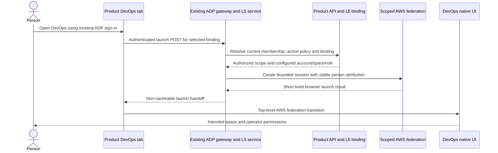

# DevOps native UI SSO security review

Reviewed **2026-10-26** against POC [PR #8817][poc] at
`7f82f551d2f1b8aa4ec46a829a217d6c95daf17e`, the deployed POC, the
[DevOps architecture](architecture.md#human-access) and [DA08 #8873][da08].
The requested design correction is incorporated into the authoritative
[R3 Human access contract](architecture.md#human-access). The observations below
describe the reviewed POC, not deployed R3 behavior. Acceptance IDs are preserved;
the affected delivery nodes and final evaluator must use the pinned R3 revision.

## Conclusion

The original POC scaffold explicitly created a Function URL with `AuthType=NONE`
and `Principal="*"`. [The original source][original] confirms that public invocation
was intentional for the discovery experiment. [A later correction][correction]
replaced it with IAM authorization and CloudFront origin access control (OAC).
Live readback and denial probes now confirm that anonymous direct invocation is
blocked. This review did not establish unauthorized session issuance or an incident.

The corrected Function URL is still internet-addressable. Calling it a
"private Lambda URL" confuses an IAM authorization boundary with network privacy.
OAC authenticates CloudFront to the origin; it does not authenticate the person
calling CloudFront. The POC checks the ADP session inside the function.

Production should put the launch operation in the existing authenticated ADP L5
API. The federation adapter can run inside that service. No separate Lambda
Function URL, public launcher route or identity provider is needed.

## Current deployment evidence

The AWS caller's account was matched to the private POC state before reading its
resources. The table is a sanitized review record; deployment identifiers,
policies and raw receipts remain in private operator evidence.

| Check | Observed result | Meaning |
|---|---|---|
| Function URL authorization | `AWS_IAM` | Lambda requires an AWS signature at the direct URL. |
| Entire Lambda resource policy | Exactly two Allow statements: `InvokeFunctionUrl` and `InvokeFunction`, both for `cloudfront.amazonaws.com`, restricted to the selected distribution | No wildcard/public principal remains in this policy. The URL statement requires `AWS_IAM`; the invocation statement requires invocation through the URL. |
| CloudFront OAC | SigV4, signing `always`; distribution deployed | CloudFront signs origin requests. |
| Unsigned direct launch POST | HTTP 403 | Anonymous direct-origin invocation is rejected. |
| CloudFront launch POST without ADP session | HTTP 401, `adp_session_required`, no launch URL | The request reaches the launcher, which denies it before federation. |
| CloudFront launch POST with invalid ADP session | HTTP 403, `current_access_required`, no launch URL | An AWS-signed origin request does not substitute for a valid human session. |
| Runtime source | Deployed `launcher.py` and `launch.html` exactly match the reviewed POC source | The code review applies to the current handler and page. |
| WAF and capacity | No Web ACL on this distribution; Lambda reserved concurrency is two | Concurrent work is bounded, but there is no WAF request-rate control here. |
| IAM roles | No attached managed policies; runtime, launcher and operator permissions are separate | Runtime assumes the selected launcher role; session creation is scoped to the selected space. Listing actions still use `Resource="*"`. |
| Offline authorization/page tests | All 15 passed | Includes denying missing/wrong identity, scope, origin, expiry and unexpected paths without session minting. |

These probes were bounded denial checks. They did not mint another AWS session,
start investigations, exercise a denial-of-service attack, or qualify two-user
identity isolation and session revocation.

## Findings

| Priority | Finding and consequence | Required design response |
|---|---|---|
| High, before production enablement | DA08 says to reuse the POC and require Product authorization, but does not explicitly exclude the POC's separate CloudFront-to-Lambda ingress. An implementation could preserve an unnecessary public invocation path while satisfying the current prose. | Specify the existing authenticated gateway/L5 launch operation as the only browser launch entry point. Reuse the federation logic, not the POC endpoint topology. |
| Medium, current POC | Anonymous traffic can reach Lambda through CloudFront. Valid-shaped requests with invalid bearer tokens can also cause an ADP identity lookup. Reserved concurrency limits simultaneous Lambda work, not request volume or request charges. The application expiry stops launches, not HTTP invocation or resource lifetime. | Retire the owned POC endpoint after replacement. If it must remain, explicitly bound its lifetime and apply verified request-rate protection. Test authentication and throttling before provider session creation in production. |
| Medium, deployment tooling | `private_endpoint.py` removes two known legacy public statements. Its conflict path checks principal, action and distribution but does not validate every required condition or reject all unrelated broad Allow statements. Today's policy is correct; the helper alone is not proof that a future rerun is equally restricted. | If retaining this helper, validate the entire resulting policy and OAC, including both URL conditions, and reject unexpected permissions. Production packaging should instead assert that no SSO Function URL or standalone launcher origin is created. |
| Documentation | The POC diagram and PR title call IAM-protected access "private." | Distinguish internet-addressable IAM-protected URLs from network-private invocation. A function's VPC attachment controls its resource connectivity; it does not make a Function URL private. |

The architecture already identifies two-user attribution, native history
visibility, membership removal and native-session revocation as qualification
gaps. They remain required; today's negative ingress probes do not close them.

## Required production launch path

1. Add the browser-only launch operation under the shared Product/project/service
   binding API. Use normal gateway authentication and the existing Product
   authorization boundary. An Origin header, CloudFront signature or possession
   of a Product ID never substitutes for a current human session and DevOps action
   permission. Deny unavailable or stale authorization before federation.
2. Resolve account, space, role and destination server-side from the authorized
   binding and supported provider routes. Do not accept arbitrary role ARNs,
   redirect destinations or claimed user IDs. Use the platform's scoped provider
   credential path; preserve separate launcher and operator roles. Derive policy
   from each onboarded Product, without POC identity or account allowlists.
3. Execute the federation adapter in the existing service. If isolation later
   justifies a helper Lambda, invoke it server-to-server through the AWS SDK with
   a narrowly scoped service role and **no Function URL**. Do not add a second
   public API or CloudFront behavior. If private network transit is required for
   that SDK call, qualify the Lambda API interface endpoint and its policy;
   putting Lambda in a VPC is not a substitute for ingress authorization.
4. Apply the platform's request-size, rate and abuse controls before expensive
   provider calls. Use the normal session and CSRF controls for the actual browser
   authentication mechanism. Return `no-store` responses and prevent referrer,
   telemetry, log, trace and artifact leakage of bearer credentials or launch
   tickets. Store audit identity, scope and outcome, not session secrets. Do not
   expose the browser ticket through the ordinary CLI/MCP operation surface.
5. Measure the native session lifetime and removal/revocation window independently
   of the short-lived launch credentials. Revoking ADP membership denies new
   launches; it does not establish immediate revocation of existing AWS cookies.
   Keep launch enablement blocked if the accepted identity or revocation policy
   cannot be demonstrated using supported provider behavior.

## Incorporating the review into delivery

| Owner | Concrete follow-up |
|---|---|
| [DA08 #8873][da08] | Make the gateway-only ingress explicit in the implementation contract. Extend authorization/session scenarios to show denial before any provider call and rejection of arbitrary scope/destination inputs. Reuse the existing four acceptance IDs where these are refinements of their current requirements. |
| [DA18 #8883](https://github.com/aws-e/adp/issues/8883) | Verify the full Terraform plan and effective roles: no SSO Function URL, public invocation grant or standalone launcher route. If a helper exists, prove its invocation scope. Do not create unrelated infrastructure solely to host this login handoff. |
| [DA19 #8884](https://github.com/aws-e/adp/issues/8884) | Independently read deployed ingress/IAM, verify unauthorized and rate-limited requests create no provider sessions, retain cross-Product and two-user lifecycle checks, and record cleanup of any superseded owned POC endpoint. |

Before dispatching affected work, bind the R3 architecture revision and
scenario changes into the accepted delivery plan. Preserve stable IDs and past
evidence, but reassess changed requirements; do not silently edit issue prose
while leaving the running plan pinned to an older contract. R3 does not introduce
a recurring approval gate or an extra deployment.

POC cleanup must identify ownership from private state, remove only the owned
CloudFront behavior/origin, wait for propagation, then remove its Function URL,
OAC, Lambda and dedicated roles as appropriate. Preserve other ADP routes and
any space intentionally retained for subsequent service testing. Expiry alone
does not perform this cleanup.

## References

- [AWS: Control access to Lambda function URLs](https://docs.aws.amazon.com/lambda/latest/dg/urls-auth.html).
- [AWS: Restrict access to a Lambda function URL origin with CloudFront](https://docs.aws.amazon.com/AmazonCloudFront/latest/DeveloperGuide/private-content-restricting-access-to-lambda.html).
- [AWS: Lambda interface VPC endpoints](https://docs.aws.amazon.com/lambda/latest/dg/configuration-vpc-endpoints.html).

[poc]: https://github.com/aws-e/adp/pull/8817
[da08]: https://github.com/aws-e/adp/issues/8873
[original]: https://github.com/aws-e/adp/blob/90f498328/modules/L5-services/spikes/devops-ui-sso/probe.py
[correction]: https://github.com/aws-e/adp/commit/18b26d177
