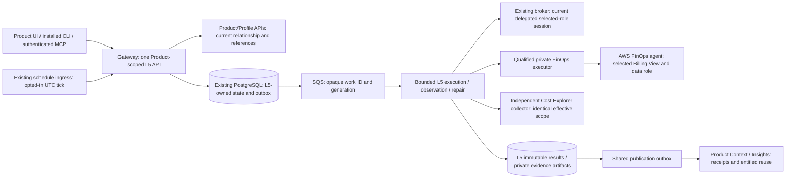
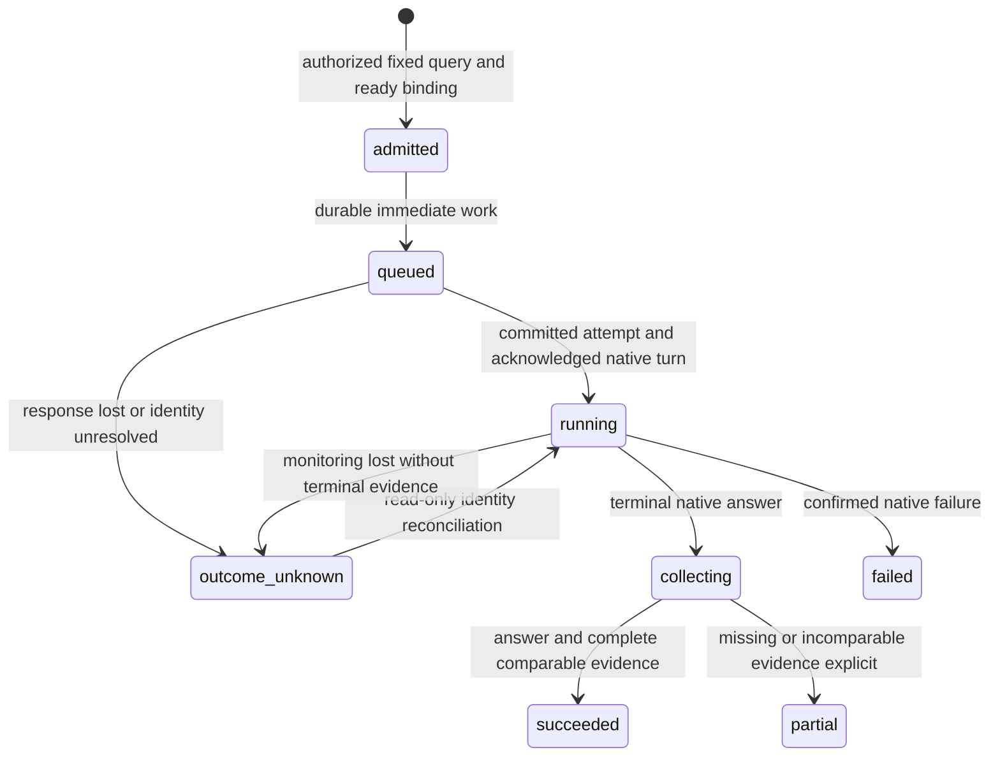

# AWS FinOps Agent architecture

Deployment ownership follows the [shared modular deployment contract](../modular-deployment-design.md):
independent L5 service roots and state, shared CI/CD, and service-specific qualification.
This supersedes earlier references to deploying L5 through gateway Terraform.

## Status and scope

Canonical design proposal for [FinOps #9079](https://github.com/aws-e/adp/issues/9079),
revision F1, 2026-10-27. **Implementation design approved.** See [accepted revision and actual review](review.json).
The epic and all seven children reference the accepted revision and actual approval. This document does not authorize implementation,
deployment, provider requests, IAM changes, purchases or a new spending allowance.
The [backlog](backlog.md) owns slice allocation and EC-to-AC mapping.

An entitled human or agent asks a fixed-interval cost question for an onboarded
Product/project. ADP returns the native FinOps answer alongside independent billing
evidence, including scope, metric, currency, estimation and freshness limitations.
Enabled periodic reports use that same inquiry operation. Later entitled tasks can
retrieve the result without rerunning the provider. Account spend is not Product
spend unless attribution is independently demonstrated. Forecasting, optimization,
remediation, purchases and billing enrollment are excluded.

Use `service_id=finops`, `capability=cost_inquiry` as proposed L5 wire identifiers;
these are not registered Module/Feature IDs. FO01 and PranavSharma1000 resolve the
catalog mapping with [shared SA01 #8683](https://github.com/aws-e/adp/issues/8683).
No repository, account, region, role, Product ID or Billing View is a platform
constant. Two projects must work on the same deployed artifacts through ordinary
configuration and bindings, not platform edits or per-project redeployment.

## Evidence baseline

Source inspection is pinned to main
`388584bdd80a4a5ff142abe3234e7d1eac1cfd64`. The [audit](audit.md) enumerates the whole
tracked tree, build/deployment entry points, workflows, Terraform declarations and
both migration graphs. It is not a claim that every artifact or live deployment
was tested. The older [shared architecture](../architecture.md) remains the common
design; its design-only baseline descriptions are not today's runtime status.

| Evidence | What it establishes; limit |
|---|---|
| [Extraction PR #9080](https://github.com/aws-e/adp/pull/9080), [proposal at `35e00861`](https://github.com/aws-e/adp/blob/35e00861a273b4a6492e05c57917c0272947255d/docs/l5-services/capability-expansion.md), [POC extraction](https://github.com/aws-e/adp/blob/35e00861a273b4a6492e05c57917c0272947255d/docs/l5-services/poc-evidence.md) | Open during audit; neither merged evidence nor approved design. Preserve its parent EC mapping. |
| [#7923 original report][poc-first] | Reports supported console/web-app automation, a custom account-filtered Billing View, dedicated data/operator roles, a native answer matching independent CE, a displayed conversation ID and owned-resource cleanup. Source refresh time was unavailable. Context `Deleted` is not proof of physical erasure. This design run did not reproduce that live result. |
| [#7981 report][poc-second] | Later billing-unavailable outcome; reusable helper was not live-requalified. Does not erase #7923. |
| [#8015 report][poc-third], [helper][poc-helper] | Reports 41 independent CE rows; setup stopped on Organizations denial and unqualified primary-view scope. No native inquiry. Saved-page Decimal normalization is not native-agent evidence. |
| [Product schema][profile], [Product client][product-client], [internal Product API][product-api] | Current Product references, financial allocation/policy fields, delegated Profile reads exist. Profile is accessed through APIs, never L5 SQL joins. |
| [Router][router], [RunInput][run-input], [admission][admission], [result router][result-api] | Shared runtime exists; configuration allows Security/DevOps, run/source validation and results still specialize in Security. A FinOps adapter alone cannot activate this service. |
| [Open DevOps DA09 PR #9081](https://github.com/aws-e/adp/pull/9081), `25e62f04bf750a7bcb36663e94105edfab587218` | Overlaps RunInput, admission, execution and gateway hosting. FO01 proposes one discriminated extension and integrates with this owner, not a competing registry. |
| [Open Security release PR #8932](https://github.com/aws-e/adp/pull/8932), `1477aed6761d4f7e09be64344fe3c27ddeb605fd` | Proposed worker/queue, packaging, migration and deployment integration; not assumed on main or deployed. FO07 reuses its compatible release mechanism. |
| [DevOps architecture](../devopsagnent/architecture.md#human-access) | Sibling ownership and session-security lessons, not a FinOps federation API contract. |

Official [FinOps overview][aws-overview], [agent creation][aws-create],
[Billing Views][aws-views] and [GetCostAndUsage][aws-ce] were fetched successfully
on 2026-10-27. Documentation availability does not qualify production automation,
current pricing/entitlement, effective IAM isolation or a recovery interface.
No supported public FinOps SDK lifecycle/result endpoint is assumed.

## Components and request flow

1. Host authentication resolves tenant and Product/project relationship; client
   fields do not assert tenant authority. Product APIs supply permitted candidates.
2. Configuration save records a version and Profile handoff, not provider setup.
   Explicit create/adopt setup establishes a persistent binding and scope receipt.
3. Admission checks current rights, binding generation, frozen query, configuration,
   provider qualification and existing budget/policy. One SQL transaction commits
   the run, idempotency receipt and work intent, then immediately sends SQS work.
4. Workers acquire fenced leases, recheck delegation, persist the provider attempt
   **before** effects and call the qualified adapter. No paid work waits for a sweep.
5. Native observation and independent CE collection are separate bounded work.
   Persist results before publication; publisher/consumer outages cannot resubmit.
6. Existing repair recovers owed sends, observation and collection/publication.
   UI/CLI/MCP see the same durable run, answer and uncertainty states.

| Owner | Responsibility |
|---|---|
| Product and existing host identity/broker | Relationships, Profile/source APIs, current rights, connection credentials and selected-role sessions; no FinOps secrets in Profile |
| Shared L5 core; FO01 coordinates changes, FO07 integrates release | Configuration/bindings/setup, admission, runs/attempts, SQL outbox/SQS, bounded recovery, results/publication contracts |
| FinOps adapter; FO02–FO04 | Provider setup and ownership receipts, supported execution, protected observation, query mapping and independent billing comparison |
| Host clients; FO05 | Product service tab, installed CLI and MCP parity, no direct provider submission |
| Context/Insights owners with FO06 | Contribution acceptance, receipts, indexing/retrieval and current-authorization denial; L5 acceptance is not consumer acceptance |

Runtime additions belong under `modules/L5-services/src/l5_services/`; docs under
`docs/l5-services/finops/`. No separate database, public Lambda URL, independent
billing platform, new scheduling service or Step Functions orchestration.

## Qualification and billing boundary

FO01 must publish a dated qualification record before enabling the dependent
native path: provider/version and supported surface, permitted automation terms,
current eligibility, regional availability, limits/pricing, stable agent and
conversation/turn identifiers, read-only observation, restart/session-expiry
behavior, data-role actions and effective Billing View isolation. Each fact has
source, tested revision, private evidence reference, owner and status. Missing
entitlement blocks affected activation/live checks, not unrelated code work.

Use the supported console/web application demonstrated in #7923 **only if** its
current automation and recovery can be qualified. Do not reverse-engineer internal
HTTP endpoints or infer APIs from IAM action names. If a documented provider API
becomes available, FO01 records the versioned evidence and adapts the same contract.
If neither path qualifies, configuration and honest readiness remain deliverable;
native EC-01/03/04/08 remain blocked. CE-only output cannot substitute for them.

The effective boundary is the intersection of the selected connection/delegation,
Billing View contents and the **provider data role**, not the worker's CE filter.
A management-account primary view can include foreign costs. FO02 must inspect the
view filter/health and provider attachment, role permissions, trust and relevant
resource policies using the selected execution path. No default/first account or
primary-view fallback. Failing Organizations discovery is a scoped readiness gap;
do not widen rights merely to complete setup. Scope changes invalidate qualification
and admission until rechecked. A changed view under an unchanged ARN is a change.

Prefer an adopted, already-qualified account-filtered view. Create a view or roles
only through separately authorized setup, never implicit enrollment at inquiry.
Allow CE actions on the selected Billing View resource where supported; prevent
other views through the effective policy boundary. Historical explicit `Deny` with
`NotResource` is evidence, not a policy to copy blindly. FO01 records service actions
that require wildcard resources and any compensating conditions; do not invent
resource scoping for actions that AWS does not support. Setup privileges remain
separate from read-only inquiry and observation. Do not grant IAM mutation to the
inquiry executor. Trust constrains the qualified principal and supported confused-
deputy protections. No ambient workload-role fallback for target AWS operations.

Acceptance requires both an owned-view success and a controlled foreign-view denial
through the actual native/data-role route, plus foreign tenant and same-Product,
other-project denial. IAM simulation alone is insufficient. Do not expose real
foreign billing as a test; the owner supplies controlled scope fixtures.

## Configuration and typed interfaces

**Proposed extension**, not an available FinOps endpoint. Keep the existing prefix
`/v1/products/{product_id}/projects/{project_id}/services/finops`. FO01 integrates
strict discriminated `service_id`/`capability` variants into the shared
[contracts](../contracts/v1/README.md), runtime validation and registration. Do not
weaken Security's immutable document/repository rules or impose them on cost queries.
Use a cost-query manifest with optional pinned context sources, not a fake repository.

| Configuration input | Authority, precedence and validation |
|---|---|
| Product/project, `profile_ref` | Route scope plus current Product relationship; immutable Profile revision via Product APIs |
| `connection_ref`, `region` | Explicit currently authorized selection; Profile `configuration.advanced.environments` provides candidates, not access; no default target |
| `finops.billing_scope` | Explicit selected billing account(s), view reference, verified filter/role-policy digest, scope observation time and scope generation; service configuration, not invented Profile fields |
| `finops.agent_mode`, native agent reference | `create` or `adopt`; explicit adoption permission and scope readback; never adopt by name similarity |
| Query defaults | Metric, daily/monthly granularity, supported groupings, question template and query limits; no forecast or optimization actions |
| `sources`, purpose/goals | Optional minimal authorized context; preserve immutable references and provenance; no repository prerequisite for account costs |
| Limits/policies | Existing financial budget-policy and execution-policy references; Profile allocations are proposals, not actual spend or new allowances; limits must be supplied/qualified, not reset from a POC |
| Triggers | Manual enabled only when ready; periodic explicitly opt-in, disabled by default, with UTC schedule and closed-period template |

Explicit authorized choices override inherited candidates; refresh preserves choices,
records inherited fields and conflicts, uses `If-Match`, and never silently enables
a service or overwrites a binding. Unknown/incomplete option pages are not empty
choices. Incomplete Profile fields unrelated to cost inquiry do not block it.

`POST /runs` input is the proposed strict `FinopsRunInput` in
[contract.json](contract.json); [examples.json](examples.json) contains fictional
valid/invalid contract fixtures, not live requests. It contains `service_id`,
`capability`, `configuration_revision`, `binding_id`, `question`, `query` and
optional `sources` and `parent_task_ref`. Both use shared immutable RecordRef
semantics (including rejection of `HEAD`, `latest` and `null`). Query contains inclusive `start`, exclusive `end` UTC calendar
dates, `metric`, `granularity`, explicit `group_by` (empty means no grouping), and expected currency.
The client cannot inject a view ARN, data role, delegation or widened account filter
into a run: these derive from the pinned binding. The immutable query manifest adds
scope digest/generation, template revision, optional context revisions and input hash.

F1 accepts `UnblendedCost`, `DAILY|MONTHLY`, and at most two supported groupings from
`SERVICE|LINKED_ACCOUNT`; more metrics/dimensions require qualified schema additions.
Validate real dates, `start < end`, closed intervals ending no later than today's
UTC date, provider retention and admitted interval/page/call limits. Reject unknown
keys, blank questions, unsupported metric/grouping, duplicate sources/groupings and
nonfinite monetary values. Question intent must agree with frozen scope/interval;
conflicts return a validation reason before native submission. Enforce scope in
credentials even if prompt interpretation fails. Query defaults never expand scope.

Reuse current operation IDs and receipt semantics:

| Operation | Input / output and decision |
|---|---|
| `getOptions`, `getConfiguration`, `saveConfiguration`, `checkConfiguration`, `refreshConfiguration` | Existing shared operations extended to FinOps; options only enumerate authorized candidates; save/check have no setup effects |
| `startBindingOperation`, `getBindingOperation`, `reconcileBindingOperation` | Shared lifecycle operations; explicit owned setup/retirement, operation receipt and readiness; see shared operation matrix for routes |
| `submitRun`, `getRun`, `listRuns`, `reconcileRun`, `cancelRun`, `retryRun` | Freeze query, return durable run; recovery is read-only; retry allowed only with authoritative no-effect proof, not because a session expired |
| `getResult`, `listResults`, `getArtifactAccess`, `downloadArtifact`, `getPublication`, `retryPublication` | Service-discriminated cost payload, original answer/evidence and independent publication recovery; never coerce costs into Security findings |

`202` means accepted durable work, not provider success. Retain shared strong ETags,
`If-None-Match: *` on first save, `If-Match` for mutable resources and scoped
`Idempotency-Key` receipts. Same key/body returns original receipt after current
authorization; changed body is `409 idempotency_conflict`. `428` missing precondition,
`412` stale ETag, `422` invalid/unsupported input, `409` disabled/not-ready/stale binding,
`401` authentication required, `403` forbidden action on an authorized resource,
`429` bounded/budget admission, `503` peer/capability unavailable and masked `404`
inaccessible resource. Preserve shared `410` expired pinned-revision behavior.
Use shared error envelope; no credentials/native sign-in URLs in errors. Pagination
cursors remain bound to tenant, Product/project, service and filter.

## SQL entities and lifecycle

Reuse existing L5 tables in the existing PostgreSQL database, not Profile SQL or a
second FinOps store. Names/keys here are verified against [model sources][models]
and [migration inventories](audit.md#storage-and-entry-point-findings).

| Existing entity | Key/invariant and FinOps use |
|---|---|
| `l5_service_configurations` / `l5_service_config_versions` | PK `(tenant_id, configuration_id)` / plus `revision`; unique tenant/Product/project/service; immutable typed FinOps settings in existing payload |
| `l5_service_config_receipts` | Tenant/Product/project/service/principal/operation/idempotency key; preserve Profile handoff independently of setup |
| `l5_service_bindings` | PK tenant/binding; scoped configuration FK, revision/generation, connection/native keys, ownership, provider identity and creation receipt; add typed FinOps payload semantics |
| `l5_service_setup_intents` | PK tenant/operation; unique scoped actor/idempotency key; setup and cleanup result/uncertainty retained independently of runs |
| `l5_service_binding_operations` / `l5_service_setup_work` | Tenant/operation and tenant/work PKs, setup-intent FKs, unique operation/generation work; bounded leased setup and cleanup, independent of run work |
| `l5_service_runs` / `l5_service_receipts` | PK tenant/run and scoped receipt identity; pinned configuration, binding generation, frozen cost query, admission limits, separate local/provider states |
| `l5_service_work` | PK tenant/work; unique tenant/run/kind/generation/step; due time, fenced lease, retry and blocked disposition; queue is transport only |
| `l5_service_worker_attempts` | PK tenant/attempt; unique tenant/run/operation; immutable input hash/token, native identity and reconcile count; commit before effects |
| `l5_service_provider_observations` | Unique tenant/run/work; append-only observations with observed time and evidence references |
| `l5_service_results` / `l5_service_result_details` | Tenant/result and unique tenant/run/version; immutable cost payload, optional later comparison version; result survives provider cleanup |
| `l5_service_event_receipts` | Scoped service/trigger/event identity; freeze configuration/query at schedule tick, reuse for replay |

FinOps conversation/turn identity, agent identity, observed status, comparison and
artifact metadata fit existing structured payloads. FO03 extends typed native
references with `conversation_id`, `turn_id` when available, executor receipt and
question hash, without claiming a provider idempotency token exists. FO02 adds a
**shared native-agent scope uniqueness constraint/index** if necessary: two Products
must not accidentally share one context-bearing agent. Existing uniqueness includes
configuration, so it does not alone enforce this rule. Add an internal unique retained-agent
scope index on service + digest of verified provider account/region/native agent
identity, across project/tenant scopes; the guard persists while the native agent/context exists, including after adopted
binding retirement. Only verified owned-agent absence releases it; retained/adopted
agents keep a scope tombstone. Reactivation uses the same scope/binding, not another
project. Cross-project transfer of retained context is outside this epic. Backfill without deleting conflicts: block affected adoption
for owner resolution. Provider ownership checks still apply. Mask conflicts without
revealing another tenant's binding.
A Billing View may be reused only if the effective scope and authorization match;
an agent with accumulated context may not be shared across project scopes.

FO04 proposes `l5_service_cost_collections` only for independently checkpointed CE
work: PK `(tenant_id, run_id, collection_id)`, scoped run FK, immutable query hash,
status, request count, page count, private cursor/checkpoint ref, completion time and
coverage/reason. The query hash is write-once for that primary key; updates compare its original
value and reject mutation (a uniqueness constraint alone cannot enforce immutability). A collection restart gets a new collection ID; never combine pages
from different collections. Existing work handles `collect` dispatch/recovery; no
second queue or scheduler. FO01/FO04 finalize the additive migration with common-core
owners, including retention for private checkpoints and no credentials in SQL.
Shared publication records are a dependency, not assumed implemented tables: FO06
reuses the SA11 contract and coordinates missing producer/consumer storage rather
than inventing a FinOps-specific publication service.

Configuration uses shared `draft`, `needs_input`, `ready`, `disabled`. Binding
lifecycle uses the shared enum: `unconfigured`, `checking`, `provisioning`, `ready`,
`blocked`, `outcome_unknown`, `suspended`, `unlinking`, `unlinked`, `cleanup_pending`,
`cleaned`, `cleanup_failed`. Retirement is an operation, not a new binding state;
adopted resources remain retained after `unlinked`. The diagram above is finite
run state only, with intermediate `materializing`/`submitting` as applicable. Provider state is not inferred
from local state. Local `cancelled`/`expired` never claims native stop; record
`stop_unsupported` or unknown when applicable. Publication status is independent of
run success. A discrepancy/partial comparison retains the native answer and prevents
an accepted reconciled-result claim; it does not manufacture a provider failure.

## Native inquiry and recovery

Use [AssessmentAdapter][adapter] semantics (`submit`, `reconcile_submit`, `observe`,
`collect`, `cancel`) with typed FinOps outcomes. [ExecutionService][worker] and
[WorkerAttempt][attempt] remain the durable owners. Reuse one shared discriminated
manifest path with Security/DevOps; no FinOps fork of the dispatcher.

For a qualified browser path, the worker delegates each bounded action to an
isolated private executor with supported browser dependencies. FO01 must select the
execution artifact based on measured action duration/session capability: a packaged
bounded Lambda action if it fits, otherwise an existing authenticated job-execution
facility with an explicit adapter and receipt. Do not assert either is already
FinOps-ready. Long-lived browser processes in the gateway and arbitrary signed
provider URLs returned to clients are rejected designs. FO03 owns executor wiring;
FO07 owns its packaging/IAM/network/release integration after qualification.

Each action uses an ephemeral browser profile scoped to tenant/Product/project,
binding, inquiry and executor lease. Session material stays in memory where possible;
necessary restart material is encrypted in a protected, TTL-limited session store,
referenced by an opaque handle, never public JSON/SQL/logs/queue payloads. Revalidate
current delegation before refreshing through the selected connection. Restrict egress
to qualified provider destinations; disable arbitrary navigation/downloads and redact
or exclude cookies, headers and sign-in URLs from evidence. Provider text is data,
not permission to navigate or invoke another tool. Only scoped, redacted answer
captures reach result readers; protected raw evidence has independent access checks.

| Fault point | Required behavior, independent observation |
|---|---|
| Admission committed; SQS send lost | Existing repair republishes owed work; same run and query; no second receipt |
| Before submit after attempt commit | On restart reconcile first. A local “not clicked” flag is insufficient no-effect proof after a crash |
| Provider accepted; response/native ID lost | Query qualified read-only history/receipt by saved inquiry identity. No submit. If unique correlation is impossible, retain `outcome_unknown` and block effects |
| Conversation ID exists but turn ID absent | Require a qualified unique turn locator/receipt and question hash within that conversation; timestamps or text similarity alone cannot prove identity |
| Session expired, access revoked, browser changed | Refresh only with current authority; observe same inquiry or report monitoring blocked/unknown; do not start a new conversation or turn |
| Refused question | Preserve refusal as provider output. The rephrasing in #7923 was another explicit question, not an automatic retry pattern. No autonomous paid rephrasing |
| Answer saved; collection/publication failed | Retry only CE read/collection or publication intent as applicable; preserve native IDs/answer |
| Cancellation/deadline | Stop local future effects; request remote cancellation only if supported and qualified; bounded observation until confirmed or explicitly unresolved |

Transport retries do not promise exactly-once provider effects. The design promises
**no automatic second submit after uncertainty** and truthfully exposes unresolved
outcome. New paid work requires a new admitted request or qualified definitive
no-effect proof under existing retry rules. Poll interval/attempt/deadline and total
request limits come from admitted policy, stay fixed across repair and are persisted
before calls. Never renew budgets by restarting a worker.

**Shared recovery extension:** The current execution worker returns early for local
terminal states. FO03/FO07 must integrate the same shared-core extension owned
with WA04/WA07: remote-running/unknown work can still receive bounded, separately
authorized observation and collection after local expiry/cancellation. Keep the
local terminal outcome, native outcome and recovery disposition separate. Never
reuse submit, reset budgets or infer remote termination from local state. Exhausted
recovery becomes explicit owed/blocked work; retain identity, artifacts and cleanup
receipts. Verify a late native completion after local expiry through the real
worker/recovery path, including revoked authority and unchanged Security stop behavior.

## Independent reconciliation and provenance

FO04 collects CE independently from the native answer using the selected scoped
connection and **the identical effective view/account set, interval, metric,
granularity and groupings**. Freeze canonical request bytes/hash; paginate
`GetCostAndUsage` with `NextPageToken` until absent. Preserve each page's private
artifact version/digest, collection ID and observed time, response interval, unit and
`Estimated`; count requests before calls, cap pages/calls, detect repeated tokens,
parameter changes and incompatible periods. An error or truncated page sequence is
partial/unavailable, never complete. Retry bounded reads only; never the native turn.

CE does not provide an immutable billing snapshot. Resuming a collection must retain
the exact request and cursor provenance; expired/invalid cursor starts a new collection
with a recorded supersession reason. Do not mix old/new pages. Time-varying estimates
and native-versus-CE collection times remain visible even when amounts match.

Use signed decimal **strings**, parsed as `Decimal`, preserving credits/refunds and
full provider precision; never binary float, absolute values, integer truncation or
currency conversion. Sum every returned group for the same interval/metric/unit,
including explicit unallocated buckets. Do not sum across currencies or different
aggregation levels. Preserve metric semantics; service totals need not equal an
independently scoped account total if coverage differs. Partial scope is not Product
attribution. A product attribution claim requires pinned tag/cost-category or other
qualified allocation evidence, coverage and shared/unallocated-cost treatment.

Comparison states: `exact`, `rounded`, `mismatch`, `incomparable`, `unavailable`.
`exact` requires identical dimensions, complete coverage, matching currency/metric,
matching known Estimated flags and decimal amounts for each matching group and total.
`rounded` records the native display quantum and difference within half that quantum;
it must not be relabelled exact. Any differing scope/period/currency/metric/group keys,
unknown Estimated or partial evidence makes the relevant comparison incomparable,
even if displayed numbers match. Unknown provider freshness stays `null` with reason;
observation time is not source refresh time. Configured staleness thresholds affect
reuse/readiness without fabricating a refreshed value. Empty/missing data yields
amount `null`; numeric zero is valid only from a complete explicitly observed zero.

`FinopsCostResult` in [contract.json](contract.json) is the service-specific payload
inside the shared Result envelope. It retains an immutable `billing_scope` snapshot
(account set, view reference and retained scope-evidence artifact), query/scope digest,
native answer artifact and native identity, a separate CE collection evidence list,
amounts/units/Estimated/refresh times, comparison state/delta and attribution level.
Complete native/CE per-group series and signed values reside in versioned evidence;
public projection preserves totals and coverage. Provenance includes adapter/parser
version, configuration/Profile/binding revisions, query/input hashes, collector time,
source authority and evidence digests. Do not treat a CE-only artifact as native
answer evidence. Retrieval rechecks current visibility of the originating scope.

## Client parity

FO05 adds a FinOps service tab within the existing Product/project workspace. It
shows choices/readiness, setup/adoption progress, question and fixed period, run
identity/status, original answer, comparison, uncertainty, evidence and cleanup
state. No credentials or native sign-in links. No native embedded UI or DevOps
`launchNativeBrowser` reuse is part of this scope; qualified protected automation
executes on behalf of the admitted request, and clients read the resulting answer.

Extend the shared `adp service` command family and `l5___*` MCP operation catalog,
not direct provider clients. These are proposed FinOps surfaces; CLI installation
and MCP registration must be tested through their real host entry points. Show the
same ETag/idempotency, scope, readiness and result envelopes in all clients.
Commands use explicit Product/project/service selection; `--json` preserves strings,
null and state. Preserve the [shared CLI/MCP contract](../architecture.md#api-and-client-contract):
exit 0 successful read/write acceptance (including 202, not completion), 2 invalid
input, 3 denied, 4 conflict, 5 unavailable, 6 failed terminal operation, 7 bounded
`--wait-seconds` elapsed with the durable reference. Reading a partial/unknown result
still returns its actual state; a wait timeout never resubmits. No service-specific
renumbering. MCP uses scoped `assessment_ref` to target an existing run, not a
caller-supplied top-level `run_id` authority argument; preserve the shared guard.
Return shared `structuredContent={data,http_status,etag?}` plus the matching JSON
text block, copying ETags verbatim. Structured errors retain `isError=true` and
`{http_status,error}`. Tool schemas/annotations do not grant delegation.
Business adoption maps to shared binding action `link`; create/check/update/suspend/
resume/unlink/cleanup keep their existing action variants. No parallel FinOps lifecycle
endpoints or invented provider methods.

The [operation matrix](../contracts/v1/operations.tsv) is the shared parity baseline.
FO05 covers configuration, binding/setup, inquiry, status/answer/evidence, cancellation,
read-only recovery and publication status; Security-only findings/triage/model
operations are explicitly unsupported for FinOps. No route returns a fake empty
finding list to imply a valid cost result.

## Publication and periodic reports

FO06 extends the existing [peer contract](../contracts/v1/peer-contracts.md) and
[Context design](../architecture.md#results-triage-and-context). L5 persists immutable
results and a scoped publication intent in the same transaction. Each consumer has
its own receipt keyed by tenant/Product/project/result/version/consumer; retries
reuse the identity. Consumer success requires acknowledgment plus its readable
projection, not just HTTP send success. A later, separately authorized task must
retrieve and cite the original scope/time/freshness and use the result; revocation
must deny reuse and prevent stale indexed copies from bypassing source visibility.
Insights must receive cost semantics, not fabricated Security finding counts.
Publication failure does not change the native outcome or submit another inquiry.

The current [schedule receiver][schedules] hardcodes Security and immutable source
inputs. Extend it by service/capability while retaining the existing event receipt,
admission and repair mechanisms. A periodic report freezes a closed query interval
at its scheduled UTC tick (for example the previous complete calendar month), template
revision, configuration revision and binding generation. Unique identity is tenant/
Product/project/service/trigger/scheduled instant. Replay uses that frozen interval,
not “previous month” evaluated at retry time. Admission recomputes the closed
interval from the receipt's original UTC tick and stored template, rejecting a
shifted copy even if both saved query fields agree. Disabled/revoked/changed-scope
triggers reject admission; missed ticks do not automatically produce unbounded
catch-up. The receiver and worker have local integration coverage; FO07 must
still qualify the installed authenticated schedule API and its live replay.
Optional delivery destinations require current entitlement; no new Slack/Jira
integration is required by this epic. Use existing scheduling transport; FO06/FO07
must verify its authenticated ingress and deployed repair, not merely the helper.

The proposed monthly schedule trigger is explicitly enabled and carries
`schedule: "0 0 1 * *"`, `period_template: "previous_closed_month"`, a positive
`template_revision`, a nonempty `question`, a `binding_id`, and `query_template`
with `metric`, `granularity`, `group_by` and `currency` (no caller-supplied dates).
At the first day of a UTC month, the receipt freezes the previous full month
as start-inclusive/end-exclusive dates in a regular `FinopsRunInput`. It also
retains the template/configuration revisions and current binding generation.
Replay finds the original receipt before examining changed configuration;
a previously unseen tick more than a day late is rejected rather than
generating an unbounded series of backdated inquiries. Admission still requires
current service authorization and the existing run limits.

## Rollout, verification and cleanup

Group delivery: FO01 contracts/qualification; FO02 bindings; FO03 inquiry and FO04
comparison; FO05 clients and FO06 publication/events; FO07 integrates each compatible
batch into **one coordinated L5 release**, retaining normal gateway/frontend deploys.
The [audit entry-point matrix](audit.md#storage-and-entry-point-findings) separates
actual publishers from proposed/unmerged paths. Schema JSON in shared contracts can
trigger gateway deployment; this design keeps draft FinOps schemas in its own docs
subtree and makes no production registration changes.

FO07 records one compatible schema/package/worker/client release manifest. Additive
SQL migrations deploy before producers of new payload variants; workers/readers
must understand the variant before admission is enabled. Coordinate gateway migration
runner with L5's branch labels and all current heads; never assume latest filename
is the schema. Stage a disabled capability, deploy compatible workers/consumers,
verify installed package and queue bindings, then enable scoped fixtures through
configuration. Gateway auto-deploy alone does not deploy the FinOps executor or
prove end-to-end readiness. Follow the existing deployment guide and authority;
this design introduces no new human checkpoint.

Rollback disables new FinOps admission/triggers, keeps repair/read-only observation,
result reads and cleanup on a compatible worker version, and retains idempotency/
native identity evidence. Payload readers tolerate unknown service variants without
misinterpreting them. Additive migrations use documented down steps only after
work drains; otherwise retain unused columns/tables. Never drop billing evidence or
receipts to roll back code. FO07 verifies fresh/existing/pending-work upgrades and
mixed-version rejection with explicit reasons, not destructive automatic downgrade.

Setup resources persist across inquiries. Retirement stops new inquiries, freezes
ownership receipts, reconciles active/unknown work, retains results/publication and
removes only operation-owned resources in dependency order: provider context/agent,
then exclusively owned roles and view after references are clear. Adopted resources
persist. Setup partial success and cleanup errors remain durable repair intents;
retry bounded cleanup/readback, not setup creation. Readback verifies agent/list,
role and view absence where supported; a context deletion marker is not permanent
erasure. Retention/purge follow existing policy and legal constraints, not new
service defaults. Revoked authority can block cleanup; report owner/action rather
than using alternate credentials.

Pre-review checks: schema/fixture/link/inventory validation and new contract,
PostgreSQL race/replay, service-routing, installed-client and worker tests from the
[backlog](backlog.md). Independent expected values are specified there. FO07 owns
post-deploy acceptance: two non-ADP projects with distinct effective scopes and one
release identity; native answers and complete independent billing; controlled foreign
view/tenant/project denial; lost acknowledgment, worker death and session expiry;
partial/missing/zero/credit counterexamples; all client journeys; event replay;
consumer receipts and later entitled use/denied reuse; owned cleanup/adopted retention.
Use private evidence, recording revision, actual attempts/costs, unknown charges,
resource disposition and EC → child AC → scenario → proof. Mocks do not satisfy live ECs.

## Prerequisites and review handoff

| Unresolved fact | Owner / required action | Affected phase |
|---|---|---|
| Supported automation, stable turn identity/read-only resume, scope policy, provider eligibility/pricing | FO01 with authorized fixture owner; publish qualification and precise unsupported reasons | Native adapter selection/activation and EC-01/02/03/04/08; independent schema/client work can continue |
| Authoritative Module/Feature catalog IDs | FO01 + PranavSharma1000 with SA01; resolve registered mappings | Dependent dispatch/catalog registration, not runtime target selection |
| Shared RunInput/manifest/host overlap in PR #9081; worker release PR #8932 | FO01/FO07 with sibling owners; integrate one compatible contract/release | Common-core merge/release, not sibling-wide closure |
| Product Context/Insights contribution and entitled retrieval availability | FO06 and consumer owners; qualify actual routes/receipts/index visibility | EC-07 and publication activation |
| Two controlled non-ADP billing fixtures and selected delegated access | PranavSharma1000 coordinates, FO07 release owner executes within existing authority/budget | Post-deploy live acceptance only |
| Roadmap membership | Coordinator added and independently verified all seven native children in [project 4](https://github.com/orgs/aws-e/projects/4), 2026-10-27. | Resolved; no implementation dispatch. |
| Design approval | Actual accepted revision and review are recorded in [review.json](review.json) and all seven children/epic | Complete; native qualification and live acceptance remain pending |

Keep implementation stories open and use `Refs` until live acceptance. This design
PR can be reviewed before main-only/live checks; no runtime/provider verification
has been performed by the architecture assignment.

[poc-first]: https://github.com/aws-e/adp/blob/46bbf63486b3af677bddd4a694de9a1c793cfd5a/docs/spikes/aws-agent-setup/finops.md
[poc-second]: https://github.com/aws-e/adp/blob/573062809251f240634f998f045d9716834c6f79/docs/spikes/aws-agent-setup/finops-adp.md
[poc-third]: https://github.com/aws-e/adp/blob/83673b8808bc266ee52f1d1a2d97c6b3a55add1a/docs/frontier-agents/spikes/finops-cost-inquiry.md
[poc-helper]: https://github.com/aws-e/adp/blob/83673b8808bc266ee52f1d1a2d97c6b3a55add1a/scripts/frontier-agent-spikes/finops-cost-inquiry.py
[aws-overview]: https://docs.aws.amazon.com/finops-agent/latest/userguide/what-is.html
[aws-create]: https://docs.aws.amazon.com/finops-agent/latest/userguide/creating-an-agent.html
[aws-views]: https://docs.aws.amazon.com/cost-management/latest/userguide/billing-view.html
[aws-ce]: https://docs.aws.amazon.com/aws-cost-management/latest/APIReference/API_GetCostAndUsage.html
[profile]: https://github.com/aws-e/adp/blob/388584bdd80a4a5ff142abe3234e7d1eac1cfd64/modules/gateway/src/products/configuration.py#L74
[product-client]: https://github.com/aws-e/adp/blob/388584bdd80a4a5ff142abe3234e7d1eac1cfd64/modules/L5-services/src/l5_services/product_client.py#L10
[product-api]: https://github.com/aws-e/adp/blob/388584bdd80a4a5ff142abe3234e7d1eac1cfd64/modules/gateway/src/internal/l5_product_routes.py#L1
[router]: https://github.com/aws-e/adp/blob/388584bdd80a4a5ff142abe3234e7d1eac1cfd64/modules/L5-services/src/l5_services/api/router.py#L10
[run-input]: https://github.com/aws-e/adp/blob/388584bdd80a4a5ff142abe3234e7d1eac1cfd64/modules/L5-services/src/l5_services/run_input.py#L31
[admission]: https://github.com/aws-e/adp/blob/388584bdd80a4a5ff142abe3234e7d1eac1cfd64/modules/L5-services/src/l5_services/admission.py#L42
[result-api]: https://github.com/aws-e/adp/blob/388584bdd80a4a5ff142abe3234e7d1eac1cfd64/modules/L5-services/src/l5_services/api/results.py#L11
[models]: https://github.com/aws-e/adp/tree/388584bdd80a4a5ff142abe3234e7d1eac1cfd64/modules/L5-services/src/l5_services/models
[adapter]: https://github.com/aws-e/adp/blob/388584bdd80a4a5ff142abe3234e7d1eac1cfd64/modules/L5-services/src/l5_services/adapters/protocol.py#L1
[worker]: https://github.com/aws-e/adp/blob/388584bdd80a4a5ff142abe3234e7d1eac1cfd64/modules/L5-services/src/l5_services/workers/execution.py#L37
[attempt]: https://github.com/aws-e/adp/blob/388584bdd80a4a5ff142abe3234e7d1eac1cfd64/modules/L5-services/src/l5_services/models/attempt.py#L12
[schedules]: https://github.com/aws-e/adp/blob/388584bdd80a4a5ff142abe3234e7d1eac1cfd64/modules/L5-services/src/l5_services/events/schedules.py#L15
