# AWS Transform: bounded Product modernization

Deployment ownership follows the [shared modular deployment contract](../modular-deployment-design.md):
independent L5 service roots and state, shared CI/CD, and service-specific qualification.
This supersedes earlier references to deploying L5 through gateway Terraform.


## Status and scope

**Reviewed implementation design TF-R1.** Accepted revision and actual approval
are recorded in [review.json](review.json). This is the
canonical design for [epic #9077](https://github.com/aws-e/adp/issues/9077), under
[shared parent #8150](https://github.com/aws-e/adp/issues/8150). It defines a
reusable service that turns an entitled repository snapshot and a bounded goal
into the original provider-produced patch, independently checked tests and a
versioned result. Configuration works for any onboarded Product/project; ADP is
not a required fixture. Saving configuration never starts paid work.

The architectural direction is approved for implementation planning. Live enablement is **not ready**:
the current provider protocol, isolated executor bridge and interrupted paid
session recovery require TF01 qualification. The seven stories in the
[backlog](backlog.md) are independently verifiable delivery slices, not evidence
that the service is implemented. TF07 owns compatible release and live acceptance;
PranavSharma1000 coordinates acceptance. No runtime, deployment, purchase,
credential grant, agent dispatch or approval is created by this design.

In scope: bounded refactoring and dependency/runtime version modernization,
reviewable patches, one-off/opt-in recurring runs, later entitled Context reuse,
and separately authorized PR publication. No portfolio, mainframe, VMware,
Windows migration, automatic merge/deploy, new budget platform, new service
database or Step Functions orchestration. Story artifact lists are advisory,
never source-write grants or node failure gates.

## Evidence baseline

Source inspection is pinned to main
`388584bdd80a4a5ff142abe3234e7d1eac1cfd64` (2026-10-27). The branch's initial
`3503538cc15466bc5281aca92c2310193ad85fa6` is a no-content worker checkpoint.
Repository links below are relative for navigation; [the audit](audit.md)
records immutable paths/blob IDs and the pinned revision for every source claim.
This review did not run provider jobs or inspect a deployed database/cluster.

| Evidence | What it establishes; what it does not |
|---|---|
| [Proposal PR #9080](https://github.com/aws-e/adp/pull/9080), [capability expansion](https://github.com/aws-e/adp/blob/35e00861a273b4a6492e05c57917c0272947255d/docs/l5-services/capability-expansion.md), [POC extraction](https://github.com/aws-e/adp/blob/35e00861a273b4a6492e05c57917c0272947255d/docs/l5-services/poc-evidence.md), [original service proposal](https://github.com/aws-e/adp/blob/35e00861a273b4a6492e05c57917c0272947255d/docs/l5-services/transform/README.md) | Open at inspection, not assumed on main. Preserve these historical links rather than importing sibling proposals into this PR. |
| [Refactor report #7982](https://github.com/aws-e/adp/blob/cebebe4c4bb6ed13cfbd5b9c68749b144cec79f9/docs/spikes/aws-agent-setup/transform-adp.md), [runtime helper](https://github.com/aws-e/adp/blob/cebebe4c4bb6ed13cfbd5b9c68749b144cec79f9/scripts/aws-agent-onboarding/transform_runtime.py#L186) | Reported native refactor, original 13/expanded 21 relevant passing tests; `atx 3.19.0` JSON conversation, file-tool checks and Landlock writable projection. Not a merged L5 integration or a newly reproduced result. |
| [Upgrade report #8016](https://github.com/aws-e/adp/blob/398cf85c6017cc5492e246eae440fd4ccf241341/docs/frontier-agents/spikes/transform-dependency-upgrade.md) | Reported Uvicorn 0.34.0→0.34.3, 26 before/after tests and independent lock/artifact comparison. Not full gateway CI. Completed replay, not interrupted paid continuation or remote cancellation, was demonstrated. Historical usage estimates are not invoices or remaining allowance. |
| [Shared architecture](../architecture.md), [v1 contracts](../contracts/v1/README.md), [DevOps architecture](../devopsagnent/architecture.md) | Shared design and compatibility rules. Older statements that all runtime is proposed must be read against current source, not treated as current absence. |
| [L5 package](../../../modules/L5-services/README.md), [router](../../../modules/L5-services/src/l5_services/api/router.py#L10), [run input](../../../modules/L5-services/src/l5_services/run_input.py#L30), [results router](../../../modules/L5-services/src/l5_services/api/results.py#L15) | Configuration accepts Security/DevOps; run and result paths still reject other services. Transform has no adapter or registered contract at this baseline. |
| [Security release PR #8932](https://github.com/aws-e/adp/pull/8932) at `1477aed6761d4f7e09be64344fe3c27ddeb605fd`; [DevOps admission PR #9081](https://github.com/aws-e/adp/pull/9081) at `25e62f04bf750a7bcb36663e94105edfab587218` | Open shared release/admission work. TF01/TF07 must integrate with these owners; neither an open PR nor a closed sibling story proves live availability. |

Official AWS documentation was fetched on 2026-10-27:
[custom transformations](https://docs.aws.amazon.com/transform/latest/userguide/custom.html)
and [command reference](https://docs.aws.amazon.com/transform/latest/userguide/custom-command-reference.html).
It documents `atx custom def exec`, non-interactive execution, pinned transformation
versions, minute limits and conversation resume. It does **not** establish that
the POC's `atx json` event protocol is a supported stable integration, or prove
idempotent submission, unattended authentication, remote stop or loss recovery.
Documentation fetch is not installed-version or live-provider qualification.

## Components and ownership

```mermaid
flowchart LR
  Clients[Product UI / CLI / MCP] --> Gateway[Gateway: authenticate and authorize]
  Gateway --> Product[Product APIs: Profile / bindings / pinned source]
  Gateway --> Core[L5 core: config / admission / SQL outbox]
  Core --> Queue[SQS: opaque work ID and generation]
  Queue --> Control[L5 bounded Lambda control and observation]
  Control --> Broker[Existing broker: current scoped connection]
  Control --> Provider[Trusted finite Transform CLI job]
  Control --> Executor[Existing validation executor isolation]
  Product --> Snapshot[Sealed source snapshot]
  Snapshot --> Provider
  Snapshot --> Executor
  Provider --> Patch[Original provider patch and session evidence]
  Patch --> Executor
  Executor --> Evidence[Independent before / after checks]
  Patch --> Results[L5 versioned results and private artifacts]
  Evidence --> Results
  Results --> Clients
  Results --> Consumers[Context / Insights with receipts]
  Results -. separate SCM authorization .-> SCM[Branch and PR; never merge]
```



| Boundary | Owner and responsibility |
|---|---|
| Gateway HTTP host; existing Product workspace, CLI and tool transport | TF05 integrates clients; TF02 owns configuration host changes; TF07 coordinates host rollout. All use one Product-scoped L5 API, not direct provider clients. |
| `modules/L5-services/` / `l5_services` | Shared SQL configuration, bindings, runs, work, results, migrations and provider adapter. TF01 owns common-contract proposals; TF03 owns execution; TF04 results; TF06 events/publication. No direct Profile SQL. |
| Product source and credential delegation | Existing Product API/broker owners retain authorization; TF02 integrates selected references. Profile text, repository instructions and file lists confer no rights. |
| Isolated source/build/test jobs | Select the existing Kubernetes validation executor described below. TF01 qualifies the bridge with its owner; TF03 integrates non-blocking job lifecycle; TF07 qualifies deployed isolation. |
| Provider CLI job | Trusted Transform adapter code owns a finite native session; Lambda only submits/observes bounded steps. Never run an hours-long CLI or repository build inside Lambda. |
| Deployment | TF07 integrates SA15 release work and applicable tools/executor packaging; normal gateway/frontend automatic delivery remains enabled. No public Lambda URL. |

## Configuration and Product handoff

Existing [Product profile projection](../../../modules/gateway/src/products/routes.py#L163),
[configuration schema](../../../modules/gateway/src/products/configuration.py#L60),
[ProductClient](../../../modules/L5-services/src/l5_services/product_client.py#L18)
and [internal Product reads](../../../modules/gateway/src/internal/l5_product_routes.py)
are the source interfaces. Worker reads use current stored delegation via the
internal IAM transport, not forged identity headers on public human routes.

Proposed service discriminator `transform`; capabilities `refactor` and
`dependency_upgrade` (runtime upgrades use a typed runtime target in the latter).
TF01 adds strict discriminated schema branches to the existing contract catalog,
Pydantic validators, registration and client matrix together. Omitted service ID
continues to mean Security for old callers; no Transform fields leak into that
branch. Unknown service/capability pairs fail closed. Registered roadmap/catalog
module/feature IDs remain unresolved; TF01 and PranavSharma1000 resolve the shared
#8683 mapping before implementation dispatch, without inventing catalog IDs here.

| Setting / origin | Resolution, ownership and invalid case |
|---|---|
| Product/project and relationship revision | Server-resolved current membership and Product–Project relation; tenant from authenticated authority. Keep anchor-stable tenant formats; never use Profile text as tenant selection. |
| Repository choices | Suggestions from `configuration.basic.repositories`; intersect with currently entitled source bindings. Select exactly one immutable `repository_commit` reference per run in this slice. Reject symbolic revisions, foreign bindings and unavailable content. |
| Purpose, architecture, decisions | Product purpose/goals plus `configuration.basic.architecture` and `.decisions`; optional entitled context, not mandatory cloud inventory. Pin resolved references and hashes. |
| Test/build policy | Suggest from `configuration.advanced.test_strategy` and `.pipelines`. Store a versioned `test_policy_ref` resolved to approved argv arrays, relative cwd, image digest, dependency bundle digest, selectors/oracles and per-command limits. Free-form Profile text is not executable policy. |
| `transform.executor_binding_ref` | Selected protected executor configuration and qualification revision. Host cluster, namespace and image references come from owned configuration, never caller-selected raw URLs or kubeconfig. |
| `transform.connection_ref`, `region`, optional `definition_ref` | Existing selected AWS connection, eligibility readback and pinned definition/version. Reject role/account/region mismatch; refresh credentials through that same connection. No hardcoded Product, repository, account or region. |
| `transform.write_paths`, `read_paths`, `excluded_paths` | Canonical repository-relative paths constrained by separate source-write authority; nonempty write scope. Resolve/deny traversal, case collisions, symlinks, submodules and LFS unless qualified explicitly. Never interpret advisory story file lists as grants. |
| `transform.goal_defaults` | Typed kind, summary and optional dependency/runtime target. Per-run goal may narrow within configured capability/source limits, not widen them. Dependency/runtime targets require explicit expected target version. |
| Budget, permission, execution and retention limits | Existing `configuration.financials.budget_policy_ref` and policy references resolve current limits. Freeze provider minute ceiling, wall deadline, observation/reconcile counts, source/output bytes, scratch size and retention at admission. Missing limit means blocked, not unlimited/zero cost. |
| Triggers | Manual enabled only when ready; recurrence off by default. Explicit opt-in pins trigger revision, binding, capability, goal and source selection policy; use shared schedule transport. |

Precedence: explicit authorized service setting, then named Profile-derived
suggestion, then a documented non-authority default (recurrence disabled). No
fallback credential, repository or executor. Configuration saves replace explicit
settings, retain immutable historical versions and ETags, and start no provider
work. Refresh is explicit and preserves overrides while recording source changes.
Readiness is per capability: `ready`, `missing_input`, `denied`, `unsupported`,
`unqualified` or `stale`, with field/code/owner/affected-step gaps. UI must not
require unrelated EKS/resource inventory for repository modernization; selected
executor infrastructure is a platform binding, not a fact every Product invents.

## API and client contract

Existing route family:
`/v1/products/{product_id}/projects/{project_id}/services/{service_id}`.
All Transform behavior in this section is **proposed**, not available on main.
Reuse existing operation IDs and transports; do not introduce a parallel API.

| Operation | Input → response; implementation owner |
|---|---|
| Configuration options/get/version, PUT, check/refresh/handoff | Existing shapes plus strict `transform` settings branch; ETag and idempotency preconditions unchanged. TF02. |
| Binding operation POST/read/reconcile; binding list/read | Pinned config revision, selected connection/executor refs, create/adopt/verify/cleanup action → durable operation ID/readiness. TF02. |
| Run POST/list/read/cancel/reconcile/retry | Pinned config/binding, capability, one immutable source, typed goal and optional parent Task reference → 202 durable run, location/readback. TF03; route integration TF05. |
| Results list/get; artifact metadata/bytes | Existing result envelope extended with Transform variant; original patch, tests, provenance and limitations. TF04/TF05. Do not fabricate Security findings for patches. |
| Separate PR handoff | Proposed authorized result-to-SCM operation, outside run submission. Input result version/digest and target repo/base; output existing SCM operation/reference. TF05 must qualify the existing SCM writer or show this optional action unavailable. |

`Idempotency-Key` is required for mutations; same scoped key and identical
canonical body returns the recorded response after current authorization.
Changed payload is 409; stale ETag is 412; missing precondition is 428; invalid
shape/unpinned input is 422; missing/foreign readable resource is 404 without
existence disclosure. Current permission denial is 403; unavailable installed
capability is 503. Do not turn an unknown run into HTTP success evidence.
Preserve existing host status codes where stricter current contracts apply.

The following **proposed request fixture** is fictional, not executable against
today's Transform routes. Its six-field source reference follows existing
`RecordRef`; the validator extension belongs to TF01.

```json
{
  "service_id": "transform",
  "configuration_revision": 3,
  "binding_id": "00000000-0000-4000-8000-000000000001",
  "capability": "dependency_upgrade",
  "sources": [{
    "tenant_id": "user-10001",
    "project_id": "sample-project",
    "source_connection_id": "sample-repository",
    "record_type": "repository_commit",
    "record_id": "example/widget",
    "record_revision": "1111111111111111111111111111111111111111"
  }],
  "transform_input": {
    "goal": {
      "kind": "dependency_upgrade",
      "summary": "Upgrade the selected library without changing public behavior",
      "target": {"kind": "dependency", "name": "sample-library", "version": "2.1.0"}
    }
  }
}
```

Server derives tenant/product/project authorization, delegation, budget admission,
executor image, commands and immutable effective policy; none are accepted from
the public request as authority. Hash the complete canonical effective input,
including configuration/binding generations, Profile/source revisions and goal.

TF05 adds a Transform service tab in the existing Product workspace with options,
missing-input remediation, configuration history, run progress/freshness, original
diff, before/after checks, limitations and separate PR action. CLI adds the same
service selection to the installed Product service command family (new Transform
commands are proposed); JSON output retains run/result IDs and status. Admission
exit 0 means accepted, not passed; explicit wait distinguishes success, failed
verification, blocked/unknown and local wait timeout. MCP extends the existing
contract's operation tools, preserving `data`, `http_status` and quoted `etag`.
Client tests compare semantic request/response/scope, not screenshots alone.

## Executor and provider qualification

**Selected existing executor:**
[KubernetesValidationExecutor](../../../modules/agent-factory/agent-worker-image/lib/codex_kubernetes_validation.py#L103),
[dedicated validation service](../../../modules/tools/validation/README.md),
[service identity transport](../../../modules/tools/validation/validation_tools/executor.py#L29)
and [qualification procedures](../../../modules/tools/validation/isolation-infra/README.md).
It projects source into credential-free Pods, pins images, denies network and
preserves termination evidence. The public `/tools/validation` API currently
requires an authenticated Task attempt; its
[runner](../../../modules/agent-factory/agent-worker-image/lib/codex_validation_service_runner.py#L19)
limits checks to 120 seconds. These are real constraints, not a generic L5 job API.

Reuse that executor's source projection, Pod construction, boundary checks,
bounded Kubernetes API and termination/finalizer rules through a **proposed
L5-authorized non-blocking bridge** under `l5_services.adapters.transform`.
The executor owner exposes launch/read/terminate/collect primitives without
changing existing Task callers or passing fake Task identities. Gateway validates
an L5 work/attempt/fence grant; the trusted control process alone holds cluster
transport identity. SQL L5 work owns retries; do not copy the validation service's
DynamoDB operation store into another L5 database. The bridge checks namespace,
node qualification revision/UID and image digest before each launch.

First supported test policies keep the existing 120-second **per-check** ceiling
and source projection limits. Longer test commands are unsupported until the
executor owner qualifies them; a long overall transformation does not waive the
check limit. Prepare dependencies in a separate credential-free preparation job
with approved package-registry egress, then seal a hash-addressed bundle; baseline
and candidate tests run with network denied and identical bundles except admitted
dependency changes. Never grant the existing deny-all test Pod broad network
access merely to run a package installer. Missing compatible cached artifacts or
an executor inability to stage them is a readiness gap, not a fabricated pass.

The **provider CLI is a different finite job**, not a test Pod. Trusted adapter
code uses the current supported AWS Transform custom interface, pinned binary
digest/version and definition version. It receives only scoped temporary provider
credentials and a sealed source projection; no SCM write credential, Kubernetes
credential or platform database secret. The provider may use file-read/editor
tools only within admitted paths. Deny repository hooks, shell/build/test tools,
MCP servers, project/user skill discovery, credential-file reads and arbitrary
network tools; enforcement must be machine-verifiable, not a prompt request.
Keep provider credential transport separate from materialization and tests.

TF01's qualification record must identify the exact supported invocation/auth
mechanism, region constraints, tool mediation, session/native IDs and output
formats. Prefer documented `atx custom def exec` where its controls suffice;
the historical `atx json` conversation protocol is a candidate only, not a promise
of support. Do not automatically install/update a CLI in a run or call an
unrelated Transform migration API. If no supported interface can prevent
repository tool execution while credentials are present, report the capability
unsupported and leave live submission disabled. Do not relax isolation to pass.

**Working-setup protocol selection (2026-10-29, delivery coordinator):** Implement
and qualify the pinned NDJSON candidate rather than assuming the finite
`--non-interactive` command supplies file-tool mediation. The vendor still lists
[3.19.0 as active](https://transform-cli.awsstatic.com/3.19.0/manifest.json).
Its archive SHA-256 is
`2538a09e24ab5a8b2abeef16fec824600d66b5b215dceccd11e5c4f4318e904e`;
the executable SHA-256 is
`87117a33f1aab02e78e0ed216549edef49918329df55e756bebd84d8f79a10bf`.
Both match the earlier POC. The coordinator downloaded and verified this archive;
the unmodified executable's `atx json --help` advertises “NDJSON stdio mode for
programmatic agent communication.” An offline invocation also verified rejection
of unknown frames and permission/cancel messages without an active session.
These observations establish an implementation candidate, not native acceptance.

Use a typed, version-pinned NDJSON protocol selection with the complete image
digest, retained conversation/checkpoint identity, explicit tool-permission
decisions and bounded agent minutes. Keep `trustAllTools=false`,
`interactiveMode=true`, `doNotLearn=true` and `useKnowledgeItems=false`.
The vendor implicitly trusts some read-only tools, so permission handling alone
cannot protect credentials: retain the filesystem sandbox, clean provider
scratch space and separate credential-free tests described above. Unknown tools
are denied. The earlier runtime and frame handling are available at immutable
revision `cebebe4c4bb6ed13cfbd5b9c68749b144cec79f9`,
`scripts/aws-agent-onboarding/transform_runtime.py`; reuse them only after current
boundary tests. Build and test the concrete integration before release; keep
native enablement dependent on installed qualification. Public HTML omission
of this advertised programmatic command is not an implementation blocker.
Lost native identity remains uncertain, with no replacement paid submission;
local cancellation remains distinct from confirmed remote cancellation.

TF01 must test supported submission/readback, session-ID capture before/after
acknowledgement loss, process/node restart, bounded observation, original patch
capture and cancellation. A documented `--resume` option is not proof of paid
idempotence. A local process stop is not a remote cancellation. If remote cancel
is unsupported, report `unsupported` and retain last known provider state and
cost liability. Never increase a provider minute limit or reset existing budgets
to resume work. No new native jobs are authorized in this design assignment.

Alternatives rejected: hours-long CLI in Lambda (duration/recovery mismatch),
normal credential-bearing agent/ARC worker (untrusted build exposure), chat
sandbox (less direct repository-check contract), and Superplane's protected
infrastructure-operation executor (different plan/authority semantics). The
existing validation executor is the closest source-backed fit, but its L5 bridge
and provider-job isolation still require qualification, not just library import.

## SQL entities and concurrency

Use the shared gateway PostgreSQL host and L5-owned metadata/migrations.
[All model tables](l5-models.tsv), [all L5 migration sources](l5-migrations.tsv)
and [gateway migration DAG](migrations.tsv) are enumerated; no new Profile table,
secret naming convention, bucket or DynamoDB control plane is proposed.
Operational artifact bytes use the existing protected artifact store; SQL keeps
scoped references, digests, versions and durable intents.

| Existing entity | Key / concurrency rule; Transform use |
|---|---|
| `l5_service_configurations`, `l5_service_config_versions` | `(tenant_id, configuration_id)` and version triple; unique tenant/Product/project/service. Strict Transform settings stored in immutable JSON payload; optimistic current revision/ETag. |
| `l5_service_config_receipts` | Tenant/Product/project/service/principal/operation/idempotency key; canonical request hash detects conflicting replay. |
| `l5_service_bindings` | `(tenant_id, binding_id)`; config/connection/native uniqueness; revision and generation fence stale runs. Preserve executor/native ownership separately in typed binding payload. |
| `l5_service_setup_intents`, `l5_service_binding_operations`, `l5_service_setup_work` | Tenant/operation identities; scoped mutation key; unique operation/generation work. Setup/adopt/verify/cleanup use the same durable pattern and owned-resource receipt. |
| `l5_service_runs`, `l5_service_receipts`, `l5_service_admission_preparations` | Tenant/run and immutable config revision FK; existing admission/idempotency preparation records. Store effective goal, source manifest, policy, delegated scope and deadline. |
| `l5_service_work` | `(tenant_id, work_id)`; unique tenant/run/kind/generation/step; SQL due time, lease owner and monotonic fence. Stage launch/read/collect/cleanup and publication share this outbox, not SQS-only state. |
| `l5_service_worker_attempts` | `(tenant_id, attempt_id)`; unique tenant/run/operation; stable idempotency token, input hash and native reference. Extend typed operation names for baseline checks, provider submit and candidate checks; each step gets a stable bounded operation key, not a fresh key on redelivery. |
| `l5_service_provider_observations` | Unique tenant/run/work; append native and executor observations with receipt times, available provider times and exact attribution. Do not overwrite last good observation on monitoring failure. |
| `l5_service_results`, `l5_service_result_details` | Unique tenant/run/version and tenant/result projection. Transform discriminated result payload references original patch, verification records and retention manifest; no fake finding rows. |
| `l5_service_event_receipts` | Tenant/Product/project/service/trigger/event identity. TF06 generalizes service selection while preserving deduplication and existing Security event behavior. |

Source evidence: [configuration](../../../modules/L5-services/src/l5_services/models/configuration.py#L12),
[binding](../../../modules/L5-services/src/l5_services/models/binding.py#L10),
[run](../../../modules/L5-services/src/l5_services/models/run.py#L12),
[work](../../../modules/L5-services/src/l5_services/models/work.py#L11),
[attempt](../../../modules/L5-services/src/l5_services/models/attempt.py#L12),
[results](../../../modules/L5-services/src/l5_services/models/evidence.py#L27).
JSON storage is not permission to accept arbitrary fields: TF01 owns schemas,
TF02/TF03/TF04 own typed producers/consumers and TF07 assembles migrations.

No new table is needed for this slice. Additive payload discriminators and work
operations require compatible readers and explicit version handling. If shared
publication needs indexed receipt fields, TF06 proposes an additive shared
migration to the common-core owner rather than creating Transform-specific
publication tables. Existing DevOps knowledge-publication tables remain DevOps
owned. Readers must not require new fields in existing Security rows. Expand
schema before new writers; rollback disables new Transform admission but retains
old rows, reconciliation and cleanup readers. Never drop in-flight evidence to
make a down-migration succeed.

## Execution and recovery

```mermaid
sequenceDiagram
  participant Client
  participant API as Gateway + L5
  participant SQL
  participant Worker as Bounded worker
  participant Jobs as Isolated executor / provider job
  participant Store as Private evidence + consumers
  Client->>API: Scoped input + idempotency key
  API->>API: Current authority + source/policy/budget admission
  API->>SQL: Commit immutable run + next-work intent
  API-->>Client: 202, durable run ID
  API->>Worker: Immediate post-commit SQS publish
  Worker->>SQL: Claim lease/fence; commit effect attempt
  Worker->>Jobs: Launch with stable effect identity
  Jobs-->>Worker: Native ID or ambiguous acknowledgement
  Worker->>SQL: Save observation + bounded next intent
  Note over Worker,Jobs: Lost response => reconcile same identity; never replacement paid submit
  Worker->>Jobs: Read bounded progress / collect original patch and checks
  Worker->>Store: Seal bytes and verify readback hashes
  Worker->>SQL: Commit immutable result + publication/cleanup intents
  Worker->>Store: Retry consumer publication independently
  Worker->>Jobs: Owned cleanup; preserve observed termination
```

Stages: authorize and pin → materialize → independent baseline checks → native
provider session → preserve original patch → independent apply/scope/dependency
checks → candidate tests → result retention → publication and owned cleanup.
Baseline failures remain evidence; they must not become “all tests passed.”
First-slice admission blocks paid work if required baseline checks fail or cannot
run. A later explicit policy change creates a new admitted run, not silent repair.

Reuse [AssessmentAdapter](../../../modules/L5-services/src/l5_services/adapters/protocol.py#L15)
methods `submit`, `reconcile_submit`, `observe`, `collect`, `cancel`; the adapter
returns classifications/native references/evidence, never owns worker state.
TF03 adds typed executor launch/read/terminate/collect operations behind that
boundary. The existing
[execution worker](../../../modules/L5-services/src/l5_services/workers/execution.py)
and [work store](../../../modules/L5-services/src/l5_services/work_store.py#L203)
commit an attempt before external effects; expand this pattern for each finite
stage. No synchronous library `run()` waits for an hours-long job inside Lambda.

Reuse run states `admitted`, `materializing`, `queued`, `submitting`, `running`,
`collecting`, `succeeded`, `partial`, `failed`, `cancel_requested`, `cancelled`,
`expired`, `blocked`, `outcome_unknown`. Keep provider state separately:
`not_started`, `running`, `completed`, `failed`, `stopped`, `unknown`. Stage and
verification status are typed extensions, not overloaded provider states.
Persistent binding readiness is separate from finite run completion. Monitoring
freshness (`fresh`/`overdue`/`unavailable`) and suspected stall are advisory; no
missing heartbeat is proof of failure. Use shared admitted poll/reconcile limits,
SQL due times, delayed SQS and bounded recovery sweep; no new scheduler.

| Failure boundary | Required behavior / independent assertion |
|---|---|
| SQL commit succeeds, SQS send fails | Run/work remains owed; shared recovery redrives same work. No lost admitted operation. |
| Launch acknowledged, SQL write lost | Reconcile deterministic executor name plus UID/input digest and native conversation identity; at most one provider launch. |
| Provider call may have happened but no native ID/readback | `outcome_unknown`; retain effect attempt and cost uncertainty. Bounded reconciliation only. Missing job row/404 is not definitive no-effect proof. Never resubmit automatically. |
| Lease expires or duplicate queue delivery | Current fence/authority check precedes every effect and write; stale owner cannot settle successor. SQS payload contains only opaque work ID/generation. |
| Provider completed, collection/upload failed | Retry collect/store of the same native result. No new session, transformation or candidate patch generation. |
| Result retained, consumer acknowledgement lost | Retry same publication identity/content digest; query receipt. Never rerun paid work. |
| User cancels or scope revoked | Stop new effects, request supported remote stop, retain native last-known status. Allow only separately scoped recovery/cleanup authority. Local cancellation/expiry is not remote-stop confirmation. |
| Pod absent or node unreachable after deletion | Preserve termination receipt/finalizer and unknown cleanup state. Absence alone cannot prove process termination or no delayed create. |
| Definitive provider failure/no-effect | Preserve native evidence; any retry uses existing shared retry admission and budget checks with `retry_of`. No inference from a timeout. |

Idempotent run admission does not imply provider idempotence. TF01 must state
which readback/correlation mechanism actually proves no duplicate paid work; if
the interface cannot reconcile a lost native ID, EC-04 stays incomplete even
though fail-closed behavior safely avoids submitting a replacement.

**Shared recovery extension:** The current execution worker returns early for local
terminal states. TF03/TF07 must integrate the same shared-core extension owned
with WA04/WA07: remote-running/unknown work can still receive bounded, separately
authorized observation and collection after local expiry/cancellation. Keep the
local terminal outcome, native outcome and recovery disposition separate. Never
reuse submit, reset budgets or infer remote termination from local state. Exhausted
recovery becomes explicit owed/blocked work; retain identity, artifacts and cleanup
receipts. Verify a late native completion after local expiry through the real
worker/recovery path, including revoked authority and unchanged Security stop behavior.

## Identity and isolation

Gateway derives current tenant/Product/project scope for every client read and
mutation, including replay, artifact download and later reuse. Worker operation,
attempt, delegation revision and fence must match on source/broker calls; see
[credential route](../../../modules/gateway/src/internal/l5_credential_routes.py#L142)
and [snapshot route](../../../modules/gateway/src/internal/l5_snapshot_routes.py).
Verify both selected AWS account **and exact assumed role**, not just account.
Source capture uses authorized Product APIs and hashes; no Profile SQL or ambient
credentials. Provider, cluster transport, SCM publication and human identities
remain distinct. Credentials never appear in SQL payloads, queues, patch metadata,
public issues or logs; only opaque authorized references and sanitized receipts.

No AWS/SCM/cluster token, host mounts, privileged mode, metadata access or shared
provider home enters repository build/test Pods. Separate Pod identities, UIDs,
filesystems and network policies; provider output is untrusted too. Reject archive
traversal, unsafe links, oversized expansion and writes outside admitted scope.
Test policy/check oracle comes from the admitted immutable policy outside the
editable tree. A malicious patch replacing tests with `true`, changing the test
selector or deleting assertions must fail independent verification.

TF07 checks the actual workload path, not merely namespace YAML: denied metadata,
egress, cross-Pod/source access, token mounts, credential environment, host access
and scope escape; use a reachable negative-control endpoint to distinguish a
real network denial from a broken probe. Keep source/provider tool-denial tests
separate from credential-free test-Pod probes. Current isolated node qualification
is tied to node UID/configuration, not inherited indefinitely by replacement nodes.

## Patch, test and result provenance

Retain the original provider patch **before** any normalization or platform edits,
with SHA-256, media type, byte length, native session/definition/CLI identity and
base snapshot manifest. If the provider yields changed files rather than a diff,
preserve its exact output tree and deterministically derive a separately labelled
diff; never call an ADP-generated replacement patch the provider's original.
Store both base and candidate tree hashes; record candidate local commit only
when one actually exists. A tree hash is not an upstream target commit. No SCM
push is needed to produce a reviewable result.

TF04's proposed Transform result variant contains `schema_version`, run/result
version, source/config/policy/release references, provider attribution,
`original_patch`, `candidate_tree`, independently derived `changed_files`,
`dependency_comparison`, `tests_before`, `tests_after`, `verification_status`,
`limitations`, `cost_status`, artifact retention and cleanup/publication status
references. Private artifact references carry tenant scope, digest, byte length
and access policy, not public/presigned provider URLs. Existing result artifact
routes currently export Security findings; Transform patch/test bytes require
an explicitly typed and authorized extension, not reuse of an unverified URL.

Each test record retains exact argv/cwd, sanitized environment allowlist, image
digest/runtime identity, source tree and lock/bundle digests, start/end/timeout,
exit code, bounded stdout/stderr references, test count and independent oracle
version. `not_run`, `blocked`, `failed`, `passed` and `inconclusive` remain distinct.
Provider prose or `agent_turn_complete` is never a test verdict. Compare baseline
and candidate with the same required checks; verify changed files independently
of the patch's own manifest. For upgrades independently parse manifests/locks,
verify exact requested version/artifact hashes and reject unrelated lock churn.

`succeeded` means required source/scope/dependency and before/after checks pass
with retained readable evidence. A valid patch with failed/incomplete checks is
`partial`, not ready-to-merge success. Collection failure remains recoverable;
publication/cleanup status cannot be hidden by a successful provider result.
All artifacts must be durably written and hash-read back before scratch deletion.
Expose retention expiration and revocation; expired artifacts are unavailable,
not reconstructed by silently rerunning the provider.

## Setup, ownership and cleanup

Default setup adopts a selected eligible connection, executor binding and optional
existing provider definition. No provider space/resource is invented because
Security uses spaces. Optional owned definition creation is enabled only if the
qualified current interface requires it and existing scope/budget permits it.
Persist creation intent before any create and native identity/owned receipt after
readback; ambiguous create follows setup reconciliation, not another create.

Bindings distinguish adopted persistent resources from created owned resources;
readiness verification starts no modernization. Per run own projected source,
credential-free dependency/test scratch, finite provider-job scratch and temporary
native session state. Preserve native IDs and original patch/tests in retained
private storage. Cleanup deletes only receipt-proven owned objects under current
scope, verifies termination/absence, and preserves adopted definitions/connections
and unrelated executor resources. Never delete shared node pools per Product run.

Cleanup is a durable owed work item with bounded automatic recovery, not a
best-effort `finally`. Retain ownership/termination receipts through worker loss;
stale or ambiguous resource identity remains blocked cleanup. TF07 reports retained
resources, retention costs, actual provider usage and unknown/unsettled costs
separately. Missing billing evidence is unknown, never zero or invoice-verified.

## Events, publication and reuse

TF06 extends the existing [schedule receiver](../../../modules/L5-services/src/l5_services/events/schedules.py#L14)
which currently selects Security explicitly. Parameterize service/capability via
the shared registry; preserve event receipt keys and current authority checks.
One-off and recurring runs enter exactly the same admission path. A schedule
occurrence identity is tenant/Product/project/service/trigger plus scheduled UTC
instant and trigger revision. Resolve a configured branch selector to one
immutable source at occurrence admission, then never repin it on retry. Changed
goals/policy create a new configuration revision; disabled/revoked triggers deny
new effects. No second cron platform or implicit opt-in.

Use the [shared peer contribution contracts](../contracts/v1/peer-contracts.md)
for Context and Insights. TF06 coordinates any missing installed producer or
consumer with its owner; the existence of an MCP search endpoint is not a
contribution acknowledgement. Commit durable publication work keyed by result
version, consumer and payload digest; store consumer receipt/readback before
marking acknowledged. Retry with identical identity after response loss.
Publication payload includes scope, source/base/candidate identities, native
attribution, original-patch/test references, confidence/limitations, freshness,
visibility and retention policy. Do not publish raw secrets/source publicly or
silently update Profile facts from provider output.

Acceptance requires a later **different** entitled task to retrieve and use the
versioned result with a cited source marker; unrelated/revoked tenant or project
must be denied. A write receipt alone proves neither indexing nor useful reuse.
Insights records run/event/test evidence separately from acceptance assessment.
Post-result publication recovery never relaunches modernization.

## Deployment and compatibility

The [exhaustive audit](audit.md#deployment-and-build-entry-points) inventories all
tracked artifacts/entry candidates and provides the source-backed delivery matrix.
TF07 owns one compatible grouped L5 release; corrective releases remain possible.
Ordinary Product onboarding changes configuration, not platform code or deployment.

1. TF01 coordinates strict service contract additions with Security #8682 and
   DevOps #8865 owners, including open admission #9081; do not overwrite sibling
   schema branches or renumber their criteria. TF02 integrates Product/broker
   handoff; TF03/04/06 implement compatible execution/results/events.
2. TF07 assembles installed wheel, worker archive, trusted provider-job image,
   validation-check image/dependency bundle and executor bridge at immutable
   digests. Runtime remains under `modules/L5-services/`; shared host/executor
   changes stay with their existing owners, not copied implementations.
3. Apply additive migrations/registration through the host migration owner before
   enabling new writers. Main currently contains wheel staging but release
   registration/worker infra is still in #8932; reconcile the real migration DAG
   at integration. Old Security/DevOps readers/rows and pending work must pass
   compatibility tests; no destructive downgrade of owed work.
4. Preserve main-triggered gateway/frontend auto-deploys. Extend #8932's explicit
   protected L5 artifact release and existing tools/executor deployment owner for
   this batch. Workflow presence is not proof of a validation-service publisher;
   TF07 must wire that missing bridge publication and verify installed digests.
   No public Function URL, unrestricted IAM grant or manual shell outside existing
   deployment authority is introduced.
5. Pre-review CI proves schemas, source boundaries, migration compatibility,
   deterministic recovery and client parity. TF07 merges the live harness before
   the release that it evaluates; main-only checks cannot block review of their
   enabling code. After authorized deployment, TF07 verifies real admission,
   provider results, recovery, denied paths, reuse and cleanup on two fixtures.
6. Rollback disables new Transform admission/schedules, retains reconcile/cleanup
   and result reads, and rolls compatible host/worker artifacts back. No forced
   deletion of unknown jobs or adoption receipts; keep pending publication work.

Identity verification uses the existing selected connection and deployment
playbook, privately configured account/role/region and protected target. This
design assignment does not authorize those operations. No recurring human gate
or expanded allowance is added. Existing review/deployment/budget authority remains.

## Verification and acceptance

The [backlog](backlog.md) maps every TF group and EC to stable child AC/SCN IDs.
Each story separates pre-review deterministic tests from post-deploy evidence;
TF07 owns end-to-end integration, not every producer's unit tests. Test selectors
named in stories are planned until implementation supplies them. Required blocked
or not-run live evidence is incomplete; issue closure/merge cannot substitute.

Offline controls: fixed clocks/UTC ticks, isolated tenant/Product identities,
pinned source/lock/image/CLI/contract versions, deterministic fault injection at
commit/send/launch/ack/collect/publication boundaries, bounded polling rather than
fixed sleeps, and independent SQL/queue/Pod/artifact readback. No model judge is
the sole oracle. Provider live checks assert bounded invariants, not identical
generated text. Preserve every retry and its input/source/catalog revision.

TF07 fixture A is a non-ADP Python library with dependency-upgrade/lock tests;
fixture B is a non-ADP JavaScript library with refactor tests and different
repository/check configuration. Names/URLs/accounts live only in private fixture
configuration. Both run the same deployed L5/executor artifacts with no platform
edits/redeployment between them. Dependencies and runnable detached checks must
fit the admitted execution limits. Report native sessions, actual tests,
requested/base/candidate revisions, result readback after cleanup, SCM side-effect
absence, cross-scope denial, publication acknowledgement, later retrieval/use,
resource retention and cost uncertainty. Source-only synthetic fixtures do not
establish EC-03/EC-08 live acceptance.

## Open prerequisites and review record

| Item | Current evidence / next owner action | Affected boundary |
|---|---|---|
| Canonical approval | Recorded in [review.json](review.json), 2026-10-27; all seven stories use the same accepted revision. | Design approved; implementation/live acceptance remains separate. |
| Shared catalog mapping | Unresolved module/feature IDs from epic/#8683; TF01 + coordinator resolve registered IDs before dispatch. | Dispatch/catalog integration, not this audit or PR publication. |
| Provider protocol, auth, entitlement, region, tool isolation, session recovery/cancel | Current docs and reported POCs only; TF01 supplies pinned qualification record. A broker/entitlement failure blocks affected live steps, not all design/contract work. | TF02 setup where native-specific; TF03 live submit and EC-01/02/04. |
| Executor Product authority and non-blocking bridge | Existing Task-scoped validation executor verified in source; bridge and provider job are proposed. TF01 and executor owner qualify contract/limits; TF03 builds; TF07 verifies live. | EC-02/03/04 and longer test policies. |
| Shared release and admission | #8932 and #9081 open at inspected revisions; TF07/TF01 integrate with owners, recheck main before shared edits. | Compatible deployment/EC-06/08; not proof of a deployed L5 worker. |
| Context/Insights and SCM endpoints | Shared contribution contracts/source paths inspected, installed Transform publication and optional SCM handoff not verified. TF06/TF05 supply exact authorized boundary tests. | EC-06/07; patch production does not depend on optional PR handoff. |
| Roadmap membership | Coordinator added and independently verified all seven native children in [project 4](https://github.com/orgs/aws-e/projects/4), 2026-10-27. | Resolved; no implementation dispatch. |
| Branch review policy read | Protection/rules API returned HTTP 403. Existing required review checks cannot be fully enumerated with this connection; follow PR-reported checks and owner review, no bypass. | Approval evidence, not authoring. |
| Live fixtures/identities/cost readback | Not queried; TF07 binds two private authorized projects and current limits during existing execution authorization. | Post-deploy EC-01–EC-08 only. |

The design's approval record is deliberately separate from eventual service
acceptance. An accepted canonical revision authorizes implementation only through
the existing workflow; it does not establish live availability or close children.
