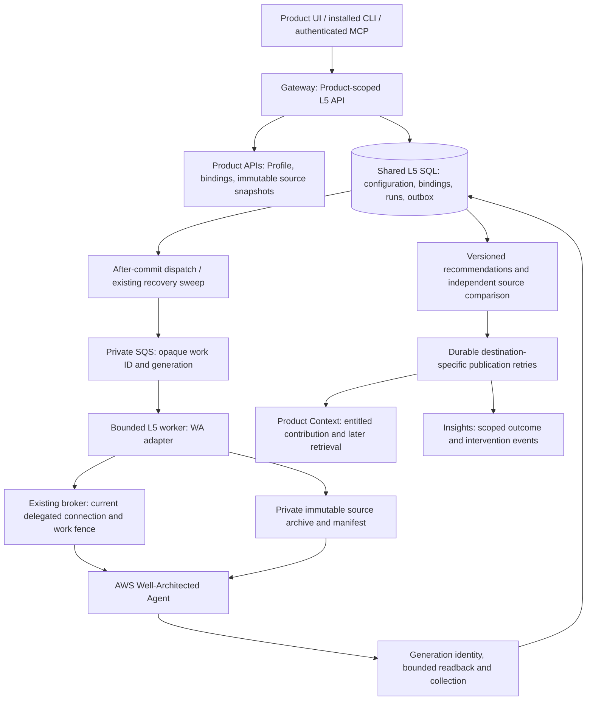
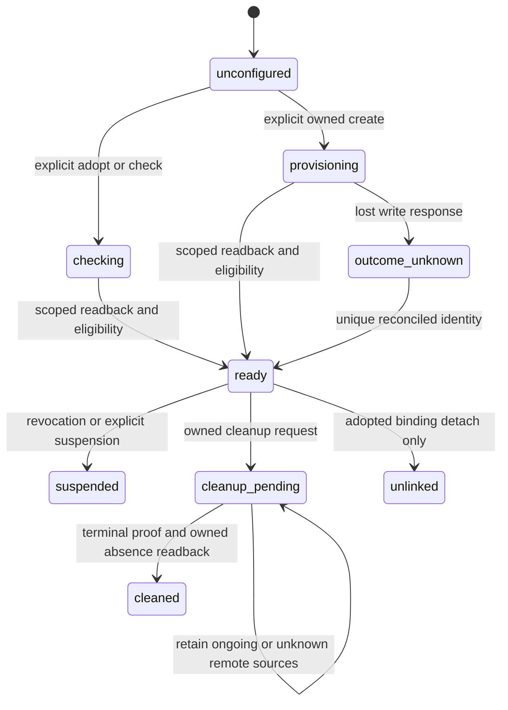

# AWS Well-Architected Agent architecture

Deployment ownership follows the [shared modular deployment contract](../modular-deployment-design.md):
independent L5 service roots and state, shared CI/CD, and service-specific qualification.
This supersedes earlier references to deploying L5 through gateway Terraform.


## Status and evidence

**Reviewed implementation design.** See [accepted revision and actual approval](review.json).
This is the canonical
implementation design for [epic #9078](https://github.com/aws-e/adp/issues/9078),
not evidence of a deployed service. Its seven stories reference the same
accepted revision. Provider execution, Support entitlement and release acceptance
remain implementation work.
PranavSharma1000 coordinates acceptance; WA07 integrates compatible shared edits
and owns live evidence. The assignment ends at design/backlog publication and
review handoff; the implementation epic still ends at deployed/live verification.

The service turns selected Product architecture documents, IaC and goals into
native AWS Agent recommendations with exact source provenance and declared
coverage. It works for any onboarded Product/project, with ADP only an optional
fixture. Ordinary onboarding changes configuration, not platform code or releases.
This is **not** the Well-Architected Tool questionnaire/workload API, certification,
remediation, cloud-resource discovery, Support purchasing or a new scheduler.

Evidence checked on 2026-10-27:

| Source | What it establishes / limit |
|---|---|
| Main `388584bdd80a4a5ff142abe3234e7d1eac1cfd64` | Source baseline for the [complete audit](audit.md); no live deployment inspection. The branch's initial WIP commit has no content difference. |
| [Shared architecture](../architecture.md), [v1 contracts](../contracts/v1/README.md), [DevOps design](../devopsagnent/architecture.md) | Reuse decisions, not proof every proposed peer API exists. Their older baseline statements must not override the current source findings below. |
| [PR #9080](https://github.com/aws-e/adp/pull/9080) at `35e00861a273b4a6492e05c57917c0272947255d`: [expansion][expansion], [POC extraction][poc], [service proposal][proposal] | Open, unmerged research baseline. Shared files are linked immutably rather than copied over sibling work. |
| [#7922 report][first], [#7980 report][helper], [#8014 report][iac] | Reported Support failures and IaC preparation, **not native recommendations**. Historical private artifacts were not independently re-downloaded. |
| [Current public AWS SDK service model][sdk] | Agent operation names, typed fields and enums; the model has no generation client token or stop action. Current primary documentation supplies `additionalContext` source fields and architecture-review limits; the model alone does not establish live eligibility, per-file ingestion or cancellation behavior. |
| Security [#8682](https://github.com/aws-e/adp/issues/8682), DevOps [#8865](https://github.com/aws-e/adp/issues/8865), release [PR #8932][release-pr] at `1477aed6761d4f7e09be64344fe3c27ddeb605fd`, DevOps investigation [PR #9081](https://github.com/aws-e/adp/pull/9081) | Shared release wiring and capability extensions are concurrent integration dependencies, not already deployed contracts. Preserve sibling service content and tests. |

## Components and ownership



| Owner | Existing component / proposed change |
|---|---|
| Product/Profile | [`ProductClient`][product-client] and [Product configuration][profile] supply purpose/goals, source/connection references and revisions. No new Profile SQL access. `basic.environments` and `advanced.environments` now both exist with normalization compatibility; do not perpetuate the older DevOps mapping's missing-field finding. |
| Gateway host, coordinated by WA07 with shared release owner #8698 | [Host backend][host] authenticates Product/project membership and current connection rights; [router][router] currently accepts only `security`/`devops`. Its binding authority is Security-specific. Extend typed registration, backend authorization, readiness and clients together, not just the route allowlist. |
| Shared L5 core | Existing [configuration][config-model], [binding][binding-model], [runs][run-model], [work][work-model], [attempts][attempt-model], [worker][worker], [source verifier][source] and [events][schedule]. No separate WA database, queue control plane or Step Functions. |
| WA-owned runtime, proposed | `modules/L5-services/src/l5_services/adapters/well_architected/` owns provider mapping, eligibility, source handoff and recommendation normalization. Domain configuration helpers remain in `l5_services`; SDK locks and tests are module-owned. |
| Credential broker | [Internal L5 credential route][broker] validates work/delegation and selected connection before issuing a short-lived session. Credentials never enter configuration, SQL outbox, source archives or public results. |
| Context/Insights peers | The [shared contribution/query contract][peers] is the integration target; existing [DevOps publication model][devops-publication] is not a generic recommendation sink. WA05 coordinates shared SA11 #8693 and Context #8149; unsupported consumer admission stays explicit. |

The existing [adapter protocol][protocol] separates `submit`, `reconcile_submit`,
`observe`, `collect` and `cancel`. Setup uses the separate [binding worker][binding-worker].
Two existing reusable patterns are Security binding setup and DevOps persistent
space setup; two delivery patterns are the gateway wheel staging and existing
shared execution/recovery handlers. WA extends these rather than adding a new
provider-specific service host.

## Configuration and interfaces

### Configuration ownership

The proposed public discriminator is `service_id: well_architected`, capability
`architecture_review`. WA01 registers these with shared SA01 #8683 and confirms
Module/Feature catalog IDs with PranavSharma1000 before dependent dispatch; these
strings are proposed API identifiers, not claimed catalog IDs. Runtime under
`modules/L5-services/`; documentation under `docs/l5-services/`.

Use the existing scope prefix:
`/v1/products/{product_id}/projects/{project_id}/services/{service_id}`.
The [strict input proposal](contract-proposal.json) and
[synthetic mixed-source example](request-example.json) make this extension
reviewable without modifying runtime registration. Draft settings can omit
readiness prerequisites; activation requires all applicable inputs.
All Well-Architected behavior under that prefix is **proposed**, not available on
this baseline. Public objects forbid unknown fields. Scope/actor/delegation are
server-derived; Product references retain the existing six fields:
`tenant_id`, `project_id`, `source_connection_id`, `record_type`, `record_id`,
`record_revision`. An input reference is a candidate to authorize, not a grant.

| Configuration field | Type, source and rule |
|---|---|
| Shared `source_refs`, `connection_ref`, `region` | Authorized immutable `RecordRef[]`, selected credential `RecordRef`, explicit qualified provider region. Inherit candidates from Profile and source API; never pick a connected account or arbitrary region silently. Source kinds are `document` and `repository_commit`, mixed in one review. |
| Shared `purpose`, inherited fields, `overrides` | Product purpose, intended users, goals, architecture/decisions/documents, governance classification and execution/budget policy references. Preserve explicit choices on refresh; increased source scope needs an explicit effective save, not silent activation. Missing irrelevant Profile fields do not block this capability. |
| `well_architected.review_mode` | Literal `source_only` in this release. Reject `resource_inspection` with `422 unsupported_review_mode`; resource inspection requires a later explicitly scoped extension, not a hidden checkbox. |
| `well_architected.pillars` | Unique nonempty subset of `COST_OPTIMIZATION`, `SECURITY`, `RESILIENCE`, `PERFORMANCE` (maximum four) for documented architecture reviews; the SDK enum additionally includes `OPERATIONAL_EXCELLENCE`, which is not a documented review pillar. No implicit Sustainability or Reliability alias. |
| `well_architected.goal_refs` | Optional authorized immutable Product document/goal references, resolved to bounded text and manifest entries. Do not synthesize business goals. Missing optional goals produces a limitation, not a fabricated objective. |
| `well_architected.execution_role_ref` | Authorized reference to the provider's source-only execution role; separate from the caller's selected broker role. Setup/readback must verify exact trust, policy and ownership. No raw credentials. |
| `well_architected.source_store_ref` | Authorized private artifact-store binding supporting immutable object keys and retention holds. Existing shared source storage is preferred. Bucket/resource creation is explicit setup only when no suitable approved store exists. |
| Shared `enabled`, `triggers`, `limits`, `monitoring`, `visibility`, `exclusions` | Draft/save never calls AWS; triggers disabled by default. Opt-in schedule pins capability/binding, timezone-aware cadence and eligible sources. Admission intersects request limits with existing policy/provider bounds; it cannot increase a budget. Visibility is narrowed by current source rights. |
| Binding create/adopt mode | Existing binding operation selects owned-create versus linked/adopted native profile reference, pinned configuration revision and current selected connection. Provider identity stays in the binding, never Product's selected-capability payload. |

Saved configuration and provider readiness remain separate. Profile refresh
updates inherited facts while preserving overrides, source selection and disabled
triggers. Profile handoff uses [conditional API linking][handoff], storing a
`handoff_pending` receipt on an ETag conflict and retrying the link only.

### Operation and client parity

Extend the [operation matrix](../contracts/v1/operations.tsv), strict schemas,
OpenAPI and generated MCP descriptors through **one coordinated WA01 contract
change**, retaining every existing Security/DevOps example and behavior. Do not
ship this prose as runtime schema registration. WA06 consumes that contract.

| Shared operation | Proposed WA behavior and client state |
|---|---|
| GET/PUT `/configuration`, POST `/configuration/refresh` | Draft, effective source/pillar choices, inherited provenance, conflicts and current revision; no provider setup or eligibility call on save. |
| POST `/configuration/check` | Per-capability reasons, checked config/binding/qualification revisions and observation age. `support_unverified`, `support_ineligible`, `region_unqualified`, `source_contract_unqualified`, `source_access_denied`, `binding_not_ready`, `scheduled_generation_risk` remain distinct. |
| POST `/binding-operations`; create/link/check/suspend/unlink/cleanup actions | Durable setup receipt; create/adopt/readback precedes readiness. Native profile identity and ownership are distinct from setup operation ID. Retain adopted resources. |
| POST `/runs`; GET `/runs`, `/runs/{run_id}` | Strict `RunInput`: service/capability, `configuration_revision`, `binding_id`, immutable `sources`, optional `parent_task_ref`. Provider profile/generation IDs, arbitrary SDK arguments and authority cannot be public run overrides. |
| POST `/runs/{run_id}/cancel`, `/reconcile`, `/retry` | Cancel requests local stop only when remote stop is unsupported; reconciliation observes the original generation. Retry paid work requires definitive no-effect proof or a separately admitted intentional new run after the prior outcome is resolved. |
| GET results, findings, artifacts and comparisons | Preserve native and normalized evidence, coverage/limitations, collection state, independent verification and publication receipts. All pagination, artifacts and aggregate counts enforce current scope. |
| Saved schedule through existing event surfaces | `enabled=false` by default; enabled ticks pass the same scoped admission/deduplication/budget checks as manual runs. Do not enable AWS weekly discovery. |

Use shared conditional writes: `Idempotency-Key` on mutations, `If-Match` on
existing mutable resources, `If-None-Match: *` for first configuration creation.
Scope idempotency by tenant + Product/project + service + principal + operation +
key and canonical request/precondition hash. Same replay returns the original
receipt after reauthorization; changed body is `409 idempotency_conflict`.
`202` means committed intent, not native success. Shared errors remain
`{code,message,retryable,request_id,operation_ref?}`: `401`, non-enumerating `404`,
`403` forbidden action on a known authorized resource, `409` state conflict,
`410` expired snapshot, `412` stale ETag, `422` invalid choice, `429` admission
limit and `503` unavailable capability/peer. Redact provider diagnostics.

Product Services UI adds a Well-Architected tab with draft/readiness/setup,
source/pillar selection, run status, coverage and recommendations. The installed
CLI gains the shared proposed `adp service` surface and MCP L5 operation descriptors gain the same
service choice, not a second backend. These L5 client operations are not installed on this baseline. Use matrix command/tool names,
JSON receipts and exit behavior; the API remains the acceptance oracle. Pending
remote outcome cannot render as “cancelled in AWS”, and source-only cannot render
as “deployment verified”. A later consumer's denied source rights hide derived
content even if it knows a result ID.

## SQL and lifecycle

Reuse shared SQL in the gateway database. Existing L5 models/migrations have their
own metadata/version directory; [main's Alembic host][alembic] still targets only
gateway metadata. [PR #8932][release-pr] proposes the migration bridge; WA07 must
integrate the actual merged compatible DAG, not copy migrations into a WA database.
The [inventory](migrations.tsv) enumerates every gateway and L5 revision/parent.

| Existing entity / key | WA use and required additive change |
|---|---|
| `l5_service_configurations`: PK `(tenant_id, configuration_id)`, unique tenant/Product/project/service; `l5_service_config_versions`: PK tenant/config/revision | Strict WA settings in version JSON; immutable settings hash, Profile relation revision and compare-and-swap current revision. No new configuration table. |
| `l5_service_bindings`: PK tenant/binding; unique tenant/config/connection/native key | Persistent Agent Profile ARN, native scope, ownership, setup receipt, verified source-role/settings snapshot and generation fence. Add typed WA provider identity/readiness to the shared contract. |
| `l5_service_setup_intents`, `l5_service_binding_operations`, `l5_service_setup_work` | Immutable requested setup/hash/current-authority evidence; mutable operation/readback; due/leased outbox work. Original setup token/candidate identity survives restart. |
| `l5_service_runs`: PK tenant/run, FK tenant/config/revision | Finite review input, pinned binding generation and manifest, local/provider states, deadline, native identity and monitoring. Proposed service-specific versioned JSON receipt stores generation name, SDK model hash, prepared provider request hash and Profile/context readback hash. |
| `l5_service_worker_attempts`: PK tenant/attempt; unique tenant/run/operation | Commit original submission identity **before** provider effect. Its local idempotency token is not sent as a nonexistent provider token. Persist correlation name and profile identity in the prepared run receipt before this attempt. |
| `l5_service_work`: PK tenant/work; unique tenant/run/kind/generation/step | Outbox, due time, leases/fences and bounded repair. Separate collect/publication/retention recovery from a new submit. Queue contains opaque work ID/generation, never credentials/source bodies. |
| `l5_service_provider_observations`, `l5_service_results` (tenant/run/version unique), details/findings/triage | Append native observations, versioned raw/normalized result and source comparison; shared findings gain a typed architecture recommendation kind. Native IDs deduplicate only within tenant/result/kind. |
| `l5_service_event_receipts` | Scope and semantic deduplication for opt-in ticks; extend Security-only schedule receiver to discriminate service while preserving existing keys/replays. |
| Proposed shared source-retention record | PK tenant/artifact/run; FK tenant/run; artifact reference, remote disposition, retain reason, last evidence revision, policy expiry and release timestamp. WA03 owns semantics, WA07 coordinates the common migration with Product snapshot owner #8684. Pinning TTL must not delete bytes still needed remotely. |
| Proposed shared publication record (unless SA11 lands it first) | PK tenant/result/version/destination/schema; payload hash, visibility watermark, due time/lease, receipt/ref and status. Reuse SA11 common implementation. Never reuse orchestration tracker-outbox tables or DevOps space-to-native-knowledge rows as result publication. |

The two proposed shared records fill source-inspected gaps, not a service-specific
control plane. WA07 resolves exact names with shared owners before writing an
additive migration; acceptance concerns uniqueness/FKs/recovery, not filenames.
All new tenant fields use `tenant_id`; legacy gateway `org_id` is a transport
synonym, never a second scope. Tenant formats remain anchor-stable (`user-<numeric
GitHub ID>` or organization login). Rows require Product/project relationship and
current delegation checks even where a database FK cannot express authorization.



The diagram uses the existing shared Binding state enum. Additional existing
binding states `blocked`, `unlinking`, `cleanup_failed` preserve denial/partial
cleanup; retention disposition is a separate hold record, not an invented Binding
state. Setup Operation uses `accepted`, `running`, `waiting`, `succeeded`,
`blocked`, `failed`, `outcome_unknown`; Configuration uses `draft`, `needs_input`,
`ready`, `disabled`. It is **not** a new run state enum. Finite runs use
existing `admitted → queued → running → collecting → succeeded` (preparation work
precedes provider submit), plus `blocked`, `outcome_unknown`, `cancel_requested`,
`cancelled`, `expired`, `failed`. Keep provider state and monitoring freshness
separate. Native `QUEUED`/`IN_PROGRESS` mean pending/running; `COMPLETED` starts
collection, not automatic accepted findings; `ERROR` records native failure.
Unrecognized values mean unknown, never failed by default. `succeeded` means
results durably collected; comparison and publication may still be pending.

## Identity and provider setup

1. Resolve current authenticated tenant, Product/project relationship, source
   entitlement, configuration revision and explicit connection. Worker requests
   additionally prove stored delegation revision, work identity and current fence
   through the existing internal IAM/broker path. No ambient-role fallback.
2. Verify the selected connection's account **and exact assumed role** through the
   same broker path used for every target operation. Transport identity is not
   target authority. Refresh expired sessions through that selected connection;
   lost write responses must reconcile before any effect is repeated.
3. Read-only qualification distinguishes IAM denial, missing Support eligibility,
   unsupported region/source contract and insufficient context. An account that
   permits List/Get calls is not thereby Support-eligible. No Support purchase or
   activation follows from readiness. Missing eligibility blocks live setup/run
   acceptance only; deterministic contract and adapter development can continue.
4. Owned create persists setup intent and stable `clientToken` before
   `CreateAgentProfile`. Selected pillars, execution role and
   `aggregationConfiguration=[]` are source-only requirements. Read back the exact
   profile and reject unrequested aggregation or scheduled-generation risk.
   `eligibleForArchitectureGeneration`, `eligibleForScheduledGeneration` and
   `fieldErrors` are observations, not permissions; absence is unknown, not false.
5. Adopt requires explicit native reference and authorized exact account/region,
   source role, pillars, goals/context and no-resource-discovery readback. Never
   rewrite an adopted profile to “make it work” or delete it on cleanup. A profile
   with unrelated contexts or automatic discovery is not source-only ready.
6. Profile updates, context/goal setup and role-source-policy changes are serialized
   with runs per binding. Hold the native configuration snapshot stable from
   admission through terminal observation. A per-run source lease admits at most
   one active generation per binding initially; no implicit last-writer-wins update
   to the persistent profile's sources. Drift or unmanaged edits suspend admission.

A native context-bearing Agent Profile belongs to exactly one tenant/Product/project
scope. Configuration-scoped binding uniqueness alone does not enforce this. WA02
coordinates the shared retained-native-resource claim with FO02: a database-unique
service + digest of verified account/region/native identity, independent of connection
aliases and configuration IDs. Claim before attachment, mask conflicts, and serialize
profile updates/generations by that claimed identity. Adopted/retained profiles keep
the claim after unlink; only verified owned-resource absence releases it. Reusing a
retained profile in another scope is outside this release. Test concurrent claims
from two projects/tenants and re-adoption after unlink; no second scope may obtain
context or mutate the profile. WA07 integrates one compatible migration with FO07.

Provider execution role permissions are source-only S3 GetObject/GetObjectVersion
on admitted immutable object keys, plus KMS Decrypt for the selected key and
service/encryption-context restriction if needed. Do not add resource discovery,
account-wide reads, IAM writes or cost APIs to that role. Bucket policies,
identity policies, key policy and trust must all permit exactly the intended
read. Provider trust principal/external-ID behavior must be qualified against
current documentation/readback; the [historical helper][lifecycle] used
`wellarchitected.amazonaws.com` with profile ARN external ID, which is not live
proof for this release. Broker caller `iam:PassRole` is scoped to the selected role
and provider service. Setup IAM/S3 creation belongs only to explicitly admitted
owned setup, with boundary and ownership receipt; normally reuse an approved
store/role. List APIs that cannot be resource-scoped need a documented action-only
exception plus exact subsequent scope checks, not blanket `Resource: "*"` grants.
No new Secrets Manager naming scheme, public Lambda URL or pod-role substitution.

## Source packaging and provenance

WA03 extends [existing snapshot materialization][source], not a new repo crawler.
Pin Product source receipts and source bytes at admission; workers never resolve
`HEAD`, `latest` or a branch a second time. Every byte-bearing item records source
RecordRef, snapshot ID/revision, path, byte count, SHA-256, inclusion/exclusion
reason and component. Goals/context and decisions receive the same provenance.
A bounded manifest includes selected revision, complete selected-tree inventory,
IaC/build/deployment entry map, component coverage, excluded files, unresolved
references/submodules and unsupported formats. “Complete” is relative to admitted
source scope; it never implies complete deployed-resource discovery.

Archive deterministically: stable sorted POSIX paths, fixed timestamps/modes,
canonical manifest JSON, content hashes, explicit encoding; reject absolute paths,
traversal, duplicate paths, symlinks, encrypted archives, nested archive expansion,
secrets and compressed/decompressed size or file-count overflow. Do not apply IaC,
execute repository commands, evaluate untrusted templates or follow remote modules
implicitly. Account for omitted remote module bodies as a coverage gap. Inspect
all selected entry artifacts rather than choosing representative files. A user
may explicitly narrow the review; do not silently truncate to fit provider limits.

Use an immutable run-specific object key and verify stored bytes/hash before
submission; metadata-only HEAD is insufficient. If provider APIs cannot pin S3
VersionId, prevent overwrites of that key for its full retained lifetime. Keep
publisher authority separate from provider read-only authority. Source packages
contain selected IaC/documents/goals only, never credentials or live deployment
state masquerading as source. Locally compare the archive manifest against an
independent `git ls-tree`/document digest enumeration, not the packager's own list.

Current [AWS architecture review documentation](https://docs.aws.amazon.com/wellarchitected/latest/userguide/agent-architecture-reviews.html)
specifies `additionalContext={s3Uri,s3VersionId,lensArns}` with the Framework lens.
Pin the S3 object version and independently verify its bytes before Start; ZIP files
are at most 25 MB, while S3 folders are at most 100 MB and each file at most 1 MB.
Bucket and profile must share a Region. The daily quota is five reviews per profile.
Keep ADP manifest, model and request digests in durable records, never as undocumented
AWS context fields. Provider ingestion cannot be observed before Start: after Start,
read the original generation and recommendation source references independently.
Upload or reflected S3 URI alone never proves per-file consumption. Retain
`provider_source_coverage_unverified` as an explicit result limitation where AWS
exposes no per-file proof; do not fabricate a receipt or silently narrow sources.

Product snapshot expiry and private artifact lifecycle must honor the retention
record while remote state is running/unknown, including after local timeout,
revocation or an exhausted read budget. Stop new usage on revoked authority, but
do not destroy ongoing sources. Mark `retention_blocked` with owner and cost
uncertainty; resume bounded verification only under current authorized policy.
Revocation immediately denies user reuse without pretending it can revoke an
already fetched provider copy. If provider-required retention cannot meet the
selected source's policy, reject admission before submission.

## Generation, recovery and cancellation

```mermaid
sequenceDiagram
  participant Client
  participant API as Gateway / shared admission
  participant DB as SQL outbox
  participant Worker as L5 worker
  participant AWS as Well-Architected Agent
  Client->>API: Run with pinned config, binding, source revisions
  API->>DB: Commit run, source holds, budget admission, execute intent
  API-->>Client: 202 durable receipt
  API->>Worker: Immediate SQS dispatch after commit
  Worker->>DB: Seal manifest and stable prepared request; commit submit attempt
  Worker->>AWS: Start once (SDK mutation retries disabled)
  alt response recorded
    Worker->>DB: Store profile + generation ID; schedule observation
  else response lost or worker dies
    Worker->>DB: outcome_unknown, same attempt, bounded reconcile intent
    Worker->>AWS: List generations, Get exact candidate(s); never blind Start retry
  end
  Worker->>AWS: Observe at due time; reauthorize every action
  Worker->>DB: Terminal native observation, collect intent
  Worker->>AWS: Paginated generation-scoped recommendations
  Worker->>DB: Versioned result + independent publication intents
```

WA04 prepares a unique opaque generation name from the durable run/attempt (not a
user name), profile identity, model revision, request hash and time boundary before
Start. `StartAgentRecommendationGeneration` accepts `profileArn`, `types`, `name`,
`additionalContext`, `scope`; it has **no clientToken** in the pinned public model.
Use `types=[ARCHITECTURE]` and selected pillars/goals. Disable automatic SDK retries
for this non-idempotent write (`total_max_attempts=1`); transport retry wrappers
must not repeat it either. SQL lease fencing prevents competing local owners,
not an already dispatched remote side effect.

On ambiguous submission, paginate `ListAgentRecommendationGenerations` for the
pinned profile and compare name, creation interval, creator where observable,
and `GetAgentRecommendationGeneration` scope/context to the prepared request.
Exactly one attributable match recovers its native ID; multiple matches, mismatched
context, incomplete pagination, unavailable fields, denial, or zero matches under
eventual consistency remain `outcome_unknown`. **Zero list results are not proof
that Start had no effect.** At the admitted reconcile bound, block further submit
and retain sources with an actionable receipt. WA01 must qualify how the provider
exposes enough identity to resolve this; an unsafe exactly-once guarantee is not
acceptable. A deterministic provider rejection before creation may be definitive
no-effect only when its semantics are qualified and its receipt persisted.

Execution is event-driven, one bounded SDK action per worker claim. After commit,
attempt immediate queue publication. A lost send/ack is recovered from due SQL
work using [existing dispatcher/recovery][recovery], not a new scheduler or a Lambda
held open for hours. Ten-minute observation is the service default within shared
policy limits; jitter and max attempts/deadline are pinned. Existing one-minute
repair sweeps recover due work and bounded failed sends; they are not the normal
start delay. Stale fences cannot commit; redelivery resumes the original attempt.
Record read attempts before reads, preserve last successful provider observation,
and distinguish stale/overdue/unknown from native failure. Fair per-tenant admission
and existing budgets remain authoritative; no old spike allowance is renewed.

No stop API appears in the checked model. The adapter reports cancellation as
unsupported without a destructive substitute. Cancel before a provably unsubmitted
attempt can be local terminal cancellation. After submission, expose local
`cancel_requested`/`expired` independently of remote state and retain identity and
source holds. Never delete the Agent Profile as a cancellation mechanism. Recovery
must still collect a later completed generation without re-running paid work.
**Shared-core change required:** [current worker][worker] exits for terminal local
states and treats completed readback during `cancel_requested` as unknown; WA04
and WA07 must add bounded observation/collection work for remote-running/unknown
runs after local expiry/cancel. A typed `cancel_unsupported` result alone would
not fix that lifecycle gap. Do not change Security stop behavior inadvertently.

Collection has its own persisted cursor/checkpoint. Retry page/read/persistence
failure without Start. Result-complete plus publication failure retries only the
destination. An acknowledgement lost after durable consumer admission uses the
same publication ID/readback. Retire each repair intent only on verified receipt,
terminal no-effect, or an explicit bounded blocked state, never merely on worker
exit. Unknown costs remain unknown; no permission to increase run limits.

## Results, publication and cleanup

Proposed `WellArchitectedResult` is a strict service result variant extending the
shared result envelope: `schema_version`, run/config/binding revisions, native
profile/generation ref, SDK model hash, timestamps, manifest/archive hash,
`review_mode=source_only`, pillars/goals, coverage, limitations,
`native_recommendations`, `recommendations`, `comparison`, `publication`.
Nested source and artifact references use shared RecordRef/ArtifactRef types.
Raw provider payloads stay in private versioned artifacts; public API exposes only
entitled normalized fields and opaque artifact references.

Recommendation items preserve native ID, generation ID, pillar, title/description,
priority/effort/impact/tradeoffs and native sources. ADP annotations hold source
path/revision/hash and independent verification `supported`, `contradicted`,
`not_verifiable` or `not_checked`, with explanation and verifier/test reference.
Do not invent line citations from a profile-level recommendation. Deterministic
same-tenant fingerprints group equivalent findings without merging across Products.
Only compare runs with compatible scope, pillars, goals and manifest coverage;
otherwise return `not_comparable` with specific differences. No false precision
about savings, compliance or deployed exposure.

The provider lists recommendations by profile, not generation. Paginate all
relevant recommendations, Get each, and retain only exact `generationId` matches.
Collect item detail if used, preserving pagination receipts/limits. A missing
`generationId` must be visibly unattributed, not silently assigned to the newest
run. No matches/empty results require source/readback/coverage explanation and do
not alone establish a useful native review. Store native results before owned
cleanup and before optional independent comparison completes.

WA05 compares substantive recommendations against pinned selected sources/goals
using an independent verifier and source citations. Tests intentionally inject
wrong generation, unsupported claims, changed manifests and fabricated citations.
Provider nondeterminism means acceptance checks attributable recommendations and
comparison quality, not a fixed recommendation count or golden prose match.

Publish versioned contributions through the shared Context interface and scoped
Insights event contract, with tenant/Product/project, result version, manifest,
visibility, evidence refs and revocation watermark. Each destination has its own
idempotent receipt/retry. Unsupported schema/consumer is `publication_blocked`,
not success or an ungoverned storage fallback. A later distinct entitled design
task must query and use this version, cite it and retain retrieval/usage evidence;
a foreign consumer and a consumer whose source access was revoked must be denied.
Consumer persistence, later query and revocation enforcement are separate claims.
Insights owns its ingestion/schema; Context owns searchable contribution/query.

Cleanup fences new admission and reconciles every pending owned effect first.
Retain adopted profile/roles/store, pre-existing goals/context and all sources
needed by ongoing/unknown work. For owned setup, verify creation receipt + native
identity + current cleanup grant + reference/retention holds. After remote
terminal proof and durable result readback, delete only owned goals/context,
profile (honoring deletion protection and explicit cleanup confirmation), owned
source object versions and dedicated role/policy if unreferenced; shared buckets
and roles are never deleted because one run finished. Verify provider absence
and retained results by independent reads. Partial deletion keeps a durable cleanup
intent with bounded retry and per-resource disposition; tags alone do not prove
ownership. Permanent denial remains blocked with source/storage cost uncertainty.

## Rollout and verification responsibilities

WA01 owns the capability/schema/provider qualification proposal. WA02 owns
configuration and persistent setup; WA03 packaging/retention; WA04 execution and
recovery; WA05 results/publication; WA06 all clients/events; WA07 coordinates shared
edits, release identity, migrations/IAM, fixtures and live acceptance. Shared
contracts, host and migration changes have one integration owner per compatible
batch; sibling Security/DevOps designs are not overwritten. Advisory file groups
in the [backlog](backlog.md) explain likely changes, not node-failure gates.

[Audit deployment matrix](audit.md#deployment-and-build-entry-points) records actual
main versus open-PR entry points. Current gateway path filters already include L5
source/package/schema inputs and stage the wheel. Normal gateway/frontend
auto-deploys remain; no deployment per story. WA-only prose does not request runtime
publication. Existing L5 CI does not publish workers. The release PR adds manual
L5 artifact/worker lifecycle workflows and schema/infra wiring, still unmerged at
this audit. WA07 integrates that shared release, not a new WA publisher.

Order: validate compatible schema/package/consumer contracts → additive SQL
migration and source retention support → private infrastructure/least-privilege
roles and installed worker factory registration → compatible gateway/worker
artifacts and clients → enable only qualified service capabilities/configurations.
New fields are optional/defaulted for existing Security/DevOps rows; new service
variants must not reach old readers. Retain old-schema contract fixtures, migration
DAG tests and a feature-disabled old-reader rollback test. Rollback disables new
admissions/schedules, rolls back compatible code, and retains IDs, rows, artifacts
and recovery ability; do not downgrade away active/unknown run records. A schema
down migration is safe only before dependent writes, otherwise forward-fix.

WA07 obtains eligible privately configured fixtures and provider/source role
permissions through existing deployment authority. Filing or merging docs grants
none. Test two **non-ADP** projects with distinct architecture/goals using the same
release digests without code edits/redeployment; include sibling-project and
foreign-tenant denial. Operator account/role/region, artifact coordinates and
operational receipts stay private. Record deployed package/worker/schema/client
versions, provider receipts, Context/Insights receipts, cost disposition, retained
assets and owned-only absence evidence. Source-only verification cannot close
claims about deployment inspection.

The [backlog acceptance matrix](backlog.md#acceptance-and-scenarios) assigns every
EC-01–EC-08 to stable story AC/SCN IDs and keeps parent #8150 EC meanings intact.
Offline/pre-review checks qualify code and failure controls; live checks qualify
native results, source consumption, access, clients, recovery, cleanup and later
reuse. Main-only/live acceptance must not block review of its enabling PR, but
blocked/not-run acceptance remains incomplete after merge. WA07 implements and
repairs integration defects; PranavSharma1000 accepts evidence, not story closure
by design authorship.

## Qualification register

| Gap / decision | Owner and concrete next artifact | Affected phase |
|---|---|---|
| Current Support prerequisite and eligible provider regions not tested | WA01 records official current documentation/model revision, exact read-only/activation checks and redacted positive/negative provider responses; WA07 supplies eligible fixture without purchase | Live activation and EC-01/03/08, not independent development |
| `additionalContext`, ZIP/file/byte limits, object-version read semantics, provider consumption evidence and source-only role trust | WA01 qualification table + SDK/source test vectors; WA03 immutable source readback and honest post-Start coverage | Live packaging/activation and EC-02/03; fail closed while unknown |
| No token/stop in public SDK; native correlation uniqueness/read consistency not qualified | WA01 records safe reconciliation/no-effect rules; WA04 fault traces. If readback cannot disambiguate, retain `outcome_unknown`, never resubmit | EC-04; ambiguous live acceptance stays blocked |
| Mutable adopted profile and native scheduled behavior | WA02 exact setup readback, drift/concurrent-update test and source-only eligibility evidence; reject unsafe adoption | Setup/readiness and EC-02 |
| Shared core stops observing terminal local states; no generic source-hold/publication model on main | WA03/04/05 coordinate additive shared contracts with #8684/#8688/#8693; WA07 integrates, tests cross-service compatibility | Implementation and EC-04/05/07 |
| Consumer contribution/query/Insights semantics not live-verified | WA05 + Context #8149 / shared SA11 #8693 owners record admitted schema, receipt recovery and revocation contract; WA07 later-task proof | Publication/reuse EC-07 |
| Release PR #8932 open; live worker/infra identity unverified | Shared release owner #8698 + WA07 reconcile main, install factory/transport/migrations, preserve normal deployment authority | Deployment and all live acceptance |
| Catalog IDs unmapped | WA01 + coordinator resolve authoritative Module/Feature IDs. All seven children are verified in roadmap project 4 (2026-10-27). | Dependent catalog integration, not document review |
| Canonical approval | Recorded in [review.json](review.json); all seven stories reference the accepted revision | Design approved; runtime/live acceptance remains pending |

[expansion]: https://github.com/aws-e/adp/blob/35e00861a273b4a6492e05c57917c0272947255d/docs/l5-services/capability-expansion.md
[poc]: https://github.com/aws-e/adp/blob/35e00861a273b4a6492e05c57917c0272947255d/docs/l5-services/poc-evidence.md
[proposal]: https://github.com/aws-e/adp/blob/35e00861a273b4a6492e05c57917c0272947255d/docs/l5-services/well-architected/README.md
[first]: https://github.com/aws-e/adp/blob/a06a0b55d1905da47c40318caa179220df904515/docs/spikes/aws-agent-setup/well-architected.md
[helper]: https://github.com/aws-e/adp/blob/72e06b2160263e305078aba1278f54a345f71736/docs/spikes/aws-agent-setup/well_architected-adp.md
[iac]: https://github.com/aws-e/adp/blob/b442cf8904ad003d119659520bced807a7d8131c/docs/frontier-agents/spikes/well-architected-iac.md
[lifecycle]: https://github.com/aws-e/adp/blob/b442cf8904ad003d119659520bced807a7d8131c/scripts/frontier-agent-spikes/well_architected_lifecycle.py#L279
[sdk]: https://github.com/boto/botocore/blob/3d3e64b320672d27f348375a1b4620a5625e25d8/botocore/data/wellarchitected/2020-03-31/service-2.json
[release-pr]: https://github.com/aws-e/adp/pull/8932
[product-client]: https://github.com/aws-e/adp/blob/388584bdd80a4a5ff142abe3234e7d1eac1cfd64/modules/L5-services/src/l5_services/product_client.py#L10
[profile]: https://github.com/aws-e/adp/blob/388584bdd80a4a5ff142abe3234e7d1eac1cfd64/modules/gateway/src/products/configuration.py#L62
[host]: https://github.com/aws-e/adp/blob/388584bdd80a4a5ff142abe3234e7d1eac1cfd64/modules/gateway/src/l5_integration.py#L67
[router]: https://github.com/aws-e/adp/blob/388584bdd80a4a5ff142abe3234e7d1eac1cfd64/modules/L5-services/src/l5_services/api/router.py#L10
[config-model]: https://github.com/aws-e/adp/blob/388584bdd80a4a5ff142abe3234e7d1eac1cfd64/modules/L5-services/src/l5_services/models/configuration.py#L12
[binding-model]: https://github.com/aws-e/adp/blob/388584bdd80a4a5ff142abe3234e7d1eac1cfd64/modules/L5-services/src/l5_services/models/binding.py#L10
[run-model]: https://github.com/aws-e/adp/blob/388584bdd80a4a5ff142abe3234e7d1eac1cfd64/modules/L5-services/src/l5_services/models/run.py#L12
[work-model]: https://github.com/aws-e/adp/blob/388584bdd80a4a5ff142abe3234e7d1eac1cfd64/modules/L5-services/src/l5_services/models/work.py#L11
[attempt-model]: https://github.com/aws-e/adp/blob/388584bdd80a4a5ff142abe3234e7d1eac1cfd64/modules/L5-services/src/l5_services/models/attempt.py#L12
[worker]: https://github.com/aws-e/adp/blob/388584bdd80a4a5ff142abe3234e7d1eac1cfd64/modules/L5-services/src/l5_services/workers/execution.py#L37
[source]: https://github.com/aws-e/adp/blob/388584bdd80a4a5ff142abe3234e7d1eac1cfd64/modules/L5-services/src/l5_services/source_manifest.py#L34
[schedule]: https://github.com/aws-e/adp/blob/388584bdd80a4a5ff142abe3234e7d1eac1cfd64/modules/L5-services/src/l5_services/events/schedules.py#L15
[broker]: https://github.com/aws-e/adp/blob/388584bdd80a4a5ff142abe3234e7d1eac1cfd64/modules/gateway/src/internal/l5_credential_routes.py#L34
[peers]: ../contracts/v1/peer-contracts.md#context-contribution-and-read-proposal
[devops-publication]: https://github.com/aws-e/adp/blob/388584bdd80a4a5ff142abe3234e7d1eac1cfd64/modules/L5-services/src/l5_services/models/devops_knowledge.py#L10
[protocol]: https://github.com/aws-e/adp/blob/388584bdd80a4a5ff142abe3234e7d1eac1cfd64/modules/L5-services/src/l5_services/adapters/protocol.py#L15
[binding-worker]: https://github.com/aws-e/adp/blob/388584bdd80a4a5ff142abe3234e7d1eac1cfd64/modules/L5-services/src/l5_services/workers/bindings.py
[handoff]: https://github.com/aws-e/adp/blob/388584bdd80a4a5ff142abe3234e7d1eac1cfd64/modules/L5-services/src/l5_services/profile_handoff.py
[alembic]: https://github.com/aws-e/adp/blob/388584bdd80a4a5ff142abe3234e7d1eac1cfd64/modules/gateway/alembic/env.py#L19
[recovery]: https://github.com/aws-e/adp/blob/388584bdd80a4a5ff142abe3234e7d1eac1cfd64/modules/L5-services/src/l5_services/workers/recovery.py
