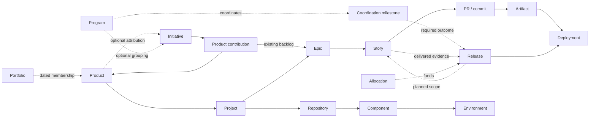

# ADP Context Model v1 — practical product and delivery context

**Status: proposed design for review, 2026-10-15.** This specifies a shared context
contract; it does not claim a deployed registry, connector or API. The companion
[JSON Schema](context-model-v1.schema.json) makes the proposed record shapes
checkable. [Examples](examples/) illustrate a minimal profile and a delivery view.
The [lineage alignment review](lineage-alignment.md) records compatibility with
the existing lineage schemas, corrected ambiguities and remaining adapter work.
The [Product-to-Test contract](product-to-test-lineage.md) defines the drill-down
from Product through Epic, Story, acceptance criterion and scenario to Test ID,
then to actual execution results, using a connected worked example.
The [AWS agent capability design](aws-agent-capabilities.md) describes guided
setup of DevOps, Security, Well-Architected and FinOps capabilities from this
profile, reuse of their exposed knowledge/results, and tenant-scoped bindings.
The [proposed catalog storage contract](catalog-storage.md) records dated
Portfolio membership and Contribution invariants with independently checked
[wire and transaction examples](catalog-contract-examples.json); it does not
describe deployed catalog endpoints.
The [catalog API proposal](catalog-api.md) defines scoped reads, writes and
pagination; [access examples](catalog-scope-examples.json) check denial behavior.
The [catalog rollout decision](catalog-rollout.md) selects an existing gateway
deployment unit and records the source audit, migration and recovery boundaries.
The [manual catalog scenario plan](catalog-scenarios.md) binds independent
acceptance assertions to reproducible fixtures without claiming live execution.

**Decision:** maintain a small, typed context model, populated from authorized
sources, with source-backed narrative generated from it. Start with a useful saved
profile. Add records only when the product actually has the corresponding work,
assets or capabilities. Do not require users to complete an enterprise inventory.

The daily questions are simple: **What is this product? What are we delivering
next? What is blocked? What actually shipped? What can ADP help with next?**

## 1. The smallest useful experience

1. Save name, purpose, intended users, owner and Idea / Existing assets / Running
   product. The owner defaults from tenant membership. Tenant and governed Project
   binding are resolved in the same operation, without duplicate forms.
2. Connect a repository. ADP discovers technical context and offers Getting
   Started capabilities. Add a tracker or documents when useful; Jira, GitHub and
   Linear are alternatives, not a checklist of compulsory integrations.
3. Show **Product Context**: sourced understanding, current work, environments,
   financial context, what is missing or stale, and one or two next steps.
4. When a release exists, assemble its context from connected planning, code,
   finance and deployment sources. Confirm only ambiguity, conflicts and approvals.

The four input sections remain Product Information, Product Context—Basic,
Product Context—Advanced and Product Financials. Getting Started / Advanced / Pro
are information maturity, not pricing. A profile can be useful before a capability
is operational. No profile percentage, relationship or AI inference grants access,
spending rights or deployment authority.

## 2. Research findings and adoption choices

Primary sources were read on 2026-10-15. These are related standards/models, not
interchangeable database schemas. **No source below supplies the entire ADP model.**

| Reference | What it contributes | ADP decision and limit |
|---|---|---|
| [IT4IT, The Open Group][it4it] | Digital-product lifecycle reference architecture | Use to check lifecycle coverage and service ownership; do not implement the whole architecture as onboarding forms. This research uses the public overview, not a field-by-field conformance assessment of the full standard. |
| [OSLC specifications][oslc] | Requirements, change/work, quality and configuration resources and cross-tool links | Preserve qualified identities and typed links. OSLC does not mandate our Product/Epic/Story hierarchy. No RDF server or OSLC protocol implementation is required for v1. |
| [Backstage catalog descriptors][backstage] | Systems, components, APIs, resources, owners and dependencies | Reuse component/catalog concepts and offer mappings. Backstage System is not automatically an ADP Product/Project; its owner field is not runtime authorization. Do not copy its open-ended annotations as our core contract. |
| [CDEvents v0.5 documentation][cdevents] | Source, build, test, deployment, operation and ticket events, on CloudEvents | Map supported delivery events to existing ADP lineage. Events update context; they do not replace planning records or invent missing scope. No claim that existing ADP emitters implement CDEvents. |
| [W3C PROV-O][prov] | Entity, activity, agent, derivation and attribution concepts | Reuse provenance semantics for facts and summaries; a graph database/OWL implementation is unnecessary. |
| [JSON Schema 2020-12][jsonschema] | Types, constraints and structural validation | Specify the snapshot contract in JSON Schema; generate implementation types later. Enable format validation explicitly. Authorization, cross-record integrity and business rules remain service checks. |

**Keep one ADP contract.** Standards inform it; source adapters translate into it.
Do not force customers to install Backstage or adopt OSLC/IT4IT to use ADP.
A relational store with typed records and relationship tables is sufficient for
v1. Storage selection remains implementation work; no knowledge-graph platform
or generic ontology engine is a prerequisite.

### Existing ADP contracts to reuse

Repository inspection baseline: `df11ca525` (main at the start of this research).

- [Lineage schema](../engineering-insights/lineage-schema.md), especially §§3.0,
  3.7, 3.11, 4 and 11: scoped native identity, dated relationships, source authority,
  append-only evidence and requirements/test revisions.
- [v2 record references](../../modules/insights/schemas/lineage/v2/references.schema.json):
  reuse its six-field reference shape. Shape reuse is not raw-event compatibility:
  v2 requires same-project endpoints; cross-project context coordination is a
  separate authorized view. Do not mint replacement Story/Test/Run IDs.
- [Connections contracts](../../modules/gateway/src/admin/org_connections/schemas.py):
  existing org/GitHub installation ownership is not replaced by a context record.
- [Budget schemas](../../modules/gateway/src/budget/schemas.py): money uses decimal
  strings; independently capped budget lines must not become an invented combined cap.
- [Deployment receipts](../../modules/gateway/src/orchestration/deployment_runtime_contract.py):
  reuse verified runtime evidence through an adapter. Its ADP-specific component
  enum is not the customer-product component model.

These are checked-in contracts, not proof that an end-to-end context service is
live. In particular, Insights v1 deployment permits an absent `release_id`; legacy
receipts must remain importable with a visible unresolved release association.
Do not silently rewrite old events to satisfy this proposed managed-release path.

## 3. Records and relationships, not a compulsory hierarchy



Arrows illustrate relationships, not compulsory records or access grants. A
release can select stories from several epics; an epic can span releases. A bug
or routine task need not have an epic. One product can span several projects;
each project retains its own access boundary. One repository can support several
components; environments and cloud accounts are distinct.

**Identity rule:** a record reference is
`(tenant_id, project_id, source_connection_id, record_type, record_id, record_revision)`.
The provider owns its native ID. ADP mints IDs for genuinely ADP-owned records;
it never derives an ID from a display name or substitutes a GitHub board number
for a governed `project_id`. Connection namespace disambiguates provider instances.
Mutable keys, titles and URLs are display attributes/aliases.

For downstream adapters, Product `record_id` supplies `product_id`, Project
`record_id` equals its governed `project_id`, and tracker work IDs supply
`epic_id`/`story_id` under the explicit kind mapping. The generic envelope does
not mint a second identity for those entities. Preserve source-native revision
and normalized record revision separately when normalization changes.

Portfolio `record_id` similarly supplies the stable `portfolio_id`. Portfolio is
an optional durable collection of Products for investment, ownership and reporting.
Its catalog identity is independent of member Product IDs and execution Projects;
the designated catalog/portfolio authority owns it, with governed direct ADP entry
when no external authority exists. Names are labels, not identity keys.

Tenant-level product identity can be shared through explicitly authorized Project
projections. The project-scoped snapshots below repeat that stable identity; they
are not independent products. Changes to shared product fields go to the catalog
owner and propagate as new projections. Product pages query only allowed projects;
absence of access must not reveal hidden record names, counts or summary facts.
Cross-project release views compose scoped records; v1 actions execute within one
Project. Coordinated multi-project promotion is a later explicit service contract.
In this paragraph, v1 means this proposed **context model**, not Insights lineage
v1. A context snapshot is never directly submitted as a lineage event.

Portfolios, Programs and Initiatives use the same projection rule: one authoritative business
identity, with permitted views in each participating Project. A Program is an
optional grouping of Initiatives; an Initiative is an objective that can span
products without a Program. Keep v1 to one effective parent Program per Initiative
and no nested Programs. Neither grouping becomes an execution Project or grants
its owner access to participating Projects.

Portfolio groups **Products**; Program groups **Initiatives**. An Initiative is a
change objective with Contributions from Products, potentially across Portfolios.
These are independent optional associations, not mandatory levels of one tree.
V1 has no nested Portfolios or automatic Portfolio–Program/Initiative parent link.
Derive related Initiatives through member Products' dated Contributions when useful.

Cross-project context links are coordination associations evaluated by the context
service with grants to both endpoints. They are **not** raw Insights v2 links:
[lineage §11.1](../engineering-insights/lineage-schema.md#111-versioned-references)
requires every reference in a raw record to share its tenant/project. Analytics
composes separately authorized Project views; adapters must not serialize these
cross-project edges into v2, rewrite endpoint Project IDs to make them pass, or
duplicate execution facts in another Project. Equal names or IDs in two Projects
are insufficient to join business projections: use the source authority's explicit,
versioned namespace/alias mapping and retain both qualified references.

## 4. Common types and record envelope

The companion schema is a **proposed context snapshot/export format**, not an
Insights event schema or a new deployed endpoint. Its `schema_version: "1.0"`
is scoped to this document; it does not downgrade Insights v2. Records have typed
`data`; provenance is separate so clients do not unwrap every primitive value.

| Type | Exact representation / validation |
|---|---|
| `ID` | Non-blank string, max 512 characters; native format retained. No `latest` or string `null` as a revision. No UUID requirement for imported IDs. |
| `Name`, `Text` | Non-blank string, max 200 / 10,000 characters. Longer content stays in an authorized document/artifact. |
| `Instant` | RFC 3339 UTC string ending `Z`; e.g. `2026-10-15T09:00:00Z`. Validate the date/time, not only a regex. |
| `Date` | ISO calendar date `YYYY-MM-DD`. Never invent midnight UTC for a date-only source. |
| `Timezone` | IANA zone name, validated by the service; required for schedule interpretation, not a source of authority. |
| `Money` | `{amount: decimal-string, currency: ISO-4217-code}`; amount nonnegative for allocations, max 6 fractional digits. Never binary floating point. Currency allow-list and units validated by the finance adapter. |
| `Ref` | The six-field qualified reference above, matching Insights v2 `record_ref`. Pins a revision; resolve current version explicitly when refreshing. |
| `PrincipalRef` | `{kind: user\|team\|service, id: ID}`; resolved in the authenticated tenant. Display names/emails are not identity or permission. |
| `URI` | Absolute URI; user-facing links must be HTTPS. Validate scheme/host and credentials before fetch; an imported URL is not permission to fetch it. |
| `List<T>` | JSON array; schema bounds apply. An observed empty list differs from an unobserved omitted list. |

All tables below use **R** required on that record, **O** optional, **C** required
for the named capability. Optional does not mean an authorization requirement can
be ignored. Required identity comes from services, not additional user questions.

| Envelope field | Type / required | Source / rule |
|---|---|---|
| `tenant_id`, `project_id` | `ID`, R | Resolve from session + registry and check membership/grants; never trust request IDs alone. |
| `source_connection_id` | `ID`, R | Registered scoped namespace, including an ADP-owned namespace for direct entry. Credential vault remains separate. |
| `record_type` | Enum, R | `portfolio`, `product`, `project`, `connection`, `repository`, `component`, `environment`, `document`, `program`, `initiative`, `contribution`, `coordination_milestone`, `business_case`, `work_item`, `release`, `allocation`. |
| `record_id`, `record_revision` | `ID`, R | Authoritative native ID + immutable normalized revision. Preserve native source revision in provenance; derive a content hash if source exposes no immutable revision. |
| `recorded_at` | `Instant`, R | ADP capture time. Not proof of fresh provider observation. |
| `source_url` | `URI`, O | Provider readback; omit if not entitled. |
| `data` | Typed object, R | Discriminated by `record_type`, unknown properties rejected. |
| `provenance` | `List<FieldProvenance>`, R | Applies to one or more explicit `/data/...` field paths; fields may share one entry when provenance is identical. |

Unknown values are **omitted**, never `"unknown"` in an ID/date/money field or
invented zero. Use provenance status `missing` or `not_applicable` for evaluated
absence. A null source value maps to absence with source evidence; it does not
mean zero, unlimited, approved or not applicable. Explicit `unknown` is allowed
only in the enums that define it. An empty array means the scoped read found none;
partial/paginated reads cannot assert completeness.

## 5. Field dictionary

### Product and governed Project — owner #5411

| Record.field | Type / required | Expected source and authority |
|---|---|---|
| Product.`name` | `Name`, R | Owner entry or designated product catalog `name`; source mapping selects one authority. |
| Product.`purpose` | `Text`, R | Owner-confirmed brief; document extraction may propose, not silently approve. |
| Product.`intended_users` | `List<Name>`, R, min 1 | Owner-confirmed brief; captured in the same purpose/users step. |
| Product.`owner_ref` | `PrincipalRef`, R | Tenant member/team selection; default current authorized user. |
| Product.`starting_point` | `idea\|existing_assets\|running_product`, R | User choice; not readiness or lifecycle state. |
| Product.`lifecycle_status` | `draft\|active\|retired`, R | Catalog/owner; default draft. Active describes the offering, not permission to execute. |
| Product.`domain` | `Name`, O | Owner/catalog; no compulsory industry taxonomy in v1. |
| Product.`goals` | `List<Text>`, O | Confirmed brief/business case; text goals are not measured metric targets. |
| Project.`name` | `Name`, R | Registry; may default from Product. |
| Project.`owner_ref` | `PrincipalRef`, R | Registry/tenant membership. |
| Project.`state` | `registered\|suspended\|archived`, R | Registry lifecycle; registered does not enable agents/deployments. |
| Project.`execution_policy_ref` | `Ref`, C execution | Existing policy service; resolve effective authority at action time. |
| Project.`budget_policy_ref` | `Ref`, C billable work | Existing budget controller; allocation is not a substitute. |

Create Product + Project binding atomically or with durable recovery/idempotency.
Reuse an authorized Project where selected. Product identity/Project scope are
mandatory even when no initiative, repository or release exists. At least one
current `product_project` relationship is required for a usable profile projection.

### Connections, repositories, components and documents — #5411 consumes #7245

| Record.field | Type / required | Expected source and authority |
|---|---|---|
| Connection.`provider` | `Name`, R | Connector registry key, e.g. `github`, `jira`, `linear`, `aws`, `adp`. |
| Connection.`namespace` | `ID`, R | Verified provider instance/workspace identity; not a user-typed URL. |
| Connection.`capabilities` | `List<Name>`, R | Connector-supported operations intersected with entitlement, e.g. `repository.read`; not source claims. |
| Connection.`health` | `unverified\|healthy\|degraded\|revoked`, R | Connection service observation. |
| Connection.`verified_at` | `Instant`, O | Successful provider verification time; required before claiming healthy. |
| Repository.`name` | `Name`, R | GitHub `full_name` / GitLab `path_with_namespace`; rename does not change ID. |
| Repository.`provider` | `github\|gitlab\|other`, R | Adapter identity. |
| Repository.`web_url` | `URI`, R | Provider repository URL. |
| Repository.`default_branch` | `Name`, O | Provider readback; absent for an unobserved or empty repository. |
| Repository.`archived` | Boolean, R | Provider archived flag. False must be observed, not assumed. |
| Component.`name` | `Name`, R | Approved manifest/catalog or confirmed discovery. |
| Component.`kind` | `service\|library\|frontend\|worker\|infrastructure\|other`, R | Catalog type mapping or confirmed discovery. |
| Component.`owner_ref` | `PrincipalRef`, O | Catalog owner mapped to tenant identity. |
| Document.`title` | `Name`, R | Wiki/document/repository source metadata. |
| Document.`url` | `URI`, R | Source reference with preserved access. |
| Document.`content_revision` | `ID`, R | Page version or repository commit/blob hash; no mutable `latest`. |
| Document.`media_type` | `Name`, R | Source MIME type. Full content stays in its approved store. |

Connection records are read projections, not another credentials service.
Architecture is a combination of typed component/dependency links and referenced
versioned diagrams/documents. Do not force diagram prose into arbitrary JSON keys.
Support/incident tools and runbooks use registered connections/documents and
project/component relationships until their service owns a richer typed contract.

### Environment — #5411, provider verification via #7245

| Field | Type / required | Expected source and authority |
|---|---|---|
| `name` | `Name`, R | Owner-confirmed environment catalog. |
| `environment_class` | `development\|test\|staging\|production\|other`, R | Owner/policy classification; do not infer production authority from a branch name. |
| `provider` | `aws\|azure\|gcp\|on_premises\|other`, R | Connection provider or owner declaration while unconnected. |
| `connection_ref` | `Ref`, C cloud operations | Entitled connection, verified before operational readiness. |
| `cloud_target` | Provider-discriminated object, O/C operations | Verified coordinates below; absence is allowed for planning. |
| `cloud_target.provider` | `aws\|azure\|gcp`, R when target exists | Must equal Environment.provider; required discriminator. |
| `cloud_target.account_id` | AWS: string `^[0-9]{12}$`, C AWS operations | STS `GetCallerIdentity.Account` through the chosen connection; stored as string. |
| `cloud_target.regions` | AWS: unique `List<Name>`, min 1, C | Explicit configured targets confirmed by provider discovery. STS does not supply region or prove permission to deploy. |
| `cloud_target.role_ref` | AWS: `ID`, C | Existing connection's role binding reference, not credentials or a session token. |
| `cloud_target.subscription_id` | Azure: `ID`, C | Verified subscription under the chosen connection; never mapped to ADP `project_id`. |
| `cloud_target.locations` | Azure: unique `List<Name>`, min 1, C | Confirmed target locations. |
| `cloud_target.cloud_project_id` | GCP: `ID`, C | Verified GCP project; distinct from governed ADP Project. |
| `cloud_target.regions` | GCP: unique `List<Name>`, min 1, C | Confirmed target regions. |

One Environment can contain several component deployments. The deployment service
owns actual placement and versions; a configured target is not an observation.
`on_premises`/`other` do not accept an arbitrary target blob: require a registered
provider schema before operational activation. Azure/GCP shapes are proposed
extension contracts; this document does not establish adapter availability.

### Work items and optional business context — preserve tracker authority

One typed `work_item` shape covers tracker epics, stories, bugs and tasks. Keep
provider classification and an explicit configured mapping; no title heuristic.
This shape is context, not a replacement for Insights `story_revision`/criteria.

| Record.field | Type / required | Expected source and authority |
|---|---|---|
| WorkItem.`kind` | `epic\|story\|task\|bug\|other`, R | Configured mapping from native issue type; unclassified imports use other. |
| WorkItem.`native_type` | `Name`, R | Provider type ID/name; mapping retains its namespace. |
| WorkItem.`title` | `Name`, R | Tracker title/summary. |
| WorkItem.`description` | `Text`, O | Tracker brief; large descriptions use `description_ref`. Never truncate acceptance silently. |
| WorkItem.`description_ref` | `Ref`, O | Versioned document/brief; required instead when full brief exceeds Text limit. |
| WorkItem.`status` | `backlog\|planned\|in_progress\|done\|canceled\|unknown`, R | Versioned tracker status mapping. Done is tracker progress, not deployed/accepted. |
| WorkItem.`status_native` | `Name`, R | Native status retained even if unmapped. |
| WorkItem.`assignee_ref` | `PrincipalRef`, O | Tracker actor mapped to tenant member; unresolved stays missing, no automatic grant. |
| WorkItem.`estimate` | `{value: nonnegative decimal-string, unit: points\|hours}`, O | Configured tracker estimate field; never add points across unrelated team scales. |
| Initiative.`name`, `.objective` | `Name`, R / `Text`, O | Portfolio source or owner entry. |
| Initiative.`owner_ref`, `.status` | `PrincipalRef`, O / same work-status enum, R | Portfolio source; unknown status allowed. |
| BusinessCase.`name`, `.objective` | `Name`, R / `Text`, O | Investment record or confirmed brief. |
| BusinessCase.`approval_status` | `proposed\|approved\|rejected\|withdrawn\|unknown`, R | Designated approval system/authorized owner; AI extraction cannot set approved. |
| BusinessCase.`funding_ref` | `Ref`, O | Finance system reference, not copied credentials or a new ledger row. |

Native parent/sub-issue relationships own Epic → Story membership. Preserve their
changes over time. Work spanning several stories is an Epic. A feature delivered
within a Story is described by its acceptance criteria and scenarios; it does not
introduce another delivery tier. Existing Insights module/feature labels classify
test coverage and do not replace Epic → Story membership.
More general dependencies use separate links; a board, sprint,
Linear project or label is not automatically an epic. Work without an epic remains
valid. Existing acceptance/scenario keys are preserved and qualified by issue and
revision under the existing Insights v2 schemas.

### Portfolios and Product membership

| Record.field | Type / required | Expected source and authority |
|---|---|---|
| Portfolio.`name` | `Name`, R | Designated catalog/portfolio authority or confirmed direct entry. |
| Portfolio.`objective` | `Text`, O | Purpose of the collection; optional for initial creation. |
| Portfolio.`owner_ref` | `PrincipalRef`, R | Accountable owner; defaults may reuse the authorized creator. Ownership grants no access to member Products. |
| Portfolio.`lifecycle_status` | `draft\|active\|retired`, R | Catalog lifecycle; retirement preserves identity and history. |

`portfolio_product` is a dated many-to-many relationship. A Portfolio can contain
zero or more Products; a Product can belong to zero or more Portfolios. Membership
uses the existing qualified endpoints, independent relationship revision,
effective interval and recorded time. Permit only one effective membership for
the same logical Portfolio/Product pair at a time; authorized Project projections
represent that same membership, not extra memberships. Corrections append versions.
Removing membership does not delete the Product or alter its Project bindings.

For example, **Commerce** contains Checkout and Accounts; **Shared services** also
contains Accounts. The [Checkout](examples/cross-product/checkout.json) and
[Accounts](examples/cross-product/accounts.json) snapshots include these same-project
catalog projections. Shared identity is established by
their registered `adp-example` catalog namespace/authority, not matching display
names. Keep the original scoped references when composing the business view.

A Portfolio is managed independently in the catalog/Context layer; no synthetic
Project or Product is needed just to create one. The bounded Product Context
snapshot emits only permitted Portfolio projections relevant to that Product's
Project. A Product is usable without Portfolio membership. Portfolio selection is
optional after first save; the three-field Product creation contract is unchanged.

Report using memberships effective at the evidence's date and retain the mapping
version and decision-time snapshot. Explicit current-portfolio regrouping is a
separately labelled view. Deduplicate qualified Product/work/ledger identities
across overlapping Portfolios and Project projections. Recompute metrics from
eligible populations and use approved allocation/primary-attribution policies for
additive totals; do not sum overlapping summaries. Current access checks suppress
hidden members, counts and evidence; a partial view cannot assert full coverage.

V1 adds collection/reporting context only. Membership supplies no budget, spend
permission or financial approval, and does not add Portfolio to allocation targets.

### Cross-product Programs, Contributions and Milestones

These are **optional context**, not additional onboarding steps. The program/
initiative authority is a designated portfolio system or direct ADP entry when
none exists. Product and Project owners confirm delivery commitments within their
own scope. #5411 owns these shared context contracts; #7628 owns release outcome
integration. No new portfolio-management service is required by this proposal.

| Record.field | Type / required | Expected source and authority |
|---|---|---|
| Program.`name`, `.objective` | `Name`, R / `Text`, R | Portfolio program record or confirmed owner entry. |
| Program.`owner_ref` | `PrincipalRef`, R | Accountable tenant program owner; ownership is not a cross-project grant. |
| Program.`status` | Same work-status enum, R | Portfolio status mapping; unknown allowed, never inferred from one product. |
| Program.`planned_start_date`, `.target_date` | `Date`, O | Portfolio planning authority; start ≤ target when both exist. |
| Contribution.`initiative_ref` | `Ref` to Initiative, R | Registered initiative projection in this Project; stable shared business ID. |
| Contribution.`product_ref` | `Ref` to Product, R | Participating product projection; its Project is the envelope's `project_id`. |
| Contribution.`objective` | `Text`, R | Agreed outcome this product contributes, from portfolio/tracker plan or confirmed proposal. |
| Contribution.`owner_ref` | `PrincipalRef`, R | Accountable delivery owner authorized in the participating Project. |
| Contribution.`valid_from`, `.valid_to` | `Instant`, R / `Instant`, O | Effective commitment interval, end exclusive; retained across revisions. |
| Contribution.`planned_start_date`, `.target_date` | `Date`, O | Product commitment dates; preserve differences from the overall initiative date. |
| CoordinationMilestone.`name` | `Name`, R | Portfolio milestone name or direct entry. |
| CoordinationMilestone.`scope_ref` | `Ref` to Program or Initiative, R | Owning business scope; Project-scoped projection, not an execution target. |
| CoordinationMilestone.`owner_ref` | `PrincipalRef`, R | Accountable coordination owner; does not become release approver. |
| CoordinationMilestone.`planning_status` | `draft\|planned\|canceled`, R | Milestone planning authority; actual completion is derived separately. |
| CoordinationMilestone.`target_date`, `.target_at` | `Date` / `Instant`, O, mutually exclusive | Portfolio due date/time; one is required when planned. |
| CoordinationMilestone.`target_timezone` | `Timezone`, C | Required for a planned date-only milestone; date deadline is end of that local date. |
| CoordinationMilestone.`requirements_revision` | `ID`, C planned | Portfolio authority's immutable version of the complete required-outcome set, not a hash of the viewer's visible subset. |

A Contribution represents one Initiative × Product × governed Project commitment
at an effective time. Keep at most one current contribution for that tuple in v1;
revise its objective or work links rather than creating duplicate commitments.
Its envelope carries identity/revision/provenance; `contribution_work` links it to
existing epics/stories. Do not copy their titles/statuses into a new backlog.
Explicit `contribution_depends_on` links describe cross-product dependencies.
Dates and membership links preserve effective history; changing a target never
rewrites an accepted earlier plan.

`product_initiative` and `initiative_work` can still represent source-native
associations without a delivery commitment. When Contributions exist, derive
these views from their typed references/work links; do not require separately
maintained duplicate links. Product attribution must be explicit. An initiative
including Checkout and Accounts does not attribute every story to both products.

For a coordinated milestone, use `milestone_release` links to each participating
release. Each link requires a typed `milestone_requirement`:

| Field | Type / required | Meaning / authority |
|---|---|---|
| `required` | Boolean, R | Whether this release outcome is necessary for the milestone; confirmed coordination plan. |
| `requirements_revision` | `ID`, R | Version of the authoritative milestone outcome set; must match the milestone's requirements_revision. Separate from the link's mapping and record revisions. |
| `outcome` | `published\|deployed`, R | Required observed outcome, not the release's planning status. |
| `environment_ref` | `Ref` to Environment, C deployed | Exact target for a deployed requirement; prohibited for a publication-only requirement. |

A planned milestone needs at least one required release outcome. It is met only
when **every** required outcome has authoritative supporting publication/deployment
evidence at the selected release/artifact revisions. Missing, stale, unresolved or
inaccessible evidence cannot count as met. A draft with no outcomes is unconfigured,
not complete. Fetch the authoritative complete link set at `requirements_revision`;
all its `milestone_release` links carry that revision in `milestone_requirement`.
Keep `mapping_version` for the mapping rules and `relationship_revision` for the
link version; these identifiers are not interchangeable. A
single Project snapshot cannot establish completeness of a cross-product set.
Without that complete authorized set, withhold overall assessment. Optional
targets do not block it. Re-evaluate against current
deployment observations when rollback/supersession changes what is live; preserve
prior milestone assessments. A milestone never authorizes deployment or forces
products to share a release cadence. Other completion predicates are future typed
extensions, not free-text expressions evaluated as policy in v1.

The required release reference pins its planned identity/revision. An assessment
may resolve a later authoritative revision of that same logical release when its
manifest is published; retain both planned and observed refs, manifest/deployment
evidence, requirements revision, evaluator/policy version and assessment time.
Do not silently substitute another release. A publication/test-environment milestone
is not story acceptance or first production shipment; those retain their separate
Insights evidence and metric definitions. Historical milestone assessments remain
immutable even if a later rollback changes current readiness.

Program pages compose authorized Project snapshots. Do not create a synthetic
cross-product execution Project or a superuser cache. Without explicit grants to
the full contributing scope, show a view **limited to authorized data**, suppress
overall completion and financial totals, and do not expose hidden names/counts.
Read each source according to its own permissions even if the business owner is
the same. Planned dates are useful context; global readiness requires a complete,
authorized set of required outcomes.

Cost facts keep their original qualified ledger identity. Program/initiative/
product views deduplicate before aggregation, including when both an epic and its
stories are linked. Shared spend uses the finance service's versioned allocation
policy; absent allocation remains unallocated. A program allocation and its child
product allocations are limits/distributions, never additional actual spend.
Do not sum overlapping product/initiative totals into a portfolio number. Program
views consume existing budget enforcement rather than inventing a program-wide cap.

### Release — schema owner #7628, shared projection consumed by #5411

| Field | Type / required | Expected source and authority |
|---|---|---|
| `name` | `Name`, R | Designated release registry; planning source name may initialize an ADP draft. |
| `objective` | `Text`, O | Confirmed planning brief/document. |
| `owner_ref` | `PrincipalRef`, O/C managed release | Selected release owner or mapped source owner. |
| `planning_status` | `draft\|planned\|active\|complete\|canceled\|unknown`, R | Designated planning authority; complete is not proof of deployment. |
| `target_date` | `Date`, O | Jira version `releaseDate` / Linear `targetDate` / configured board field. |
| `target_at` | `Instant`, O | Timestamp-bearing source such as GitHub milestone `due_on`. Mutually exclusive with target_date. |
| `target_timezone` | `Timezone`, C scheduling a date | Owner/source configuration; do not infer it from agent location. |
| `planned_start_date` | `Date`, O | Planning source start date where supplied. |
| `manifest_ref` | `Ref`, C managed publication/promotion | Release service's immutable manifest; retained provider-qualified artifact identities. |
| `published_at` | `Instant`, O | Registry publication observation; not production deployment time. |

Use relationships for Product/Project attribution, planned stories, delivered
stories, repository/component coverage and target environments. Do not store a
second mutable list of the same relationships inside the Release record.
GitHub published Release, Jira planning Version and Linear milestone may refer to
the same release **only after an explicit mapping**; retain all qualified source
references. An ADP draft remains identifiable after source binding via an alias
mapping, not delete/recreate or title matching.

`release_plans_work` is a versioned plan. `release_delivers_work` records observed
work inclusion from manifest/code provenance; despite its name it does not by
itself assert full criterion acceptance or production shipment. Retain the method,
partial inclusion and gaps. First completed-in-production status requires the
successful production deployment plus complete acceptance evidence defined in
lineage §3.7 and the Insights metric contract. Closing planned stories, publishing
artifacts or passing a test-environment milestone is insufficient. Partial shipment,
scope removal and supersession do not rewrite the original plan or released manifest;
evidence corrections append superseding revisions.

### Financial allocation — #5411 context, finance/budget service authority

| Field | Type / required | Expected source and authority |
|---|---|---|
| `name` | `Name`, R | Direct entry or designated allocation source. |
| `target_ref` | `Ref`, R | Exactly one program, product, initiative, release or epic-work-item target; check kind/scope in service. |
| `amount` | `Money`, R | Finance/planning allocation or confirmed proposal. |
| `category` | `ai\|cloud\|other`, R | Source allocation policy; AI and cloud costs remain separately attributable. |
| `period_start`, `period_end` | `Date`, R | Inclusive period bounds, start ≤ end; supports a three-month release allocation. |
| `approval_status` | BusinessCase approval enum, R | Designated approval authority. A confirmed extracted number can still be proposed. |
| `owner_ref` | `PrincipalRef`, R | Authorized allocation owner. |
| `parent_allocation_ref` | `Ref`, O | Existing hierarchy; validate limits/currency and prevent cycles. |
| `enforcement_policy_ref` | `Ref`, C spending | Actual budget controller policy; validate coverage at execution. |

Actual spend, forecast and remaining allocation are **derived read models** from
the designated budget/finance service, never mutable fields the context agent
estimates into this record. Show currency, period, coverage, method and as-of time.
Deduplicate ledger facts once; parent/child allocations are not additive spending.
Do not subtract different currencies or declare available headroom when policy or
attribution is unknown. Conversion requires an explicit dated FX policy.

## 6. Relationship contract

Each link contains `relationship_id: ID`, `source_connection_id: ID` (the registered
source/authority namespace of the link), `relationship_revision: ID`, optional
`supersedes_revision: ID`, `relationship_type` from the list below,
qualified `from_ref`/`to_ref`, `valid_from: Instant`, optional `valid_to: Instant`
(exclusive), `recorded_at: Instant`, `mapping_version: ID` and
`source_refs: List<Ref>` (min 1). Corrections append a new version with the same
relationship ID with a new `relationship_revision`; retain source history rather
than overwriting a previous version. Scope is the enclosing snapshot's tenant/
Project plus the link's source connection. `mapping_version` identifies the
attribution/normalization rules, not the individual link revision. Source revisions
used by snapshots remain immutable. Resolve `valid_from`/`valid_to` at the event's
effective time; use `recorded_at` to reproduce what was known at a decision time.
Only `milestone_release` carries the required `milestone_requirement` object
defined above; it is prohibited on other relationship types.

| Relationship | Cardinality / authority |
|---|---|
| `portfolio_product` | Optional Portfolio n:m Products; catalog-owned dated membership. One effective membership per logical pair; Project projections retain the same source identity. No nested Portfolios in v1. |
| `product_project` | Product 1..n Projects; explicit registry binding. Cross-project projections require separate grants. |
| `product_work` | Product n:m work; approved attribution, not inferred from initiative membership alone. |
| `product_initiative`, `initiative_work` | Optional n:m business associations; portfolio mapping. |
| `program_initiative` | Program 0..n Initiatives; at most one effective parent Program per Initiative in v1. Portfolio authority; no parent required. |
| `contribution_work` | Contribution n:m existing work; approved initiative/product/project commitment. Reference native backlog records, not copies. |
| `contribution_depends_on` | Directed Contribution n:m Contribution; explicit coordination dependency, permitted across Projects of the same tenant with access to both endpoints; reject cycles. |
| `milestone_release` | CoordinationMilestone n:m Release; each link specifies a required/optional publication or deployment outcome. Cross-project references require endpoint grants. |
| `business_case_funds` | BusinessCase n:m programs/initiatives/epics; allocation policy keeps direct/inherited paths distinct. |
| `project_repository`, `project_environment`, `project_connection`, `project_document` | Project 0..n; entitled selections/provider confirmation. Repository reuse across Projects does not share grants. |
| `component_repository`, `component_environment`, `component_depends_on` | Explicit/discovered n:m architecture links, confirmed where inferred. Deployment evidence owns observed placement. |
| `work_parent` | Parent epic/work item to child; native hierarchy; at most one effective canonical parent per child in v1, no cycles. Other associations use dependencies. |
| `work_depends_on` | Directed work n:m; tracker links or confirmed proposal, detect cycles and expose blockers. |
| `product_release`, `release_targets_environment` | Product n:m releases; Release 0..n targets; registry/plan owner. |
| `release_plans_work`, `release_delivers_work` | Release n:m work; plan authority versus observed evidence, stored separately. |
| `work_pr`, `pr_commit`, `commit_artifact`, `release_deployment`, `deployment_artifact`, `deployment_environment` | Navigation over qualified producer facts; adapters need each actual versioned event contract, not just these link names. |
| `work_test` | Read-only navigation derived from the exact story → criterion → scenario → test mappings in Insights v2. It is not a replacement coverage mapping or acceptance record. |
| `work_story_revision` | Context work revision → exact Insights `story_revision`; source adapter owns the mapping. Source work must be a Story with the same scoped native identity; record revisions can differ because the projections have different contracts. Validate the source revision mapping, never join by title. |

A relationship is accepted only after checking endpoint type, identity, scope and
source authority. The JSON Schema validates shape/enums; the service validates
these predicates and applicable cardinality. A valid JSON document is not an
execution authorization. External test/deployment/PR records may be referenced
without copying their schemas into this snapshot.

Mandatory lineage applies **when work occurs**: retain tenant/project, native
run/task identity, applicable story link and source/context/requirement revisions.
No one needs a fictional initiative, story, release or deployment to save a profile.
Unresolved imported evidence remains visible with gaps; an action requiring that
mapping waits for resolution. Insights consumes emitted records, not engine DBs.
Current lineage v1 `task` requires `story_id`. Non-story work remains valid in the
execution source, but requires an explicitly versioned optional-story adapter
contract before it can enter that lineage path. Do not fabricate a Story or loosen
the existing schema silently. Keep source facts and report the ingestion gap.

## 7. Field provenance, authority and refresh

Each `FieldProvenance` entry applies to `paths: List<JSON-pointer>` (min 1) in a
record's typed data. It has:

| Field | Type / rule |
|---|---|
| `state` | `accepted\|inferred\|missing\|conflicting\|not_applicable`; describes knowledge, not permission. |
| `method` | `manual\|connector\|derived\|extracted`; how it was obtained. |
| `source_refs` | `List<Ref>`; min 1 for accepted/inferred/conflicting; direct input references its recorded input/confirmation revision. |
| `authority_mapping_ref` | `Ref`, R; versioned source/field authority configuration (§3.11 lineage), including direct-entry authority. |
| `observed_at` | `Instant`, R; time input/source was actually observed; never reset by merely reading cache. |
| `stale_after` | `Instant`, O; adapter policy threshold, required for volatile connector facts. |
| `confirmed_by`, `confirmed_at` | `PrincipalRef` + `Instant`, O pair; confirmation recorded independently of extraction. |
| `override_until` | `Instant`, O; bounded manual override; original source candidates retained. No override can manufacture a verified deployment or permission. |

Paths of accepted/inferred facts must exist with the declared type. Missing and
not-applicable facts have no value. Conflicting facts retain the last accepted
value if any, but all candidates and source revisions remain in the source
snapshot store for inspection. Required conflict-free inputs block only dependent
actions. A fact cannot be accepted and inferred at once. Freshness is independently
derived (`now > stale_after`), so an accepted fact can be stale. Numeric AI
confidence is not required for v1 and is never an authority score.

Authority is per entity namespace/field, not “last update wins.” For example,
Jira may own the target date, Finance owns the allocation approval, and deployment
receipts own what is live. AI may propose descriptions or links; it cannot overwrite
these authorities. Scope changes invalidate affected readiness/approval snapshots
according to the owning policy; they do not automatically authorize new work.

### Proposed sync defaults (product policy, not industry-standard timings)

| Data | Refresh | Stale threshold / action |
|---|---|---|
| Work/release plan | Webhook where supported + 15-minute reconciliation | 1 hour without successful read: show stale; release decisions requiring current scope refresh first. |
| Repo/catalog/doc metadata | Change events + daily reconciliation | 48 hours: mark stale. Fixed historical document revisions remain reproducible. |
| Financial approvals/allocations | Connector event + hourly reconciliation | 24 hours for display; execution always queries current enforcement policy. |
| Deployment/test results | Emitted completion event + reconciliation | Missing expected terminal result = unknown/pending, not pass; evidence freshness follows suite/release policy. |
| Credentials/entitlement | Revocation events plus checks on every read/action | Deny on missing authority; a freshness TTL cannot extend revoked access. |

These are configurable bounded defaults; honor provider quotas and tenant budgets,
back off on throttling, paginate, checkpoint and expose connector lag. Polling is
not an LLM call. An unchanged successful source read can refresh observation time;
a failed/partial read cannot. Distinguish explicit source deletion from access loss;
retain a tombstone/history without continuing to expose revoked source content.

## 8. Concrete provider mappings

Mappings are versioned configuration of source field → typed destination →
transformation → authority. Native fields below were checked against primary API
references; permissions, source customizations and adapter availability still
require integration verification. Do not treat every provider as shipped support.

| Source / read | Map into context | Transformation / caveat |
|---|---|---|
| [GitHub repository REST][gh-repos]: `id`, `full_name`, `html_url`, `default_branch`, `archived` | Repository identity/name/URL/branch/archived | Use string-encoded immutable `id`; owner/name is a label. Installation entitlement remains authoritative. |
| [GitHub issue REST][gh-issues]: `id`, `title`, `body`, `state`, `state_reason`, `assignees`, `milestone.id` | Work item + release-plans-work mapping | Number is repo-local display key. Explicit issue-type/label mapping classifies epic/story. Closed can mean completed or not planned; preserve reason. Filter PRs returned by issue listing. |
| [GitHub sub-issues REST][gh-subissues] | `work_parent` | Native parent/sub-issue link is hierarchy authority; body links and title prefixes are not. |
| [GitHub milestones][gh-milestones]: `id`, `title`, `description`, `due_on`, `state` | Candidate Release name/objective/target_at/plan state | Owner confirms milestone→release mapping. Closed is planning completion, not publication or deployment. |
| GitHub Projects v2 [GraphQL][gh-graphql] | Configured plan fields and associations | Discover field IDs/types and option IDs per board; never assume a field named “Release” or “Target date” exists. Preserve date-only values. Board is a planning surface, not ADP execution identity. |
| [Jira issue][jira-issues]: `id`, `key`, `fields.summary`, `issuetype`, `status`, `parent`, `fixVersions[].id` | Work identity/title/kind/status/parent/planned release links | Namespace includes Jira site/connection. Map issue type/status IDs and custom fields explicitly; story-points field IDs are installation-specific. Rich-text description is a document or a versioned plain-text rendering with source retained. |
| [Jira Version][jira-versions]: `id`, `name`, `description`, `releaseDate`, `released`, `archived` | Release planning source | `releaseDate` is Date; released/archived are tracker assertions, not runtime evidence. Keep source flags; configured mapping selects plan status. |
| [Linear GraphQL][linear] `Issue.id`, `identifier`, `title`, `state`, `parent`, `projectMilestone`, `estimate` | Work item + configured parent/milestone links | ID is identity, identifier display. An issue parent becomes canonical epic membership only under an explicit type mapping. |
| Linear `ProjectMilestone.id/name/targetDate/project`, or configured `Project.id/name/targetDate/status` | Candidate release/initiative mapping | Use one selected authority per namespace. Linear Project is not automatically an ADP Project or Epic. `Project.state` is deprecated in the inspected SDK schema; use `status`. |
| Designated portfolio source or direct ADP entry | Program/Initiative identity and planning dates; confirmed Contribution and CoordinationMilestone | Map native catalog, owner and hierarchy fields explicitly before adapter activation. A source milestone becomes a coordination milestone or a product release under that mapping, not both by name matching. Provider names alone do not prove these adapters exist. |
| Document connector: native ID, immutable revision, title, content | Document + proposed Product purpose/goals/Release objective | Version extraction method and inputs, retain source ACLs. Confirmation is required to promote inferred business commitments. Connector owns provider-specific field mapping before enablement. |
| [AWS STS][sts] `Account` through connection | Environment AWS account identity | No region inference; verification establishes caller identity, not sufficient action permissions. |
| Budget/finance adapter | Allocation + readonly actuals/policy refs | Source field names depend on chosen system; publish explicit mapping before activation. No invented universal finance API. |
| Release/pipeline/test emitters | Publication, manifests, deployment and test references | Use current qualified contracts; publication, successful build, test pass and production deployment remain separate facts. |

Missing mandatory adapter fields produce an actionable mapping error, not a best
match from text. Preserve raw source status/IDs/revision in the source snapshot
store even where the normalized view is smaller. Cross-source identity merges and
new field authorities require a versioned, authorized mapping decision.

## 9. What the Product Context view derives

Persist facts, mappings and source revisions. Derive these views from authorized
inputs; do not let clients edit a derived score or generated paragraph as truth.
Corrections create a fact/mapping revision and regenerate affected views.

| View | Concrete output / rule |
|---|---|
| Portfolio | Authorized member Products and related Initiatives through Contributions; dated membership, source coverage and deduplicated investment/delivery evidence. A partial view cannot assert a complete member count or total. |
| Understanding | Sections `purpose`, `delivery`, `operations`, `financials`; each claim contains text and record/field/revision citations. Unsupported text is explicitly inferred. |
| Work | Epic/story scope, native/normalized status, dependencies, unassigned work and source freshness. “Done” stays distinct from acceptance and shipment. |
| Release | Plan versus delivered stories, target date/time, relevant risks, budget references and observed deployment per environment. Unknown evidence is shown. |
| Program/Initiative | Participating Contributions, existing work and dependencies; milestone required/observed outcomes with evidence and as-of revision. Financials deduplicate ledger facts. An access-limited view cannot assert overall completion or total spend. |
| Completion | `completed_count`, `applicable_count`, nullable `percentage`, `criteria_version`, selected capabilities and missing prerequisite keys. Equal-weight criteria v1: floor(100 × completed/applicable); zero denominator yields null, not 100. |
| Maturity | `draft\|getting_started\|advanced\|pro` plus prerequisite-map revision. Connected authorized repo is required for Getting Started; higher-level rules are configured/versioned, never payment tiers or action grants. |
| Capability | `unavailable\|needs_context\|ready_to_set_up\|setting_up\|operational\|needs_attention\|suspended`; prerequisite checks with source/field refs and last actual verification. Repo+AWS offers setup, not operational status. |
| Next steps | At most two ranked actions: benefit, missing prerequisite keys, owner/action target. Hide actions and reasons that would reveal unauthorized sources. |
| Finance | Allocation/actual/forecast separately, with currency/period/as-of/coverage and authority. No invented zero actuals when no feed exists. |

A generated view records `context_snapshot_id`, `generated_at`, exact input refs,
authority/prerequisite mapping revisions and derivation method/version (including
model/prompt version if used). Confirmed corrections retain actor/time. Actions
reference that snapshot but recheck current authorization, budgets and mutable
prerequisites before execution. Caches use tenant/project/principal scope and must
invalidate on revocation; an old snapshot is never a permission token.

Versioned strategy, agent/skill policy, roadmap narratives and domain-specific
context can start as authorized Documents + typed relationships. Promote a field
into the core only when a named consumer needs it. Extensions require their own
schema/version/owner/source mapping; no free-form `custom_fields` in the core.

### Optional AWS capabilities from the same profile

Users enter shared information once; ADP creates or links selected provider
resources through authorized setup. DevOps and Security use separate Agent
Spaces, Well-Architected uses an Agent Profile, and FinOps supplies an independent
agent. Their knowledge/findings enrich Product Context with source identity,
revision and freshness. They do not replace Product/Project identity, explicit
Story-to-Test lineage or financial approval and budget enforcement.

The [capability design](aws-agent-capabilities.md) owns the prerequisite matrix,
setup/recovery lifecycle, proposed typed bindings, provider reuse and ingestion
boundaries. Feature prerequisites differ: documents can support threat modeling,
billing context can support FinOps, and AWS accounts/goals can support
Well-Architected setup. A repository plus an environment is a useful setup hint,
not proof that every provider is available or ready. FinOps programmatic setup
remains unverified; preview eligibility and actual permissions are checked before
activation. These are proposed adapters, not deployed features.

## 10. Day-to-day delivery examples

**Monday: start an idea.** An owner saves “Checkout”, its purpose and intended
users. ADP creates/selects the governed Project and saves a draft. No repository,
budget or initiative is needed. The [minimal fixture](examples/minimal-profile.json)
contains only Product, Project and their binding; metadata is backend-produced.

**Tuesday: connect work already in progress.** Import the repository and tracker.
A configured GitHub epic issue owns its native child story. ADP shows scope and
status without asking the user to type them again. Connecting a repository unlocks
Getting Started once entitlement is verified. A wiki adds architectural facts as
proposals; it does not quietly override the confirmed product purpose.

**Wednesday: assemble a release.** Map one milestone/version to a Release. Story
A and Story B are planned; A merges, B is blocked. ADP shows A's implementation
progress but neither as shipped until evidence supports it. A three-month AI
allocation is referenced from Financials, not entered again. The
[delivery fixture](examples/release-planning.json) illustrates typed release/work/
allocation records and their separate relationships. Its release date/name come
from a milestone; its objective is an unconfirmed document extraction. The
extracted budget amount is confirmed as an input but allocation approval remains
`proposed`. These are deliberately different states. External source-observation
and mapping refs illustrate records in the source store, not live integrations.

**Thursday: a date conflicts.** The designated tracker moves the target date;
a slide still says Friday. Keep the tracker-owned date, show the stale conflicting
slide and ask its owner only if authority is ambiguous. Preserve the earlier
snapshot so the previous decision can be explained. Do not silently rewrite an
approved release baseline or post updates to the tracker.

**Inspect a Story's tests.** From Product, expand Epic and Story to see each
acceptance criterion, scenario, stable Test ID and its run/results. The
[connected context example](examples/product-to-test.json) joins the existing
Insights test bundle through an explicit Story revision mapping. The
[trace contract](product-to-test-lineage.md) explains every join and visible gap.
Test mappings alone never show the Story as tested, accepted or shipped.

**Friday: verify shipment.** The pipeline emits a deployment for the same manifest
hash in the selected environment. ADP links that observation to delivered scope
and qualification through #7356/#7295. A rollback is another observed event, not
a manual overwrite of the original deployment. Unknown release linkage remains
unknown; absence of incidents is not proof of success.

**Across products: Unified Customer Identity.** The Customer Experience Program
groups an Identity Initiative. Accounts commits to shared authentication; Checkout
commits to adopting it. Each Contribution has its own owner and existing epic.
Checkout depends on the Accounts contribution. A “Ready for pilot” milestone
requires both products' selected releases deployed in their own test environments.
Each release keeps its own manifest, approval and deployment authority.

The [Accounts snapshot](examples/cross-product/accounts.json) and
[Checkout snapshot](examples/cross-product/checkout.json) use the same Program,
Initiative and Milestone business IDs in separate governed Project projections.
This pair uses a separate fictional tenant from the minimal/release examples;
the scenarios are not conflicting revisions of one live dataset.
Checkout's snapshot references the Accounts contribution to express the dependency;
that link can only be returned to a caller entitled to both endpoints. These
fixtures contain no deployment evidence, so the milestone is **not demonstrated
met**. The example viewer has both grants; neither file is an access token. A user
with only Checkout access receives no Accounts dependency details or names.

## 11. Validation, evolution and implementation boundary

The supplied JSON Schema checks record shapes, enums, lengths, money syntax,
date formats (when enabled), provider target shape and relationship names.
It is intentionally a bounded snapshot (maximum 1,000 records/5,000 links);
paginated production APIs and larger snapshot manifests are future service work.
It does not validate authorization, live endpoints, URI access, provenance truth,
referential integrity, currency/region/IANA catalogs or cycles.

To check the supplied examples from the repository root, using the existing
Insights schema dependency (`jsonschema`):

```python
import json
from pathlib import Path
from jsonschema import Draft202012Validator, FormatChecker

root = Path("docs/product-context")
schema = json.loads((root / "context-model-v1.schema.json").read_text())
Draft202012Validator.check_schema(schema)
validator = Draft202012Validator(schema, format_checker=FormatChecker())
for example in sorted((root / "examples").rglob("*.json")):
    validator.validate(json.loads(example.read_text()))
    print(f"valid: {example.name}")
```

Before accepting writes/imports, service checks must additionally enforce:

1. Tenant/project membership; entitled connection and both relationship endpoints;
   correct endpoint types and Project binding. Reauthorize reads, summaries and actions.
2. One authority/mapping per field/namespace/time; every populated business field
   covered exactly once by provenance. Inferred data cannot set verified IDs,
   approval, permission, budgets-to-spend or observed deployments.
3. Valid referenced revisions; paired confirmations; missing fields truly absent;
   no source-ID collision or title-only join; preserve tombstones and aliases.
4. Date range, target date/time exclusivity, currency precision, permitted cloud
   regions, allocation hierarchy/cycles and compatible release evidence.
5. Idempotent upsert by scoped native ID + source revision; compare-and-swap on
   the mutable current-view pointer only. Authoritative record/link revisions and
   source observations are append-only: same identity/revision with changed bytes
   is a conflict, not an overwrite. Mapping/parser changes produce a new normalized
   revision even when native source revision is unchanged; arrival time is never
   a source revision. Preserve raw hashes, method versions and supersession links.
6. An initial profile is usable without optional business/execution records;
   confirmed source facts, proposed extraction and missing data remain distinguishable.
7. Portfolio/Program/Initiative/Contribution/Milestone projections retain one source-owned
   business identity and coherent revisions; only the catalog authority edits
   shared fields. Reject duplicate active commitments for one initiative/product/
   Project, multiple effective Program parents or dependency cycles. Milestone
   assessments require the complete authorized outcome set and real evidence.
8. Portfolio membership has Portfolio → Product endpoints, a valid effective
   interval and one effective logical link per pair. Reject nested Portfolios;
   Project projections cannot duplicate membership or bypass endpoint access.

**Proposed API behavior:** reject invalid shape/enum with 422 and field paths;
revision conflicts with 409 and current revision; unauthenticated requests with
401; unauthorized resource lookup with non-disclosing 404 (or the existing route's
consistent policy). Never return hidden candidates inside conflict errors.
No new endpoint path is claimed by this design.

Use major schema versions for breaking field/enum/meaning changes; publish explicit
migration and adapter mappings, retain original source revisions and permit dual
reads during rollout. With strict unknown-field rejection, new optional fields
still require a negotiated schema version; do not silently send them to old readers.
Do not change existing Insights v1/v2 schemas or registered IDs in place. New
context→Insights adapters preserve the existing six-field refs and separately emit
source event/time/envelope fields. Mapping a `work_item` to a v2 `story_revision`
requires the full story/criterion contract; a title/status projection is insufficient.
Context `recorded_at`, provenance `observed_at`, source `event_time` and Insights
`ingested_at` have different meanings; never fill all four with snapshot generation
time. See the [adapter matrix](lineage-alignment.md#adapter-contract) for required
fields and unsupported extensions.

### Delivery order and ownership

| Increment | Deliverable and everyday benefit | Owner |
|---|---|---|
| 1 | Product/Project schemas, shared refs/provenance, profile save/read and simple Context view; no integrations needed to save | #5411 |
| 2 | One repository + one tracker + documents, mappings and sync/conflict UI; see current work without re-entry | #5411 + #7245 |
| 3 | Environment/Financials context, field authority and capability prerequisites; expose useful setup offers | #5411 + connection/budget owners |
| Optional coordination slice | Program/Initiative projections, Contributions and Milestones; coordinate existing product work without another backlog or mandatory onboarding inputs | #5411 shared context; #7628 release outcomes |
| 4 | Release planning/projection, planned-versus-delivered scope and managed release behavior | #7628; #5411 consumes/activates |
| 5 | Test/evidence/lineage integration through existing service contracts; explain readiness and actual outcomes | #7356 / #7295 / #7298 |

Release records, refs and field ownership are agreed now; full release behavior
need not block initial profile delivery. #5408 remains ADP's own release adoption
and verification. This document extends the shared design; it neither creates
child stories nor changes any epic's acceptance IDs or authorizes agent dispatch.

**Bounded decisions left for implementation owners:** actual registry storage/API
entry points; admitted initial connector list and permissions; exact Advanced/Pro
prerequisite map; deployed authority mappings and evidence retention policy. These
do not justify replacing specified fields with arbitrary JSON or blocking an idea
profile on cloud setup. Resolve each before the capability that needs it ships.

## 12. Research sources

Standards sources support modeling choices, not assertions of ADP conformance.
Provider field mappings are verified examples, not an adapter certification.
Linear field names were also checked against the upstream SDK GraphQL schema
at [revision ecbd3105][linear-schema], retrieved on 2026-10-15; adapters must
pin/introspect their supported schema version. Reference pages are otherwise live
links, and their later revisions may differ from this research date.

[it4it]: https://www.opengroup.org/it4it
[oslc]: https://open-services.net/specifications/
[backstage]: https://backstage.io/docs/features/software-catalog/descriptor-format/
[cdevents]: https://cdevents.dev/docs/
[prov]: https://www.w3.org/TR/prov-o/
[jsonschema]: https://json-schema.org/draft/2020-12
[gh-repos]: https://docs.github.com/en/rest/repos/repos?apiVersion=2022-11-28#get-a-repository
[gh-issues]: https://docs.github.com/en/rest/issues/issues?apiVersion=2022-11-28#get-an-issue
[gh-subissues]: https://docs.github.com/en/rest/issues/sub-issues?apiVersion=2022-11-28
[gh-milestones]: https://docs.github.com/en/rest/issues/milestones?apiVersion=2022-11-28
[gh-graphql]: https://docs.github.com/en/graphql/reference
[jira-issues]: https://developer.atlassian.com/cloud/jira/platform/rest/v3/api-group-issues/
[jira-versions]: https://developer.atlassian.com/cloud/jira/platform/rest/v3/api-group-project-versions/
[linear]: https://linear.app/developers/graphql
[linear-schema]: https://github.com/linear/linear/blob/ecbd310554ff5e0b81ed8b021183941285e4e55d/packages/sdk/src/schema.graphql
[sts]: https://docs.aws.amazon.com/STS/latest/APIReference/API_GetCallerIdentity.html
