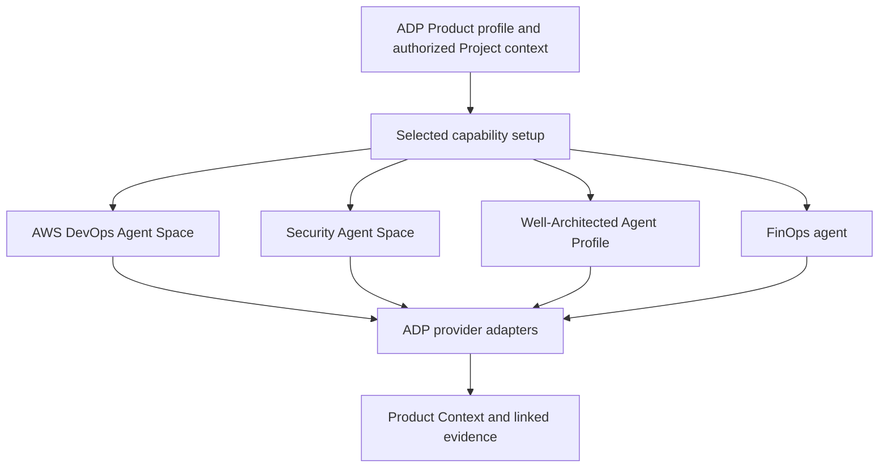

# AWS agent capabilities through Product Onboarding

**Status: proposed ADP integration design, 2026-10-15.** AWS documentation reviewed
on this date supports the provider features below. No AWS resources were created,
no integration was live-tested, and this document does not establish implemented
ADP provisioning or ingestion. Preview features and regional eligibility must be
rechecked at setup. This supplements the [Context Model](README.md) and
[Product Onboarding guide](../product-onboarding/README.md).

For the updated capability-by-capability CLI, prerequisite, pricing and spike-evidence table,
see the [frontier-agent capability catalogue](../frontier-agents/capability-catalogue.md).

## Product experience: enter shared context once

A user creates a tenant-bound Product profile in ADP, connects authorized sources,
and progressively enables capabilities. ADP uses the existing profile to create
or link the appropriate AWS resource, asks only for missing inputs, and brings
exposed knowledge and findings back into Product Context. Equivalent UI and CLI
flows use the same backend, permissions and resumable setup operation.

These are optional capabilities. Saving a profile does not provision a service,
start a scan, send a message, authorize remediation or grant spending rights.
A greenfield Product can remain useful before repositories or environments exist.
Product IDs and governed Project IDs retain their existing meanings.

The nodes represent distinct provider resources. They do not imply shared AWS
storage, credentials, GitHub App installations or automatic interoperability.
ADP reuses authorized profile values while respecting each service's setup.

## Capability and prerequisite map

| Capability | Provider resource and contribution | Shared ADP inputs | Additional setup/readiness checks |
|---|---|---|---|
| AWS DevOps Agent | Agent Space; operational topology, dependencies, investigation findings, release readiness and recommendations | Name/purpose, repositories, environments, accounts, operational connections and runbooks | Scoped IAM access, selected repository/provider authorization and relevant telemetry; verify the selected feature's availability. Release management is documented as preview. |
| AWS Security Agent, now part of AWS Continuum | Security Agent Space; code/design reviews, threat models, penetration-test runs and findings | Name/purpose, repositories, design documents, environments and security requirements | Service setup/access, repository authorization and capability-specific IAM roles. Penetration testing additionally needs target domain verification, explicit test scope, connectivity and authentication where applicable. Threat models can start from documents, code or both. |
| AWS Well-Architected Agent | Agent Profile; prioritized resource/application improvements and on-demand IaC architecture reviews | Application overview, industry, criticality, goals, accounts/Regions, tags and architecture context | Preview eligibility, supported hosting Region, eligible AWS Support plan, execution role and workload access roles; at least one goal and application context for scheduled recommendations. A repository is not an intrinsic provider prerequisite. |
| AWS FinOps Agent | Independent agent; cost inquiry, anomaly investigation, reports and existing AWS optimization recommendations | Account/product/team mappings, cost categories, owner routing, financial goals and reporting preferences | Preview availability, scoped billing/operational access, agent/operator roles and enabled data sources. Jira and Slack are optional. Repositories are not required for cost inquiry. |

Getting Started / Advanced / Pro remain information maturity, not AWS pricing or
permissions. Capability readiness is evaluated per feature. For example, design
documents can unlock threat-model setup before an environment exists; connected
billing data can unlock FinOps setup without a repository. The existing Getting
Started profile level still includes a repository. Avoid imposing every agent's
prerequisites on the minimal profile.

AWS WA Agent currently analyzes cost, security, resilience and performance. Its
Agent Profile is distinct from the older Well-Architected Tool questionnaire
profile or workload. AWS documents Business+ or higher Support eligibility;
monitored-account eligibility can affect available recommendations. Resource and
application recommendations refresh weekly; architecture reviews run on demand.
Do not present these as an immediate response to each infrastructure change.
See [WA overview][wa-overview], [concepts][wa-concepts] and [refresh][wa-refresh].

## Guided setup and lifecycle

1. **Select or link.** Resolve the authenticated tenant and governed Project,
   selected capability, target AWS account/Region and entitled connection. Offer
   an existing compatible provider resource as well as creation. Verify its
   actual data/access scope before binding it.
2. **Prepare.** Reuse confirmed profile inputs. Show the proposed resource scope,
   permissions, missing provider consents, expected billing and selected actions.
   Reuse existing authorizations only when they apply to this provider and action.
3. **Activate.** An authorized enablement action creates or links the provider
   resource and configures approved capabilities. Repository OAuth/App approval,
   cross-account role grants and domain verification remain real prerequisites.
   Provisioning does not automatically authorize recurring tests, remediation or
   Jira/Slack publishing; configure those actions explicitly.
4. **Verify.** Check provider resource existence, access, configuration and the
   selected feature's readiness. Distinguish configured/operational from initial
   discovery or analysis still pending. Show specific missing prerequisites.
5. **Reuse results.** Import exposed knowledge/findings with provenance and show
   freshness, coverage and one or two useful next steps in Product Context.

Use the existing capability states: `unavailable`, `needs_context`,
`ready_to_set_up`, `setting_up`, `operational`, `needs_attention`, `suspended`.
Retries resume the recorded operation and reconcile provider state before creating
anything again. Do not assume all providers offer an idempotency token. Record
partial success so a failed integration can be repaired without duplicate spaces.

On access revocation, suspend ADP reads/actions and invalidate derived caches.
Stopping an ADP adapter does not stop AWS schedules or revoke a provider's own
credentials: manage those explicitly within the approved lifecycle operation.
Unlinking stops ADP synchronization; deleting the external resource is a separate
explicit action. Never delete a customer-owned linked resource as automatic cleanup.
Retained evidence follows the original tenant/source retention and access policy.

## Tenant scope and provider bindings

Default to a dedicated DevOps/Security space or WA profile per governed Project
when provider limits and scope permit. Split production or other environments
when their access differs. FinOps agents may naturally serve an account/team
boundary; verify their underlying billing access before making them available
within any Product. Never use a prompt, tag filter, context file or display-name
match as a tenant access boundary.

A shared external scope must not leak data through summaries, findings, context
files or reports. Where the provider cannot enforce the required separation,
use a dedicated scope or keep the capability unavailable. AWS account-level
integration registration is not an ADP tenant grant. Security Agent organization
requirements apply across its spaces; unrelated tenants must not share that
policy scope accidentally. FinOps context files are visible to users of the
agent, so upload only context authorized for that entire audience.

The activation service needs the following bounded, typed binding contract.
This is a **proposed service-owned extension**, not a new record already accepted
by `context-model-v1.schema.json` or the Insights event validators. `ID`, `Ref`,
`Instant` and `List` use the Context Model's types.

| Field | Type / requirement | Source and meaning |
|---|---|---|
| `binding_id`, `binding_revision` | `ID`, required | ADP activation service; append revised bindings, retain history |
| `tenant_id`, `project_id` | `ID`, required | Authenticated tenant and governed registry |
| `product_ref`, `project_ref`, `connection_ref` | `Ref`, required | Exact authorized registry/connection revisions |
| `capability` | `aws_devops\|aws_security\|aws_well_architected\|aws_finops`, required | Selected provider adapter |
| `environment_refs` | `List<Ref>`, required, may be empty | Authorized scope selections; documents/code-only setup needs no invented environment |
| `aws_account_id`, `aws_region` | AWS account string / Region name, required | Verified provider resource location, not a user-supplied grant |
| `provider_resource_id` | `ID`, required after create/link succeeds | Provider-returned identity; retain an ARN where that is the documented identity |
| `ownership` | `adp_created\|customer_linked`, required | Recorded creation/link operation; controls cleanup behavior |
| `state`, `last_verified_at` | Capability-state enum / `Instant`; time required after verification | Actual setup/readiness check, not profile completeness |
| `profile_snapshot_id`, `adapter_version` | `ID`, required | Exact setup inputs and mapping implementation |
| `setup_operation_id`, `authorization_ref` | `ID` / `Ref`, required | Resumable operation and applicable authorization decision |

Secrets remain in the connection/vault layer. Provider asset, run, recommendation
and finding IDs are retained in imported refs; they are not replaced by Product
IDs. Provider resource identity must include account/Region and service namespace.

## Reuse provider knowledge and evidence

Use supported APIs/exports as sources. Keep a small local projection for identity,
relationships, readiness and navigation; fetch additional detail when needed.
Preserve versioned snapshots of evidence used in recorded decisions. Do not assume
access to a provider's internal database or copy all logs and telemetry into ADP.

| Provider | Documented reusable data/access | ADP integration boundary |
|---|---|---|
| DevOps | Versioned memory assets through `ListAssets`, `GetAssetContent`, `GetAssetFile`, `ListAssetVersions`; investigation journals through `ListJournalRecords`; recommendations through `GetRecommendation`. Topology JSON export is documented in the web app. | Reuse environment, code-dependency and pipeline understanding. Validate managed-memory availability in a real space; automated topology export is not established by a UI export. Memory is synthesized context with provider refresh/deletion rules, not an exact execution ledger. |
| Security | `ListFindings`/`BatchGetFindings`, threat models and threats via `BatchGetThreatModels`/`ListThreats`; assessment-specific run IDs | Reuse architecture/trust-boundary understanding, threats and findings. Preserve assessment/run, source scope and native finding identity. A finding or scan summary does not establish Story acceptance. |
| Well-Architected | Agent recommendation APIs and documented exports; application context and goals belong to the profile | Reuse prioritized recommendations with timestamps, affected scope, trade-offs and source identity. Do not turn estimated savings into realized financial outcomes. |
| FinOps | Context files, memory, task results and downloadable cost reports documented in its web app | Feed authorized product/team/account mappings; reuse analysis/report outputs through validated interfaces. Programmatic provisioning, context synchronization and result retrieval still need SDK/API qualification. IAM action names alone do not prove a usable supported client workflow. |

Each import retains the provider connection/resource, native record/run ID,
source version when available, observed time, parser/mapping version and access
scope. If a provider exposes no immutable revision, retain captured content/hash
and observation time; do not invent a source revision. Generated descriptions
remain sourced interpretations. Extracted typed facts require field authority
and confirmation where the core model requires it.

ADP owns Product/Project identity, business context and the explicit
[Product → Epic → Story → Criterion → Scenario → Test chain](product-to-test-lineage.md).
Provider knowledge supplements that chain. A report with no stable test identity
or criterion mapping remains a referenced assessment with a visible lineage gap.
A registered adapter contract is needed before new provider findings can enter
Insights; these domains are not silently accepted as existing v2 test results.

## Events, synchronization and storage

Connectors use an initial import, supported events and bounded reconciliation.
Direct APIs/MCP provide additional detail on demand. Connecting a tool grants
neither automatic synchronization nor a complete change history.

DevOps Agent publishes investigation/mitigation lifecycle events to EventBridge
(`aws.aidevops`). A completion event can identify a summary; retrieve its matching
journal record when present. This is not a feed of every connected-system change,
nor an event contract for all its other agent activities. Use documented polling
or exports where change events are unavailable; do not assume the other three
providers expose equivalent EventBridge events.

The proposed AWS ingestion path uses EventBridge for supported event routing and
SQS for buffering/retries. Workers validate scope, deduplicate, preserve source
evidence in S3 and update current context/relationship projections. AppFlow can
land supported SaaS objects in S3 for the same normalization path, especially for
initial imports and reconciliation. Confirm object, field and trigger coverage;
AppFlow does not supply ADP identity or acceptance mappings.

S3 is the durable Evidence Lake direction already described by
[Engineering Insights](../engineering-insights/architecture.md). SQS is transient
work storage with a dead-letter queue. A relational context store is sufficient
for current-view joins; this document does not choose a new database engine or
replace the existing proposed S3/Parquet/DuckDB analytics path. The generic pipeline
is implementation work. Unknown Project scope is quarantined, never defaulted;
failed synchronization leaves visible freshness gaps. Repeated deliveries and
direct/AppFlow overlap must not duplicate records, results or spend.

## Product Financials and overlapping recommendations

FinOps Agent supplies AWS spend analysis, forecasts, anomaly investigations and
summaries of existing optimization recommendations. WA Agent adds business-goal
prioritization and cross-pillar trade-offs. They may reference the same underlying
Compute Optimizer or Cost Optimization Hub recommendation: retain that source ID
and do not sum duplicate savings. Estimated, approved and realized savings are
different values with different evidence.

Product/initiative/release allocations, business-case approvals and AI spending
limits remain with their designated finance sources and ADP Budget Controller.
Cloud spend is distinct from model usage; shared billing facts are counted once.
A FinOps answer, uploaded budget document or optimization goal cannot authorize
spend or override enforcement. AWS-only analysis does not establish complete
multi-cloud, SaaS or product-level cost attribution.

## Implementation status and ownership

Provider documentation establishes these integration options:

- **DevOps:** Agent Space management APIs, asset/journal/recommendation reads and
  scoped tool connections. ADP setup, memory mapping and lifecycle require testing.
- **Security:** `CreateAgentSpace` and `UpdateIntegratedResources` are documented.
  Initial service identity setup, provider consents and feature readiness still
  require an adapter; creating a space does not start a penetration test.
- **Well-Architected:** documented CLI/API setup uses `CreateAgentProfile`,
  `CreateAgentGoal`, `CreateAgentContext`, then `GetAgentProfile` eligibility checks.
  The APIs do not create the required IAM roles automatically.
- **FinOps:** console setup and IAM `finops-agent:CreateAgentSpace` and related
  actions are documented. A supported end-to-end SDK/API integration was not
  verified in this review; expose guided setup/linking until qualified.

#5411 owns profile inputs, capability activation, bindings and Product Context;
#7245 owns authorized connections and tool access; #7295 owns admitted evidence
contracts and analytical views; #7356 owns registered test/run/result integration;
#7628 consumes this context for releases. Budget enforcement remains with its
existing owner. Do not add four independent onboarding forms or rebuild the
providers' specialist discovery/analysis inside ADP.

Before declaring an adapter operational, demonstrate creation/linking and retry
recovery, actual permission boundaries, provider result retrieval with provenance,
source revocation, freshness failures and cleanup of ADP-created versus linked
resources. Qualify optional publishing/remediation separately. This proposal
adds no mandatory profile fields and does not change epic acceptance IDs or mark
any integration complete. On adoption into delivery requirements, update the epic's
immutable document reference to the accepted revision.

## AWS sources reviewed

- DevOps: [GitHub connections][devops-github], [memory][devops-memory],
  [Asset API][devops-assets], [topology][devops-topology],
  [EventBridge integration][devops-events].
- Security: [resource hierarchy][security-hierarchy],
  [CreateAgentSpace][security-create], [integrations][security-integrations],
  [domain verification][security-domain], [ListFindings][security-findings].
- Well-Architected: [overview][wa-overview], [concepts][wa-concepts],
  [API quickstart][wa-api], [refresh][wa-refresh], [API actions][wa-actions].
- FinOps: [overview][finops-overview], [agent creation][finops-create],
  [context and memory][finops-context], [IAM setup][finops-iam],
  [action controls][finops-controls].
- AppFlow: [flow triggers][appflow-triggers], [GitHub connector][appflow-github].

[devops-github]: https://docs.aws.amazon.com/devopsagent/latest/userguide/connecting-to-cicd-pipelines-connecting-github.html
[devops-memory]: https://docs.aws.amazon.com/devopsagent/latest/userguide/about-aws-devops-agent-devops-agent-memories.html
[devops-assets]: https://docs.aws.amazon.com/devopsagent/latest/userguide/about-aws-devops-agent-managing-assets.html
[devops-topology]: https://docs.aws.amazon.com/devopsagent/latest/userguide/about-aws-devops-agent-what-is-a-devops-agent-topology.html
[devops-events]: https://docs.aws.amazon.com/devopsagent/latest/userguide/configuring-integrations-and-knowledge-integrating-devops-agent-into-event-driven-applications-using-amazon-eventbridge-index.html
[security-hierarchy]: https://docs.aws.amazon.com/securityagent/latest/userguide/understand-lifecycle.html
[security-create]: https://docs.aws.amazon.com/securityagent/latest/APIReference/API_CreateAgentSpace.html
[security-integrations]: https://docs.aws.amazon.com/securityagent/latest/userguide/about-integrations.html
[security-domain]: https://docs.aws.amazon.com/securityagent/latest/userguide/enable-test-domain.html
[security-findings]: https://docs.aws.amazon.com/securityagent/latest/APIReference/API_ListFindings.html
[wa-overview]: https://docs.aws.amazon.com/wellarchitected/latest/userguide/agent.html
[wa-concepts]: https://docs.aws.amazon.com/wellarchitected/latest/userguide/agent-concepts.html
[wa-api]: https://docs.aws.amazon.com/wellarchitected/latest/userguide/agent-api-quickstart.html
[wa-refresh]: https://docs.aws.amazon.com/wellarchitected/latest/userguide/agent-refresh-cadence.html
[wa-actions]: https://docs.aws.amazon.com/wellarchitected/latest/userguide/wa-api-actions.html
[finops-overview]: https://docs.aws.amazon.com/finops-agent/latest/userguide/what-is.html
[finops-create]: https://docs.aws.amazon.com/finops-agent/latest/userguide/creating-an-agent.html
[finops-context]: https://docs.aws.amazon.com/finops-agent/latest/userguide/context-files-and-memory.html
[finops-iam]: https://docs.aws.amazon.com/finops-agent/latest/userguide/setting-up.html
[finops-controls]: https://docs.aws.amazon.com/finops-agent/latest/userguide/agent-guardrail-control.html
[appflow-triggers]: https://docs.aws.amazon.com/appflow/latest/userguide/flow-triggers.html
[appflow-github]: https://docs.aws.amazon.com/appflow/latest/userguide/connectors-github.html
