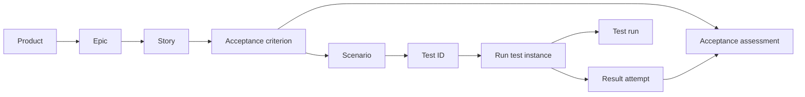

# Product-to-Test lineage

**Status: proposed contract, 2026-10-15.** This connects the proposed Context
Model to existing Insights v2 schemas. The example is checkable; a deployed
query/API and its adapters remain implementation work.

## Delivery hierarchy

**Product → Epic → Story → acceptance criterion → scenario → Test ID.**
Work spanning several Stories is an Epic. A Story describes the feature or
behavior being delivered, with criteria defining what must hold and scenarios
describing how to verify it. There is no additional Feature work-item tier.
Standalone Stories can link directly to Product without inventing an Epic.

Arrows show navigation, including reverse reference lookup. Every node retains
its qualified identity and revision. Tenant and governed Project scope every
join; Project is an access boundary, not an extra delivery tier. Programs,
Initiatives and Releases provide optional context around this chain.

Existing Insights `coverage_definition` records also classify scenarios under
module/feature labels. Preserve those catalog IDs as coverage metadata. Such a
label neither owns Stories nor creates a parallel backlog. The feature being
tested within a Story is reached through that Story's criterion and scenario.

## Exact links and their sources

`Ref` is the existing six-field reference: `tenant_id`, `project_id`,
`source_connection_id`, `record_type`, `record_id`, `record_revision` (strings).
An unqualified ID is only a display value. Reuse native IDs; do not mint a
second Story or Test identity for onboarding.

| Join | Stored contract | Expected authority |
|---|---|---|
| Product → Epic, or standalone Story | Context `product_work`, with exact endpoint refs | Product registry attribution confirmed by an authorized owner |
| Epic → Story | Context `work_parent`, parent to child | Tracker's native parent/sub-issue relation and configured work-kind mapping |
| Context Story → Insights Story revision | Context `work_story_revision` | Tracker adapter maps the same scoped native Story identity and source revision into both contracts |
| Story → criterion | `acceptance_criterion.story_ref` | Versioned Story acceptance criteria; preserve criterion keys |
| Criterion → scenario | Active `coverage_mapping`, kind `criterion_scenario` | Explicit requirements mapping from structured source or confirmed authoring |
| Scenario → Test | Active `coverage_mapping`, kind `scenario_test` | Test registration/requirements mapping, retaining its own revision |
| Test → run instance | `run_test.test_ref`; `run_ref` identifies the run | Test Director or CI adapter's actual selection manifest |
| Run instance → result | `test_result.run_test_ref`, with attempt number | Runner's observed result and evidence artifacts |
| Criterion → acceptance decision | `acceptance_assessment.criterion_ref` and `result_refs` | Recorded assessor and policy snapshot |

The Story bridge must resolve to `work_item.kind = story` and `story_revision`
with equal tenant, Project, source namespace and native ID. Its two record
revisions can differ; the adapter must retain the underlying source revision
mapping as evidence. JSON Schema checks endpoint types; these identity and
revision predicates require service validation. Similar titles are not a join.

## Worked example

Load [the context snapshot](examples/product-to-test.json) alongside the existing
[Insights traceability bundle](../../modules/insights/schemas/fixtures/v2/traceability-bundle.json).
Both are fictional and scoped to `tenant-example` / `project-example`.

| Step | Exact record ID | Meaning |
|---|---|---|
| Product | `product-membership-example` | Team Administration |
| Epic | `issue-40` | Manage team membership |
| Story | `issue-42` | Invite a member |
| Criterion | `issue-42/AC-001` | An authorized administrator can send an invitation |
| Scenario | `MOD-002-F001-S001` | Send invitation |
| Test | `TEST-001` | Administrator invites member |
| Run | `RUN-001` | Illustrative completed test run |
| Run instance | `RUN-001/TEST-001/default` | Selected Test with its parameter instance |
| Result | `RUN-001/TEST-001/default/1` | Attempt 1, passed |
| Assessment | `assessment-001` | Illustrative accepted criterion |

Context records use revision `context-1`; their links use revision `1` and
mapping version `mapping-1`. Product/Project use namespace `adp-example`, tracker
work uses `connection-example`. All referenced bundle records use namespace
`connection-example` and revision `revision-1`. The explicit Story bridge makes
this revision transition visible rather than assuming equal revision strings.

The scenario's catalog parent is feature `MOD-002-F001` (Invitations), whose
parent is module `MOD-002` (Organizations). These are existing coverage labels.
`TEST-001` points to `tests/invitations.py` / `test_invite` at its recorded code
revision. Its stable Test ID is distinct from the selector, run ID, parameter
instance and retry attempt. The fixture's passing result and acceptance are
illustrative, not evidence about the live product.

## Product Context view and query requirements

Starting with a Product ID and authorized Project scope, return all attributed
Stories, including those with missing criteria or tests. Each expanded coverage
row carries `product_ref`, `project_ref`, optional `epic_ref`, `story_ref` (context),
`story_revision_ref` (Insights), `criterion_ref`, `scenario_ref` and `test_ref`.
Missing downstream refs are null and accompanied by a named gap. Coverage labels
can be returned as optional `feature_ref` and `module_ref` metadata.

Retain `context_snapshot_id`, as-of time, the exact context relationship
IDs/revisions/mapping versions, and coverage-mapping refs behind every row.
Execution expansion adds exact `run_ref`, `run_test_ref`, `result_refs[]` and
`assessment_refs[]`; expose code revision, environment and policy with results.
Support reverse lookup from Test ID to all linked criteria, Stories, Epics and
Products under the caller's grants. Do not require Product IDs on every raw event.

Keep three separate facts visible:

- **Coverage:** missing criterion, missing scenario, unmapped Test, or mapped.
- **Execution:** no matching run, or the recorded selection/execution state and
  result outcome. A skipped, blocked or failed run is never displayed as passed.
- **Acceptance:** no assessment, or the exact assessment verdict and policy.
  A passing Test alone does not accept a Story or prove production delivery.

Missing refs, unresolved revisions, retired mappings or incompatible run bindings
remain visible gaps. A direct `work_test` shortcut cannot bypass missing criterion
or scenario mappings. Do not infer coverage from filenames, titles or a green CI
job. Results for old requirements remain historical evidence and do not silently
satisfy changed criteria. Use the run's recorded requirement/catalog/selection
snapshots and explicit instance bindings when deciding relevance.

One Test can verify several criteria and a criterion can need several Tests.
Return every mapping, but deduplicate execution totals by qualified run-instance
and attempt identity. Preserve retry attempts; a later pass does not erase a
failure. Story/Epic roll-ups evaluate their complete required criterion sets,
not just rows that happened to join successfully.

## Boundaries and ownership

All Insights v2 nested refs stay in the same tenant and Project as their record.
A Product spanning Projects is an authorized context-view aggregation. Never
rewrite Project IDs to make an event pass ingestion. Resolve relationships at
their effective time and preserve recorded time and immutable revisions for
reproducible historical views. Recheck access on reads and derived summaries.

Product Onboarding (#5411) owns Product attribution and the context-to-Story
bridge; Engineering Insights (#7295) owns versioned trace ingestion, joins and
read views; Test Director (#7356) owns test registration, selection and normalized
execution outcomes; Release Planning (#7628) consumes these refs for release
views. Connectors supply their authorized source observations through #7245.

This adds one context relationship (`work_story_revision`), not a second test
catalog or a change to the existing Insights event schemas. Minimal onboarding
still requires no Epic, Story or Test. When those records exist, adapters must
retain the chain and expose gaps. Runtime implementation must validate full-ref
resolution, source/revision correspondence, scenario kind/parent, mapping status,
run bindings, scope and assessment evidence before declaring a complete trace.
