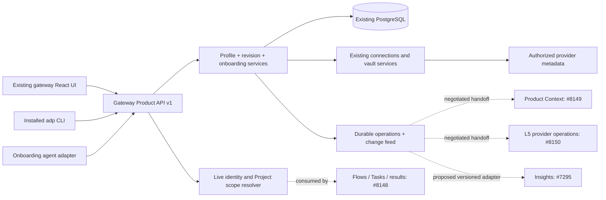
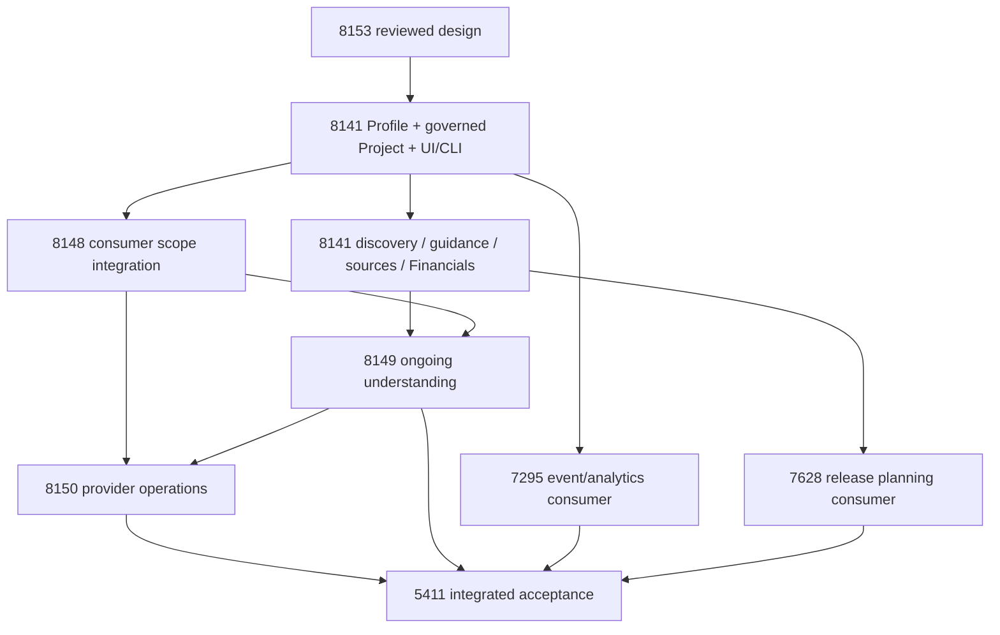

# Architecture and ownership decisions

All new behavior in this document is **proposed**. Existing mechanisms and their
pinned source evidence are indexed by S01–S16 in [source audit](source-audit.md).

## Components and deployment units

Use a modular gateway extension, proposed `src/products/` (identity/configuration,
bindings, authorization, revision service) and `src/product_onboarding/` (sessions,
discovery coordination, proposals and handoffs). Do not repurpose `admin/onboarding/`:
it admits people to tenants. Two existing router patterns—hierarchy management
(S03) and OAuth connections (S06)—already separate schemas, shared service work and
authenticated handlers. Follow them; new routers mount at `/v1`, without an extra
`/api` prefix. The public gateway adds `/api` once (S04, S07).



The API, bounded discovery coordinator and agent-facing tools ship in the gateway
image. CLI scripts ship in that image and are installed through existing CLI
publication. UI ships as the existing SPA. Alembic changes ship with the gateway
image and run in its existing migration job. No new worker image, Lambda, DynamoDB
table, S3 bucket, IAM role or secret path is necessary for core Profile. Bounded
provider calls use the credential broker/connection service, not gateway ambient
credentials. Long-running ingestion and provider runs belong to their peer services.

Why not a new service: profile edits require atomic identity/binding/progress
updates next to current membership and credentials; splitting introduces a new
distributed transaction and deployment prerequisite without independent scaling
evidence. Why PostgreSQL: relational integrity, concurrent edits and dashboard
queries fit existing RDS. Neither the identity-index DDB hot path nor the blob
evidence store is a replacement for these relations. The inventory enumerates
their existing infrastructure; none needs a Profile-owned copy.

## Identity and authorization

| Concept | Decision and invariant |
|---|---|
| Tenant / organization | Reuse authenticated organization IDs. New tables call the column `tenant_id`; legacy `org_id` is its adapter alias. Existing native IDs are preserved; new GitHub anchors come from identity APIs (`user-<numeric-id>` / organization login), never a Product slug. |
| Product | Stable UUID identity plus common name/purpose/users/domain/goals and accountable owner. Common metadata is deliberately shared among authorized linked Projects. No credentials, private source content or private results in this common area. |
| Portfolio | Optional catalog/Context-owned collection, identified by `portfolio_id`. Dated `portfolio_product` relationships allow multiple collections per Product. Membership grants no access, budget authority or required onboarding parent; it is not a Profile-owned table or field. |
| Governed Project | New gateway registry entity, UUID for new IDs, existing IDs retained only through approved mapping. A Product has one or more current Project bindings; a Project belongs to at most one current Product in v1. Binding is dated/versioned. No project ID is a repo slug or Knowledge Layer filter. |
| Owner / team | Owner is a current human organization-local user, default caller. `products.team_id` references one existing organization team and is inherited by its bound Projects. Creation assigns the caller's current primary team, or sole membership; missing or ambiguous membership returns `409 team_assignment_required`. The nullable field accommodates legacy Products. No synthetic team is created. Source user names map via existing verified identity/admin APIs, never email-string matching. |
| Shared workspace | Product rows, Profile, bound Project configuration, saved onboarding progress and Product Context are visible only to current Product team members or verified platform administrators within the selected tenant. Ownership, organization-admin roles and stale primary-team pointers do not grant visibility. Legacy teamless Products are administrator-only until assigned. No Project privacy selector or per-field ACL. Team changes use existing membership/administration permissions and never make personal credentials team-owned. |
| Product editing | Authorized team members with the relevant existing write permission edit Product fields, Project configuration and onboarding steps directly. No separate owner-acceptance workflow for ordinary edits or imported suggestions. Ownership/team administration still uses existing administrative permissions. Optimistic revisions and change history prevent silent overwrite and preserve attribution. |
| Administration | Verified platform administrators can see Products in the selected tenant; operation-specific permissions still govern changes. Existing admin rights govern organization/team/connection administration. Product/Project transfer requires the current authorized owner and a valid target member. If that owner lost tenant membership, restoration uses existing audited identity administration first; there is no Product-specific takeover bypass. Visibility does not grant owner-only mutation rights. |
| Agent | Uses the existing authenticated on-behalf-of actor plus request lineage. Service identity must have an explicit delegated operation and scope. Never impersonates owner, self-approves a proposal, or inherits authority from an issue/comment. |

The shared proposed resolver takes caller, authenticated tenant, Product, Project,
operation and optional source reference. It checks the selected tenant, current
Product–Project binding and live workspace/Product-team membership (S02), or
verified current platform-admin authority, then existing operation
permission and current source entitlement. It returns scoped IDs and the effective
human/delegation identity. Denied/missing foreign IDs return indistinguishable 404;
known-resource action denial returns 403. Lists filter before counting/pagination.
Exports, old revisions, operation polling, callbacks and cached values use the same
resolver. Cache keys include tenant, Project, caller and source authorization version;
do not cache an allow decision across requests. If live authorization cannot be
resolved, fail closed; metadata freshness is not permission freshness.

Revoked team/tenant/source access removes subsequent reads immediately even when a
historical snapshot exists. Revocation before a provider effect must cancel it;
effects already committed before revocation are reconciled without further writes.
Binding a personal source into a team Project exposes only its safe connection
label/status; members need their own entitlement or explicit existing workspace
delegation to read source-derived fields. Aggregation cannot reveal unauthorized
project counts, source names, financial fields or inference derived from them.

`Only me` / `Product team` applies to individual runs and delivery activities in
#8148, not to profile configuration. Private run results never automatically enter
shared Context or Insights. Existing source entitlements still filter restricted
source-derived fields; this is not a new user-configurable field permission model.
Projects inherit the Product team; they have no separate team override in v1.
Unbound Projects use existing owner access until deliberately associated. Binding
an existing Project requires current authority and a clear preview of the Product
team that will gain access; it is an identity association, not a privacy workflow.
Removing a binding returns that Project to owner access and never migrates private
run results into the Product. Initiatives may span Products using the existing
typed relationships; an initiative association never grants cross-product access.

#8141 supplies this registry resolver contract; #8148 integrates it into Flow,
Task, search, exports and result consumers. Do not create a second permissions
engine or claim whole-platform Product isolation from registry tests alone.

## Shared operations and durable state

```mermaid
sequenceDiagram
  participant Client as UI / CLI / agent
  participant API as Shared gateway service
  participant DB as PostgreSQL
  participant Provider as Existing connection/provider service
  Client->>API: create minimal Product (idempotency key)
  API->>DB: lock key; verify tenant/owner/selected Project
  API->>DB: Product + Project + binding + revision + receipt (one commit)
  API-->>Client: stable IDs / revision / resume route
  Client->>API: start session + selected sources
  API->>DB: record durable discovery operation
  API->>Provider: authorized bounded read (no transaction held)
  Provider-->>API: immutable IDs / source revisions / coverage
  API->>DB: recheck scope + expected revision; save candidates/progress
  API-->>Client: accepted facts / conflicts / next gaps
  Client->>API: confirm a choice with expected Profile revision
  API->>DB: configuration + provenance + progress + change record (one commit)
```

Chat is neither the profile nor a transaction log. Sessions store section choices,
step status, pending operation IDs and resumable handoffs. Two clients GET current
state; each mutation presents the expected Profile revision. On conflict, neither client auto-replays
against a new revision; show differing fields and ask for a deliberate merge.
Only proposals based on still-current field/source revisions can be confirmed.

The v1 Product Onboarding Agent is a bounded proposal assistant, not a new hosted
execution engine. `guideOnboarding` assembles an authorized current snapshot and
missing-check list, requests at most one structured model response through the
existing metered gateway model API, validates at most 10 proposals and stores them
in the session’s typed pending-proposals document, separate from section status.
GET Session returns still-pending authorized candidates so another client can
resume without chat history. Model suggestions carry no permission. Actual discovery, editing,
confirmation and handoffs still invoke the shared operations under the original
actor. Model timeout/denial leaves deterministic guidance and direct editing usable;
no hidden retry incurs new model spend. Budget admission/call receipts and model
revision are retained by existing model services. Guidance output is untrusted,
schema-validated and cannot set approval/verification or execute arbitrary tools.
Do not reuse `agentauth/chat_tools.py` as a generic bypass: its existing relay is
restricted to registered Crew session/pod proofs. Future hosted-agent consumers
must use their existing Task/delegation admission plus the same Project resolver.

Discovery runs before questions. It first enumerates authorized existing identity,
connection and Project records, then bounded provider metadata. It never asks for
a known account/region/repo ID again. Unique authoritative observations can fill
unconfirmed empty fields automatically with connector provenance. Inferences and
financial extraction remain proposals. Confirmed/manual authoritative values survive
refresh; contrary observations produce conflicts, not silent overwrites. Missing
permission, incomplete pagination and unavailable adapters are not empty systems.
Do not fetch an arbitrary user URL: resolve references through an allowlisted
provider, reject private-network/credential-bearing redirects and enforce size/time
bounds. User documents and provider text remain untrusted data for the agent.

V1 discovery bound: at most 10 selected bindings per operation, 100 records per
provider page, 5 pages / 30 seconds per attempt; checkpoint cursor and report partial.
User requests continuation explicitly. The API records a lease before a bounded
attempt; a request/status poll may acquire an expired lease and reconcile safe
reads. No detached in-memory task is the sole owner of work. Scheduled ongoing
reconciliation belongs to Context, not this coordinator. State changes and replay
rules are specified in [database](database.md) and [API](api.md).

## Sources, financials and selected effects

Bindings refer to existing `channel_tenant_map` installation rows or
`user_credentials` rows using `{kind,id}`; IDs come from those APIs, never invented
by the CLI. Store provider-native IDs separately from URLs/display names. Source
metadata and desired selection are not provider permission. AWS environment facts
must come from the selected connection's verification and immutable account/role
binding. Verify the exact account **and role** through that connection before
provider operations. Profile storage grants no STS permission.

Greenfield repository creation is a separately selected operation: preview the
owner/template revision/visibility/protections, require existing GitHub write
authority and explicit confirmation, persist the operation before creating, and
reconcile immutable provider identity if the response is lost. Do not automatically
replace an existing pipeline; proposed bootstrap changes become a reviewable PR.
Credential/admin handoffs use existing install/OAuth/AWS connection flows. The
session holds a non-secret operation reference, never the OAuth state/token itself.

Financials stores typed allocations and per-field provenance, not spend ledgers.
Amount is decimal-string/decimal, currency is explicit, allocation target and
period are scoped, extracted values require confirmation. Confirmation does not
set approval status. Finance/budget authorities own approval/limits; missing parent
currency/limit proof leaves an allocation proposed and blocks activation, not
profile save. Actuals/forecasts are read-only service projections with coverage,
method and as-of time; unknown is not zero. No summation of parent and child
allocations as spend, no implicit FX conversion. Existing org/team/user budgets
remain enforcement; a new Project allocation is not automatically a budget limit.

## Handoffs, events and dependent services

Profile owns a durable change feed in the same transaction as edits, not a new
event bus. Entries contain `event_id`, `schema_version`, tenant/Product/Project,
profile revision, actor, changed paths, recorded time and resource references.
No raw document, secret or inferred summary is emitted. Consumers use their
existing authorized transports and at-least-once pull with opaque checkpoints;
deduplicate by event ID and process per-product revisions monotonically. Lost
delivery is replayable; a revoked scope is not replayable to a former reader.

Explicit handoff exports a frozen, authorized snapshot with scope, profile revision,
binding/source revisions, requested operation and initiating actor. Context accepts
configuration/source references; L5 accepts the capability setup request, then owns
provider state/run IDs/results. Insights requires a separately owned, versioned
registry/relationship adapter; current raw producer schemas do not admit generic
Profile or Portfolio events. A receiver must return a receipt containing the same
scope/revision and a native operation ID. The gateway stores receipt/status, not the peer's state machine.
Callbacks must be authenticated, tied to an existing pending operation and rechecked
against current access. A callback never creates a new source grant.

Unavailable contract/provider: show `unavailable` and the named prerequisite, retain
the saved profile/session, permit other steps, and do not enqueue automatic activation
when the service later appears. Context screen can show a readable local summary
of confirmed profile facts and sources, clearly labelled **Profile only — Context
service unavailable**. It must not masquerade as ongoing sourced synthesis. Actual
handoff acceptance (EC-11 / PO-08, PO-12) waits for a real receipt and independently
retrieved result; an adapter mock is pre-merge contract evidence only.

## Ownership and dependencies



Arrows mean contract/data dependency, not whole-epic completion gates. Core and
guided onboarding must work without any optional consumer. The release integrator
owns version alignment and cross-service denial tests; service owners own their
implementation/deployment/results. No work is dispatched by this design.

## Shared business and evidence model

Use the [shared data model](data-model.md) with Context and Engineering Insights.
Portfolios optionally collect Products through dated many-to-many membership;
Programs group Initiatives. The catalog/Context authority owns Portfolio identity,
membership and Initiative/Contribution records. Profile's API and PostgreSQL
design own Product/Project configuration and the managing binding; financials may
reference authorized external records without duplicating their storage.
Initiatives are cross-product business objectives; Contributions record each
Product’s agreed outcome in its governed Project. Releases and work have dated
many-to-many associations. The profile registry’s current Product–Project binding
does not infer attribution or replace those associations. Raw lineage remains
Project-scoped; new registry adapters require an owned Insights contract.
The [consistency review](consistency-review.md) maps these boundaries to the API,
database and mockup, including the catalog contracts still needed for implementation.
