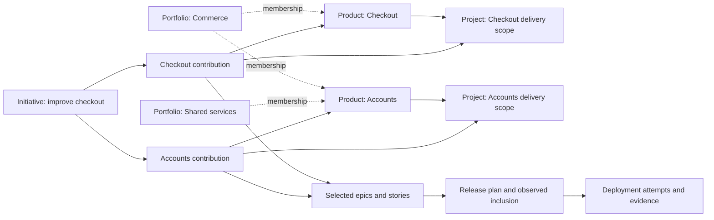

# Shared Portfolio, Product, Project, Initiative and Release model

This design uses the [Product Context model](../../product-context/README.md) and
[Engineering Insights lineage](../../engineering-insights/lineage-schema.md) as its
shared vocabulary. It specifies the Profile registry's implementation of those
concepts; it does not create a competing work hierarchy or a new Insights event
format. The existing [lineage alignment](../../product-context/lineage-alignment.md)
and [Product-to-Test trace](../../product-context/product-to-test-lineage.md) remain
normative for adapter and evidence boundaries.

## Concepts and authority

| Concept | Meaning and identity owner | User experience |
|---|---|---|
| Portfolio | Optional durable collection of Products; catalog/Context authority owns `portfolio_id` | Organize Products for investment and reporting after first save; no required parent |
| Product | Enduring offering; `product_id` from the catalog/Profile registry | Create once; shared name, purpose, users and team |
| Project | Persistent delivery/operating, evidence and access scope; canonical registry `project_id` | First Project created automatically; select additional Projects only when needed |
| Initiative | Optional business objective, typically spanning products; portfolio authority or governed registry `initiative_id` | Link an existing initiative when contributing to its outcome; never a required onboarding parent |
| Contribution | One agreed Initiative × Product × Project contribution at an effective time; Context/portfolio contract | Describes that product's outcome, accountable owner and linked work without copying a backlog |
| Epic / Story | Authored work owned by the configured tracker; preserve native identity and dated hierarchy | Reuse existing work; an Initiative is not a substitute for an epic |
| Release | Planned/observed shipment identity owned by the designated release registry (#7628) | Plan when useful; link selected work, exact artifacts and targets |
| Deployment | An observed attempt to place release artifacts in an environment; deployment producer owns identity/result | Show each attempt and actual result separately from the release plan |
| Business case / allocation | Justification and scoped funding plan; finance authority owns approval and attribution | Optional financial context; no implicit spend permission or duplicated ledger |

A Project is not the business delivery effort usually called a project in a PMO
system. Preserve that source's `source_project_id`; map its business objective to
Initiative where appropriate. Neither overwrites canonical `project_id`.

## Relationships, not a compulsory tree



| Relationship | Cardinality and rule |
|---|---|
| Portfolio ↔ Product | Optional many-to-many dated membership. A Product can belong to several collections. V1 has no nested Portfolios and membership grants no access. |
| Product ↔ Initiative | Many-to-many. Initiatives commonly span products; products participate in several initiatives over time. |
| Product → Project | One or more current profile scopes. V1 retains one managing Product per Project for shared-team/configuration ownership. This registry constraint is not an attribution rule for work or releases. |
| Initiative × Product × Project → Contribution | At most one current contribution per tuple; revise the commitment and its dated work links. |
| Product ↔ Epic/Story | Many-to-many explicit attribution, with dated epic membership and story-level exceptions. Do not attribute all initiative work to every participating product. |
| Product ↔ Release | Many-to-many authorized links. A release can group contributions from several products; products may ship independently. |
| Release ↔ Story | Many-to-many. Keep `release_plans_work` separate from `release_delivers_work`; inclusion can be partial. |
| Release → Deployment | One-to-many attempts/targets. A release name, closed story or published artifact is not successful production delivery. |

A coordinated business view composes separately authorized Project records through
explicit catalog/namespace mappings. V1 execution remains within one canonical
Project; multi-Project promotion is an explicit later release-service contract.
Shared business IDs do not join raw evidence automatically or grant access.

Portfolio groups Products; the existing optional Program groups Initiatives.
An Initiative can involve Products across Portfolios through their Contributions.
Avoid a mandatory Portfolio → Program → Initiative → Product tree. Portfolio's
catalog `record_id` supplies `portfolio_id`; authorized Project projections preserve
that identity and exact source refs. Membership belongs in Context's typed
`portfolio_product` relationships, not a required `portfolio_id` on Product creation.

The [Context Portfolio contract](../../product-context/README.md#portfolios-and-product-membership)
defines the optional record, dated membership and reporting rules. For example,
Commerce contains Checkout and Accounts; Shared services also contains Accounts.
Attribution follows membership at event effective time. Changing a collection
does not silently rewrite historical delivery or count Accounts twice in a combined
view. Current-membership regrouping must be labelled explicitly. Portfolio views
preserve Project/source access and expose incomplete coverage without hidden counts.

The one-managing-Product constraint keeps Profile writes and team inheritance
unambiguous in v1. It must not become a universal `product_id` parent field on
stories, releases or initiatives. Their many-to-many, source-owned relationships
remain valid. Supporting multiple managing Products for one registry Project would
require an explicit configuration/authorization revision, not a hidden change in
an analytics join.

## Stable identifiers and versions

Every versioned reference preserves the existing six fields:

```text
(tenant_id, project_id, source_connection_id,
 record_type, record_id, record_revision)
```

Provider IDs, registry IDs, human display names and revisions have different jobs:

- The Profile registry mints only its own Product/Project identities. An imported
  identity is resolved by an explicit mapping; names, repository slugs and board
  numbers cannot substitute for it.
- API `Profile.revision` is a Product aggregate concurrency token. It is not a
  globally unique source revision, relationship revision or mapping-policy version.
- Registry export `record_revision` pins an immutable normalized record. Use the
  owning `product_changes.id` for newly emitted Product/Project projections, with
  the original identity unchanged. Carry that exact reference forward when reused.
  Do not use a bare aggregate revision for a Project that can move between
  Products: two Products can each have revision 1.
- `relationship_revision` versions one relationship; `supersedes_revision` names
  its prior version. `mapping_version` versions the normalization/attribution rule.
  Changing one must not silently stand in for another.
- `source_connection_id=adp.profile` is the registered internal direct-input
  namespace, not a credential or fabricated provider connection. External sources
  keep their actual registered namespace.

## Dated links and storage

Reuse Context's exact `relationship` shape: qualified endpoints, relationship ID,
source namespace, relationship revision, optional superseded revision, valid-from /
valid-to, recorded-at, mapping version and source references. Effective time says
when a link applied; recorded time says when ADP learned it. Corrections preserve
both what was true for attribution and what was known at a prior decision.

`product_project_bindings` is the current registry projection. A bind, close or
correction appends its complete immutable relationship version to the same
`product_changes` transaction, then updates the projection. Older relationship
versions are not edited or lost when `valid_to` changes. Retain relationship
versions for the Product lifetime even when heavyweight profile snapshots expire.
Snapshots/adapter output use those exact revisions, not reconstruction from the
current binding row.

Profile owns only its identity/configuration/binding relationships. Context and
portfolio services own Portfolio membership and Initiative/Contribution mappings; trackers own work parent
links; release services own plans; producers own observations. There is no second
mutable Portfolio, Release, Initiative or Story table inside onboarding. Profile Financials
stores qualified references and typed planning allocations, not copies of those
services' entities or actual spend.

## Engineering Insights integration

| Profile / Context output | Insights use / boundary |
|---|---|
| Canonical Project ID and qualified source bindings | Inherit exact tenant/Project scope into flows, tasks and producer records through #8148; no per-client identity generator |
| Product identity and immutable dated relationships | Registry/relationship adapter resolves business context at event effective time and records the mapping version used |
| Team mapping and changes | Dated ownership context; current team membership must not rewrite historical cohorts or cost attribution |
| Initiative/Contribution and funding references | Optional contextual joins; distinguish not applicable from unknown and retain direct/inherited funding provenance |
| Profile change feed | Bounded, authorized source for owned adapters; consumers do not read gateway tables |
| Release, deployment, test and ledger facts | Consume existing source-owned records and exact revisions; the Profile does not manufacture these facts |

The currently admitted Insights v1/v2 record types do **not** include a generic
Profile, Portfolio, Product, Initiative or registry relationship. A six-field reference does
not make a Profile snapshot an Insights event. #7295 must own and version the
registry/relationship ingestion adapter, including its source-event identity,
event/ingestion times, publisher authorization, deduplication and quarantine rules.
Missing integration is explicit; saving a product does not depend on it.

Insights now specifies the matching [Profile/Context integration contract](../../engineering-insights/lineage-schema.md#52-profile-and-context-integration-contract),
including source ownership, immutable change/revision readback, replay identity,
Project rebind history and required adapter acceptance scenarios. Its overview,
relationship table and architecture use these same cardinalities and boundaries.

Existing v2 raw references remain in the containing record's tenant and Project.
Cross-Project context views query each authorized scope and join only through
approved mappings; they never rewrite Project IDs or copy execution facts to make
a cross-scope raw record pass. Existing v1 Tasks still require a Story. Keep valid
non-story execution at its source with a visible adapter gap rather than inventing
a Story, Initiative or Release.

For ROI, deduplicate original qualified work/ledger identities before aggregation.
Retain secondary product/initiative associations for filtering; use the approved
primary attribution or allocation policy for additive totals, with any unallocated
remainder visible. Recompute metrics from eligible populations. A release date,
profile budget or 100% onboarding score cannot establish shipped work, approved
funding, actual cost or acceptance.

## Simple onboarding over the same model

Save name, purpose and intended users; default the authorized owner and create the
first Project in the same operation. A user need not choose a Portfolio, Initiative, Release,
repository, team or environment. Product details stay shared; a Project switch
loads its own connections, plan, session and evidence without transferring them.

The optional financial form defaults target to the Product, owner to the current
accountable user, category to AI, status to proposed and an editable three-month
period. Existing Initiative selection records a cross-product association, not a
new child initiative. A release target date can be saved before a Release exists;
when planning begins, the release registry owns the identity and explicit mapping.

The Products list shows lifecycle, authorized Project count and optional team. It
does not invent a Product-wide completeness average. Progress is evaluated in the
selected Project using the server's `profile-1` rules and current source evidence.

## Review checks

`validate_design.py` checks the common reference structure and the registry
relationship example against Context's actual schema. It also invokes the existing
Insights validator to establish that a valid scoped v2 record passes, a changed
nested Project is rejected, and a Profile is not an admitted v2 producer record.
These are design compatibility checks, not a deployed adapter or access test.
