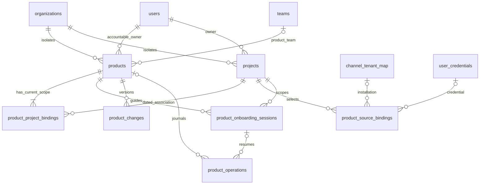

# Database and recovery contract

**Proposed physical design, not a migration.** PostgreSQL in the existing gateway
owns the following records. [Source audit S01–S06](source-audit.md) and the complete
[migration graph](migrations.tsv) establish existing storage. The inspected graph
has 113 revisions and one head, `105_flow_cost_covering`. Implementation allocates
new revision IDs against the then-current head; this design reserves none.

## Existing entities reused

| Physical table | Existing key / relevant columns | Use and compatibility |
|---|---|---|
| `organizations` | `id varchar(255)` PK | Tenant FK target; do not require thin `tenants` row to exist for legacy tenants. |
| `users` | `id varchar(255)` PK, `org_id`, human/shadow discriminators | Organization-local accountable owner/actor; resolve verified login links first. No new user table. |
| `teams` | `id varchar(255)` PK, `org_id`, `department_id` | Optional existing team. No profile-triggered team creation. |
| `tenant_memberships` | `id varchar(36)` PK; UNIQUE(`user_id`,`tenant_id`), `role`, `is_active`, `revoked_at` | Reuse live resolver, including tombstones/legacy native-user rules. Never interpret inactive workspace selection as revocation. |
| `team_memberships` | `id varchar(255)` PK; UNIQUE(`user_id`,`team_id`), `org_id`, `is_primary` | Existing team selection/sharing; preserve primary pointer compatibility. |
| `channel_tenant_map` | `id varchar(36)` PK; provider/native scope, `org_id`, installation metadata | Real installation reference; verification/revocation stays with connection service. |
| `user_credentials` | `id varchar(36)` PK, `org_id`, nullable user/team, provider/type/label, secret pointer, verification evidence | Existing credential authority; Product stores FK references only. |
| `oauth_connection_attempts`, `installation_revocations`, `credential_validation_evidence`, `credential_workspace_delegations` | Existing attempt/revocation/evidence/delegation identities | Reuse their services, not shadow copies in Product callbacks. |
| `audit_logs`, `security_audit_logs` | Existing admin/security streams | Append existing administrative/security outcomes via their helpers. New domain changes below complement, not replace them. |
| Existing budget tables | Hierarchical org/department/team/user policy and usage | Financial allocation is profile data, not a new budget enforcer or spend ledger. |

## ER diagram

## Dictionary conventions

All definitions below are normative. `NN` means NOT NULL; `?` means nullable.
All new entity IDs use server-generated UUIDv4 serialized as lowercase strings,
stored `varchar(36)` except `projects.id varchar(255)` to permit explicitly mapped
legacy IDs. `tenant_id varchar(255) NN` FK → `organizations.id ON DELETE RESTRICT`
appears in every table. No implicit tenant default. No ON DELETE CASCADE from
identity/source tables into profile history. Every FK between new scoped tables
includes `tenant_id`; every FK's referenced columns have an explicit PK/UNIQUE.
All timestamps are `timestamptz`, serialized UTC. JSON columns are JSONB, validated
against the versioned [schemas](schemas.json), never arbitrary connector blobs.

The primary key of each new entity table is `(tenant_id,id)`. Add
UNIQUE(`tenant_id,id`) only where a table instead has a different stated PK. Lists
use `(created_at,id)` keyset pagination scoped by tenant/authorization, not offset.
`created_at NN DEFAULT now()`, `updated_at NN DEFAULT now()` are common to mutable
tables; immutable changes have `recorded_at NN DEFAULT now()` instead. Updates set
`updated_at` explicitly in the service transaction. No database triggers generate
user-facing revisions invisibly.

### `products` — shared Product identity and global revision

| Column | Type / null / default | Constraints / meaning |
|---|---|---|
| `id`, `tenant_id` | As above | PK(`tenant_id`,`id`) |
| `name` | varchar(200) NN | trimmed nonblank; not unique, names can legitimately collide |
| `purpose` | text NN | trimmed length 1–10,000 |
| `intended_users` | jsonb NN | array 1–100 nonblank names, each ≤200 |
| `owner_user_id` | varchar(255) NN | same-tenant users FK; current human owner at assignment |
| `team_id` | varchar(255) ? DEFAULT NULL | same-tenant teams FK; one optional Product team inherited by all bound Projects |
| `starting_point` | varchar(20) NN | CHECK idea / existing_assets / running_product |
| `lifecycle_status` | varchar(16) NN DEFAULT 'draft' | CHECK draft / active / retired; business lifecycle, not execution readiness |
| `domain` | varchar(200) ? | nonblank when supplied |
| `goals` | jsonb NN DEFAULT '[]' | ≤100 text goals, each ≤10,000 |
| `provenance` | jsonb NN DEFAULT '[]' | typed common-field provenance; create populates accepted direct-input references |
| `revision` | bigint NN DEFAULT 1 | CHECK ≥1; all aggregate mutations serialize on this row |
| `schema_version` | varchar(16) NN DEFAULT '1.0' | typed profile document version |
| `archived_at` | timestamptz ? | registry archive; never deletes provider assets |
| `created_by` | varchar(255) NN | immutable actor reference, no cascade deletion |

Indexes `(tenant_id,created_at,id)`, `(tenant_id,owner_user_id,id)` and
`(tenant_id,team_id,id)`. Product and bound Project configuration share the current
Product team. Creation assigns the caller's current primary team or sole membership;
missing or ambiguous membership returns `409 team_assignment_required`. Legacy
teamless Products are visible only to verified platform administrators. Current
team members and platform admins can read Products within the selected tenant;
ownership and stale primary-team pointers alone grant no access. The resolver
still applies existing operation and source permissions. Private run
results and restricted source content do not enter common Product metadata.
`team_id` is omitted on the wire when not mapped; PATCH null removes the mapping
under existing administration rights. Product revision records team changes as
well as edits. No per-Project visibility column or duplicate team setting exists.

### `projects` — governed scope and typed progressive configuration

| Column | Type / null / default | Constraints / meaning |
|---|---|---|
| `id`, `tenant_id` | As above | PK(`tenant_id`,`id`); new IDs UUID, no guessing old IDs |
| `name` | varchar(200) NN | default Product name supplied by create service, not SQL |
| `owner_user_id` | varchar(255) NN | same-tenant users FK; human |
| `state` | varchar(16) NN DEFAULT 'registered' | CHECK registered / suspended / archived |
| `configuration` | jsonb NN DEFAULT '{}' | `ProjectConfiguration`: basic, advanced, financials, applicability, selections; max 256 KiB canonical JSON |
| `provenance` | jsonb NN DEFAULT '[]' | versioned field-provenance entries, max 1,000, valid pointers into configuration; last accepted values retained |
| `execution_policy_ref`, `budget_policy_ref` | jsonb ? | qualified references; service-validatable, never free-text grants |
| `archived_at` | timestamptz ? | CHECK archive state iff archived_at nonnull |

Indexes `(tenant_id,owner_user_id,id)`, `(tenant_id,state,id)` and
`(tenant_id,created_at,id)`. No blanket JSON GIN index: v1 queries scope and IDs,
not full-text document contents. Configuration schema uses existing Context field
types: unknown fields omitted; empty observed arrays differ from missing data.
Financial arrays hold ≤100 typed allocations; no relational query/join need yet
justifies a separate allocation table. Finance retains its authoritative records.

### `product_project_bindings` — dated identity relationship

| Column | Type / null / default | Constraints / meaning |
|---|---|---|
| `id`, `tenant_id` | As above | PK |
| `product_id` | varchar(36) NN | scoped products FK |
| `project_id` | varchar(255) NN | scoped projects FK |
| `valid_from` | timestamptz NN DEFAULT now() | inclusive |
| `valid_to` | timestamptz ? | exclusive, CHECK > valid_from when set |
| `relationship_revision` | bigint NN DEFAULT 1 | CHECK ≥1; version of this binding, independent of aggregate revision |
| `supersedes_revision` | bigint ? | prior relationship version, when revised |
| `mapping_version` | varchar(64) NN | normalization/attribution rule, initially `profile-registry-1`; never the Product revision |
| `source_connection_id` | varchar(255) NN DEFAULT 'adp.profile' | registered internal registry namespace |
| `recorded_at` | timestamptz NN DEFAULT now() | when this relationship version was learned |
| `provenance` | jsonb NN | typed actor/source/input revision reference |

Partial UNIQUE(`tenant_id`,`project_id`) WHERE `valid_to IS NULL`; also partial
UNIQUE(`tenant_id`,`product_id`,`project_id`) for current pairs. Index
`(tenant_id,product_id,valid_to,project_id)`. This table is the current projection;
complete immutable relationship versions are appended in the same `product_changes`
transaction before updating it. Closing/rebinding takes Product and
Project locks in sorted-ID order. Service invariant: a nonarchived Product must
retain ≥1 current Project; the last unlink returns 409. Enforce additionally with
a deferred constraint trigger on Product/binding changes at commit, so internal
SQL cannot commit a usable orphan. This is the only proposed invariant trigger;
it does not mint revisions. A Project already bound elsewhere returns 409 rather
than silently transferring it. Transfer is close+open under explicit owner consent.

### `product_source_bindings` — selections, not credentials

| Column | Type / null / default | Constraints / meaning |
|---|---|---|
| `id`, `tenant_id` | As above | PK |
| `project_id` | varchar(255) NN | scoped projects FK |
| `kind` | varchar(24) NN | repository / tracker / document / environment / pipeline / support / communication / finance |
| `provider` | varchar(64) NN | supported adapter key |
| `installation_id` | varchar(36) ? | FK to `channel_tenant_map.id` with tenant match |
| `credential_id` | varchar(36) ? | FK to `user_credentials.id` with tenant match |
| `native_id` | varchar(512) NN | immutable provider ID, not display name/URL |
| `namespace` | varchar(512) NN | verified provider instance/workspace |
| `desired` | jsonb NN | discriminated typed binding data; max 64 KiB |
| `observed` | jsonb ? | typed source snapshot metadata, coverage, native revision, observed/stale times; never credential values |
| `status` | varchar(20) NN DEFAULT 'unverified' | unverified / healthy / degraded / revoked / unlinked |
| `generation` | bigint NN DEFAULT 1 | increment on rebind/unlink/revoke; callbacks pin it |
| `unlinked_at` | timestamptz ? | CHECK status=unlinked iff nonnull |

CHECK exactly one of installation_id/credential_id present. Direct manual fields
are not fake source bindings; they reference their own change record. Partial
UNIQUE(`tenant_id`,`project_id`,`kind`,`provider`,`namespace`,`native_id`) WHERE
unlinked_at IS NULL, preventing duplicate repository bindings through two
credentials. Index `(tenant_id,project_id,status,id)` and each source-FK pair.
Unlink preserves the connection and provider asset. Connection revocation is
observed by live access checks even before a cached binding status is updated.
Freshness is also evaluated on read: expired `observed.stale_after` makes a
previously healthy binding effectively `degraded` without rewriting `observed_at`
or minting a registry revision. Persist new verification evidence only after a
real authorized readback. The stored selection remains available for retry.

### `product_onboarding_sessions` — shared resumable guidance

| Column | Type / null / default | Constraints / meaning |
|---|---|---|
| `id`, `tenant_id` | As above | PK |
| `product_id`, `project_id` | varchar(36), varchar(255), both NN | scoped FKs; service verifies current relationship |
| `actor_user_id` | varchar(255) NN | creator/guide owner; reassignment explicit |
| `state` | varchar(20) NN DEFAULT 'open' | open / waiting_external / completed / cancelled |
| `steps` | jsonb NN DEFAULT '{}' | four-section `StepState` status/evidence map; proposals live separately |
| `proposals` | jsonb NN DEFAULT '[]' | ≤100 typed `Proposal` candidates, max 256 KiB total; remaining paths, base/source revisions and expiry; bounded errors never evict pending user work silently |
| `rule_version` | varchar(32) NN DEFAULT 'profile-1' | denominator/hint rules pinned, upgrades explicit |
| `last_product_revision` | bigint NN | exact revision last committed by this session |
| `expires_at` | timestamptz ? | inactive sessions close after 90 days; never deletes confirmed profile |

Index `(tenant_id,project_id,actor_user_id,state,id)`. Partial UNIQUE
(`tenant_id`,`product_id`,`project_id`,`actor_user_id`) WHERE state IN
('open','waiting_external'); start reuses the open session. No per-step or proposal
table: the bounded section/proposal documents commit together. GET Session returns
currently authorized, unexpired pending proposals.
Confirming selected paths atomically updates configuration/provenance, removes
only consumed paths, and journals the accepted proposal/source references.
Fully consumed candidates are removed from the pending projection; historical
confirmation remains in the change journal. Unselected paths survive UI/CLI resume.
Session progress can only certify saved/observed evidence, not an execution permission or a capability
demonstration. Saved onboarding progress and candidate suggestions share Product
team access, subject to existing source entitlements. Any authorized editor can
confirm a current suggestion; there is no private proposal/owner approval queue.
Session actor identifies attribution and the current client's resume cursor, not a
second privacy boundary. Provider credential handoff completion remains bound to
its original authenticated actor; sharing progress never transfers that authority.

Step status/evidence must agree with current checks and operations using the
[section-state rules](experience.md#section-state-and-freshness). Persist explicit
Later/N/A choices and operation references; overlay current evidence freshness and
authorization on read. An untouched optional section can remain `not_started` in
a completed session. A pending operation is `waiting_external`, never completed
because the other selected checks reach 100%.

### `product_operations` — idempotency, discovery, external handoff and receipts

| Column | Type / null / default | Constraints / meaning |
|---|---|---|
| `id`, `tenant_id` | As above | PK |
| `product_id`, `project_id`, `session_id` | varchar(36), varchar(255), varchar(36), all ? | scoped FKs; null only before atomic create or for unbound create failure |
| `actor_id` | varchar(255) NN | durable effective actor; raw login tokens never stored |
| `operation` | varchar(64) NN | allowlisted OpenAPI operation ID / typed external operation |
| `key_hash` | char(64) NN | SHA-256 of supplied idempotency key, never bearer authority |
| `request_hash` | char(64) NN | canonical validated body + route + expected revision + actor scope |
| `state` | varchar(24) NN DEFAULT 'pending' | pending / running / waiting_external / succeeded / failed / outcome_unknown / cancelled / expired |
| `expected_revision` | bigint ? | required for existing-aggregate effects |
| `binding_id`, `binding_generation` | varchar(36) ?, bigint ? | pair required for source-affecting operations |
| `request` | jsonb NN | typed allowlisted non-secret recovery inputs; max 64 KiB |
| `receipt` | jsonb ? | typed response/peer receipt, authorized/redacted again on replay |
| `provider_operation_id` | varchar(512) ? | native ID for reconciliation, not necessarily a URL |
| `callback_sequence` | bigint NN DEFAULT 0 | monotonic peer sequence, CHECK ≥0 |
| `lease_owner`, `lease_until` | varchar(64) ?, timestamptz ? | pair, bounded 60-second lease; no unbounded background ownership |
| `attempt_count` | integer NN DEFAULT 0 | CHECK 0..10; after bound, explicit recovery needed |
| `retry_at`, `expires_at` | timestamptz ?, timestamptz NN | bounded retry/receipt lifetime |

UNIQUE(`tenant_id`,`actor_id`,`operation`,`key_hash`); index
`(state,retry_at,lease_until)` for authorized recovery scans and
`(tenant_id,product_id,created_at,id)` for status. Pre-create reservation and final
Product insertion occur in one transaction for pure local creates. Provider calls
have separate prepare/effect/finalize transactions. Reusing a key with different
input returns 409; same key returns the same resource/operation, after current
authorization. Stale snapshot replies cannot leak revoked fields. Expired full
receipts leave a key/request-hash/resource-ID tombstone and return 410, never
silently rerun an old external effect. A secret-bearing OAuth state stays solely
in the existing OAuth service, not this request JSON.

### `product_changes` — immutable revisions, history and change feed

| Column | Type / null / default | Constraints / meaning |
|---|---|---|
| `id`, `tenant_id` | As above | stable event/change identity, PK |
| `product_id` | varchar(36) NN | scoped products FK |
| `project_id` | varchar(255) ? | null only for shared Product identity/lifecycle change |
| `revision` | bigint NN | UNIQUE(`tenant_id`,`product_id`,`revision`), CHECK ≥1 |
| `schema_version` | varchar(16) NN DEFAULT '1.0' | event contract version |
| `actor_id`, `operation_id` | varchar(255), varchar(36), NN | actor retained; scoped operation FK |
| `changed_paths` | jsonb NN | bounded JSON pointer list; no raw secrets |
| `snapshot` | jsonb NN | frozen typed aggregate configuration at that revision; no raw source content or secrets; read-time project/source filtering mandatory |
| `source_revisions` | jsonb NN DEFAULT '[]' | qualified immutable refs used by the operation |
| `relationship_versions` | jsonb NN DEFAULT '[]' | complete changed Context `relationship` records with original/superseded revisions; immutable, retained for Product lifetime |
| `recorded_at` | timestamptz NN DEFAULT now() | server commit time, not provider observed time |

Index `(tenant_id,product_id,revision)` and `(tenant_id,project_id,recorded_at,id)`.
No mutable delivery flag per consumer: consumers own their checkpoint and may
replay event IDs. A response acknowledgement lost after consumer commit is retried
and deduplicated; it never rewrites the historical snapshot. General security
denials go to existing audit without creating a visible Product revision.

## Cross-table and JSON constraints

Add explicit UNIQUE(`org_id`,`id`) on existing `users`, `teams`,
`channel_tenant_map`, `user_credentials` for tenant-matched composite FKs. Their
existing single-column PK already prevents duplicates; this addition changes no
identity. FK `(tenant_id,owner_user_id)` → `users(org_id,id)` and analogous team /
source FKs use `RESTRICT`. Membership validity remains a live service condition,
not an FK. Historical actors are immutable identifiers, not cascade-bound accounts.

JSON CHECKs enforce object/array root kinds and maximum sizes. Application schema
validation rejects unknown keys, invalid enum/date/currency values, duplicate refs,
invalid provenance pointers, amount precision overflow and mismatched scope before
SQL. Use PostgreSQL integration tests for deferred/partial/composite constraints;
SQLite tests alone cannot establish them (the existing team model documents that
limitation). Adding JSON does not waive typing: `schemas.json` is the contract.

Register `adp.profile` as the v1 internal direct-input source namespace in the
Profile export adapter (a proposed constant, not a credential/installation ID).
Manual facts reference their committed change/product revision in this namespace;
manual authority mapping `manual-editor` version 1 requires the existing write
permission for this operation; team membership alone does not authorize a write.
Common Product provenance lives on `products`; Project provenance on `projects`.
The Profile response composes both using `/product/...` and `/configuration/...`
pointers. No caller may supply accepted provenance or manufacture connector proof.
`governance.execution_policy_ref` and `financials.budget_policy_ref` validate and
populate the corresponding Project policy-reference columns in the same transaction;
the columns are queryable mirrors, not a second source of policy authority.

## Transactions and walk-throughs (SCN-01)

1. **Minimal create:** resolve tenant/local owner; reserve idempotency identity;
   lock selected Project if reusing, otherwise insert a new Project inheriting the Product team when mapped;
   insert Product, binding, revision 1 and success receipt in one transaction.
   A crash before commit creates nothing. Lost response after commit replays IDs.
   A reused Project must be unbound and caller-owned; no repo/budget is needed.
2. **Edit and progress:** lock Product; recheck live membership and existing operation permissions, then
   `If-Profile-Revision`; validate typed changes; increment revision exactly once; update
   profile/binding/session as one aggregate; append immutable change and receipt.
   Competing stale writes return 412 with no partial step completion. Locks always
   take tenant/identity rows, then sorted Product IDs, Project IDs, session and
   operation rows; provider I/O occurs outside locks.
3. **Discovery refresh:** prepare operation at revision N, read selected provider,
   reacquire lock/check current auth. If N changed, save a source-filtered team candidate with
   its base/source revisions, never overwrite confirmed fields. Explicit confirm
   requires current revision and revalidates the candidate source. Conflicts persist
   until resolved; a field cannot be both accepted and inferred.
4. **Create repo, response lost:** prepare durable operation and approved target;
   call provider once; timeout → outcome_unknown. Reconciler uses provider operation
   ID or the approved unique repo coordinate plus immutable ID/creation evidence.
   If ownership cannot be proved, return operator recovery, not a second create.
   On final success, bind once and complete the step in the same local transaction.
5. **Reordered/replayed callback:** authenticate producer, match operation/tenant/
   Product/Project/revision/binding generation, compare sequence. Duplicate same
   sequence+payload returns its prior acknowledgement; different payload at same
   sequence is 409; older sequence is acknowledged as ignored. Revoked/unlinked
   generation rejects application with 409 and no state revival. Newer observations
   become proposals, not overrides of accepted user decisions.
6. **Revoke/archive:** current auth denies immediately. Under Product lock mark
   affected local operations cancelled, close sessions, preserve history and
   binding tombstones. Notify peer consumers through change records; they own
   stopping their work. A Product archive alone cannot prove peer cleanup. Restore
   requires current operation/source checks; revoked references stay revoked.

## Migration, deletion, retention and recovery

Order: preflight current Alembic head and existing team/tenant integrity → add
compatible composite unique indexes → create registry/journal tables and constraints
→ ship API dark → verify real PostgreSQL constraints and old-code compatibility →
enable capability → publish clients. For large existing tables, build unique indexes
concurrently in a separately resumable migration phase, then attach constraints;
record completed index names, reject invalid indexes and retry safely. Do not run
concurrent-index DDL inside a transactional migration block. Empty new tables use
ordinary transactional creation. No destructive rekey or automatic legacy backfill.

New profiles create new governed Projects or explicitly select valid registry ones.
Old flows/knowledge objects remain unchanged. #8148 owns an operator-reviewed,
versioned mapping of existing execution scope; ambiguity is unresolved, not guessed.
The registry import requires exact old ID/tenant/owner and a provenance receipt,
is idempotent, and must not broaden visibility. First core release needs no mapping
of all historical work to function.

Rollback: disable new admissions/capability first; drain/cancel new operations;
roll API/CLI/UI back to the last compatible artifact. Additive tables and revocation
tombstones remain; older code ignores them. Down-migration may remove empty new
tables only after explicit emptiness checks; if records exist it refuses rather
than deletes. A bad schema/data revision uses forward repair or a tested backup
restore into isolated recovery, never an unreviewed production downgrade.

Proposed retention: snapshots and candidate suggestions 90 days; non-secret change
metadata and provider receipts 365 days; active configuration/binding history,
immutable relationship versions and idempotency tombstones for the Product lifetime.
Expiring heavyweight `snapshot` content must preserve `relationship_versions`,
source refs and revision metadata. Legal holds supersede expiration.
Before expiry, actions needing longer reproducibility export their scoped snapshot
to the owning evidence service under its retention rules. Missing expired data is
`410 revision_expired`, not fabricated reconstruction. Tenant deletion is a separate
authorized retention/purge workflow; Product archive never hard-deletes shared
credentials, repositories, accounts, environments or existing audit. The delivery
owner must include owned test-fixture cleanup and a verified restore drill.

## Shared identity and lineage

The [shared data model](data-model.md) defines canonical IDs, owner boundaries and
Portfolio/Product/Project/Initiative/Contribution/Release cardinalities. A current
binding is not the business attribution graph. Export registry record revisions using immutable
change IDs; keep aggregate, relationship and mapping-policy versions distinct.
No Insight consumer reads these tables directly; the authorized change/export
contract feeds the owning adapter.

This physical design covers the Profile registry only. Portfolio identity and
dated `portfolio_product` membership belong to the catalog/Context authority;
Initiative/Contribution records and release relationships remain with their
designated source owners. They have no duplicate mutable tables or mandatory
parent columns here. `projects.configuration.financials.initiatives` stores
qualified Initiative references; a release target date is planning data, not a
Release FK. Context defines the typed external records/relationships, while
their catalog CRUD and physical storage contracts still require owner design.
See the [consistency review](consistency-review.md) for the cross-artifact mapping.
