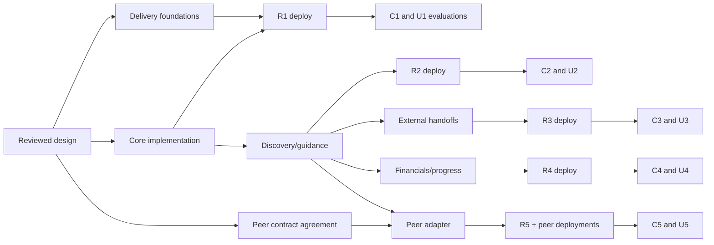

# Deployment design and implementation backlog

The current executable breakdown is the [filed BOLT/story index](../delivery/README.md)
with medium-sized stories, native GitHub hierarchy, acceptance/scenario mappings
and a [shared live verification contract](../delivery/verification-contract.md).
It supersedes the unfiled sequencing below. The component inventory and five
original increment descriptions remain design provenance, not a second active backlog.

Labels A0/D0/I1 below are historical planning references, not GitHub identities.
The new index maps them to real issues under #8141/#8149/#7295 and #5411. Canonical
runtime Project/module/feature IDs and executors remain coordinator prerequisites
before dispatch; the Roadmap project identity does not substitute for those IDs.

## Complete component-to-pipeline map

The [tracked inventory](tracked-artifacts.tsv) maps every baseline artifact to a
component or exclusion; [entry points](entry-points.tsv) include all 2,392 detected
build/deploy/executable definitions; [workflows](workflows.tsv) enumerate every
Actions workflow. The following is the semantic deployment map for every proposed
unit and reused dependency, not a claim that unrelated components must redeploy.
Pinned sources S11–S16 are in [source audit](source-audit.md).

| Unit / disposition | Existing pipeline and trigger | Artifact / migration / required change / verification |
|---|---|---|
| Gateway Product registry, sessions, discovery and proposal guidance — extend | `gateway-ci.yml` PR/push path-filtered checks; `gateway-deploy.yml` main matching paths or dispatch | Existing ECR gateway image, source SHA/digest receipts; add contract, tenancy, race/replay and installed-CLI packaging checks. Verify capabilities + API readback, not just `/health`. |
| Profile PostgreSQL schema — extend | Same gateway image/deploy; candidate-image `migrate-before-rollout.py`; `run-gateway-migrations.yml` reusable/manual | Alembic additive migrations; preflight actual head, run under serialized gateway release lock before new serving code. Existing post-deploy migration/finalization is not a second independent Profile migration path. |
| Installed CLI — extend, not independent service | Gateway Dockerfile `COPY cli/`, gateway-deploy path includes CLI | Extend installer/updater, dispatch, `command-manifest.json` and `cli_download/routes.py` allowlists. Verify installation into clean directory from deployed `/api/cli/install.sh`, script checksums and server capability version. No separate package registry invented. |
| React Product workspace — extend | `gateway-ci.yml` frontend tests; `gateway-frontend-deploy.yml` main frontend path or dispatch; manual `scripts/deploy-frontend.sh` | Existing static bundle/S3/CloudFront path. Add UI tests and bundle-version receipt; UI is capability-gated because backend and frontend deployments are independent. Verify served asset hash and real browser route. |
| Gateway feature/configuration wiring — extend only as needed | `gateway-infra-plan.yml` PR, `gateway-infra-apply.yml` explicit reviewed-source dispatch; `gateway-deploy.yml` runtime manifest | Add `BG_PRODUCT_PROFILE_ENABLED=false` and `BG_PRODUCT_ONBOARDING_ENABLED=false` deployment configuration (proposed names), exposed through server capabilities, not duplicate client-only gates. Environment selection stays private. |
| Existing tenant/team/identity/credential services — reuse | Gateway pipelines plus `github-auth-broker-deploy.yml`, `webhook-code-deploy.yml` / `webhook-ingress-deploy.yml` for their actual code/infra paths | Core does not change broker/webhook identity creation. If verified-connection notification wiring touches these producers, include their compatible artifact and tests in that increment; never assume gateway deploy publishes them. No Profile data stored in their DDB tables. |
| Existing gateway metered model API — reuse | Gateway pipeline | Guide makes a bounded authenticated request; existing budget/auth pipeline owns admission/usage. No new worker deployment. Test model unavailable/denied response and direct-use independence. |
| Hosted Task/Crew consumers — peer integration, excluded from core implementation | Existing `agent-worker-image.yml`, `chat-agent-deploy.yml`, `agent-gateway-deploy.yml` as applicable; full inventory lists their triggers | No automatic worker rollout for Profile. #8148 owns future scope/tool admission. Existing live pod/session proofs cannot be replaced with Product ID. |
| Context — peer #8149 | Existing Agent Context pipelines serve the Knowledge Layer, **not proof of a deployed Product Context service** | #8149 chooses its deployment unit and published API. Profile adapter stays unavailable until negotiated contract/version/identity exists; if a new deployable is chosen it needs build/test/package/publish/deploy/verify/rollback there before I5 live acceptance. |
| L5 provider lifecycle — peer #8150 | No generic L5 service pipeline established by this audit; spike scripts are not a production pipeline | Peer owner must bind actual deployable and scoped provider adapters to a pipeline, preferably existing gateway/tools pattern. Required before actual handoff/result evaluation; no new workflow names fabricated as current. |
| Insights / release consumers — peer-owned | `insights-ci.yml`, `insights-deploy.yml`; release workflows `adp-release.yml`, `adp-release-promote.yml`, `adp-release-tests.yml` for ADP itself | Do not treat ADP's release orchestration as a customer-product release service. Peer contract/evidence acceptance needed. Profile domain events must map to versioned Insights records, not direct reads of registry tables. |
| Cross-component live CLI/browser evaluation — extend | `eval-cli-uplift.yml`, `nightly-cli-regression.yml`, `e2e-new-ui-playwright.yml`, `adp-regression.yml` / `adp-environment-smoke.yml` | Add separately selectable Profile case groups to existing harness/catalog, pinned installed CLI and served browser, shared fixtures and independent readback. Distinct CLI/UI issues and reports even if a coordinator launches both. |
| Fresh/source/release installation — reuse and verify | `deploy.sh` → `platform/scripts/deploy-all.sh`; `platform/scripts/release/build.py`; `adp-integration-clean-install.yml`, `adp-release-upgrade.yml` | Ensure release manifest carries gateway/CLI/schema and frontend source/artifact revisions. Existing bootstrap/setup/teardown remain canonical; no new installer or cloud stack. |
| Docs/schema review artifacts — docs only | `public-docs.yml` PR path filter / dispatch, `scripts/check-public-docs.py` | This PR only; it changes no deployment path or runtime feature. Mechanical schema/link/inventory checks run locally in addition to publishing checks. |

No core unit lacks an existing pipeline. The filed D01 story (historical D0)
extends shared rollout/verification wiring and performs the first actual deployment.
Later BOLT verification owners reuse those pipelines and prove the actual deployment;
a separate deployment story is needed only for a concrete delivery gap. A Context/L5 deployment chosen by a peer is a separately owned
pipeline gap, not an excuse to defer this repository inventory to implementation.

## Workflow security and release contract

Reuse protected environment selection and `.github/actions/trusted-deployment` /
`load-deploy-config` rather than copying real account/resource IDs into new YAML or
docs. PR tests use `contents: read`, no deployment credential. Existing deploy jobs
obtain scoped OIDC/registered runtime authority; retain `id-token: write` only in
jobs that need it, plus minimal Actions/evidence permissions. Before target work,
the deployment operator selects and verifies the authorized connection's account
and exact role; this design does not grant either. Resource policies constrain ECR
repository, frontend bucket/prefix, distribution, KMS key and namespace. No new
wildcard IAM grant is requested. Core source discovery delegates to existing
connection service; the gateway pod does not gain broad customer-account access.

All publication is bound to reviewed source SHA, workflow definition revision,
build artifact digest/checksum and selected private environment. Do not deploy a
mutable `latest` image. Deployment receipt joins API image, Alembic head, installed
CLI checksums, UI bundle manifest and capability schema version. Secrets/callback
tokens/fixture identities go only to private evidence, never public logs or docs.
Manual infra applies and protected production approvals remain manual/required.

## Per-increment release checkpoint

1. **Pre-review:** implementation contract/security tests, PostgreSQL constraints,
   client unit/interaction tests, contract compatibility and packaging pass against
   the reviewed source. No live provider side effect in ordinary PR CI.
2. **Deploy:** selected dev target/access verified; snapshot/recovery readiness;
   flags off; additive migration from candidate image; backend rollout and old/new
   compatibility readback; frontend publication; installed CLI update; flags enabled
   only after contract negotiation. No admission if schema head incompatible.
3. **Verify runtime:** artifact/source/receipt agreement, authenticated create/read,
   negative scope, real migration head and per-increment success. `/health` alone
   cannot pass. A wrong frontend prefix or stale CLI must fail this checkpoint.
4. **Independent evaluations:** CLI story runs real installed commands, UI story
   runs served browser. Both share fixture contract and resume state; neither marks
   live success from mocked provider data or from pipeline success.
5. **Recovery:** disable new feature admissions first; fence pending effects, retain
   operation IDs; restore compatible API/CLI/UI artifacts with additive schema kept;
   reconcile provider outcomes and verify scoped reads. Never drop revocation or
   idempotency tombstones. Record private rollback and owned-only cleanup receipts.

Each iteration retains previous journey/security regressions. An implementation
can proceed independently on reviewed contracts while peer access is unavailable;
its required live evaluation stays blocked/not-run, not complete.

## Sequenced backlog

The issue author creates real stories using the canonical template with native
parent links, stable AC/scenario IDs, exact phase/completion and named owners.
Proposed local acceptance labels below are not replacements for #8153 AC-01–05
or #8141 EC-01–15. Every implementation story completes at reviewed merge with
pre-merge checks; every deployment story completes at verified authorized runtime;
each CLI/UI evaluation story completes only with live assertions and cleanup.

### Foundation stories

| Ref / type / proposed title | Scope, dependencies and testable criteria | Integration owner / checkpoint |
|---|---|---|
| A0 — architecture/design — Agree Product Profile and Onboarding contracts | This #8153 PR; resolve owner review choices, all AC-01–05 and SCN-01–03 walkthroughs; map every baseline obligation; contract/links/inventory checks. No runtime acceptance. | Design executor fixes findings; PranavSharma1000 reviews; delivery owner confirms reviewed merge. |
| A1 — architecture/design — Agree consumer scope and handoff compatibility | #8148/#8149/#8150 owners review scope, visibility, current revocation, callback admission, event/receipt schemas and actual endpoint/version selections; supply one executable producer/consumer fixture and reject wrong scope/revision. Depends A0; blocks I5, not I1–I4. | #5411 integrator (person unresolved) owns signed compatibility matrix; no generic new service API invented. |
| D0 — deployment — Wire Profile delivery and evaluation foundations | Extend existing CI triggers to new contracts, Postgres integration tests and UI/CLI files; ensure CLI serve/install lists and schema staging are tested; add disabled flags/capability publication and revision manifest assertions; register CLI/UI scenario groups in existing eval/catalog. Depends A0, coordinates with I1; no deploy of an incomplete feature. Test deliberate missing CLI file, stale schema and wrong UI/backend revision fail. | Deployment owner assigned by #5411; first runnable checkpoint is build/packaging plus clean DB migration job in authorized dev after I1 ready. |

### Increment 1 — usable identity and direct editing

| Ref / type / proposed title | Scope and acceptance | Dependencies / checkpoint |
|---|---|---|
| I1 — implementation — Save a minimal governed Product across UI and CLI | Registry/Project/bindings/revisions/operations; shared live scope resolver; strict create/edit/list/archive; minimal UI inside the existing Blueprint shell (Products entry) and installed commands. I1-AC01: Idea creates one Product/Project with no provider call; replay returns same IDs. I1-AC02: an authorized second team editor saves directly; stale, foreign-tenant, nonmember and otherwise unauthorized writes fail without partial state, owner/team selection uses existing APIs. I1-AC03: typed fields/provenance and archive preserve external assets/audit. Maps EC-01/02/04/05/06/07. | A0; gateway/UI/CLI implementer integrates one vertical PR sequence; D0 packaging contract. Pre-merge PostgreSQL + route/client tests. |
| D1 — deployment — Publish and recover the minimal Product increment | Migrate old/fresh DB using candidate image; enable core capability after matching API/CLI/UI artifacts. D1-AC01: actual heads/hash receipts and authenticated create/read agree. D1-AC02: flag-off/old client compatibility and rollback preserve new records/tombstones. | I1 + D0; deployment owner; dev release R1 receipt, no production inference. |
| C1 — CLI E2E evaluation — Prove minimal Product from installed CLI | Run V01–V04/V09; clean install, no-model create/edit/list, lost-response replay, tenant/nonmember denial, archive/readback and cleanup. C1-AC01: independent registry readback matches IDs/revision; C1-AC02: no extra provider assets/usage calls. | D1; CLI evaluator + fixture owner; installed CLI/source checksums recorded. |
| U1 — UI E2E evaluation — Prove served Product creation and direct editing | Run V01–V04/V09 in real browser; owner default, shared team editing without owner approval, pre-team drafts, stale-edit UI, unavailable Context, keyboard/error states. U1-AC01: independent API oracle matches rendered persisted data; U1-AC02: no saved profile lost on refresh/offline recovery. | D1; browser evaluator; served bundle/source receipt and private evidence. |

### Increment 2 — discovery-first guided, resumable onboarding

| Ref / type / proposed title | Scope and acceptance | Dependencies / checkpoint |
|---|---|---|
| I2 — implementation — Reuse connected sources and resume guidance across clients | Sessions, bounded GitHub/GitLab/AWS metadata discovery, proposals, source picker, existing team/user mapping and four sections; bounded Product Onboarding Agent plus deterministic fallback. I2-AC01: discovered IDs/confirmed fields are not asked again; partial/denied sources stay explicit. I2-AC02: UI→CLI and CLI→UI resume share revision; no model needed for direct use. I2-AC03: model cannot approve funds, create credentials or execute suggestions. Maps EC-03/05/08/09/10. | I1 + shared contracts; gateway/UI/CLI owner; no new long-running collector. |
| D2 — deployment — Release guided discovery with compatible clients | Existing gateway/frontend pipelines; enable onboarding after session schema/tool response version checks. D2-AC01: no-source/no-model paths and interrupted-operation recovery work. D2-AC02: discovered connection metadata respects current revocation after rollback. | I2, C1/U1 findings resolved; dev R2 artifact and recovery receipts. |
| C2 — CLI E2E evaluation — Prove discovery and browser-to-CLI resume | V05/V06/V07/V10 plus R1 regressions. C2-AC01: real selected source readback and no duplicate questions; C2-AC02: browser-created session resumed via installed CLI, revision conflict preserves values. | D2; CLI evaluator with browser setup driver and independent provider observer. |
| U2 — UI E2E evaluation — Prove guided journeys and CLI-to-browser resume | V05/V06/V07/V10 plus R1 regressions. U2-AC01: real CLI session resumes in served UI; U2-AC02: partial/denied/model-unavailable states and accessible chat/editor produce no unintended write. | D2; browser evaluator with installed CLI setup driver. |

### Increment 3 — explicit external changes and administrator handoffs

| Ref / type / proposed title | Scope and acceptance | Dependencies / checkpoint |
|---|---|---|
| I3 — implementation — Connect or create selected assets without losing progress | Existing GitHub/OAuth/AWS admin flows correlated to sessions; explicit approved-template repo plan/create; callback generation/sequence enforcement and production read-only adoption. I3-AC01: response-loss/reordered callbacks never create duplicate repo/binding or revive revoked grant. I3-AC02: admin handoff completes without credential sharing; imported repo/pipeline/cloud unchanged; unlink preserves asset. Maps EC-03/04/06/07/08/09. | I2; connection-service owner integrates producer notifications; reviewed callback service-token admission required. |
| D3 — deployment — Publish connection callback and recovery compatibility | Gateway plus any actually changed broker/webhook producer through its own existing pipeline; consumers before producers, flags gated on both versions. D3-AC01: callback receipt reaches the right session; D3-AC02: fenced/revoked generation and lost acknowledgement recovery survive restart. | I3; R3 records all producer/consumer digests; recovery cannot be gateway-only if producer changed. |
| C3 — CLI E2E evaluation — Prove selected asset and admin handoff effects | V06/V08/V09/V11 plus regressions. C3-AC01: approved owned repo created once, no other external change; C3-AC02: administrator's connection enables resume without member receiving a secret; cleanup deletes only fixture-owned repo. | D3; authorized provider admin/CLI evaluator; unresolved write authority blocks, never substituted credentials. |
| U3 — UI E2E evaluation — Prove greenfield and running-product safe adoption | V06/V08/V09/V11 via browser. U3-AC01: exact preview/confirmation and as-is inventory visible; U3-AC02: provider baseline unchanged except explicit selected write; replay and revoke denial independently observed. | D3; browser evaluator + provider observer; production fixtures read-only. |

### Increment 4 — financial provenance and explainable progress

| Ref / type / proposed title | Scope and acceptance | Dependencies / checkpoint |
|---|---|---|
| I4 — implementation — Confirm financial inputs without granting spending rights | Direct entries and one bounded registered document/import adapter; per-field authority/expiry/conflict; `profile-1` check/level map and hints. I4-AC01: decimal/currency/period/parent validation and confirmed override survive refresh; inferred approval refused. I4-AC02: N/A/later changes cannot erase mandatory selected check; actuals/forecasts remain unavailable unless finance adapter supplies attributable data. Maps EC-02/05/06/10, PO-10/11 Profile portion. | I2; finance/budget contract owner validates projections; no spend analytics implementation. |
| D4 — deployment — Release financial and progress schema compatibility | Additive typed fields/rules, no budget-enforcement substitution. D4-AC01: old profiles round-trip, pinned rules upgrade explicitly; D4-AC02: rollback retains accepted fields/override provenance and denies authority escalation. | I4; R4 schema/rule/release receipts, previous critical regressions pass. |
| C4 — CLI E2E evaluation — Prove financial confirmation and progress math | V07/V10/V13 plus prior security/resume. C4-AC01: known decimal allocation/import conflict and date validated independently; C4-AC02: exact numerator/denominator/N/A and budget denial agree with oracle. | D4; CLI evaluator + finance fixture owner; missing live import adapter leaves that case blocked. |
| U4 — UI E2E evaluation — Prove financial editing and truthful readiness | V07/V10/V13 in browser. U4-AC01: extraction proposal cannot silently approve/overwrite; U4-AC02: accessible provenance drawer, explicit denominator and unavailable spend display agree with independent state. | D4; browser evaluator + finance owner. |

### Increment 5 — actual scoped downstream handoff

| Ref / type / proposed title | Scope and acceptance | Dependencies / checkpoint |
|---|---|---|
| I5 — implementation — Exchange scoped Profile revisions and display real results | Profile-side change feed/export/receipt adapters and UI/CLI status; no Context/L5 implementation. I5-AC01: negotiated real consumer preserves Product/Project/source/profile revision and native operation ID. I5-AC02: duplicate/old/private/revoked events cannot duplicate state/leak; unavailable consumer leaves onboarding usable. Maps EC-06/07/11, PO-08/12/13 handoffs. | A1 + I2 + peer's compatible API available; #5411 integrator owns integration, peers own service implementation. |
| D5 — deployment — Enable only compatible Profile consumer handoffs | Publish Profile adapter after peer deployment contract/pipeline complete; register exact compatible versions and service identity. D5-AC01: actual receipt/result path verified; D5-AC02: peer outage and rollback stop new admissions without discarding Profile. | I5 + peer deploy checkpoints; R5 multi-service receipt. Missing L5 pipeline/access explicitly blocks its row, not Profile save. |
| C5 — CLI E2E evaluation — Prove real scoped consumer result through CLI | V14/V15 and all required prior cases. C5-AC01: installed CLI initiates authorized handoff, independently retrieve native peer result with matching revision; C5-AC02: outage/revoke/replay/cross-Project denial and owned cleanup pass. | D5; CLI evaluator + peer owners; mocked success cannot close EC-11/14. |
| U5 — UI E2E evaluation — Prove real downstream status and cross-surface recovery | V14/V15 and prior cases via served browser; CLI↔UI receipt resume. U5-AC01: actual result/source/freshness displayed, not setup-only success; U5-AC02: denial/unavailable states and accessible recovery match independent peer oracle. | D5; browser evaluator + peer owners; actual Context summary acceptance remains #8149. |

## Dependency graph and handoff

I3/I4 may develop independently only with disjoint implementation ownership and
explicit integration order for shared schemas/session UI. No overlapping dispatch
is authorized here. Evaluations can overlap with next implementation work after
the prior deployed checkpoint, but unresolved critical defects block later release
enablement. Delivery owner consolidates findings; PranavSharma1000 accepts product
decisions and release outcomes. Issue closure maps EC/PO → child AC → source and
artifact revision → private live proof → cleanup. A ready design PR is not that
release closure, nor is it a merged design until reviewers/controller confirm it.
