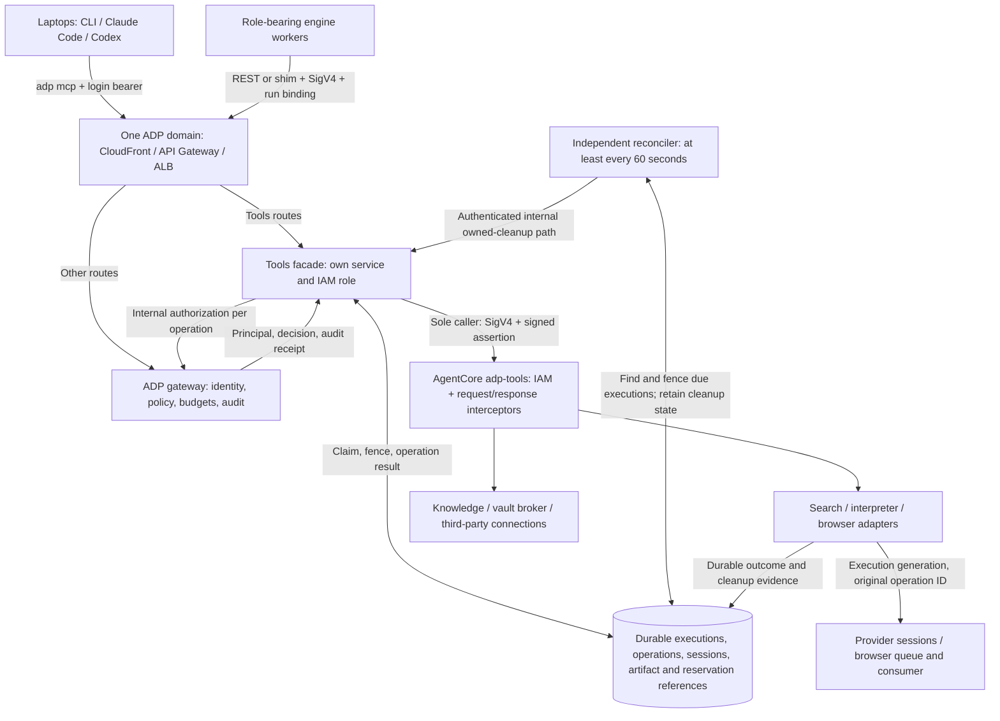

# ADP Tools Platform — architecture

How tools, knowledge, credentials and third-party connections reach agents on laptops, in Chief-of-Staff
pods and in engine workers, under one identity and policy model. This is the end-to-end design for epic
**`TLS-E1`** ([#7245](https://github.com/aws-e/adp/issues/7245)); sections marked **current** describe what is
implemented repository behavior (pending merge for open PRs), not verified deployment; sections marked
**target** describe remaining epic work, with the owning story in brackets. Each story's docs-delta
acceptance criterion updates this file in its implementation PR.

**W1 repository status (TLS-S10):** The component mapping [TLS-C01], gateway foundation
Terraform and release workflow [TLS-S02, TLS-C02], interceptor packaging and release workflow
[TLS-C03], and façade CI/release *workflow definitions* [TLS-C07] are present. This story adds
the independently packaged façade, internal gateway authorization route, IAM-scoped routing
and signed-assertion verification. Unit tests use synthetic policy and identity; the W1
checkpoint had no tenant catalogue or entitlement writer. TLS-S17 adds these in source (§4),
but does not add a general user-policy writer or establish a deployed façade release or live L1 evidence.
The `adp mcp` stdio shim and client registration are implemented in the CLI source [TLS-S04],
with local install and fake-gateway tests; a published installer, installed Claude Code discovery
and a deployed end-to-end tool call are not yet verified. The façade source now records owner-bound
executions and UUID-keyed operations in a dedicated durable table. Same-ID retries return the
original receipt, including an uncertain `unknown` outcome, without resubmitting a provider
mutation. Source-level recovery reads now return authenticated operation receipts and bounded,
full-content-SHA256-labelled chunks of the stored JSON result without provider replay, even after execution
close. Provider-owned files, owned cleanup and other target lifecycle components are not yet
implemented. See §10 for release paths and §11 for live verification.

**Deadline-fencing checkpoint (not provider cleanup):** A separate one-minute Kubernetes CronJob,
using a distinct role scoped to the due-execution index and execution-row updates, conditionally
moves expired executions to `closing` with `cleanup_status=unknown`. The façade also conditionally
checks the active execution and deadline when marking dispatch intent. Missing provider handles
are never guessed and this worker does not stop provider sessions or prove their expiry. Early
revocation detection, a provisioned authenticated provider-stop path, independent stop/expiry
evidence and deploy verification are still required before the cleanup contract can pass.

**Owner-close checkpoint (not provider stop):** The authenticated execution owner can explicitly
move an active execution to `closing` without renewing a paid-tool grant. A conditional update
orders close against the final dispatch check on the same execution row; a call already dispatched
can still finish. Repeated close returns the persisted state and unknown cleanup status, not a
claim that the provider stopped. The owner, tenant, tool and original run binding still apply.

The target lifecycle in §5 incorporates the 2026-10-10 amendment to
[#7261 (TLS-S10)](https://github.com/aws-e/adp/issues/7261), with provider adapters in
[#7254 (TLS-S05)](https://github.com/aws-e/adp/issues/7254) and client recovery in
[#7252 (TLS-S04)](https://github.com/aws-e/adp/issues/7252). These are required design and acceptance
contracts, not claims of implemented or live-verified behavior.

Related: [`docs/tools/README.md`](README.md) (how to use), [`shared-agentcore-tools.md`](shared-agentcore-tools.md)
(historical direct-Task REST tools, now retired), [`agentcore-integration.md`](agentcore-integration.md) (historical Task
integration details; this document supersedes its overlapping future-platform architecture), the Chief-of-Staff runtime
([#7197](https://github.com/aws-e/adp/issues/7197)), and the engine's deployment contract
([`docs/architecture/deployment-workflow-controller.md`](../architecture/deployment-workflow-controller.md)).

## 1. The problem this solves

**Source at this revision; deployment not verified.** Web search, code interpreter and browser calls
use the standalone tools façade, which asks the ADP gateway for user-rooted authorization and
invokes AgentCore. The old worker-role allowlist, Task-envelope `/tools/{websearch,code-interpreter,browser}`
API Gateway integrations and direct Lambda REST handler are removed. The façade still serves
`POST /tools/{tool}` and `POST /api/tools/{tool}` for compatible clients. Engine knowledge calls use
the run-bound gateway bridge instead of worker-supplied Door identity headers. The protected Door
service still checks the gateway-signed `x-adp-door-identity` assertion. The credentials vault brokers secrets
(`proxy-request`, `assume-role`, `materialize`) to engine workers with a verified run binding; the new
consent-bound gateway target is optional and not yet live-verified. A developer with Claude Code or Codex
on a laptop, or a user's Chief-of-Staff pod, cannot yet use all of it under their own
identity, and customers cannot let agents act in GitHub, Jira or Slack as themselves.

**Target.** One tool layer behind the one endpoint everyone already uses — the ADP domain — reached with the
`adp login` token from laptops and with IAM + run binding from EKS agents, served by a standalone tools façade
that asks the ADP gateway for every decision and is the only caller of a single Amazon Bedrock AgentCore
Gateway; governed by ADP's identity, consent, entitlements, budgets and receipts; built and deployed as its own
module through CI/CD pipelines the engine can trigger.

## 2. The shape (target)

This diagram describes the completed design, not an observed deployment. The repository's
AgentCore resource policy restricts invocation to the dedicated **tools façade role**; its
gateway-invoke policy stays disabled until a reviewed AgentCore gateway ARN is configured.
Laptops and workers have no direct AgentCore invoke grant [TLS-S02, TLS-S10].



The durable store and independently scheduled reconciler are target components owned by TLS-S10 (§5).
Provider adapters participate through the shared versioned storage/authority contract [TLS-S05]. The
reconciler uses a service identity restricted to owned cleanup; it does not impersonate an expired user
or receive direct AgentCore access. Cleanup passes through the facade's internal service path, so the
facade remains the only caller of `adp-tools`. Provider-enforced deadlines bound sessions even while
that path is unavailable. TLS-S10 must provision this cleanup path and its scoped permissions with the
shared lifecycle checkpoint.

**One façade, one policy authority.** Laptops and role-bearing workers reach the ADP tools
façade through the ADP domain. Role-free Crew pods use their existing scoped chat gateway,
which relays to the same façade without exposing AgentCore credentials in the sandbox. The load
balancer sends `/agent/tools/*` and `/tools/*` to the tools façade service and everything else to
the gateway pods. Users configure no second URL and
nobody learns the AgentCore hostname. The ADP gateway remains the single policy point (the façade asks it, per call, over the internal plane and
forwards nothing it did not approve); the façade's role is the **only** IAM principal allowed on the one
AgentCore gateway; it forwards each authorized call with a signed principal assertion. A
JWT-authorized AgentCore gateway for third-party remote-MCP clients that cannot run the shim is **not** built;
it can be added later as its own story without touching this design [TLS-S02, TLS-S10].

## 3. Identity — three callers, one principal

**Implemented source flows; live qualification pending.** The façade, gateway authorization and bundled shim
implement the identity checks described here. No deployed Crew route is established by these local results.
The previous engine-worker Task-scoped REST-to-Lambda route is retired in source; L5 must verify the deployed release (§11).

| Caller | Credential presented | How the façade + ADP gateway resolve it | Story |
|---|---|---|---|
| Developer laptop (Claude Code, Codex, `adp` CLI) | **The same Cognito access token `adp login` already issues for the model proxy**, sent as a bearer to the tools façade (behind the ADP domain) by the `adp mcp` stdio shim. The shim ships inside the adp CLI bundle (no separate install); `adp claude setup` / `adp codex setup` register it as the `adp-tools` MCP server. No second login, URL, audience or scope set exists | the façade passes the token to the gateway's internal authorize route, which resolves `sub` → `users.id`; tenant from the CLI's selected tenant claim and membership; never from the token alone | TLS-S04, TLS-S10 |
| Chief-of-Staff pod | The bundled `adp mcp` shim uses a token-protected loopback adapter. The adapter carries the current chat capability, projected workload token, session binding and Crew run through the scoped chat gateway. The pod has no AWS role | The gateway verifies the live pod, session and lease before relay. The façade carries the original proofs in its signed authorization callback; the gateway rechecks them, derives the human and tenant, and enforces the same policy, consent and budget rules | TLS-S10, TLS-S11 |
| Engine worker (Codex/Claude Code Tasks) | **Signed REST to the ADP gateway**: `POST /agent/tools/call` with host-held run credential and workload proof; the gateway forwards to the façade. The façade keeps `POST /tools/{tool}` as a compatibility route, not a direct Lambda invocation | gateway resolves the current run binding → human and checks current policy on each tool call; no Task-envelope fallback | TLS-S10, TLS-S12, TLS-S19 |
| Dev Box host (Kiro Crew on the owner's EC2 box, #8380) | The bundled `adp mcp` shim talks to the box's loopback model adapter; the adapter signs `POST /agent/crew/tools` with the instance role (SigV4) and the gateway's 60-second host model token. The gateway proves the caller is the current host of the owner's live run, mints a 30-second **host assertion** (tenant, owner, run, box, instance, generation) and relays to the façade; `/tools/authorize` verifies the assertion and resolves the owner's live target again. No `adp login` on the box; tools end with the lease. | #8380 |

**One login.** `adp login` is the only sign-in a developer ever performs; models, tools, knowledge and credentials all ride on that token, and `adp logout` ends their shared login. Tool-level permissions are not OAuth scopes — they are ADP consent and entitlement rows (§4), so adding a tool never changes what the token must contain.

**Shared tools endpoint.** Role-bearing workers use SigV4 to API Gateway and a human-rooted run binding.
A Dev Box host uses SigV4 plus its host model token on `POST /agent/crew/tools`, which the gateway relays to the façade under a host assertion.
The role-free Crew sandbox uses `POST /v1/chat/data/tools` on its scoped chat gateway;
the relay accepts only discovery, call, receipt, close and artifact routes, never an arbitrary destination.
Laptops use the `adp login` bearer through CloudFront `/api/*`. Tools use those paths for the
callers that currently have an admitted route. The load balancer sends the tools routes
(`GET /agent/tools`, `POST /agent/tools/call`, plus the existing `POST /tools/{tool}` routes kept for
compatibility) to the tools façade — a separate service in `modules/tools/facade` — which obtains the §4
decision from the ADP gateway's internal plane on every call and is the only principal allowed on the
AgentCore gateway. AgentCore's resource policy checks the façade IAM role before the interceptor
verifies its KMS-signed principal assertion; the interceptor cannot independently read the IAM caller
from its MCP event. Pods, workers and laptops hold no AgentCore permission. The façade has its own
Deployment and Service, so tool traffic can scale independently of gateway pods.

**Laptop flow.** `adp login`, then `adp claude setup` (or `adp codex setup`). The setup writes one MCP entry
whose command is `adp mcp`. Each session the client launches the shim; the shim lists tools from the façade,
forwards `tools/call`, and fetches a fresh bearer via `adp token` per request, exactly as Claude Code's model
path does through its api-key helper. Consent and connections are toggled in Settings, not on the laptop;
`adp tools logout` calls the gateway's CLI refresh-token revocation route before removing the
local token and only the `adp-tools` entries in client settings. Revocation errors leave the local
token for a retry; legacy `adp logout` removes local credentials without server-side revocation.
Already-issued access tokens
remain subject to the existing gateway revocation/expiry behavior; this design does not claim instant JWT
invalidation. Current policy is rechecked per call, and the reconciler cleans up revoked or expired tool
executions without relying on the client token. Logout or disconnection does not by itself prove a provider
session has stopped (§5).

The resolved **principal** `{user_id, tenant_id, team_id, run_id?, persona?}` is what every downstream
decision uses. Agents never choose their scope: the model cannot pass a user, tenant or namespace.

**Source now:** the bundled stdio shim translates `initialize`, `tools/list` and `tools/call` into
façade requests; a laptop uses the selected CLI login token. The role-bearing worker proxy can forward
`/tools/*` to the separately configured HTTPS `ADP_TOOLS_GATEWAY_URL`, sign with its own region and
inject fresh run and workload proofs. Signing separates the URI path and query, including repeated parameters.
The role-free Crew sandbox instead uses the authenticated loopback adapter and chat relay.
`ADP_TOOLS_GATEWAY_URL` can configure the gateway's HTTPS façade endpoint; otherwise the
relay uses the fixed in-cluster façade service. Neither setting is caller-selected.
Both Crew launch paths register the shim with its local adapter configuration; Claude Code's
explicit allowlist includes only discovered policy-approved ADP tools and the shim's recovery helpers.
The adapter follows the active turn binding and rejects requests while suspended. Tool requests
are not automatically retried after ambiguous responses; the shim retains operation IDs for recovery.
Both clients' setup writers add `adp-tools` with command `adp mcp`, preserving other
model settings. The existing installer and self-update lists include the shim; a fresh local
install test verifies its help command without pip. No separate AgentCore URL or second tools
credential is written to client configuration. These source and local-test results do not
establish deployment or a successful live tool call.

## 4. Authorization — one decision per call

**Current repository contract [TLS-S03, TLS-S10].** The standalone façade calls
`POST /internal/v1/tools/authorize` for both bearer and workload callers. The gateway resolves
the canonical human and tenant server-side, checks current membership or run authority, then
intersects configured entitlement, consent, tool cost ceiling and budget. Missing policy denies;
malformed catalogs deny discovery. The tenant entitlement editor below is implemented in source,
not a general writer for each user's protected tool policy. Ended runs return `unknown_run`
before a decision (including at the final recheck). Positive responses carry the human-rooted
principal and a generated receipt ID; approved calls persist an authorization activity row.
Fully linked denial and provider outcome accounting remains the target lifecycle below. Task
authority for non-tool operations is unchanged; provider tools use this gateway decision instead.

### Tenant and team tool access [TLS-S17, repository implementation]

An administrator with `tools:manage` opens **Tool access** at `/admin/tools`; organization
administrators can edit their own tenant and platform administrators can select a tenant. The
page loads `GET /admin/tools/catalog` and `GET /admin/tools/entitlements` for the selected
tenant and optional team, then writes a tool's enabled flag and optional positive per-call USD
ceiling with `PUT /admin/tools/entitlements`. The API checks the authenticated human's tenant
permission and that a selected team belongs to that tenant. Writes require the last-seen
revision; a concurrent change returns 409 so the editor reloads instead of overwriting it.
The mutation uses the durable admin-operation audit path. The user-facing rate-limit page
remains separate; this page does not add per-user limit controls.

The catalogue reads the configured `adp-tools` AgentCore gateway's READY target schemas,
including connector names, descriptions and credential-provider kinds. Dynamic MCP connectors
can appear without a static operation list; they cannot be granted by guessing tool names.
Catalogue lookup fails closed when that gateway is unavailable or ambiguous. These metadata
are not themselves credential access: owner consent, connected-account scopes and the
credential broker still control use.

**First-party platform tools (#8113, repository implementation).** The composed catalogue
(`tool_catalogue()` in `src/internal/tools_catalogue.py`) is the AgentCore gateway's READY
targets **plus** the gateway's own read-only platform tools declared in
`src/internal/tools_platform.py` (`platform.my_flows`, `platform.my_agent_runs`,
`platform.my_work_items`, `platform.my_budget`; connector `platform`, `first_party: true`,
`read_only: true`, no credential kinds). Admin entitlement, per-user policy validation,
consent and the access report use the composed view; the façade authorization path keeps
reading the gateway targets only and refuses a first-party tool as
`tool_chat_data_plane_only`, because these tools never run through the façade or AgentCore.
They execute inside the gateway, under the chat turn capability, for the launch's tenant
principal: `POST /v1/chat/data/tools/list` returns catalogue ∩ tenant entitlement ∩ owner
consent for that principal (tools the tenant has not entitled are not revealed; consented
but entitled-only tools are named as `withheld` with `not_consented`), and
`POST /v1/chat/data/tools/call` re-evaluates that set, runs the read and records the same
`tool_authorized` activity row the façade path writes, with a zero estimate. "Not configured"
(no `ADP_TOOLS_GATEWAY_ROLE_ARN`) yields the first-party tools alone; a configured gateway
that cannot be read still fails closed. Two deliberate deviations from the third-party
rule set, both declared on the tool rather than inferred: first-party read-only tools are
**implicitly allowed** for every tenant member once the tenant entitles them (no admin
per-user `allowed_tools` write; `PUT /auth/tools/consent` offers them, creating the
owner's empty policy row when none exists, and an admin policy write never prunes that
consent), and they carry **no positive cost ceiling** (no provider spend, no budget
reservation, no rate bucket). Consented MCP-backed tools are *not* offered to the default
chat turn: the Crew relay (`/v1/chat/data/tools`) requires a persistent Crew binding the
default sandbox turn does not hold, which the listing reports as
`tools.mcp: unavailable (crew_binding_required)` instead of bypassing the relay.

A missing or disabled **tenant** tool grant denies calls and omits that tool from discovery.
A team's optional override inherits an enabled tenant grant when absent; an explicit team
disable narrows it, but a team enable never broadens a disabled tenant grant. A team's cost
ceiling cannot loosen the tenant ceiling: authorization uses the lowest applicable tenant,
team and existing per-user policy ceilings, alongside existing budget and rate checks. The
gateway checks current SQL grants on each new authorize request before signing a decision;
the credential broker checks again before exposing credential metadata. The AgentCore
interceptor verifies the gateway-approved signed assertion rather than reading SQL itself.
Changing an entitlement affects new decisions, not already dispatched provider work. Source
and local SQLite tests cover team X denied `browser` while a separately allowed team Y can
call it; L5 must repeat this against the deployed release. The SQL migration, gateway and
frontend releases must be applied through their normal pipelines before operators can use
the editor; none has been verified as deployed here.

### User consent controls [TLS-S08]

Settings → Credentials shows an “Available to agents” toggle for each personally owned
credential. `PUT /auth/credentials/{id}/agent-consent` updates only a credential owned
by the authenticated human in their current organization; listing credentials exposes
the saved flag but never a secret. The additive `agent_consent` column defaults to
false for existing and newly registered credentials. Shared credentials cannot be
enabled through an individual's toggle.

The Tools tab loads `GET /auth/tools/consent` and submits the complete selected set
with `PUT /auth/tools/consent`. The owner's existing protected tool policy supplies
the entitled names; a missing policy grants nothing, and a write cannot add a tool
outside those entitlements or silently overwrite a concurrent entitlement change.
The authorization decision and credential broker re-read current policy and consent
before effects, rather than trusting the UI or a previously issued tool listing.
These are source and local-test guarantees; denial within 30 seconds on the deployed
gateway remains an L2 live-evaluation check.

```
allow_mutation(call) = identity_resolved
            ∧ tenant_entitles(tool)            # admin catalogue, default deny          [TLS-S17]
            ∧ user_consented(tool | credential) # Settings toggles                     [TLS-S08]
            ∧ scope_granted(connection, tool)   # third-party scopes                   [TLS-S15]
            ∧ within_budget(user, tenant, tool) # rate + daily spend                   [TLS-S09]
            ∧ (run_live ∨ ¬workload)            # fenced lease ⇒ deny                  [TLS-S10]
            ∧ ownership_and_binding_match       # execution/session/run                [TLS-S10]
            ∧ frozen_grants_allow(tool)          # intersect applicable Task/persona grants
            ∧ execution_active_before_deadline   # generation/fence checked at dispatch
```

The decision runs in the ADP gateway's internal authorize route, called by the façade before anything is
forwarded. **Current:** approved calls persist a tenant-scoped authorization row with the verified
principal, tool, receipt ID and estimated cost; the façade refuses denied calls before provider dispatch.
**Target lifecycle:** link the authorization and denial decisions to provider execution/operation
outcomes and reconciled charges in §5. An approval does not prove provider work started or finished.
The AgentCore interceptor Lambda stays
thin: AgentCore's IAM gateway resource policy enforces the sole caller role **before** Lambda runs;
the Lambda verifies the principal assertion's signature and re-checks tenant, method, tool and arguments.
AgentCore's documented MCP interceptor event has request headers but **no authenticated IAM caller ARN**:
a caller-supplied role header is not evidence of IAM identity. The RESPONSE interceptor adds the signed
receipt id to the MCP result's `_meta.adp_receipt_id`, provider-error `data.adp_receipt_id`,
or streaming-frame `params._meta.adp_receipt_id` without discarding the provider response
[TLS-S03, TLS-S10].

**Second-fence assertion contract (TLS-S03, TLS-S10):** After the ADP gateway authorizes the
operation, the façade supplies `x-adp-tenant` and
`x-adp-assertion` as request headers. The latter is base64url-encoded UTF-8 JSON with `claims` and a
base64url `signature`. Claims are `caller_role_arn`, `principal` (`user_id`, `tenant_id`, `team_id`),
`method`, `tool`, `arguments_sha256`, `receipt_id`, `issued_at` and `expires_at` (integer Unix seconds).
`tool` is the MCP tool name for `tools/call`, or `tools/list` for discovery. Current façade
discovery uses the gateway's authorized catalog and does not call AgentCore `tools/list`. Compute the digest over
`tools/call`'s `params.arguments` or `tools/list`'s `params` (default `{}`), serialized as UTF-8 JSON
with sorted keys, compact separators and unescaped Unicode. The façade role signs the same
canonical JSON of `claims` using KMS `RSASSA_PSS_SHA_256`; the Lambda verifies that signature with the
configured key and requires a lifetime of at most 60 seconds. A missing/invalid signature, expiry or
KMS failure yields `untrusted_assertion`; a mismatch with `x-adp-tenant` yields `tenant_mismatch`;
a different method, tool or argument digest yields `tool_mismatch`. Denials never forward to a target.

The platform output `assertion_signing_key_arn` identifies an asymmetric KMS key; the configured
caller role alone is granted `kms:Sign`, and the Lambda execution role has `kms:Verify`.
Set `ADP_TOOLS_ASSERTION_KEY_ARN` on the Lambda to that exact output and
`ADP_TOOLS_FACADE_ROLE_ARN` to the same role allowed by the gateway resource policy.
Configure the Lambda execution-role ARN in the platform's `interceptor_execution_role_arn` input
when attaching an interceptor. `tools-interceptor-deploy.yml` refuses a new Lambda version if
these environment settings are absent or point at another account/region; it does **not** set
them automatically or prove the configured key matches the platform output. The resource policy
and `pass_request_headers` gateway setting must also be deployed. The façade assertion producer
is implemented in the repository; its key, resource policy and two-user behavior are not live-verified.
AgentCore's documented MCP transformed request includes a body, not a
confirmed header-forwarding contract to tool targets; `x-adp-principal`/`x-adp-receipt` target
headers still need an integration proof before claiming that behavior.

The predicate above governs new provider mutations. Creating an execution freezes the initially authorized
grants; every later action intersects them with current policy, consent and applicable Task/persona/run
restrictions. A later grant expansion cannot widen an existing execution. The final authority and generation
check happens at dispatch, including in the browser consumer; queued work cannot cross a close fence.

Recovery/status and artifact reads require current read authorization and matching ownership/bindings, but
do not require an active execution or trigger another provider mutation. This permits authorized recovery
after completion. They never inherit the cleanup exception.

**Cleanup exception:** a currently authenticated owner may close already-owned resources after execution
permission is revoked. The cleanup decision checks ownership and permits only fencing, stop and cleanup
confirmation; it grants no new execution or artifact-reading privileges. Invalid/expired credentials remain
rejected. The internal reconciler has independently authenticated, narrowly scoped cleanup authority so
revocation, lease loss or client death cannot strand sessions. An auth or policy dependency outage fails
closed for new work; cleanup uses only its provisioned service authority and durable owned-resource binding,
otherwise records pending cleanup and relies on the provider deadline [TLS-S10].

Cedar/resource policies are used only for coarse gateway-level restrictions (the single role that may reach
the AgentCore gateway, `aws:SourceArn` pinning); per-user logic lives in ADP where tenants, budgets and audit are.

## 5. Execution lifecycle and recovery (target)

TLS-S10 owns one shared lifecycle contract, durable store and reconciler. TLS-S05 integrates search,
interpreter and browser adapters; TLS-S04 exposes recovery through the installed CLI MCP shim. Existing
[Task integration contracts](shared-agentcore-tools.md) are the reuse baseline. Extending them to laptop
users and workload runs requires the explicit ownership and fault tests below; reuse alone is not proof.

### 5.1 Durable authority and state

A laptop invocation creates an explicit user-owned tool execution without a synthetic Task or model turn.
A workload execution binds to its canonical human, tenant and existing run/lease, retaining Task/persona
restrictions where applicable. Token refresh preserves the stable identity; a new run cannot take over an
old run's session without an explicitly authorized recovery binding. Otherwise the old execution is cleaned
up under its original ownership.

The IaC-owned store has versioned schemas and conditional transitions for:

| Record | Required durable fields |
|---|---|
| Execution | Canonical owner/tenant, stable caller/run binding, tool, frozen grants, deadline, generation/fence, `active`/`closing`/`closed` state |
| Operation | Stable request/operation IDs, execution binding, canonical input hash, dispatch intent, provider operation reference, outcome, safe error, reservation reference |
| Provider session | Opaque public handle, private provider reference, owner/execution binding, provider deadline, cleanup status and stop/expiry evidence |
| Artifact reference | Execution/operation binding, protected storage reference, content type, byte length, full-content SHA256, retention policy |

**TLS-S10 ownership checkpoint:** A dedicated `adp-tools-<environment>-executions` DynamoDB
table (not the Task/agent-authority table) stores schema-versioned execution IDs, canonical
owner/tenant/team, verified run and workload binding or human caller, one frozen tool grant,
deadline, generation and state. The façade creates a row before an approved provider call,
limits its default deadline to 900 seconds or the earlier run expiry, and requires a matching
owner, binding, tool and current gateway decision when resuming with `execution_id`.
Refreshed bearer tokens resolve to the same canonical owner; a different run or user gets 404.
The table has point-in-time recovery, a 30-day retention TTL separate from the work deadline,
and prevent-destroy protection; its ARN is a reviewed input to the façade's exact-table
GetItem/PutItem IRSA policy. An unset table or IAM input fails closed. This checkpoint does
**not** implement stable operation IDs, safe replay, durable provider receipts/artifacts or
independent cleanup; those remain necessary before provider lifecycle acceptance. A rollback
must preserve this table and compatible recovery code for existing rows. Existing Task records remain readable;
ownership namespaces cannot collide. Neither activity rows nor an in-memory MCP session replace this store.
Foreign or mismatched handles return 404 without protected data. Public handles reveal no reusable provider
credential. Changes to owner, run or generation cannot be supplied by model arguments.

Execution state moves `active -> closing -> closed`. Moving to `closing` fences new mutations before
provider cleanup; serialize action and close transitions against that fence. Close is idempotent. Keep
cleanup pending/unknown until the provider's stop or expiry is independently confirmed; only then record
`closed`. Retain receipts and artifacts according to their own retention policies.

### 5.2 Stable requests and uncertain outcomes

Every provider operation has a stable UUID request ID independent of its MCP JSON-RPC correlation ID.
Creation deduplicates by canonical tenant/owner/tool/request ID. Later operations also validate the original
execution, run and session binding before lookup or return. Atomically claim the operation, its canonical
payload hash and dispatch intent before external mutation:

| Observation | Required behavior |
|---|---|
| Same ID and payload, including concurrent requests or after restart | Return/recover the original durable receipt; do not dispatch a second mutation |
| Same ID with changed payload | Reject with 409 |
| Timeout, lost response or crash around dispatch | Preserve `pending` or `unknown` as appropriate; observe the original operation rather than resubmitting |
| Provider confirms a result | Persist `confirmed` with a separate success/error result; a nonzero interpreter exit remains a failure |
| Authorization/input refusal before dispatch | Record `rejected`; no provider work |

The operation-status vocabulary is `pending`, `confirmed`, `rejected`, `unknown`; `confirmed` means the
outcome was observed, not necessarily successful. Do not claim exactly-once external execution. Reads may
reconcile an async provider reference with its original operation; polling must never rerun code, search
or a browser action. Unknown mutations cannot be silently retried with a new identity.

The shim preserves a caller-provided ID. If it generates an ID, it persists it before submission and makes
the recovery reference available even when the response is lost. Reconnect/retry uses that same ID and
payload; diagnostics do not corrupt MCP protocol stdout. Both Claude Code and Codex must receive truthful
pending/unknown/error results and a usable recovery reference [TLS-S04-AC06–AC07].

**CLI source checkpoint:** For each tool call the shim writes the original UUID, tool name and
input to a user-private operation record before dispatch. If a response is lost, it reports an
unknown outcome with the saved reference; `adp mcp operations` lists local references without
a network request. MCP `adp___operations_list` lists them after reconnection, and an explicit
`adp___operation_retry` reads the original receipt by GET when the execution ID is known;
otherwise an explicit retry sends the saved ID and identical input. Before dispatch the record
also stores non-credential login, gateway/deployment and applicable run bindings. Retries refuse
changed or missing bindings rather than making a new owner-scoped mutation. Token renewal may
change the credential without changing this binding; the gateway still authorizes every request.
Caller-supplied execution identity is stored separately from the learned execution ID, so an
identical original call can recover by GET after reconnection. The shim never retries
a mutation automatically. An explicit retry can make the first submission if the earlier
request never arrived; the façade's same-ID claim prevents duplicate provider dispatch after
admission. These local fault tests are not an L2 live proof.

### 5.3 Recovery and artifact operations

Each tool registers the shared logical recovery operations under its chosen public naming convention:

| Operation | Contract |
|---|---|
| `operation_get` | Return the original owner-authorized durable receipt; never resubmit or create a second paid operation |
| `artifact_read` | Authenticate and check owner/tenant/execution/run binding; bounded reads, default/max 8192 bytes per chunk; return content type, total length and full-content SHA256 |
| `execution_close` | Fence and idempotently stop only owned sessions; return actual closed/pending/unknown cleanup state |

Artifact reads validate offsets/ranges and distinguish chunk bytes from the full-content digest. No public
object URL is introduced. Closing or expiring an execution does not delete evidence. Interpreter result/file
operations map to the original owned async execution and preserve stdout, stderr and exit status. Browser
recovery preserves operation ordering, view/candidate binding, bounded observations and artifact references;
socket continuity after a consumer crash is not promised. Unknown state must remain recoverable even if the
provider session itself cannot resume [TLS-S05-AC05–AC08].

**Current source scope:** The façade rechecks live human membership or verified run identity for recovery,
then matches the stored owner, tenant, tool, execution and run binding; recovery bypasses new tool grants and
budget checks because it does not dispatch work. A confirmed operation exposes its stored JSON result as the
`result` artifact, in base64 chunks of at most 8192 bytes with the full-result SHA256. Pending and unknown
operations expose a receipt but no invented artifact. Bounded interpreter files now preserve their bytes and full SHA256 behind owned recovery reads;
interpreter close fences new work and records provider-confirmed termination, or remains pending
when the stop outcome is unknown. The façade preserves the initial authorized interpreter
tool set on the owned session and reauthorizes each call; the same execution carries start,
execute, result, file and close across tool names. Result polling reuses the original
execute request ID and provider task ID; a new result ID cannot find the owned task. Read-only polling recovers a lost response
using the original provider task ID. Interpreter sessions now have a one-minute scheduled
cleanup pass over due owned records. A close, an expiry, or a stopped client fences new
provider mutations; in-flight mutations finish before stop, and uncertain starts retain
unknown receipts after the bounded provider timeout rather than claiming termination. A rollback
must retain the scoped interpreter resource policy until existing sessions have been stopped.
Browser FIFO consumer cleanup and authenticated evidence recovery use the same pending-versus-confirmed
distinction. Local emulator tests are not live evidence.

### 5.4 Independent cleanup and provider bounds

The default execution deadline is 900 seconds, tightened by principal, run and provider limits. A provider
session's lifetime cannot exceed its execution deadline; existing stricter limits such as the Browser's
600-second lease remain effective. Changes to these bounds require an explicit tested amendment.

The reconciler runs at least every 60 seconds, independently of client lifetime, and survives facade and
browser-consumer restarts. It discovers expired, cancelled, revoked and lease-ended executions, conditionally
fences them, and requests only owned cleanup through the provisioned internal service path (§2/§4). Durable
cleanup claims and idempotent stop prevent concurrent passes from widening authority or creating work.
Storage TTL is retention only; it does not implement provider cleanup.

A lost connection does not by itself cancel an uncertain operation. If the client never returns, the
execution deadline, lease and revocation rules still bound provider work and cost. A cleanup request is not
proof that the provider stopped: retain pending/unknown until provider stop or expiry is independently
evidenced. Invalid client credentials cannot prevent this service-owned cleanup.

Explicitly test a crash after provider start but before its handle is persisted. Use provider-supported
correlation/observation where available; otherwise retain the unknown intent and rely on bounded provider
expiry with independent evidence. Do not guess a session handle or start a replacement to conceal an
uncertain outcome. If that evidence cannot be obtained, live acceptance remains blocked. Keep reservation
and evidence references for accounting reconciliation; an absent response does not establish zero cost.

## 6. Tools

| Tool family | Target type | Backend | Notes |
|---|---|---|---|
| `websearch___search` | Lambda | existing `agentcore_tools/websearch.py` (AgentCore Web Search) | receipts move from Task envelope to principal [TLS-S05] |
| `code_interpreter___*` | Lambda | existing handler (AgentCore Code Interpreter) | session-per-principal limits [TLS-S05, TLS-S09] |
| `browser___*` | Lambda → SQS → EKS consumer | existing #6636 path | unchanged backend [TLS-S05] |
| `knowledge___*` | MCP server | Door (`modules/agent-context/door`) | optional private target; identity propagation is not yet implemented, so this tool family is not ready for use [TLS-S06] |
| `credentials___*` | OpenAPI | vault broker routes | §7 [TLS-S07] |
| `github___get_user`, `jira___get_issue`, `slack___get_user`, `slack___post_message` | OpenAPI | vendor APIs | optional OAuth targets; the signed decision and interceptor enforce each tool's connection scope [TLS-S15] |
| `x_amz_bedrock_agentcore_search` | built-in | gateway | semantic tool discovery; keeps prompts small as the catalogue grows |
| `platform___my_flows`, `platform___my_agent_runs`, `platform___my_work_items`, `platform___my_budget` | first-party (in-gateway) | orchestration flows, activity index, tenant GitHub App installation (read-only `issues`/`pull_requests`/`metadata`), `/me/budget` | chat data plane only (`/v1/chat/data/tools/*`), owner-scoped, results carry `source`/`observed_at`/`coverage` [#8113] |

Search/interpreter/browser targets also expose the shared recovery operations in §5.3. They propagate the
original execution, generation and operation identity into provider requests and the browser queue/consumer.
Adapting a Task handler to a principal assertion must preserve ownership, no-replay, evidence and cleanup
semantics; changing the transport does not discard them [TLS-S05].

### Shared Lambda targets (TLS-S05 source checkpoint)

The source defines `websearch`, `code-interpreter` and `browser` Lambda targets on the single
ADP user/workload access gateway. The separate Web Search connector gateway is upstream of the
search Lambda, not a second user-facing login or gateway. The façade maps the public
`code_interpreter___*` name to the provider-supported `code-interpreter___*` target name. Tool
schemas include `websearch___search`, interpreter `start`/`execute`/`result`/`file`/`close`,
browser `start`/`step`/`inspect`/`close`, and recovery/close operations. Gateway `tools/list`
must still be checked after a protected release; a Terraform mock-provider plan is not that check.

The façade obtains the current ADP decision and signs the user/tenant/team, root-human identity,
tool, argument hash and receipt ID. The interceptor verifies this assertion and inserts
`adp_assertion` into Lambda arguments; callers cannot supply or replace it. The Lambda checks the
signature, signer role, tool and argument binding again before work. Terraform limits its IAM role
to `kms:Verify` on the configured signing key (never `kms:Sign`) and refuses target attachment
unless the existing Lambda reports that same key and façade role. A verified search passes the
bound arguments to the existing Web Search connector and returns the original receipt with the
user and tenant. The old `/tools/websearch`, `/tools/code-interpreter` and `/tools/browser`
API Gateway integrations no longer invoke the shared Lambda. The separately hosted façade keeps
`POST /tools/{tool}` and `POST /api/tools/{tool}` under the same user-rooted decision.

**Codex engine-worker tool path (TLS-S19, source only).** The run-local MCP tool server
still delegates execution to the trusted Task host; it never receives run credentials.
The host keeps a configured allowlist of provider tool names but sends remote provider calls
to the signed `POST /agent/tools/call` gateway route using its control gateway address,
`x-adp-run-credential` and `x-adp-workload-token`. The gateway resolves the active human
run, and the façade returns an attributed receipt. The host unwraps the result into the
existing Task tool result and publishes the Task artifact for its Codex journal. There is
no `ADP_TOOLS_VIA` flag or Task-envelope fallback: a failed façade call does not silently
retry a paid action. Local workspace and validation tools keep their separate Task authority.
Source tests use a fake façade, not a deployed release; L5 must verify the deployed path,
user-attributed receipts and direct Lambda invocation denial.

This is a source checkpoint, **not** a live service claim: local fixtures exercise search through
the façade, interceptor and Lambda with a synthetic connector result. The signed search
request is claimed in Lambda storage before the paid query; a lost reply can recover its original
result or truthful unknown receipt, without another query. Interpreter Gateway start/execute bind
provider session and task IDs to the original owner and request; result polling reads the owned
provider task and stores terminal stdout, stderr and exit status without executing code again.
Interpreter file reads now retain bounded bytes and their full SHA256 for authenticated recovery,
and close fences the session before requesting a provider stop. An uncertain stop remains pending;
only a confirmed provider response or not-found establishes termination. A scheduled Lambda
fences expired interpreter sessions, retries owned stops without the client, and keeps an
ambiguous start pending after its bounded provider expiry. The Browser FIFO consumer similarly
retries owned cleanup and retains authenticated evidence. The façade now freezes the interpreter tool set
from the authorized catalog at session start, rechecks each subsequent operation and carries
one owned execution across interpreter tool names. A lost execution/file response is polled
read-only against its original owned request. Advertised recovery schemas alone do not prove
deployed provider termination;
never retry uncertain work with a new ID. Protected Lambda publication must provide the reviewed signing-key and façade-role inputs
before the platform target release attaches the Lambda; neither a PR nor an infrastructure plan
deploys or verifies the tools. Live L2/L3 checks own provider outcomes and user-A receipts.

**Current:** the first three also exist as REST for Tasks; the working Door route remains the engine-worker
bridge. The optional `knowledge` target and private ingress are source configurations, not a deployed,
authorized knowledge path. The credential OpenAPI target is implemented but optional, not a verified live
tools release.

**Knowledge route and identity boundary (TLS-S06).** Door currently runs behind a ClusterIP service;
its existing engine-worker route is unchanged. The Door deploy workflow can optionally apply a separate
internal HTTPS ALB ingress on `/mcp` using protected environment variables `ADP_DOOR_MCP_HOST`,
`ADP_DOOR_MCP_CERTIFICATE_ARN` and `ADP_DOOR_MCP_ALB_SOURCE_CIDR`. It rejects incomplete inputs,
limits ingress to `/mcp`, and adds a NetworkPolicy for the specified private ALB source range. The
`tools-platform` workflow accepts the corresponding `knowledge_door_endpoint` (the same HTTPS hostname
and `/mcp/` path), `knowledge_door_routing_domain` (the internal ALB DNS name), VPC ID, private subnet
IDs and security-group IDs through its protected Terraform inputs. The target is disabled when the
endpoint is empty and rejects missing private-route settings or a missing interceptor. The private
hostname, certificate, ALB address, network identifiers and signing keys belong in protected
configuration, not public documentation. A configured route does not establish reachability; that
requires a deployed-gateway check against the released artifact.

Do **not** enable knowledge tools on this configuration yet. Door only trusts a short-lived
`x-adp-door-identity` signature bound to the exact upstream HTTP method, path and body and carrying
tenant and a linked GitHub login or owner subject. The current façade assertion includes user, tenant
and team IDs, but no linked GitHub identity. The documented AgentCore MCP request-interceptor output
can change a request body but has no header output; it cannot add a Door identity header, nor can it
prove the bytes that the gateway will send to Door. The knowledge target intentionally forwards no
client-controlled identity header. A reviewed target-facing signing design and key/role wiring are
still needed before the user-visible `knowledge___*` tools can be enabled and signed-header tests
can pass. The interceptor preserves an upstream 403 as an MCP error, but Door's current search ACL
filters an unauthorized repository to an empty result rather than emitting HTTP 403. The live
nonmember-403 criterion therefore needs reconciliation with Door's existing ACL behavior; neither
this target nor the interceptor changes that authorization policy.

## 7. Credentials — the vault stays the system of record

**Current.** `UserCredential` rows (api_key, oauth_token, basic_auth, bearer, ssh_key, certificate,
config_file, aws_role) with one owner scope (user/team/org/domain_app), secret values in Secrets Manager,
resolution user→team→org, audit on every access. Legacy credential values remain in Secrets Manager;
Identity-managed OAuth rows are pointers, as described in §8. Broker routes for runs: `proxy-request` (gateway injects the
secret and performs the call — the agent never sees it), `credential-assume-role` (STS, ExternalId, session tags),
and gated `raw-read`. Legacy `credential-materialize` now refuses after authorization and file-type checks:
a 300-second presigned URL never deleted the underlying secret object. A private recipient and durable
cleanup are required before file materialization can resume.

**Implemented target (not deployed/verified here) [TLS-S07].** The optional OpenAPI schema
`modules/tools/platform/schemas/credentials.yaml` advertises exactly `credentials___list`,
`credentials___proxy_request`, `credentials___assume_role` and `credentials___materialize`.
Terraform attaches it only with private broker URL, API ARN, broker verification role and an enabled
interceptor. The façade forwards a short-lived signed decision for the exact operation and request;
the broker requires the edge-verified tools gateway role, verifies the signature, and intersects
the owner's current tool-policy grant with consent on the selected user-owned credential row.
Requests select a credential by service and optional label, **not** a caller-chosen credential ID.
Absent or revoked consent returns `not_consented` (403); denied assume-role and proxy selections
write audit rows. The existing engine-worker run binding stays separate. A signed or unsigned
gateway-role request for `credential-raw-read` returns 404; raw-read is neither a target operation
nor in the target's IAM permissions.

Gateway `assume_role` issues temporary STS credentials with a maximum 900-second duration,
tagged with the verified user and agent. Workspace and task STS issuance are also capped at 900 seconds,
including when a stored role asks for longer. This limits newly issued sessions, not sessions already issued.
Generic façade calls to `assume_role` and `materialize` are refused pending private recipient delivery;
existing generic receipts and result downloads also fence these results. Legacy `materialize` refuses
before fetching or uploading secrets because a short-lived URL cannot clean up its S3 object.
A separate native-human issuer is mounted but default-off: when configured, it checks current human
membership, explicit credential consent and policy, signs an encrypted one-shot role or file delivery
for a proved ephemeral recipient, and records metadata without credential bytes. The reviewed native
host consumes into a bounded private child process and cleans its own volatile file sink. The flat CLI
and MCP command do not yet install or invoke that host; local synthetic issuer/host checks do not imply
client availability or a protected deployment.
`proxy_request` injects the stored key only server-side and returns a bounded upstream response: at most
1 MiB of wire and decoded text, within 30 seconds and the signed assertion lifetime. Encoded responses
are refused before reading; neither overflow nor timeout retries a paid provider call. A positive live
consent decision awaits the persisted per-credential consent model and UI [TLS-S08], private
deployment configuration, and L2 evaluation; tests use synthetic consent rows, not live AWS evidence.

```
agent ─► credentials___assume_role(service, label?) ─► generic façade refuses pending private recipient delivery
agent ─► credentials___proxy_request(service, label?, request) ─► broker performs the HTTP call with the stored key
      ◄─ upstream response, not the stored key
```

## 8. Third-party connections — AgentCore Identity behind the vault

Customers want agents to act in GitHub, Jira and Slack as the user. Pasted tokens have no consent flow or
provider-managed refresh. **Repository checkpoint [TLS-S13; not deployed or live-verified]:** the optional
`tools-platform` Terraform resources register GitHub, Atlassian and Slack OAuth2 credential providers in
AgentCore Identity and a user-scoped workload identity. All three providers are disabled by default; an
operator must register the vendor apps, supply private Secrets Manager entries (JSON keys `client_id` and
`client_secret`), configure `oauth_provider_secret_ids` and `oauth_return_url`, and register the Identity
callback URLs with the vendors. Terraform reads client IDs ephemerally with a write-only field and refers
Identity to the external client secret; it does not put the client secret in a public document or state.
The configured return URL must match the gateway's `BG_OAUTH_RETURN_URL`, a browser-accessible HTTPS
`/api/auth/connections/oauth/return` endpoint behind the CloudFront `/api/*` proxy (the gateway also
accepts the direct `/auth/connections/oauth/return` path). The gateway workload name comes from
`BG_OAUTH_WORKLOAD_NAME`.

**Repository checkpoint [TLS-S14; not deployed or live-verified]:** Settings → Connections lists user
OAuth pointers for GitHub, Atlassian (Jira) and Slack separately from GitHub App installations and
pasted tokens. It displays connection status, agent-access consent, configured OAuth scopes and last-used metadata
from the signed-in user's credential list; an unavailable list is an error, not evidence of disconnection.
An authenticated human selects Connect, which calls `POST /auth/connections/oauth/{provider}/start`.
ADP requests a user-bound Identity workload token and `GetResourceOauth2Token(USER_FEDERATION)`, then
returns the provider's `authorization_url` and opaque `state` and `session_uri`. The browser retains
these in tab-scoped session storage only until the provider returns; it never places the session URI
in a redirect query string. The unauthenticated GET return route redirects the browser to Settings → Connections,
but **does not** grant access. The signed-in page calls `POST /auth/connections/oauth/return` with
`state` and `session_uri`. ADP checks the caller, tenant, session and ten-minute expiry before
`CompleteResourceTokenAuth`. Only then does it write a user-owned vault pointer
(`credential_type=oauth_token`, `provider=agentcore-identity`) and audit event; the page reports
Connected only after the pointer appears in a refreshed credential list. A failed or cancelled return
never reports success. No provider access token or workload token is stored in ADP. Provider-specific
connector targets remain outside this UI story [TLS-S15].

**TLS-S15 source checkpoint; not deployed or live-verified.** When all three OAuth provider apps are
configured, Terraform also registers `github`, `jira` and `slack` OpenAPI targets on the existing
AWS_IAM tools gateway. Each uses its corresponding AgentCore Identity OAuth credential provider at
the target level with an authorization-code grant; target IDs enter the existing release synchronization
path. The exposed operations are `github___get_user` (`read:user`), `jira___get_issue`
(`read:jira-work`, with a Jira Cloud `cloudId` and `issueIdOrKey`), `slack___get_user`
(`users:read`) and `slack___post_message` (`chat:write`). No target is created when OAuth apps
are unset, and a reviewed interceptor is required when they are set. The broker remains a separate
way to use consented vault credentials; these targets do not grant a model direct token access.

The custom gateway role also requires outbound Identity and secret-read permissions.
The platform state owner prepares the bootstrap `gateway_oauth` input using the
gateway-generated workload identity and exact provider and external secret references,
then applies the reviewed policy before enabling vendor targets. The release root exposes
`gateway_workload_identity_arn` even without OAuth targets and the full `gateway_oauth`
reference object once configured. Bootstrap grants only that workload's token, the three
providers' OAuth tokens and the configured secrets; customer-key decryption is limited to
those secrets through Secrets Manager. With no OAuth configuration it grants nothing.
The [bootstrap handoff](../../modules/tools/platform/bootstrap/README.md#outbound-oauth-permissions)
preserves IAM ownership outside the routine release role.

For vendor calls, the ADP decision service first checks tool policy and consent, then reads only
the authenticated human's user-owned, tenant-bound Identity connection pointer. That credential
must currently have **Available to agents** enabled (`agent_consent=true`); otherwise the call
returns `scope_not_granted` before budget reservation or provider dispatch. The façade signs
that connection's recorded scopes into the assertion bound to the requested tool and arguments.
The interceptor rejects missing scopes and unknown vendor operations with `scope_not_granted`
before forwarding; it cannot accept an unsigned scope in arguments or headers. Current connection
consent requests only `users:read` for Slack, so `slack___post_message` is advertised by its
schema but **cannot be forwarded** until a separately granted `chat:write` connection scope is
supported. Synthetic Jira forwarding/receipt and Slack denial tests do not prove that target-level
OAuth uses the same user's live Identity session; the L4 workflow must establish that on the
deployed release. The enabled-provider Terraform path cannot be mocked locally because Terraform
does not mock ephemeral secret resources.

The existing `credentials___proxy_request` broker verifies the authenticated run, selected credential,
tool consent and allowed destination before asking Identity for a fresh user token on **every call**.
Identity owns refresh; ADP keeps no access-token cache. The broker injects the token server-side, strips
caller-supplied Authorization, redacts a directly echoed token in the response, and never returns a token
field to the agent. The service role, not an agent role, has narrowly scoped Identity API permissions.
The proxy route can use a legacy `github/github-pat` bearer credential in Secrets Manager only
during its tenant's migration grace period; AWS roles, API keys and SSH keys remain on their
existing vault paths. Mocked tests establish broker
behavior but do not prove that deployed Identity refreshes a vendor token or that a released connector works.

**GitHub PAT compatibility [TLS-S16, source only].** Settings has no GitHub PAT
setup form or dedicated legacy-token section. The GitHub App is the primary
GitHub connection; optional profile-only OAuth is inside the same card in
Settings → Connections. Existing bearer credentials in other deployments remain
manageable through the ordinary credential list, and the general vault
registration API is unchanged. Profile-only OAuth does not grant repository
access. See
[Connections onboarding](connections-onboarding.md) for provider app setup. The
first GitHub PAT tool delivery for a tenant persists `github_pat_grace_started_at` in that tenant's
organization settings. `BG_GITHUB_PAT_GRACE_DAYS` defaults to 30; setting it to zero denies that
first and subsequent deliveries. The persisted start prevents a gateway restart from extending
the window. After the deadline, proxy, gated raw-read and operation-bound delivery deny that PAT
before secret delivery, audit the denial and direct the caller to Settings → Credentials. These controls
stop new *ADP* PAT delivery, not a PAT previously copied out or used directly at GitHub; revoke
such a PAT at GitHub. Neither source tests nor a local build prove the deployed transition.

**Incomplete revocation [TLS-S13-AC02]:** `DELETE /auth/connections/oauth/{provider}` deletes the ADP
pointer and outstanding consent attempts. Subsequent broker calls without an alternative credential return
`403 not_connected` when no other credential is selected; explicit legacy PAT delivery is
permitted only before its tenant grace deadline. The response reports
`identity_token_revoked: false`, and the audit entry records this limitation. The installed AgentCore API
models expose no per-user OAuth token deletion; deleting the shared OAuth credential provider is **not** a
safe substitute. The token remains in Identity until a supported per-user deletion path is identified and
implemented, so reconnecting might reuse an existing token rather than obtain fresh consent.
The installed Identity `GetResourceOauth2Token` API provides neither a requested provider-token
lifetime nor an expiry in its response, and the provider configuration offers no issuer TTL setting.
Therefore a 15-minute *provider*-token lifetime is not implemented or demonstrated, even though
new STS sessions are capped at 900 seconds. Do not interpret the pointer-only disconnect as completed
token revocation or deployed L4 acceptance. The issue owner must resolve this gap before claiming
TLS-S16 revocation acceptance; L4 needs
a released gateway and provider-backed token expiry and new-mint-denial evidence.

## 9. Budgets, limits, receipts, lineage

**Current repository contract [TLS-S09].** For each policy-permitted call attempt (not discovery or recovery),
the gateway debits separate RPM buckets for the verified user and tenant, scoped to the named tool.
Admins configure tool RPM through the existing `/ratelimits` API using the `rpm` field and keys
`user/tool___<tool>___<user_id>` and `org/tool___<tool>` within the tenant; unconfigured tool
buckets use the existing service RPM default. These keys do not change model rate-limit buckets.
The gateway uses the tool's configured maximum cost as a conservative **estimate**, checking the
existing user and tenant budget caps and retaining an estimated hold through each applicable budget
period, including daily caps. It is not a measured provider charge; model budget behavior remains
separate. A rate or budget cap returns 429 (`tool_rate_limit_exceeded` or `tool_budget_exceeded`)
with `Retry-After`; unavailable accounting refuses admission rather than forwarding to a provider.
The façade preserves the cap reason and retry header before it can invoke the provider.

Approved calls write a tenant- and user-scoped activity row containing tool name, authorization
receipt ID and `estimated_cost_usd`. Flat and grouped activity lists, mobile cards and tool details
label this as an **estimate** and the status as authorized, not completed. No tool arguments or
settled provider charge are stored in that row. Denials do not write these approved-call rows;
neither admission nor its receipt proves provider completion. These are source-level behaviors;
deployment and visible L2 activity require the protected release and tools live evaluation.

**Current repository export [TLS-S18; deployment not yet verified].** The gateway assigns each
approved tool authorization a `call_id` equal to its authorization `receipt_id`, retaining the
verified user, tenant and team and the configured tool cost ceiling as `estimated_cost_usd`.
Only a task ID present in the gateway-verified execution is retained; where that execution has
both a repository and issue number, `story_id` is `repository#issue`. An unbound laptop call
has no fabricated Task or Story. The tenant-index export projects these authorized-call rows
as CSV or Parquet using the call and task identifiers in
[`docs/engineering-insights/lineage-schema.md`](../engineering-insights/lineage-schema.md) §3.4–3.5.

`GET /admin/tool-calls/export` requires inclusive UTC `since` and `until` dates (`YYYY-MM-DD`),
accepts `format=csv` (default) or `format=parquet`, and optionally accepts `tenant_id` only
within the caller's `activity:read_all` scope. An org admin is limited to their organization;
a platform admin may select another authorized tenant. The returned columns are `call_id`,
`task_id`, `story_id`, `tenant_id`, `user_id`, `team_id`, `tool`, `estimated_cost_usd`,
`receipt_id`, `run_id`, `occurred_at` and `decision` (`allow`). Unknown bindings are blank
in CSV or null in Parquet. Empty days return a valid header/schema. A reversed date range
returns 400, invalid dates or formats return 422, and unreadable activity storage returns 503
instead of an empty success. Export values are authorization estimates, **not** measured tool
usage, reconciled provider cost, or proof a provider operation completed. AgentCore Gateway
rates are $0.005 per 1,000 invocations and $0.025 per 1,000 searches, plus provider charges;
these separate rates are not included in `estimated_cost_usd`.

**Target [TLS-S10].** Link authorization, durable denial and provider operation receipts
so the export can eventually distinguish completed operations and reconciled cost from estimates.

Authorization audit receipts and execution/operation receipts have different purposes. The former records
the gateway's decision; the latter records durable dispatch, outcome, artifact and cleanup state (§5).
Target lineage projections link them by execution/operation and audit receipt IDs, with Task/story
IDs only where real bindings exist. A laptop tool call does not need a fabricated Task for attribution.
An allow decision, HTTP response or model report cannot establish provider completion.

Keep reservation references and potentially chargeable unknown outcomes until accounting reconciliation.
Recovery reads do not repeat provider mutations or create duplicate operation charges. Estimates, observed
usage and settled charges remain distinct; pending cleanup is not a claim that billing has stopped. Provider
expiry/termination evidence and artifact retention are part of the durable record [TLS-S10, S05, S09, S18].

## 10. Deployment — agents hold no platform role

**Planned one module, one entrypoint.** Like every other independently deployable module, `modules/tools/deploy.sh`
deploys the whole tools platform end to end — Terraform (gateway, KMS, ECR, Identity providers), tool Lambdas,
interceptor, façade image and Deployment, target sync, `tools/list` smoke — idempotently and resumably, with
stage flags and a `--plan` dry-run. `deploy-all.sh --tools-only` and the tools step in `platform/scripts/undeploy.sh`
(typed account-ID gate) wrap it. The pipelines below call the script's stages rather than re-implementing them,
so an operator on a laptop, a self-managed customer and the engine-triggered workflow run the same code [TLS-C08].

**Build and test isolation.** The tools platform is a separate component, not a route group inside the gateway:
`modules/tools/facade` (the façade service [TLS-S10]), `modules/tools/interceptor`, `modules/tools/platform` (Terraform) and
`modules/tools/agentcore` (tool Lambdas). `tools-ci.yml` selects `modules/tools/**` changes for Ruff,
façade/interceptor unit and contract tests, and a façade image build without a push. The image smoke
build runs on the existing Docker-capable CodeBuild project with its nonpublishing PR role; ARC itself
has no Docker daemon and no validation service is provisioned. Those façade test/build steps require
the TLS-S10 service package; the workflow alone cannot prove a façade release. The façade deployment
workflow selects `modules/tools/facade/**` (plus its own receipt helper and workflow) on `main` for dev;
prod is dispatch-only. `gateway-ci.yml` excludes façade-only paths, so those PRs do not select gateway
CI. The TLS-C07 integration also changed the engine's gateway manifest and component mapping, which correctly
selected gateway CI on that mixed PR. The façade imports no gateway code — it calls the gateway's
internal plane (`/internal/v1/tools/authorize`, vault broker routes) over HTTP, the same way the Lambda
interceptor would have. Gateway-side changes for tools are deliberately small and few: the internal authorize
route [TLS-S10], consent toggles [TLS-S08] and tenant entitlements [TLS-S17]; those three run gateway CI
because they are gateway changes. The one shared artefact is the `adp mcp` shim, which ships in the adp CLI
bundle under `modules/gateway/cli` and therefore runs the CLI tests in gateway CI when it changes.

**Façade pipeline definition (TLS-C07; service pending TLS-S10).** `tools-facade-deploy.yml` responds to a path-filtered
`push` on `main` for dev or to `workflow_dispatch` for dev/prod. Dispatch accepts the engine triplet
`adp_correlation`, `adp_source_revision`, `adp_definition_revision` and an environment; when any engine
input is present, all three must be valid and agree with the checked-out main-ancestor source and the
approved workflow definition. The protected `adp-tools-deploy-dev` environment is intended for automatic
dev delivery without a manual reviewer; prod remains dispatch-only under its required reviewer. A pre-role
test job checks the façade package, then the deploy job verifies the exact configured account and assumed
role. The workflow calls the shared `deploy.sh --facade` stage, which must build, push and roll the image once
TLS-S10 supplies the service and Deployment; today it fails closed instead of uploading an image. After a
successful stage, the workflow reads back the Deployment's digest and, for forward releases, confirms ECR holds that digest under the selected
source tag. It then publishes `adp-deployment-context-tools-facade-deploy.yml-<attempt>` and
`adp-release-tools-facade-<attempt>/release.json`. The latter uses the engine release schema, including
its source/workflow revisions and `image_digest`. TLS-C02/C03 own the other tools workflows, and TLS-C04
owns D3 verification. No agent receives an AWS role.

**Foundation deployment to dev (not verified here).** Merged TLS-C02 adds the gateway infrastructure workflow and its main-branch
push/dispatch triggers; merged TLS-C03 adds the interceptor release stage. Other tools components and their
deploy stages belong to later stories.
The shared module entry point selects all stages, but does not yet constitute an end-to-end release:
missing tool-Lambda and façade assets and the authenticated `tools/list` client stop their stages. An engine dispatch also requires an enabled, reviewed D1 manifest entry, the exact
approved release revision, and a verified environment connection and physical target. Those external
prerequisites have not been verified for this pipeline. Protected GitHub
environments control deployment authority and required reviewers; agents do not acquire an AWS role.

### Gateway foundation pipeline (TLS-C02)

`modules/tools/platform/infra` defines one `adp-tools` AgentCore gateway with AWS_IAM authorization,
a rotating customer-managed KMS key, semantic MCP tool search, 15-minute gateway sessions and response
streaming. The default plan has one gateway, one key, no Cognito resources and no targets; Lambda targets
are attached only when explicitly configured. A provider-managed resource policy allows only the ADP
gateway's IRSA role to invoke the internal gateway and explicitly denies every other role. The role ARN
comes from the shared platform's gateway IRSA output and is supplied in private Terraform variables.
The AgentCore *execution* role trusts service requests only from the account and `adp-tools-*` gateway
ARNs in the configured region (`aws:SourceAccount` and `aws:SourceArn`). Direct SigV4 IAM-role calls
do not have `aws:SourceArn`, so the invocation policy instead checks `aws:PrincipalArn`. The service
trust uses a gateway-name prefix because the exact gateway ARN is generated only after its execution
role exists; it is not an exact ARN pin.

A later interceptor release can supply one Lambda ARN: the gateway then invokes it at request and
response points with forwarded request headers and permission scoped to that function. Without an ARN,
no interceptor is attached or deployed. The AWS provider is locked to version 6.68.0 so policy changes
remain visible to Terraform drift checks. The ADP gateway and tools façade still decide user-level
authorization; this module does not implement an interceptor, a façade or a target handler, and creates
no Cognito pool, clients or JWT authorizer. Optional existing-pool and discovery references do not open
another login path.

The `tools-platform-ci.yml` job is triggered by a PR changing this module, its shared script or either
platform workflow. It checks Terraform formatting, validation and lint, then plans against the existing
dev state with a separate read-only GitHub OIDC role. The uploaded `tools-platform-plan-<run-id>` artifact
lists resource addresses and actions plus redacted planned resource counts, not the sensitive binary
plan or private variables. It fails unless the plan contains one gateway, one KMS key, no Cognito
resources and no targets. PRs never apply; a failed or empty plan is not a successful artifact.
CI requires the privately configured `ADP_TOOLS_PLAN_ROLE_ARN`, `ADP_TOOLS_STATE_BUCKET`, optional `ADP_TOOLS_REGION`, and
`ADP_TOOLS_PLAN_TFVARS_JSON`; their existence and an actual PR artifact still need confirmation.

`tools-platform-deploy.yml` deploys on path-filtered `push` to `main` into `adp-tools-deploy-dev`, or on
`workflow_dispatch` with `adp_correlation`, `adp_source_revision` and `adp_definition_revision`.
The workflow rejects a mismatched definition and requires the source to be an ancestor of `main` before
any plan. Manual dispatch instead supplies `manual_source_revision` with no engine inputs. Production
is dispatch-only under `adp-tools-deploy-prod`, which must require a human environment reviewer; the dev
environment must not require a manual reviewer for continuous deployment. Both jobs run on
`arc-runner-org` and call `modules/tools/deploy.sh --infra --targets` with the same reviewed source.
The script refuses apply outside main-branch CI, checks the assumed deployment role and account, saves
and applies one plan, verifies the live gateway is `READY` with its expected URL and KMS key,
then synchronizes the Terraform-selected target IDs through AgentCore and waits for those exact
targets to report `READY` with synchronization timestamps. A failed sync or target readback
stops before any release artifact or SSM publication. Before publishing, it imports the protected
`TLS_EVAL_REFRESH_TOKEN` session using the existing CLI authentication flow against
`ADP_TOOLS_EVAL_GATEWAY_URL`. The selected dev or prod environment must configure both values for
an isolated test user authorized to search. The already-deployed façade must support live discovery
and point at the Terraform-selected gateway; an older façade or missing session fails closed.
The script obtains live MCP discovery through `/api/agent/tools?live=true`, calls the normal authorized
`websearch___search` route once with the fixed query `example.com`, and reads discovery again. Both
discovery results must identify the expected gateway and have the same SHA-256 digest; search must
return a confirmed successful receipt, not merely HTTP success. The search request also carries an
expected gateway digest that the façade checks before dispatch, preventing a different façade
instance from searching another gateway. Any failure prevents release creation and SSM publication.
Runner-owned tokens are isolated in a temporary directory and removed on success or failure.
After these checks it writes `/adp/<env>/tools/{gateway-id,gateway-arn,gateway-url,kms-key-arn,caller-role-arn,targets,release}`
to SSM and uploads `release.json` in the `adp-release-tools-platform` artifact with the source and workflow
revisions, gateway identifiers, the verified permitted caller role, target IDs, `target_sync_revision`
and `tools_list_sha256`. The target revision hashes sorted target IDs and their ISO synchronization
timestamps using the runtime reader's representation. The discovery digest hashes the complete raw
AgentCore tool array across pages using compact, sorted-key, UTF-8 JSON, also matching that reader.
These SSM values
identify one *internal* AgentCore endpoint for the later façade; they are not laptop/pod URLs or new
Cognito client IDs. Target readiness alone is not smoke evidence. Live discovery uses the existing
gateway authorization decision, façade IAM identity and interceptor-bound signed assertion;
deployment receives no direct gateway invocation or assertion-signing permission. Normal discovery
still returns the authorization-filtered catalog. The opt-in live response adds only gateway/list
digests, not raw schemas or names hidden from that user. Fixture checks cover this behavior; protected
deployment and L2 evaluation remain separate and have not been established by these local checks.

**Tools module commands (TLS-C08; protected release handoff).** `bash modules/tools/deploy.sh --help`
lists the stage flags. With no stage flags, the script selects `--infra`, `--tool-lambdas`,
`--interceptor`, `--facade`, `--targets`, then `--verify`. `--plan` checks the selected stage prerequisites
and prints their order without applying or writing the private `.adp-tools-deploy-state.json`; it is not a
Terraform change-count report. A missing kube context, gateway internal-plane SSM parameter, or façade
ECR repository stops a full plan before any apply. For an infrastructure-only Terraform plan, the
protected tools-platform job passes `ADP_TOOLS_MODE=plan` to `--infra --targets`. Normal runs recheck
Terraform; the private journal records a stage's run and attempt **before** starting it and labels a
successful command `command-succeeded`, not deployed. `--resume` skips an attempted stage only after a
matching private independent-runtime receipt binds its source, target, run, attempt, private backend
and Terraform-variable fingerprint, and runtime digests;
set `ADP_TOOLS_STAGE_RECEIPTS_DIR` to the owner-only directory containing `manifest.json` with the
complete reviewed stage digests and its separate owner-only stage receipts. Missing, changed, plan-only or
partial receipts stop before another mutating stage. The coordinator independently verifies an interrupted
stage and supplies its receipt; a different state bucket, existing key, private Terraform name or
protected binding stops resume before skipping or mutating. No implicit retry or downgrade is permitted. Prior-format journals and
another source must be reconciled and preserved privately instead of being overwritten. The file
contains target identifiers and stays untracked with owner-only permissions.
When the operator supplies a reviewed base revision through `ADP_TOOLS_RELEASE_BASE_SHA`, a plan also
prints a `plan-only` component sequence derived from the source diff. It never dispatches a workflow
or asserts that an image is running.
The coordinator can supply `ADP_TOOLS_RELEASE_MANIFEST_FILE` and `ADP_TOOLS_RELEASE_RECEIPTS_FILE`
alongside the reviewed base and source, plus `ADP_TOOLS_REPOSITORY`, to make the same plan reconcile
observed GitHub Actions runs before any recovery dispatch. This read-only check needs Actions read
access for the selected repository. Each private manifest maps every selected component to its pinned
content digests; each protected receipt must bind that entire manifest and matching independent runtime
digests to the exact workflow, source, run and attempt, account and environment. The planner reads the
current default branch twice to refuse a racing main update and never dispatches a workflow itself.
For a manual dispatch, the workflow's GitHub head can be newer than the reviewed deployed source:
the selected source must match authenticated dispatch inputs or a receipt bound to the exact workflow
head and run/attempt. The two revisions remain distinct; a later verified deployment of a newer
source prevents implicit downgrade. It reports `reuse` only for a completed successful run with a
matching applied receipt; missing runs,
pending runs, plans without runtime receipts, or an incompatible newer release block recovery.
`protected-apply-required` only identifies a possible operator action after a failed run or for a manual
path; it does **not** authorize apply or establish that private prerequisites or existing-state ownership
are ready. A GitHub API access denial means observation was unavailable, not that no release ran.
The `reuse` result is a plan based on the supplied private receipt, not a live attestation: the
protected receipt publisher and independent component readbacks must be completed before using that
result to pin an evaluation window.
An apparently successful gateway smoke job may have skipped token mint and both HTTP probes. The
coordinator must restore a dedicated approved smoke-account refresh-token reference in the protected
checks environment and verify the actual probe steps; never store a human administrator's token for CI.
Active-login endpoint checks do not replace hosted token-mint or all-tool acceptance.

`platform/scripts/deploy-all.sh --tools-only` forwards to the shared module; `--ci` adds `--plan`.
The existing `tools-platform-deploy.yml`, `tools-interceptor-deploy.yml` and
`tools-facade-deploy.yml` select their respective shared stages from protected main-branch runs. They
do not grant deploy authority to a developer laptop or agent. The shared provider runs separately
through `shared-agentcore-tools-deploy.yml` on reviewed main under its own protected deployment role.
The state owner first enables the dedicated CodeBuild project and scoped release role using approved
private inputs and grants the release group access only in the selected existing Browser namespace.
The protected environment supplies the exact existing backend key, bucket and reviewed Terraform
variables; no live backend or repository bindings belong in git. A green default `mode=plan` build
does not publish images or establish runtime evidence. On explicit apply, the workflow verifies
Lambda's resolved image and the ready Browser Deployment and pod image ID against built digests.
It records source/run/attempt plus hashes of the protected configuration and applied state, then
writes the receipt only to the approved private state bucket under
`codebuild/artifacts/shared-agentcore-tools/<run>-<attempt>.receipt.json`. Missing or mixed runtime
images fail without a receipt; this is not live AC-04 acceptance. The coordinator observes applicable
automatic releases first; if no compatible shared release exists, they explicitly dispatch
`mode=apply`.
Provider changes require a protected platform-target dispatch after the shared apply receipt; a
combined provider/schema push defers its automatic platform apply rather than racing the provider.
Changed interceptor, façade/reconciler, gateway, installed clients and Door then follow their own
reviewed push or dispatch paths. The module’s `--tool-lambdas` stage accepts only a source-bound,
applied receipt whose Lambda and Browser runtime images match the built digests; `--verify` requires
passing protected SCN-8068-04 live-evaluation evidence. Neither replaces independent runtime readback.
These receipts and private rollout bindings are supplied at the coordinator-owned deployment
boundary; until then the stages fail closed. Administrator-only `--bootstrap-ci` remains separate.
For `SCN-8068-04`, the protected dev evaluation needs an approved private component manifest
(`ADP_TOOLS_RELEASE_MANIFEST_JSON`) and resource selectors (`ADP_TOOLS_RELEASE_SELECTORS_JSON`).
The [repository-owned observer](release-observer.md) loads from the clean checkout and independently
reads the selected workloads, pods, Lambda and AgentCore targets before and after the handoff.
It never receives expected digests. The verifier matches each component's workflow, source,
run/attempt and deployed digest, including the runner's pinned gateway and façade images.
Missing bindings, unsupported components, failed reads or changed runtime images fail the case;
an isolated fixture cannot claim live acceptance. The workflow persists its owned kubeconfig across
steps and always removes its private configuration. No live target addresses, receipts or credentials
are committed. The test window remains unqualified until post-deploy independent reads and bounded
evaluation pass.

The protected shared apply retains the nineteen pre-retirement REST/Lambda/worker-policy addresses
in the **same existing shared state** only when the private existing-installation retention switch
is enabled with the original API parent, stage and full worker-role ARN keys. The switch defaults off;
the plan/apply guard compares exact addresses and route bindings against the saved prior state, and
rejects missing identities, creation, replacement or deletion. Every refreshed retained-resource
drift is a stop condition even if the planned action is `no-op`; the state owner independently
reconciles routing, authorization, trust and other retained changes before a new plan. The coordinator
separately binds opt-in read-only API and worker-role refresh grants to the existing shared release identity,
including tag readback scoped to the existing shared and retained Browser log groups;
only the retained Browser Lambda receives the narrowly scoped update grant. Never change the existing backend key,
remove addresses from state or add API-stage publication to resolve a failed plan. The retained Browser
Lambda uses a refusal-only handler, and the three historical worker policies explicitly deny invocation
of their retired REST routes without denying the supported gateway-to-façade path. The coordinator
must verify cleanup of legacy sessions, then have the scoped state/bootstrap owner perform the
one-time worker-policy Allow-to-Deny migration before ordinary shared apply; the shared release
role must not receive worker-policy administration. The protected owner also verifies retained
resource IDs, prior state lineage and independent REST refusal after applying. A passing local plan
or unchanged identity in source is not evidence of that authorized migration or deployed acceptance.

`platform/scripts/undeploy.sh --tools-only --dry-run` plans deletion from the dedicated tools state
key `tools/platform/<env>.tfstate` and lists state-backed resources and the matching façade Deployment,
without deleting either shared or tools state buckets. The operator must provide the original private
`ADP_TOOLS_TFVARS_JSON`; use `ADP_TOOLS_STATE_BUCKET` when tools state is in a different bucket from
the existing platform state bucket. A real `--tools-only` run requires typing the complete confirmed
AWS account ID, even with `--yes` or the internal `--phase tools` option. The engine verifies the
state-bound EKS cluster and pinned façade image/UID before deletion, removes the façade before
gateway targets and KMS, and compares SSM parameter versions before clearing tools outputs. Its
private Terraform override permits deletion of the tools gateway and optional assertion-signing KMS keys only during teardown;
the deploy script rejects that override if it remains in the checkout. Inspect private teardown
plans and retention needs before confirming; a pipeline rollback is a release/alias flip, not teardown.
Actual dry-run and deletion on the dev target are post-deploy reviewer checks, not a code or PR claim.

The protected environments must privately supply `ADP_DEPLOY_ROLE_ARN`, `ADP_TOOLS_ACCOUNT_ID`,
`ADP_TOOLS_STATE_BUCKET`, optional `ADP_TOOLS_REGION`, and `ADP_TOOLS_DEPLOY_TFVARS_JSON`.
The Terraform variables include the confirmed `aws_account_id`, the single `adp_gateway_role_arn`,
optional `kms_key_alias`, optional `interceptor_lambda_arn` from the later interceptor release, and an
initially empty `targets` list. Keep real account, login and target identifiers out of this repository. Operators and agents do not apply Terraform by hand; roll back by
dispatching an approved earlier main ancestor through the same protected pipeline.

A daily scheduled dev drift job, or a `workflow_dispatch` with `mode=drift` and a reviewed
`manual_source_revision`, compares the latest main configuration with live state using Terraform's
detailed plan result. No-change succeeds; changes fail with the resource addresses; a provider or state
read failure fails separately. Drift never applies. The PR fixture tests exercise these branches without
AWS, but a console change and a deployed-gateway check belong to the engine/reviewer L1 evaluation;
CI fixture success alone does not establish a live release or D3 verification.

**Who runs the pipelines: an agent, through GitHub Actions only.** Each live wave opens with a deployment-execution
story (`TLS-X01`–`X05`) in which an engine agent dispatches that wave's workflows to dev with the engine inputs,
using the GitHub App's `actions: write`; watches the runs; classifies each failure as `pipeline_defect` or
`code_defect` (fixed through the normal develop → review → merge path and re-dispatched), `transient` (one re-run)
or `prerequisite_missing` (stop and report — never retried); and finishes only when every component's D3 adapter
reports `runtime_verified` for the merged revision. The agent holds no AWS credential, never touches IAM, GitHub
environments or secrets, and never dispatches `gateway-deploy.yml` with the human-approval input: the few gateway
changes in this epic are released by the environment reviewer, and the agent verifies that run like any other.
The live gate that follows is then a human decision on verified evidence, not a deployment step.

The engine deployment contract calls for inputs `adp_correlation`, `adp_source_revision` and
`adp_definition_revision`, a bounded context and an `adp-release-<component>-<attempt>` artifact. The
named workflow runs on `arc-runner-org` under its protected GitHub environment; its reviewer releases
that job and a registered D3 adapter must verify the deployed target before the engine counts it as
runtime-verified. The Door workflow, interceptor pipeline and façade pipeline are separate releases.
TLS-C02/C03 own the platform/interceptor workflows, TLS-C07 owns the façade workflow, and TLS-C04 owns
the D3 adapters.

| Component | Paths → component (`components_for_paths`) | Deploy workflow | D3 adapter | Story |
|---|---|---|---|---|
| `tools-platform` (Terraform: the `adp-tools` AgentCore gateway, IAM resource policy, KMS and targets; optional Identity providers [TLS-S13] and vendor OpenAPI targets [TLS-S15], neither live-verified) | `modules/tools/platform/**` | `tools-platform-deploy.yml` → `deploy.sh --infra --targets` (authorized discovery/search smoke before publication) | `agentcore-gateway-verification` (registered; release evidence pending) | TLS-C01, C02, C05, C04 |
| `tools-facade` (service: image → ECR, Deployment `tools-facade`, own IRSA) | `modules/tools/facade/**` | `tools-facade-deploy.yml` → `deploy.sh --facade` (build, test, push, roll; D3 health) | `tools-facade-health-verification` | TLS-C07, C04, S10 |
| `tools-interceptor` (Lambda) | `modules/tools/interceptor/**` | `tools-interceptor-deploy.yml` → `deploy.sh --interceptor` (publish version, promote `live` alias; rollback = alias flip) | `lambda-version-verification` | TLS-C03, C04 |
| tool Lambdas | `modules/tools/agentcore/**` | `shared-agentcore-tools-deploy.yml` (extended from plan-only) | `lambda-version-verification` | TLS-S05 |
| `knowledge-door` | `modules/agent-context/door/**` | `agent-context-deploy.yml` (+ engine inputs) | `door-identity-verification` | TLS-C01, C04 |
| gateway routes, CLI | `modules/gateway/**` | `gateway-deploy.yml` | `gateway-health-verification` | existing |
| frontend | `modules/gateway/frontend/**` | `gateway-frontend-deploy.yml` | `gateway-health-verification` | existing |
| live evidence | — | `tools-live-evaluation.yml` (dispatch-only; headless MCP client as test users) | — | TLS-C06 |

**D3 tool verification (TLS-C04; code present, live evidence pending).** The controller registers
`agentcore-gateway-verification`, `lambda-version-verification`, `door-identity-verification`
and `tools-facade-health-verification`. Each reads the actual target using the approved,
registered vault role, requires an authenticated release artifact from the pinned workflow,
and records component-specific facts in a bounded `DeploymentReceipt`; a successful workflow or
generic health check does not set `runtime_verified` by itself. No rollback adapter is registered.

- **Gateway:** confirm the live AgentCore ID, ARN, URL and `READY` state, enumerate the
  reviewed target IDs, compare their `lastSynchronizedAt` fingerprint with
  `target_sync_revision`, then sign a `tools/list` request to that gateway and compare
  its canonical tool-list SHA-256 with `tools_list_sha256`. A different live gateway,
  sync or listing blocks with `deployment_runtime_mismatch`.
- **Lambda:** read alias `live` and its numbered version, reject weighted routing,
  then require the qualified function ARN, published `CodeSha256` and ready state to
  match the release's `lambda_version` and `code_sha256`. A different digest blocks
  with `deployment_runtime_mismatch`.
- **Door:** require the release image digest on its Deployment and serving pods,
  the release's `door_identity_sha256` in the Deployment annotation, and an identity
  probe rejecting an invalid assertion. The release producer records that key hash;
  the manifest now preserves the annotation instead of overwriting it.
- **Façade:** require its reviewed Deployment and serving pods at the release image
  digest, an HTTP 200 from `/healthz`, a nonempty `tools/list` response through the
  façade service, and an unchanged Deployment after probing. The future service
  must expose a named `http` port and `/mcp` for this probe; TLS-S10 has not yet
  delivered that service.

**Producer and permission boundary:** the platform workflow synchronizes and reads back
target readiness and records `target_sync_revision` and `tools_list_sha256` after authenticated
façade-backed smoke. Its deploy role still cannot invoke the gateway: the resource policy
permits only the gateway caller role, and MCP list/search require an authorized, signed
principal assertion. The platform artifact does not yet provide the full engine release envelope,
and the D3 reader still needs an authorized discovery path of its own; producing hashes does not
grant that reader permission or establish a dev/L1 receipt. Those TLS-C04 integration requirements
remain distinct from the TLS-C05 publication gate. The interceptor workflow binds its alias
readback to the trusted run and target context before uploading the full engine
release envelope. Its D3 path still needs an enabled manifest entry and an
approved dev connection; neither was verified here. The engine and
protected-environment reviewer own deployment and live acceptance.

**Façade handoff and rollback (TLS-C07; not yet deployed).** The engine maps façade source, its release
helper and the deploy workflow to `tools-facade`; the CI workflow alone does not cause a deployment. The
packaged façade manifest entry names `tools-facade-health-verification` but stays `unresolved`: the
environment owner must verify its dev connection/target and pin the reviewed definition/release before
enabling it. TLS-C08 must supply the `deploy.sh --facade` stage; TLS-C04 registers the D3 adapter, but
a valid workflow receipt is not live proof of `/healthz`, gateway `tools/list`, or running pod digest.

Manual `workflow_dispatch` may set `rollback_to_digest` to a previous `sha256:` image digest in the
façade's immutable, scan-on-push ECR repository. The workflow rejects malformed or push-triggered rollback
requests before requesting the protected role. After establishing that role, it rejects missing, foreign
and already-running images before reporting success; it passes
`ADP_TOOLS_FACADE_ROLLBACK_IMAGE` to the same `deploy.sh --facade` stage. TLS-C08 must implement that
stage's rollback branch as **no build/no push**, rolling only the façade Deployment; rollback skips
package/build checks, verifies the resulting Deployment image and waits at most 110 seconds for the rollout.
The reviewer still needs live run logs and `kubectl rollout history` to establish the two-minute outcome
and unchanged gateway pods. Keep the older digest tagged, and follow the lifecycle safety rules below
before routing new traffic to an older binary. No rollback, D3 adapter, or protected environment has been
verified live by this implementation.

**TLS-C01 foundation state (not a deployment claim):** Changes under `modules/tools/platform/**`,
`modules/tools/interceptor/**` and `modules/agent-context/door/**` now map to their respective components;
`modules/tools/facade/**` maps to the separate `tools-facade` component, whose manifest and workflow
belong to TLS-C07. Other tools paths still fail with `deployment_component_unmapped` rather than being
silently ignored. The packaged D1 manifest adds one dev entry each for tools-platform, tools-interceptor
and knowledge-door, with the workflow and D3 adapter names in the table. All three entries are
`unresolved`: no dev connection ID, physical target, immutable workflow pin or approved release has
been invented. TLS-C02 defines the tools-platform workflow and TLS-C03 defines the interceptor
workflow, but neither resolves the dev target or supplies a verified live release. The
engine identifies these entries but refuses dispatch until the environment owner verifies the dev
connection and target and the platform owner reviews and pins each workflow and release.

For an engine-triggered Door run, `agent-context-deploy.yml` validates the complete engine input triplet
and a reviewed main-ancestor source, deploys the context-mcp image from the approved source tag by ECR
digest, and reads back the deployment and running replicas before recording bounded context and
`adp-release-knowledge-door-<attempt>/release.json` with the digest. A mismatch fails the job instead
of producing a release. Manual and image-build deployments retain their previous paths; those runs do
not publish this engine receipt. This local contract does not prove a live deployment: the engine and
protected-environment reviewer own the L1 workflow run and artifact, and the D3 adapter (TLS-C04)
checks the deployed target against that release.

### Interceptor release pipeline (TLS-C03)

A PR touching `modules/tools/interceptor/**` or either interceptor workflow runs dedicated CI on
`arc-runner-org`: ruff and pytest check the Lambda package against Gateway request and response
examples before any release. The examples come from the AgentCore developer guide, **not** from a
recorded deployed Gateway. The handler now verifies the façade role, signature, tenant and tool
binding, and denies missing or forged assertions. Deployment still requires the actual key and
façade role configuration; a passing mock test does not make live tools usable.

A merge to `main` changing the interceptor package, the shared deploy stage or the deployment workflow
starts a **dev-only** deploy. The engine can also dispatch the workflow with its correlation and exact
source/definition revisions; an operator can dispatch it manually without those inputs. Staging and
production are dispatch-only. The job runs on `arc-runner-org` inside
`adp-tools-deploy-<environment>`: the environment must supply a scoped `ADP_DEPLOY_ROLE_ARN` and
`ADP_TOOLS_INTERCEPTOR_FUNCTION_NAME`, and production requires a configured environment reviewer.
The reviewed Lambda function must already exist with Python 3.12 handler
`tools_interceptor.handler.handler`. The job checks that the source is a main ancestor and that its
workflow file matches the expected definition, then tests it before exchanging environment-approved
OIDC identity. `modules/tools/deploy.sh --interceptor` checks the actual AWS account against the
resolved deployment account. The shared entrypoint routes this flag to
`modules/tools/interceptor/deploy.sh`; `--infra --targets` retains the gateway foundation path.
TLS-C08 owns extending the entrypoint to the remaining tools stages.

Before publishing code, the workflow verifies the Lambda function's account, region and identity,
then uploads `adp-deployment-context-tools-interceptor-deploy.yml-<attempt>` containing bounded
`deployment-context.json`. This records the repository/run/attempt, source and workflow revisions,
effective environment and rollback inputs, and engine correlation. The physical target is
`resource_kind: lambda-function` with the unqualified function ARN as `resource_id`; a configured
engine target must use the same identity. This context lets the engine adopt the run, including a
subsequent deployment failure; it is not a successful-release receipt or live health evidence.

The shared stage creates a deterministic ZIP of the package, publishes a numbered Lambda version,
checks the version's AWS `CodeSha256` against the ZIP's base64 SHA-256 digest, refuses
weighted alias routing using the same alias snapshot as its revision guard, moves alias `live`, and
reads back both the alias version and routing before writing `release.json` with `version` and
`code_sha256`. A successful job
uploads `adp-release-tools-interceptor-<attempt>` containing that receipt; an error before alias
readback emits no receipt. The alias points gateways at the selected version without rebuilding
or changing their target configuration. This ZIP hash establishes code identity, not gateway health:
the D3 `lambda-version-verification` adapter (TLS-C04) and L1 evaluation own checking the deployed
gateway against the release artifact. A passed local test or workflow alone is not live acceptance.

To roll back, manually dispatch `tools-interceptor-deploy.yml` with `rollback_to_version` set to an
existing **numbered version** and the intended environment; do not supply engine-correlation inputs.
The same protected job verifies the version, refuses an alias with weighted traffic routing, and
updates only alias `live` with the revision ID from the checked snapshot. It reads the alias version
and routing back and records the selected version's hash in the release artifact; it does not build,
publish or upload new code. The
rollback stage has a 60-second command limit after environment approval. The reviewer must confirm
the alias and gateway behavior on the deployed target; neither the command limit nor local fake-AWS
tests establish the live 60-second acceptance result.

### Lifecycle rollout and rollback

The shared TLS-S10 checkpoint includes versioned execution/operation storage, scoped authority and the
independently scheduled reconciler before W2 adapters admit provider work. The tools deployment must verify
the store and cleanup path as prerequisites; a healthy facade or successful `tools/list` alone is insufficient.
TLS-C08 provisions these prerequisites through the module stages; TLS-C07 deploys the facade and its cleanup
runtime. TLS-S10 records the exact scheduling/packaging choice with the reviewed storage schema.

For rollback, disable **new admission** first. Keep compatible code and service permissions for existing
operation/status/artifact recovery and owned cleanup until all sessions are confirmed stopped or expired.
Retain unknown receipts and reservation references for reconciliation. Do not delete the execution store,
purge queue/session ownership or remove cleanup IAM merely because new traffic uses a previous image.
Schema migrations must preserve old records and generation fences. If an older binary cannot safely read
them, use the compatible recovery/cleanup runtime rather than rolling that path back blindly.

The source-level admission-off checkpoint uses a reserved `CONTROL#admission-off` row in the
existing execution table, without a retention TTL. An authorized operator writes the row before
stopping admission; absence means enabled for compatible binaries. New claim and final-dispatch
transactions conditionally check that it remains absent. The worker and authenticated recovery,
artifact and close paths do not check this flag, and existing operation receipts remain in the
same table. A dispatch already committed before the switch may still be in flight. Do not roll
to a pre-checkpoint façade binary that ignores this row or remove the table/cleanup permissions;
the release stage and any live migration still need independent compatibility verification.

The source removal does not establish that an environment is safe to switch. Before release, confirm
L3 passed and existing sessions are drained or handled by a verified compatibility path; L5 then
checks the deployed Task call, its user receipt and direct invocation denial. These prerequisite
and live results have not been established by this source change. The REST `/tools/*` routes
remain façade compatibility routes; retirement removes obsolete direct worker-to-provider
permissions, not the ability to recover retained work. Evidence follows its retention
policy independently of provider cleanup [TLS-S10-AC14, TLS-S19].

## 11. Increments and live gates

| Gate | After | What a user can verify |
|---|---|---|
| **L1** | W1 foundation | after `adp login` + `adp claude setup` alone, Claude Code and Codex list and search ADP tools under the user's identity through the ADP gateway; a wrong tenant is denied; receipts in activity; no second URL or login anywhere; the gateway, façade and interceptor were deployed by pipelines with D3 receipts |
| **L2** | W2 core tools | web search, run Python, drive a browser, query knowledge about `aws-e/adp`, `aws s3 ls` via a consented vault role — each switched off by one toggle; tool costs visible |
| **L3** | W3 workloads | their Chief-of-Staff pod and a Codex engine worker use the same tools through the same façade; a second user is denied; tools stop at lease end; no pod or worker role holds any AgentCore permission |
| **L4** | W4 connections | connect Jira (consent screen); the agent reads a ticket as them; disconnect → 403 |
| **L5** | W5 governance | admin entitlements, cost export; the direct worker-role → Lambda path, Task-only authority and the legacy Door header path retired (the REST `/tools/*` routes stay, served by the façade); full regression |

Scenarios are `SCN-TLS-nnnn`, tagged with the stories they prove, produced by `tools-live-evaluation.yml`.


### Protected evidence producer (TLS-C06 repository checkpoint)

The source now includes a **dispatch-only** `.github/workflows/tools-live-evaluation.yml` on
`arc-runner-org` in the protected `adp-tools-deploy-dev` environment. The engine supplies the
approved façade source, workflow definition and gateway source revisions; a manual
`workflow_dispatch` uses the same inputs. The GitHub environment reviewer releases the
job. A test user's refresh token stays in an environment secret, is imported into a
runner-private CLI directory via standard input and is removed after the run. The
workflow's protected deployment role checks the expected account and exact assumed
role, reads the deployed Kubernetes image digests, and matches each to the source-tagged
ECR image. Gateway `/health` reports health, **not** a revision; health alone does not
bind evaluation to the release. No agent gets a target AWS role.

The runner (`tests/e2e/tools/runner.py`) communicates over JSON-RPC with the bundled
`adp mcp` stdio shim; an empty filter or missing result fails instead of silently
qualifying. The private S3 `tools-live-evaluation-<run-id>-<attempt>` evidence archive
is retained for 14 days; its versioned manifest and checksum appear in the run's
**CI evidence** summary for authorized operator retrieval. It contains
`evidence.json` and `junit.xml`, with selection, `@scenario`/`@story` tags,
deployed image digests, client version and per-scenario verdicts. This is a
`workflow-evaluation/v1`-shaped producer report, **not** the machine-accepted
orchestration evaluation receipt: that separate adapter still pins the CLI Uplift
workflow. Local fixtures are labelled non-live; real gateway and provider acceptance
remains with L2/L3/L5 after release and environment approval. At this checkpoint,
only the workflow artifact/list probe `SCN-TLS-0017` has a configured live driver;
`SCN-TLS-0050–0059` have bounded, run-owned fault recipes tested with a synthetic
driver, but remain not-run without an authorized isolated provider driver and
independent provider observations. A synthetic driver never establishes acceptance.
The `full` and `l5` selectors register the exact earlier L1–L5 scenario IDs as well as
0050–0059. They report each applicable CLI/Claude Code/Codex × tool result
separately, plus Crew-pod and engine-worker × interpreter/browser results for
0058–0059. No real-client result inherits a headless shim probe: without its
own pinned client version, run-owned provider observations and independent
termination/expiry it stays not-run or blocked. `SCN-TLS-0017` remains blocked
until its uploaded artifact is verified by the gate, not merely created locally.

### Lifecycle acceptance added on 2026-10-10

The [epic amendment](https://github.com/aws-e/adp/issues/7245) makes this lifecycle part of acceptance:

| Contract and owner | Repository evidence | Required live evidence |
|---|---|---|
| TLS-S10-AC09–AC14: ownership, stable claims, recovery, cleanup, close races, rollback ([#7261](https://github.com/aws-e/adp/issues/7261)) | W1 shared authority/storage fault tests in [#7273](https://github.com/aws-e/adp/issues/7273), using fake provider transports | L2 SCN-TLS-0051–0057; workload bindings at L3 |
| TLS-S05-AC05–AC08: actual search/interpreter/browser adapters ([#7254](https://github.com/aws-e/adp/issues/7254)) | W2 adapter and browser queue/consumer tests in [#7275](https://github.com/aws-e/adp/issues/7275) | L2 SCN-TLS-0050–0057 |
| TLS-S04-AC06–AC07: shim IDs, reconnect, refresh and recovery ([#7252](https://github.com/aws-e/adp/issues/7252)) | W1 client tests in #7273 | CLI, pinned Claude Code and pinned Codex: each tool, including recovered artifacts and close |
| TLS-C06-AC04–AC06: fault fixtures and evidence ([#7260](https://github.com/aws-e/adp/issues/7260)) | Runner rejects unverified cleanup success and omitted scenario selection | Per-client/per-tool results; provider observations and independently confirmed termination/expiry |
| Workload lifecycle: TLS-S10/S05/S11/S12 | Shared and adapter tests with run/lease bindings | L3 SCN-TLS-0058–0059 in [#7278](https://github.com/aws-e/adp/issues/7278): worker interruption, foreign-run denial, lease fencing and independent cleanup |

The [L2 gate #7276](https://github.com/aws-e/adp/issues/7276) includes concurrent duplicates/conflicts,
lost responses/restart, foreign handles, token refresh, revocation/expiry, close/action races, ambiguous
provider starts and admission-off rollback. Every client/tool cell must pass: search results; interpreter
stdout, exit status and retrieved file hash; browser inspection and artifact hash; independently confirmed
termination for stateful sessions. Mere tool discovery or a headless protocol mock does not qualify a real
Claude Code/Codex integration. Tests use owned fixtures and bounded authorized provider work.

Retain tested component revisions, pinned client versions, request/operation/run IDs, provider-call counts,
artifact SHA256 and cleanup observations without credentials. Pending/unknown cleanup, skipped cells or
unverifiable provider expiry cannot count as a pass. Socket resumption is not required where unsupported;
truthful recovery and bounded cleanup still are. The [L5 gate #7282](https://github.com/aws-e/adp/issues/7282)
must include **SCN-TLS-0050–0059** in full regression in addition to its original scenarios.

W1 delivers the shared contract before W2 adapter integration; L1 scaffold results do not replace L2/L3
provider proof. The minimal live-evaluation runner is a prerequisite for L1, even though TLS-C06 is listed
in W2: its early checkpoint/dependency must be explicit in the next plan revision. Pin these added ACs and
scenarios when the registered delivery plan is next revised/accepted; do not silently reuse an earlier
approval/hash for changed requirements. Old #6685–#6688 acceptance is superseded only after its replacement
lifecycle evidence passes.

### Keeping the architecture current

Every later tools-platform story with a docs-delta acceptance criterion must update the
relevant section **in its implementation PR**, not defer the edit until deployment or a
follow-up documentation story. Before review, compare that PR against its base branch:
`docs/tools/architecture.md` must appear in the changed-file list, and its actual diff
must describe the behavior the story changes. A changed-file check alone does not prove
that the text is accurate. Replace **planned/target** claims with **current repository**
claims only after the owning implementation merges; keep deployed/live claims pending
until the named release and evaluation provide evidence. If a story changes an existing
contract without completing the target flow, update the contract and keep the flow planned.
This PR verifies its own delta; later stories must supply their own review evidence.

| Section to update | Owning stories for remaining planned behavior |
|---|---|
| §2 diagram and routes | TLS-S10, TLS-S05–S07, TLS-S13–S15 |
| §3 laptop, crew and worker identity | TLS-S04, TLS-S10–S12 |
| §4 authorization and §5 execution/recovery | TLS-S03, TLS-S08–S10, TLS-S17; TLS-S04–S05 for recovery |
| §6 provider tools and Door | TLS-S05–S06 |
| §7 vault credential broker | TLS-S07–S08 |
| §8 third-party connections | TLS-S13–S16 |
| §9 budgets, receipts and lineage | TLS-S09–S10, TLS-S18 |
| §10 release and §11 verification | TLS-C04–C06, TLS-C08, TLS-S19; update each live gate only with its own evidence |

## 12. Decisions and open items

1. One endpoint (the ADP domain) and one AgentCore gateway (AWS_IAM, sole caller = the tools façade role).
   The façade is its own service and image under `modules/tools`; policy stays in the ADP gateway, asked per
   call over the internal plane; default deny. No user or workload ever addresses AgentCore. Tools CI and
   releases are independent of the gateway's.
2. Vault is the credential system of record; AgentCore Identity only for third-party OAuth, via pointer rows.
3. Door is a tool like the others; its ACL store stays authoritative.
4. No agent holds an AWS role; deployment = engine contract + environment reviewer + D3 adapter.
5. Open until the W1 spike [TLS-S01]: façade latency and streaming behaviour for long tool calls through
   CloudFront/API Gateway (response-timeout limits); Terraform provider coverage for AgentCore Gateway; Door
   reachability from the AgentCore gateway (VPC/PrivateLink); the 30 req/s class of AgentCore quotas under per-turn tool
   use.
   The [client-spike report](spikes/agentcore-gateway-clients.md) distinguishes inspected source from
   operator-supplied dev measurements. Both pinned clients discovered tools through the façade, and 100
   sequential shim calls were confirmed (p95 4.204 s, zero 429s at the tested rate); only Claude Code
   completed a client-driven search. Both the shim and façade have source-level 30-second HTTP timeouts
   and buffer responses. The edge timeout, higher-rate quota, token refresh and long-call streaming remain
   untested. Keep TLS-S10 streaming/timeout and TLS-S09 quota decisions open pending targeted live checks;
   shim-only calls do not establish Codex end-to-end invocation.
6. Superseded: the hand-built OAuth/MCP server of #6685–#6688; the direct worker-role → Lambda path and the
   Task-only authority after L3. The REST `/tools/*` routes themselves stay, re-backed by AgentCore.
7. Deferred, not rejected: a JWT-authorized AgentCore gateway for remote-MCP clients that cannot run the
   shim (hosted agents, IDEs without local processes). Add as its own story when a customer needs it.
8. TLS-S10 must name the durable store/namespace, versioned schema, scoped service permissions and reconciler
   scheduling/packaging at its shared checkpoint. The default 900-second execution bound, 60-second cleanup
   cadence, no-replay rule and independent stop evidence are required contracts (§5), not open choices.

## 13. Glossary

**Façade** — the standalone tools service (`modules/tools/facade`) behind the ADP domain: the only thing clients
talk to and the only thing AgentCore trusts. **Shim** — `adp mcp`, the stdio MCP server inside the adp CLI that
turns a client's MCP calls into façade REST calls. **Interceptor** — AgentCore Gateway REQUEST/RESPONSE Lambda
run on every call. **Target** — a backend the
gateway aggregates into its virtual MCP server (Lambda, OpenAPI, MCP server, connector). **Run binding** — the
gateway's record that a workload acts for a human (`root_human_id`), used for models, tools and credentials.
**Execution** — durable owner/run-bound tool authority with frozen grants, deadline and a generation fence.
**Operation** — one stable request, its dispatch intent and observed or uncertain provider outcome.
**Reconciler** — independent service that fences due executions and confirms owned cleanup.
**Authorization audit receipt** — the gateway's decision record; **operation receipt** — durable dispatch,
result/artifact and cleanup state. The records are linked; authorization alone is not completion.
**D1/D2/D3** — the engine's deployment
manifest, workflow dispatch and runtime verification stages.
