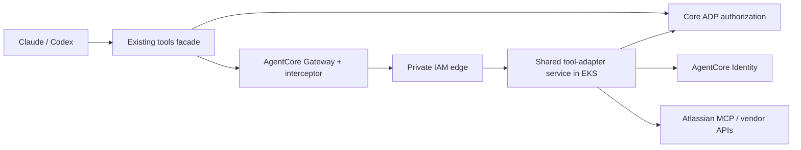

# Shared tool-adapter service — design v5

This is part of the [canonical design](../atlassian-mcp-contract.md) for [#8445](https://github.com/aws-e/adp/issues/8445). The user selected a separate shared adapter service and continued AgentCore Identity reuse. Implementation and independent review remain pending. Every path, interface and configuration below marked proposed is a deliverable, not an available runtime.

## Responsibilities and packaging

| Component | Responsibility |
|---|---|
| Core ADP gateway | Login, Connections APIs, Identity provider setup and consent-session completion; canonical owner/site/permission state, admission and durable metadata/revocation recovery. |
| AgentCore Identity | OAuth consent orchestration, provider callback/code exchange, user-token storage and refresh. |
| AgentCore Gateway and interceptor | Existing MCP routing and signed invocation checks. |
| Existing tools facade | Client entry point, operation admission, receipts, durable outcomes and reporting/reconciliation. |
| New shared tool-adapter service | Vendor MCP/REST transport, response/schema handling, provider user/site observations and invocation-time Identity token retrieval after core authorization. |

One EKS Deployment, Service, image and service account host the connector adapters; this is not one deployment per vendor, nor an extension of the core gateway or facade image. Atlassian MCP, GitHub, Slack and legacy Jira execution move here in one coordinated release with unchanged existing public tool names and credential bindings. The user reports no active consumers of the existing connectors and requests no scheduled maintenance window. This is the rollout decision, not independently measured usage or a zero-interruption claim. Door, browser, interpreter and web search keep their existing runtimes; credential management stays in the core. This epic adds no new GitHub/Slack verbs.

Proposed source root: `modules/tools/adapters/`, containing `tool_adapters/`, `pyproject.toml`, a reproducible dependency lock, `Dockerfile`, `tests/`, `k8s/`, scoped `infra/` and `deploy.sh`. Connector modules are `tool_adapters/atlassian.py`, `github.py`, `slack.py` and `jira.py`. Reuse the small `modules/tools/adp_tools/` distribution and extract only reviewed wire-schema/signature-validation helpers into it where needed. Never import/copy `modules/gateway/src`, install the gateway distribution, or copy its image/dependency tree. Database models, migrations, orchestration, CLI assets and frontend are excluded. Vendor SDK/MCP dependencies belong exclusively in the adapter package.

Follow the existing [facade packaging pattern](https://github.com/aws-e/adp/blob/0ebf98389d609aa553679497250572b8a13bdb07/modules/tools/facade/Dockerfile), not its runtime identity. Pin base/dependencies, run nonroot with a read-only root filesystem and bounded writable scratch, publish a separate SBOM/image digest, and scale independently. Initial deployment proposal: two replicas, 100m CPU/128 MiB memory requests and 1 CPU/512 MiB limits per pod, spread across nodes, readiness/startup/liveness probes, one-pod disruption budget and bounded graceful drain. These are starting resource settings to qualify under #8453 load/failure tests, not measured capacity promises. Per-connector concurrency limits prevent a slow vendor from consuming the whole service; reject excess work with a bounded retryable error. No browser or code execution is loaded into this image.

## Routing and trust

Retain the existing private API Gateway/VPC-link/internal-ALB transport and add a distinct adapter Service/target group. The current [private edge](https://github.com/aws-e/adp/blob/0ebf98389d609aa553679497250572b8a13bdb07/modules/tools/platform/knowledge-edge/main.tf) sends every route to the core gateway. #8453 must extend its per-route backend and caller policy, rather than register a new target that still executes in the core. `/internal/v1/tools/atlassian/mcp` resolves to the adapter Service from its first release. All four connector paths share the coordinated handoff below; Door remains routed to its existing mediator.

Each route allows its exact service caller: AgentCore Gateway invokes MCP routes; the core invokes observation routes; the adapter invokes core authorization/dispatch routes. Extend resource policies, VPC-endpoint policies, security groups, ALB rules and route-authority manifests together. Use service-specific edge provenance, overwritten caller headers and signed audience-bound assertions. Do not mount the gateway's global secrets/signing keys into adapter pods. Direct pod/ALB calls, forged caller headers, wrong role/audience and public routes must fail. Merely being on the VPC or supplying a tenant header is insufficient.

The adapter's dedicated IRSA role can verify approved assertion keys, invoke the exact core control routes and retrieve user tokens from only the configured Identity workload/provider. It cannot create/update OAuth providers, complete browser consent, revoke grants, read app secrets, access core SQL, or write the facade operation journal. Where an AWS action cannot be resource-scoped, #8446/#8453 must document and test its supported conditions; no invented IAM condition or unexplained account-wide grant. Identity token retrieval is permitted only after the core resolves the original human and current connection. Public tool arguments never select a user, provider, workload, token, URL or adapter backend.

### Observation signing key

Omit `observation_runtime.assertion_key_arn` when preparing the adapter foundation
to provision a dedicated RSA signing key. Terraform grants the core role signing
and verification and the adapter role verification, restricted to
`RSASSA_PSS_SHA_256`, in both the runtime IAM policies and the key policy. Use the
returned `observation_runtime.gateway.assertion_key_arn` for the protected adapter
configuration and gateway activation. Publish matching configuration to both
services before verifying a saved consent through `/resume`.

An explicitly supplied key remains supported, but its owner must grant these
exact runtime identities in the key policy. Do not reuse the facade principal
assertion key: it intentionally reserves signing for the facade. A runtime IAM
allow alone does not authorize that key and produces `adapter_unavailable`
before the gateway can contact the adapter.

## Core-to-adapter contract

Proposed wire types live in `modules/tools/adp_tools/adapter_contracts.py`; implementation begins in #8447 and behavioral integration in #8448. Core handlers belong in proposed `modules/gateway/src/internal/tool_adapter_authority.py`. All requests use the existing private IAM transport and a versioned assertion; neither a raw user token nor a caller-provided owner establishes authority.

| Internal interface | Request | Result / invariant |
|---|---|---|
| Core `POST /internal/v1/tool-adapters/authorize` | Original signed invocation or core observation ticket, purpose, operation/receipt IDs, payload digest and adapter contract/release/group generation | Re-resolve canonical tenant/human, membership, current binding/scopes/site, policy and active group generation. Return a short-lived admission ID plus configured Identity workload/provider, canonical Identity user ID and permitted operation/context. No OAuth token. Reject fenced tools or mismatched contract, owner, purpose, generation or operation. |
| Core `POST /internal/v1/tool-adapters/dispatch` | Admission ID and exact operation/receipt/payload/binding/group generation | Recheck current policy/binding and group fence after token retrieval and atomically consume the existing receipt for that dispatch. Fail on stale or reused admission. A timed-out consumption is not permission to retry a write. |
| Adapter `POST /internal/v1/tool-adapters/observe` | Core-signed, owner-bound completed-consent attempt and purpose `connection_observe` | Only provider identity, accessible sites and granted scopes, returned with attempt/config references and no token. The core publishes a binding after validating the observation against the initiating attempt and current revision. No general tool invocation or write before a binding exists. |
| Adapter `POST /internal/v1/tools/{connector}/mcp` | Existing MCP named-tool request plus signed facade assertion injected by the interceptor | Validate private transport/schema, obtain current core admission, retrieve transient access from Identity, recheck/consume dispatch authority, call the exact allowed vendor operation and return sanitized evidence to the facade. No generic URL/execute endpoint. |

The observation route also calls core authorization: `connection_observe` is admitted from a completed, unexpired owner-bound attempt, not from a connection that does not yet exist. This avoids a consent/binding cycle. Calls from the core use its separately registered control-plane signer/audience; a facade tool assertion cannot become an observation ticket. #8448 implements both producer and consumer, plus provider observation logic inside the adapter package. No new vendor HTTP implementation is added to the core for this purpose.

MCP target bootstrap may expose the pinned non-user schema under the restricted target-registration identity. User discovery and execution require current admission and the proven authorized catalogue; bootstrap never obtains a user token. The adapter does not read SQL or trust cached authorization. It holds access tokens only in request memory and calls Identity's existing user-federation token APIs using the resolved owner/provider. It never handles refresh tokens, directly exchanges OAuth codes, persists tokens or falls back to another owner. The Identity compatibility proof includes retrieval using the separate adapter role; the core's successful retrieval alone is insufficient.

Admission expires no later than the original signed operation deadline. All additional service/Identity hops, retries and vendor calls share the canonical 20-second work budget. Adapter/core/Identity outages return `adapter_unavailable`, `authority_unavailable` or `identity_unavailable` before dispatch; stale contracts return `adapter_contract_mismatch`. No outage routes automatically to an alternate backend. Reads use existing bounded retry semantics. Writes keep zero blind replay after dispatch, including timeout, pod loss and rollout.

Durable state remains in the existing core metadata/receipt tables and facade execution journal. Add adapter contract/image and group/backend generation to those records; do not create an adapter operation database. #8447 defines the shared fields; #8448 implements durable core activation/fencing checks on both legacy and adapter dispatch paths before #8453 switches any routes. #8453 owns the release controller/lease and records phase/progress in existing release state. A stale controller cannot reopen a newer generation. The facade records dispatch uncertainty before sending an operation, and the core consumes its receipt before the adapter sends a vendor mutation. Cross-store interruption therefore leaves recoverable uncertainty, never permission to duplicate a write. Reconciliation uses the same operation/owner and an explicitly scoped readback admission; the core authorizes it and the adapter performs the vendor read. Reporting survives pod replacement through the existing facade reconciler. No in-memory adapter session or cache is required for correctness.

## Independent release and migration

The [capability-based delivery revision](../../delivery-flow/plans/atlassian-adapters-8445/agent-capabilities.md) brings minimum adapter release/receipt support forward into #8447 so each increment can be deployed and verified. #8453 retains the complete coordinated handoff/rollback and final live-repair integration. This refines execution ownership without changing the service or four-connector migration contract.

Use existing tools CI, `tools-platform-deploy.yml` and release orchestration with a separately selectable `tool-adapters` build/release stage. No new standalone workflow is required. #8453 adds missing source/lock/shared-contract/K8s/infra mappings and protected ECR/build/deploy permissions. An adapter-only change builds/publishes/rolls out only its image and necessary target/config changes; it must not rebuild/redeploy the core gateway, facade or unrelated tool runtimes. A changed shared contract selects all actual consumers and requires compatible staging. No push/drift check is described as a deployment: tools-platform release retains its protected main `workflow_dispatch` mechanism. The existing delivery reconciler dispatches only the required stage after reviewed-source receipts.

Release order: core control APIs and metadata recovery first; separate adapter infrastructure/image/service next; then prepare private edge/backend mappings, AgentCore targets and compatible facade/interceptor/UI/CLI configuration without switching active legacy routes; finally hand off all four connector paths. Keep old/new wire versions compatible during that sequence. Observe exact adapter digest, service account, effective IAM/network policy, replicas/probes and route destination before enabling traffic. Fresh installation uses the same stage functions through the tools launcher, without a forked deployment script. Execute as soon as implementation, proof and release checks pass under existing deployment authority; scheduling a maintenance window is not a prerequisite.

Connector migration is part of the existing stories:

1. #8447 delivers the standalone package/service foundation, shared contracts and test entry point before #8448 needs it. #8448 supplies core admission plus adapter-side connection observations; #8449 adds Atlassian reads and migrates existing GitHub/Slack/legacy-Jira execution code with complete existing-verb parity. #8450 adds Atlassian writes. No successor becomes a prerequisite for an earlier story.
2. #8453 prepares all four connectors in one pinned release manifest. Before handoff, qualify each connector's discovery, reads, advertised writes, permission denials, refresh/disconnect and recovery using owned fixtures. Legacy parity and Atlassian proof are prerequisites for the whole group. Preserve user grants, selected sites, tool names, operation IDs and Connections behavior; placement alone must not require reconsent. Never duplicate a real write to compare old/new paths.
3. The release controller holds a durable release lease and fences new admission for the four-connector group. Reject unconsumed admissions from the old generation; drain already-dispatched work to a recorded deadline and retain unresolved operations as uncertain with their original backend generation. Apply the prepared routes/targets, independently read back all four destinations and readiness, then reopen admission against the new group generation. This is a coordinated handoff, not an atomic AWS transaction: persist phase/progress, reject stale-generation dispatch and resume the same release after controller loss. One active backend per connector; no weighted write split or automatic error fallback. During the bounded handoff, fresh calls return retryable unavailability within the existing 20-second work budget. Core login/model APIs and unrelated runtimes stay available; no user scheduling step is added.
4. Failed apply, readback or readiness keeps the group fenced while automation restores and verifies the previous complete route/target/enablement manifest and compatible artifacts. Reopen only after verification; if restoration fails, retain durable progress and report the exact recovery action. For the initial release, rollback disables the new Atlassian namespace and restores existing connector routes; it never maps Atlassian MCP requests onto legacy Jira. A later rollback restores that release's recorded group configuration. Preserve operation/backend generation, grants, revocations and reporting state. Keep generation-specific reconciliation available for residual operations without admitting new writes on a retired generation; never replay unknown writes on either backend. Unrelated tool routes are outside this rollback group.
5. Record rollback retention and keep previous images/manifests plus compatible recovery consumers until it ends and residual operations are accounted for. Core compatibility handlers may remain inactive for that retention period, receiving no new vendor features. Later removal is separate cleanup, not a claimed image-size reduction in this epic. Artifact retention does not require a maintenance window or defer the coordinated migration.

Image size is measured, not guessed. Record compressed image bytes, installed dependency/SBOM inventories, startup time and idle/loaded memory for core and adapter at pinned revisions. Acceptance requires that new vendor/MCP code and dependencies are absent from the core image, adapter-only edits select no core release, and adapter failure/rollout leaves core login/model/API health operational. Core metadata APIs may still be required for tool availability; no claim is made that tools work through a core outage. This separation adds a service/hop and operating cost; it does not promise a smaller total platform footprint.

## Acceptance and ownership

| Story | Added or changed proof |
|---|---|
| #8446 | Existing AC-01 also proves separate-role Identity retrieval without token persistence; standalone probe still has no production prerequisite. |
| #8447 | New AC-04 / SCN-04: standalone image imports/boots with only its own package and shared library, exposes health/contract metadata, rejects unauthenticated routes and has no core package/database/app-secret dependency. Pre-review image tests; #8453 owns live IAM/network proof. |
| #8448 | AC-01–03 cover core-to-adapter observation/admission and stale/replayed/wrong-purpose denial; real private transport is separately exercised by #8454. |
| #8449 | New AC-05 / SCN-05: all existing GitHub/Slack/legacy-Jira verbs and authority/receipt/error behavior have parity through the adapter; no public schema drift or grant migration. Existing IDs stay unchanged. |
| #8450 | Existing mutation/recovery criteria add pod death and route-generation changes with zero duplicate effects. |
| #8453 | AC-04 / SCN-04: separate image/release, scoped network/IAM, resource/drain behavior, coordinated four-connector handoff without a scheduled maintenance window, partial-apply/controller-loss recovery, group rollback and core image/dependency/release isolation. |
| #8454 | AC-06 / SCN-06: both clients use the deployed adapter route; all four destinations are independently verified, forged/direct traffic fails, pod outage leaves core healthy, coordinated migration/rollback retains legacy parity and no uncertain write is replayed. |

Use independent target-group/route readback, workload digest and request/receipt correlation to prove execution location; a response that could still come from the core is insufficient. Record baseline capacity and all changed ACs at the new design revision. Full lifecycle/fixture rules in canonical sections 3–8 still apply. This file grants no deployment authority and contains no live-result claim.
